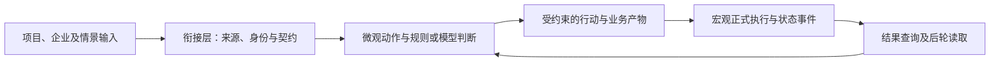

# 架构与实现

## 模块职责

`src/` 保存微观动作、专业方法、组织讨论、来源约束、任务状态和模型调用。角色包括业主、银行、建筑师、工程师、造价、政府、承包商和供应商。动作注册表共106类目标动作，不代表全部细分业务已完成验收。

`integration/` 负责场景装配、授权读取、宏观适配、业务分派、结果归档与核对。它连接已有微观处理器和宏观正式事件，不通过回答文本直接篡改宏观状态。

`vendor/gba/` 是实际运行的宏观发布包及已存在的授权修复。保留其通知、文档、包配置、前后端代码和数据库。`zwtnew/` 是动作契约及开发规范资源，部分运行代码仍按路径读取，因此作为依赖保留。

## 当前边界

已有代表性连续案例能够从机会/立项进入投标、签约、聚合完工、结算与后轮反馈。付款另有指定子链。正式模拟事件可追溯，不代表现实项目预测准确、实体交付或全部合同义务解除。

连续模型案例的真实LLM参与主要在承包商报价选项，其他动作可能由规则处理。自由生成业务回答、原生有限选项选择和确定性反馈重放是不同实验形式。

## 当前入口

- `capstone.py doctor/data/results`：离线检查、数据与结果导航。
- `capstone.py micro-demo`：微观采购工作流本地替身示例。
- `capstone.py macro-demo`：规则模式1步微宏观装配与执行检查；加 `--full` 运行48步连续案例。
- `integration.run`：通用集成宿主。
- `integration.origin_lifecycle_case`、`integration.case_library_lifecycle`：连续案例构建及运行。
- `scripts/`：已筛选的当前实验工具及其导入依赖。带旧日期/版本名的少量文件为冻结对照依赖，不是另一套开发主线。

新的运行结果写 `runs/`。历史兼容保存区优先只读，绝不自动重放已计费或未知请求。

