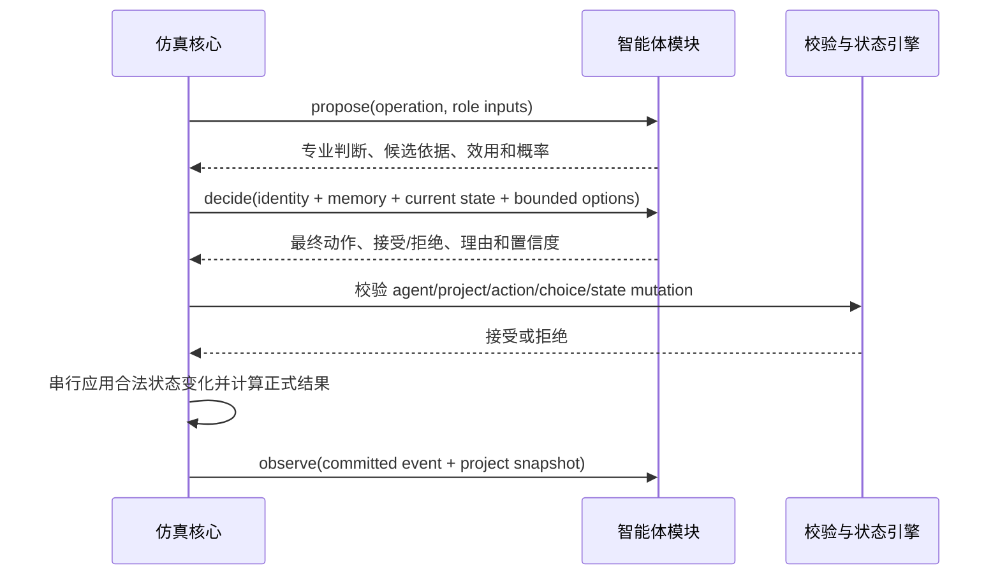

# GBA 建设项目多智能体仿真系统规范：智能体模块集成

| 文档属性 | 内容 |
|---|---|
| 文档编号 | `GBA-MAS-SPEC-02` |
| 所属文档集 | [GBA 建设项目多智能体仿真系统技术规范总册](./gba_multi_agent_simulation_specification.md) |
| 文档状态 | 公开技术规范 |
| 规范版本 | `1.0` |
| 适用范围 | 外部智能体模块与 GBA Construction Simulation 仿真核心的集成 |
| Python 入口 | `gba_construction_sim.backend.agents` |

本规范定义智能体模块与仿真核心之间的职责边界、消息契约、运行接口、状态隔离、错误处理及一致性验证要求。智能体模块负责形成主体判断；仿真核心负责事实计算、合法性校验和状态变更。

本文使用“必须”“不得”表示强制性要求，使用“应”“建议”表示推荐性要求。

主体类别、项目全生命周期以及仿真、宏观环境、政策、主体和初始项目参数见 [`GBA-MAS-SPEC-01`](./simulation_model_specification.md)；角色函数的精确输入输出见 [`GBA-MAS-SPEC-03`](./agent_operation_contracts.md)。

## 1. 系统边界



### 1.1 智能体模块职责

- 每个 `agent_id` 对应一个独立智能体实例。
- 身份、背景、角色目标、长期记忆、情景记忆、信念和策略。
- 角色专业判断，例如承包商投标意愿、银行授信意愿、顾问是否接受委任。
- 在仿真给定的动作与候选范围内作最终选择。
- 接收已提交事件，更新该主体自己的记忆和信念。
- 提供模块健康状态与能力声明。

### 1.2 仿真核心职责

- 宏观环境、政策、项目、合同、资源、现金流、成本、进度、质量与风险的正式计算。
- 候选主体的硬约束筛选和机会可见性。
- 项目阶段规则、允许动作、候选选项和调用预算。
- 校验返回的 `agent_id`、`action_type`、候选 ID 和禁止修改字段。
- 串行应用动作，形成审计事件和可复现实验结果。

智能体不得自行写入项目阶段、合同、成本、进度、质量、资源占用或参与关系。智能体模块可以返回选择及其依据，但不得将语言模型生成的工程数值声明为正式仿真结果。

## 2. 运行接口

本节覆盖智能体模块的稳定公共函数，包括 `AgentContextPort` 的 1 个上下文函数、
`ExternalAgentClientPort` 的 3 个必选传输函数、`AgentModulePort` 的 10 个运行函数，
以及外部客户端可选实现的 4 个扩展函数。以下函数属于集成契约；以下划线开头的私有辅助函数和具体智能体框架内部方法不属于本规范的兼容性范围。

仿真核心只通过以下 Protocol 与智能体模块交互：

```python
class AgentContextPort(Protocol):
    def standard_context(self, agent, context: dict, **kwargs) -> dict: ...


class ExternalAgentClientPort(Protocol):
    def propose(self, request: AgentProposalRequestV1) -> AgentProposalResponseV1: ...
    def decide(self, request: AgentDecisionRequestV1) -> AgentDecisionResponseV1: ...
    def observe(self, observation: AgentObservationV1) -> None: ...


class AgentModulePort(Protocol):
    def register_profiles(self, profiles): ...
    def for_profile(self, profile): ...
    def propose(self, profile, operation: str, **inputs) -> AgentDecision: ...
    def proposal_process_name(self, profile, operation: str) -> str: ...
    def get_operation_contract(self, operation: str, role: str): ...
    def resolve_decision(self, profile, proposal, **kwargs) -> AgentDecision: ...
    def attach_decision_scheduler(self, decision_scheduler) -> None: ...
    def observe_event(self, event, project=None) -> None: ...
    def capabilities(self) -> AgentModuleCapabilitiesV1: ...
    def health(self) -> AgentModuleHealthV1: ...
```

外部实现应通过 `ExternalAgentModuleAdapter` 接入本地 Python 模块、HTTP 客户端或其他智能体框架。`SimulationEngine` 与 `ProjectLifecycleEngine` 不属于外部智能体模块的修改范围。

### 2.1 上下文函数

| 函数 | 用途与调用时机 | 前置条件与输入 | 返回语义 | 状态影响与失败语义 |
|---|---|---|---|---|
| `AgentContextPort.standard_context(agent, context, **kwargs)` | 在最终决策进入调度器前，将主体身份、记忆、信念、资源、项目、环境、政策、候选项和动作边界整理为统一上下文。 | `agent` 必须是当前决策主体；`context` 和 `kwargs` 只能包含本次调用可见的只读快照。 | 返回可序列化 `dict`，供 `AgentDecisionRequestV1` 构造和模型调用使用。 | 不得修改项目或合同状态。上下文构造失败时，本次决策请求不得发送。 |

### 2.2 外部智能体客户端必选函数

| 函数 | 用途与调用时机 | 前置条件与输入 | 返回语义 | 状态影响与失败语义 |
|---|---|---|---|---|
| `propose(request)` | 在项目生命周期需要角色专业判断时调用，例如银行授信、承包商投标或 QS 评标。 | `request.operation_contract`、`request.agent.role` 和 `request.inputs` 必须匹配。 | 返回 `AgentProposalResponseV1`；内容是专业判断和决策依据，不是正式状态变更。 | 可读取并更新该主体的推理缓存，但不得写项目状态。版本、请求 ID、动作或字段不合法时抛出 `AgentModuleIntegrationError`。 |
| `decide(request)` | 在专业判断形成后，让指定主体基于自身身份、记忆和当前情况，从有限动作及候选项中作最终选择。 | `allowed_actions` 必须非空；候选选择必须遵守 `choice_contract`；响应主体必须与请求主体一致。 | 返回 `AgentDecisionResponseV1`，明确最终动作、是否执行、理由、置信度和必要的候选 ID。 | 不直接提交状态。非法响应由适配器拒绝；超时或模型失败由调度器记为 `deferred/invalid`，不得用中央规则静默代替主体决定。 |
| `observe(observation)` | 在动作已经通过校验并写入事件流后调用，用于更新该主体的长期记忆、情景记忆和信念。 | 只接收 `committed=true` 的事实事件；实现必须按 `event_id` 幂等。 | 无返回值。 | 只允许修改目标主体自己的认知状态。失败会记录在观察错误中，不回滚已经提交的仿真事实。 |

### 2.3 智能体模块运行函数

| 函数 | 用途与调用时机 | 前置条件与输入 | 返回语义 | 状态影响与失败语义 |
|---|---|---|---|---|
| `register_profiles(profiles)` | 仿真初始化或主体池更新时批量注册主体。 | 每个 profile 必须有唯一 `agent_id` 和有效角色。 | 无返回值。 | 建立或更新 `agent_id -> 独立智能体实例` 映射，不触发项目决策。重复注册同一 `agent_id` 时更新 profile，但保留该主体实例。 |
| `for_profile(profile)` | 获取指定主体的持久化决策进程；所有专业判断和最终选择前均可调用。 | profile 至少包含身份、角色和资源字段。 | 返回与该 `agent_id` 一一对应的 `BaseEnterpriseAgent` 或兼容实例。 | 首次调用可创建实例并补全默认角色背景；后续调用不得创建第二份同 ID 记忆。 |
| `propose(profile, operation, **inputs)` | 执行一个角色专属 Operation，形成可审计的专业判断、报价、评审或候选排序。 | `(profile.role, operation)` 必须存在机器可读契约；输入必须通过契约校验。 | 返回 `AgentDecision`，其 `action_type/accepted/data` 必须符合 Operation 契约。 | 不得改变正式项目状态。角色未实现 Operation 时抛出 `ValueError`；返回类型错误时抛出 `TypeError`；外部响应违约时抛出 `AgentModuleIntegrationError`。 |
| `proposal_process_name(profile, operation)` | 为日志、事件和监控生成本次专业判断的稳定过程名称。 | profile 和 operation 应与当前调用一致。 | 返回形如 `ContractorAgent.consider_tender` 或 `ExternalClient.consider_tender` 的字符串。 | 无状态影响；不得用该名称代替 `contract_id` 做契约校验。 |
| `get_operation_contract(operation, role)` | 在调用前取得该角色 Operation 的输入、允许动作、data 字段和最终决策类型。 | 必须提供精确角色和 Operation 名称。 | 返回 `AgentOperationContractV1`。 | 无状态影响；未注册组合抛出 `ValueError`，调用方不得自行推断字段。 |
| `resolve_decision(profile, proposal, **kwargs)` | 将专业判断与主体记忆、项目状态、候选项和允许动作合并，发起最终有限决策。 | 必须提供 `decision_type`、`tick`；涉及选择时必须提供 `choice_options/choice_field`；`allowed_actions` 应覆盖正负动作。 | 返回最终 `AgentDecision`。正式计算字段沿用 proposal，模型只能选择动作、候选项并补充理由。 | 可追加该主体的情景记忆，但不提交项目状态。未配置调度器时原样返回 proposal；模型失败、预算不足或非法选择时返回未接受的 deferred/invalid 决策。 |
| `attach_decision_scheduler(decision_scheduler)` | 在仿真启动时注入共享模型网关与并发调度器。 | scheduler 必须实现当前决策调度接口；同一网关可共享，身份和记忆不得共享。 | 无返回值。 | 仅替换模块的调度依赖，不创建项目或触发决策。 |
| `observe_event(event, project=None)` | 将已提交事件转换为观察消息并交给对应主体。 | event 应有稳定 `event_id`；project 如提供，只能是提交后的只读快照。 | 无返回值。 | 内建模块可由 `AgentCognitiveService` 负责学习而保持空实现；外部适配器调用客户端 `observe()`。观察失败不得回滚事件。 |
| `capabilities()` | 模块加载、诊断或兼容性检查时声明支持的角色、Operation、契约版本和批量决策能力。 | 模块应已加载契约注册表。 | 返回 `AgentModuleCapabilitiesV1`。 | 无状态影响；外部返回的契约版本不匹配时集成失败。 |
| `health()` | 启动检查和运行监控时报告模块、模型网关和记忆存储是否可用。 | 无业务输入。 | 返回 `AgentModuleHealthV1`，状态应为 `ready/degraded/unavailable/unknown` 之一。 | 无业务状态影响。未提供外部健康函数时适配器返回 `unknown`，不能据此声明模块 ready。 |

### 2.4 外部客户端可选扩展函数

| 函数 | 作用 | 未实现时的行为 |
|---|---|---|
| `decide_async(request)` | 提供原生异步最终决策，避免阻塞事件循环。 | 适配器在线程中调用同步 `decide()`。 |
| `decide_batch(requests)` | 批量处理多个独立主体的最终决策；响应顺序必须与请求顺序一致。 | 逐个调用 `decide()`；响应数量不匹配时抛出集成错误。 |
| `capabilities()` | 由外部服务发布真实角色、Operation、版本和批处理能力。 | 适配器根据本地机器可读契约生成默认能力声明。 |
| `health()` | 报告模型、记忆库和服务依赖的实时健康状态。 | 适配器返回 `status="unknown"`。 |

## 3. 三类核心消息

### 3.1 `AgentProposalRequestV1`

功能：形成角色专业判断及可审计依据。该消息不构成最终选择。

| 字段 | 内容 |
|---|---|
| `contract_version` | 固定为 `1.0` |
| `request_id` | 本次专业判断的唯一标识 |
| `operation` | 角色操作名，见第 6 节 |
| `agent` | 身份、角色、地区、能力、偏好、资源和背景 |
| `inputs` | 项目、政策、环境、候选主体、报价等本次输入快照 |
| `operation_contract` | 当前角色与 operation 的机器可读输入、动作分支及 data 格式 |
| `recent_episodes` | 该主体最近的情景记忆 |
| `constraints` | 状态所有权和禁止写入字段 |
| `metadata` | tick、project_id 等追踪信息 |

返回 `AgentProposalResponseV1`：

```json
{
  "contract_version": "1.0",
  "request_id": "proposal-tick4-P001-C012-consider_tender",
  "action_type": "submit_bid",
  "accepted": true,
  "utility": 0.73,
  "probability": 0.68,
  "reason": "Capacity and expected margin are acceptable.",
  "factors": {
    "resource_fit": 0.81,
    "delivery_risk": 0.29
  },
  "data": {
    "bid_probability": 0.68,
    "expected_profit": 0.09
  }
}
```

`utility` 和 `probability` 必须在 `0-1`。`data` 中只能放决策依据或候选选择，不得放项目状态修改指令。

### 3.2 `AgentDecisionRequestV1`

用途：让某一个独立智能体基于完整认知上下文作最终有限选择。

| 分组 | 传入信息 |
|---|---|
| 追踪 | `request_id`、`tick`、`decision_type`、`priority`、`project_id` |
| 身份 | `agent.agent_id/name/role/region/enterprise_type` |
| 能力 | qualification、finance、technical、management、design、cost、construction、quality、safety 等 |
| 偏好 | risk、collaboration、cross-region experience、policy adaptability、preferred partners |
| 资源 | total、occupied、available resource |
| 背景 | mandate、decision style、active regions 和其他 semantic memory |
| 认知 | `memory`、`beliefs`、`strategy` |
| 当前状态 | 当前工作量、风险输入、项目快照、环境、政策、engagement、阶段规则 |
| 互动 | 最近消息 `recent_messages` |
| 决策任务 | `decision_task`、正式依据 `decision_support` |
| 选择范围 | `candidate_options`、`choice_contract`、`constraints.allowed_actions` |
| 安全边界 | `constraints.forbidden_state_keys` 和状态/正式计算所有权 |

返回 `AgentDecisionResponseV1`：

```json
{
  "contract_version": "1.0",
  "request_id": "tick4-P001-O001-owner_select_architect",
  "agent_id": "O001",
  "action_type": "select_architect",
  "decision": true,
  "reason": "The candidate fits the project and current portfolio strategy.",
  "confidence": 0.81,
  "data": {
    "selected_agent_id": "A017"
  }
}
```

以下情况会被仿真端拒绝：

- `contract_version`、`request_id` 或 `agent_id` 不匹配。
- `action_type` 不在 `allowed_actions` 中。
- 返回的候选 ID 不在 `candidate_options` 中，或数量超过 `choice_contract.limit`。
- `data` 包含 `current_stage`、`actual_cost`、`contracts`、`resource_allocation` 等仿真状态字段。
- 响应无法解析、超时或模型失败。此时记为 `deferred/invalid`，不会静默用中央规则替该主体决定。

### 3.3 `AgentObservationV1`

用途：在动作经过校验并形成事实后，把结果回传给智能体更新记忆。

```json
{
  "contract_version": "1.0",
  "event_id": "EVT000042",
  "tick": 4,
  "event_type": "contract_awarded",
  "project_id": "P001",
  "agent_id": "C012",
  "stage": "Contract Award",
  "description": "Owner and contractor signed the construction contract.",
  "data": {"contract_sum": 108000000},
  "project_snapshot": {"project_id": "P001"},
  "committed": true
}
```

`observe()` 应按 `event_id` 幂等处理。观察回写失败不会撤销已经提交的仿真状态，错误会记录在事件的 `agent_observer_errors` 中。

## 4. 参考实现

```python
from gba_construction_sim.backend.agents import (
    AgentDecisionResponseV1,
    AgentProposalResponseV1,
    ExternalAgentModuleAdapter,
)
from gba_construction_sim.backend.models.simulation import SimulationCreateRequest
from gba_construction_sim.backend.simulation.simulation_engine import SimulationEngine


class ExternalAgentClient:
    def __init__(self):
        self.agents = {}       # agent_id -> framework agent
        self.seen_events = set()

    def propose(self, request):
        agent = self._agent_for(request.agent)
        result = agent.build_professional_proposal(
            operation=request.operation,
            inputs=request.inputs,
            recent_episodes=request.recent_episodes,
        )
        return AgentProposalResponseV1(
            request_id=request.request_id,
            **result,
        )

    async def decide_async(self, request):
        agent = self._agent_for(request.agent)
        result = await agent.decide_bounded_action(request)
        return AgentDecisionResponseV1(
            request_id=request.request_id,
            agent_id=request.agent.agent_id,
            **result,
        )

    def decide(self, request):
        # 仅在未提供异步实现时使用。
        return self._agent_for(request.agent).decide_bounded_action_sync(request)

    def observe(self, observation):
        if observation.event_id in self.seen_events:
            return
        self.seen_events.add(observation.event_id)
        self._agent_by_id(observation.agent_id).remember(observation)

    def health(self):
        return {
            "contract_version": "1.0",
            "status": "ready",
            "module_name": "external-agent-service",
            "message": "model and memory store available"
        }

    def _agent_for(self, identity):
        ...


client = ExternalAgentClient()
agent_module = ExternalAgentModuleAdapter(
    client,
    random_seed=42,
    scheduler_options={"concurrency_limit": 8},
)
engine = SimulationEngine.from_request(
    SimulationCreateRequest(ticks=60, random_seed=42),
    agent_module=agent_module,
)
```

如果模块部署为 HTTP 服务，建议按以下端点建立映射：

```text
POST /v1/proposals
POST /v1/decisions
POST /v1/decision-batches   # 可选
POST /v1/observations
GET  /v1/capabilities
GET  /v1/health
```

HTTP 客户端仍实现上面的 Python `propose/decide/observe` 方法，网络细节不进入仿真核心。

## 5. 每个主体的独立状态要求

智能体模块必须以 `agent_id` 为隔离键。不得只按角色维护一个共享 Owner 或 Contractor 对话。

```text
agent_id
├── identity and organization background
├── stable preferences and role mandate
├── semantic memory
├── episodic memory ordered by tick
├── beliefs with confidence
├── current strategy
└── model conversation/session state
```

同一个模型网关可以共享，但 prompt、memory、conversation 和决策轨迹必须按 `agent_id` 隔离。不同场景运行时还应加入 `simulation_id`，避免跨实验污染。

## 6. Operation 索引

每个操作的完整函数签名、输入类型、允许动作、`accepted` 规则和 `data` 必填字段见：

**[智能体 Operation 接口规范](./agent_operation_contracts.md)**

程序内可通过 `request.operation_contract` 或 `get_operation_contract(operation, role)` 读取同一份机器契约。下表仅用于快速索引，不应替代完整契约。

| `operation` | 主体 | 主要输入 | 输出用途 |
|---|---|---|---|
| `evaluate_project_opportunity` | Owner | opportunity、environment、policy、portfolio load | 是否立项及候选项目依据 |
| `consider_financing` | Bank | amount、borrower capacity、project risk、market finance | 银行是否授信及报价依据 |
| `select_financing_offer` | Owner | accepted bank offers | 选择融资方案 |
| `consider_appointment` | Architect / Engineer / QS | project、policy/environment、resource、prior fit | 是否接受顾问委任 |
| `select_appointment` | Owner | accepting candidates、purpose | 选择顾问 |
| `consider_review_assignment` | Government | project、required resource | 是否承接审批/检查 |
| `decide_approval` | Government | project、policy | 批准或要求修改的专业依据 |
| `select_tender_invitees` | Owner | contractor candidates、project、policy、environment、limit | 形成招标邀请候选集 |
| `consider_tender` | Contractor | project、policy、environment、attractiveness | 是否投标、报价与风险依据 |
| `evaluate_bid` | QS | bid、contractor、project、policy、prior fit | 标准化评标依据 |
| `select_preferred_bid` | Owner | evaluated bids、agents | 选择首选投标人 |
| `decide_contract_award` | Owner | project、preferred bid | 接受授标条件或要求修改 |
| `decide_contract_terms` | Contractor | project、preferred bid | 接受合同或要求修改 |
| `consider_supply_order` | Supplier | project、contractor、resource、prior fit | 是否接受供货订单 |
| `select_supplier` | Contractor | accepting supplier offers | 选择供应商 |
| `decide_monthly_operation` | All roles | macro environment、own state | 无项目事件时的低优先级经营行为 |

新增角色操作时，应注册新的 `operation` 及其输入 schema。项目生命周期始终通过 `agent_module.propose()` 发起调用，不直接依赖具体智能体类。

## 7. 并发、失败与可复现要求

- `decide_async()` 可能并发调用，默认并发上限为 8；同一 `agent_id` 的内部记忆写入需加锁或串行化。
- `propose()` 当前由生命周期同步调用，应快速返回；长耗时模型调用建议放在最终 `decide_async()`。
- 使用 `request_id` 做响应关联，使用 `event_id` 做观察幂等。
- 保存模型名、prompt 版本、采样参数、原始响应摘要和错误原因，支持审计。
- 同一场景、同一随机种子和同一模型配置应尽量可复现；无法完全确定时必须保存决策轨迹。
- 模型不可用时返回明确失败，不得让一个中央智能体替多个主体作决定。

## 8. 一致性验收

- [ ] `health()` 返回 `status=ready`，版本为 `1.0`。
- [ ] 每个 `agent_id` 具有独立身份、记忆、信念和会话。
- [ ] 能处理第 6 节所有当前 `operation`。
- [ ] `decide` 仅返回允许动作和有效候选 ID。
- [ ] 响应不得包含任何仿真状态修改字段。
- [ ] `observe` 对同一 `event_id` 幂等。
- [ ] 并发决策不得复用其他主体的 memory/session。
- [ ] LLM 失败、超时和无效 JSON 有明确错误。
- [ ] 运行契约测试：

```bash
pytest -q gba_construction_sim/backend/tests/test_agent_module_contracts.py
```

- [ ] 运行完整后端回归：

```bash
pytest -q
```

## 9. 代码位置

| 文件 | 作用 |
|---|---|
| `gba_construction_sim/backend/agents/contracts.py` | 版本化 DTO、Protocol、序列化边界 |
| `gba_construction_sim/backend/agents/operation_specs.py` | 25 个角色-operation 的机器可读输入输出契约与校验 |
| `gba_construction_sim/backend/agents/external_adapter.py` | 外部客户端适配、响应校验和观察回传 |
| `gba_construction_sim/backend/agents/agent_registry.py` | 内置实现与统一 `propose` 边界 |
| `gba_construction_sim/backend/simulation/decision_request_collector.py` | 身份、记忆、项目、环境和策略上下文组装 |
| `gba_construction_sim/backend/simulation/enterprise_decision_scheduler.py` | 并发、优先级、调用预算和决策追踪 |
| `gba_construction_sim/backend/simulation/event_system.py` | 已提交事实的观察回写接口 |
| `gba_construction_sim/backend/tests/test_agent_module_contracts.py` | 可执行接口契约与一致性测试 |
| `docs/agent_operation_contracts.md` | 各 Operation 的输入、输出及示例 |
| `docs/simulation_model_specification.md` | 主体类别、项目生命周期和场景输入参数 |

## 10. 规范导航

- 总册：[GBA 建设项目多智能体仿真系统技术规范总册](./gba_multi_agent_simulation_specification.md)
- 上一册：[GBA-MAS-SPEC-01 模型与运行环境规范](./simulation_model_specification.md)
- 下一册：[GBA-MAS-SPEC-03 Operation 函数契约规范](./agent_operation_contracts.md)
