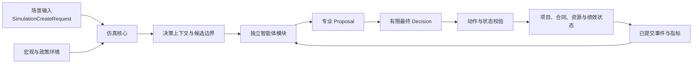
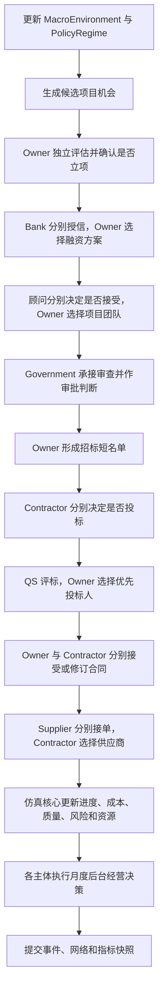

# GBA 建设项目多智能体仿真系统技术规范总册

| 文档属性 | 内容 |
|---|---|
| 文档编号 | `GBA-MAS-SPEC` |
| 文档状态 | 公开技术规范 |
| 规范版本 | `1.0` |
| 适用系统 | GBA Construction Simulation |
| 适用对象 | 仿真模型开发、智能体模块开发、场景实验设计、接口测试与技术评审 |
| 规范分册 | `GBA-MAS-SPEC-01`、`GBA-MAS-SPEC-02`、`GBA-MAS-SPEC-03` |

本总册规定 GBA 建设项目多智能体仿真系统的文档结构、系统边界、运行主线、数据对象、状态所有权及实现一致性要求。三份分册共同构成完整规范，任何一册均不应脱离另外两册单独解释系统行为。

本文使用“必须”“不得”表示强制性要求，使用“应”“建议”表示推荐性要求。

## 1. 文档体系

### 1.1 规范分册

| 编号 | 规范文件 | 负责回答的问题 | 主要读者 |
|---|---|---|---|
| `GBA-MAS-SPEC-01` | [模型与运行环境规范](./simulation_model_specification.md) | 系统中有哪些主体、项目如何运行、环境和政策参数是什么、哪些状态由仿真核心计算？ | 仿真模型开发、实验设计、结果分析 |
| `GBA-MAS-SPEC-02` | [智能体模块集成规范](./agent_module_integration_guide.md) | 外部智能体如何接入、获得什么上下文、返回什么消息、如何隔离记忆并处理失败？ | 智能体框架开发、系统集成、平台开发 |
| `GBA-MAS-SPEC-03` | [Operation 函数契约规范](./agent_operation_contracts.md) | 每类主体在每个决策点调用哪个函数、输入和输出是什么、允许哪些动作、如何校验？ | 智能体行为开发、接口实现、契约测试 |

### 1.2 推荐阅读顺序

1. 先阅读本总册，理解系统边界和端到端运行主线。
2. 阅读 `SPEC-01`，确认主体、项目阶段、环境参数和状态所有权。
3. 阅读 `SPEC-02`，实现智能体模块的公共接口和消息协议。
4. 阅读 `SPEC-03`，逐项实现 25 个“角色 × Operation”契约。
5. 运行契约测试和后端回归，验证实现与运行版本一致。

### 1.3 权威性顺序

发生差异时，按以下顺序处理：

1. 与当前运行版本一致的 Pydantic 模型、机器可读 Operation 契约和状态校验器；
2. 三份编号分册中的强制性要求；
3. 本总册中的系统说明和阅读导航；
4. 示例代码、示例 JSON 和界面文案。

示例用于解释协议，不替代类型、范围、枚举和状态校验规则。

## 2. 系统目标与边界

系统用于模拟建设项目从机会形成、业主立项、融资、专业团队委任、审批、招标、授标、施工供应到完工验收的多主体互动过程。每一个 Owner、Bank、Architect、Engineer、QS、Government、Contractor 和 Supplier 都是具有独立身份、资源、记忆、信念、策略和模型会话的智能体。

系统采用“主体判断与正式计算分离”的结构：

- 智能体负责机会判断、接受或拒绝、候选选择、谈判立场、行为理由和置信度；
- 仿真核心负责候选硬约束、项目阶段、成本、工期、质量、风险、资源、合同、现金流和正式状态迁移；
- 校验器负责验证主体、项目、动作、候选 ID、数量上限和禁止写入字段；
- 事件系统负责记录已提交事实，并将事实回传给相关智能体更新记忆；
- 语言模型不得直接生成或覆盖正式工程计算结果。

## 3. 总体架构



| 层级 | 核心职责 | 不得承担的职责 | 对应规范 |
|---|---|---|---|
| 场景与模型层 | 定义主体池、初始项目、环境、政策和运行参数 | 不替具体主体作行为选择 | `SPEC-01` |
| 智能体认知层 | 根据身份、背景、记忆和当前情况形成专业判断及有限选择 | 不直接写项目状态，不发明正式工程数值 | `SPEC-02` |
| Operation 契约层 | 定义每个角色函数的输入、动作分支和结构化输出 | 不决定状态如何应用 | `SPEC-03` |
| 仿真状态层 | 校验动作、推进阶段、计算正式结果并写入事件 | 不用统一分配替代各主体独立判断 | `SPEC-01`、`SPEC-02` |

## 4. 每月运行主线



完整阶段条件、项目状态和环境参数由 `SPEC-01` 定义；图中每个主体函数的精确契约由 `SPEC-03` 定义。

## 5. 单次主体决策事务

每一次关键主体决策必须按同一事务顺序执行：

```text
1. Simulation snapshot
   当前项目、环境、政策、主体资源和候选集合

2. Operation contract lookup
   根据 role + operation 取得精确输入和输出契约

3. propose()
   形成角色专业判断、报价、评审或候选排序

4. resolve_decision() / decide()
   指定主体基于自身记忆，在允许动作和候选项中作最终选择

5. validation
   校验 contract version、request_id、agent_id、action、choice 和禁止字段

6. state application
   仿真核心串行提交合法的项目、合同、资源或阶段变化

7. observe()
   将 committed event 回传相关主体，更新独立记忆和信念
```

Proposal 是专业依据，Decision 是主体最终选择，Committed Event 才是仿真事实。三者不得混用。

## 6. 核心数据对象

| 数据对象 | 作用 | 状态所有者 | 详细定义 |
|---|---|---|---|
| `SimulationCreateRequest` | 定义时长、随机种子、主体池、初始项目、宏观与政策场景 | 仿真核心 | `SPEC-01` 第 6、7 节 |
| `MacroEnvironment` | 表示需求、融资、材料、人工、稳定性和区域摩擦 | 仿真核心 | `SPEC-01` 第 6.2 节 |
| `PolicyRegime` | 表示资格互认、透明度、程序不确定性、合规成本和政策强度 | 仿真核心 | `SPEC-01` 第 6.3 节 |
| `EnterpriseAgentProfile` | 表示主体身份、能力、偏好、资源、背景和记忆载体 | 主体资料由仿真维护，认知由智能体更新 | `SPEC-01` 第 3、6.4 节 |
| `ConstructionProject` | 表示项目阶段、参与方、投标、合同和绩效 | 仿真核心 | `SPEC-01` 第 5、6.5 节 |
| `AgentProposalRequestV1/ResponseV1` | 传输角色专业判断请求和依据 | 集成边界 | `SPEC-02` 第 3.1 节、`SPEC-03` |
| `AgentDecisionRequestV1/ResponseV1` | 传输最终有限选择 | 集成边界 | `SPEC-02` 第 3.2 节 |
| `AgentObservationV1` | 传输已经提交的事实事件 | 事件系统发布，智能体消费 | `SPEC-02` 第 3.3 节 |
| `AgentOperationContractV1` | 发布角色函数的字段、动作和返回结构 | 机器可读契约注册表 | `SPEC-03` 第 1、4 节 |

## 7. 主体与函数覆盖

| 主体 | 关键项目职责 | 主要 Operation |
|---|---|---|
| Owner | 立项、融资选择、顾问选择、招标邀请、优先投标与授标 | `evaluate_project_opportunity`、`select_financing_offer`、`select_appointment`、`select_tender_invitees`、`select_preferred_bid`、`decide_contract_award` |
| Bank | 独立授信与融资条件判断 | `consider_financing` |
| Architect | 独立决定是否接受设计委任 | `consider_appointment` |
| Engineer | 独立决定是否接受工程委任 | `consider_appointment` |
| QS | 独立决定是否接受委任并评价投标 | `consider_appointment`、`evaluate_bid` |
| Government | 独立承接审查并作审批判断 | `consider_review_assignment`、`decide_approval` |
| Contractor | 独立投标、合同条款判断和供应商选择 | `consider_tender`、`decide_contract_terms`、`select_supplier` |
| Supplier | 独立决定是否接受供应订单 | `consider_supply_order` |
| 全部主体 | 每月选择与角色相符的后台经营活动 | `decide_monthly_operation` |

函数签名、前置条件、允许动作、返回字段和状态影响以 `SPEC-03` 为准。

## 8. 状态所有权

| 信息或动作 | 智能体可返回 | 仿真核心可正式写入 |
|---|---:|---:|
| 接受、拒绝、延期或要求修订 | 是 | 校验后记录 |
| 候选主体或方案 ID | 是，但必须来自候选集合 | 校验后建立关系 |
| 行为理由、效用、概率和置信度 | 是 | 作为决策证据记录 |
| 报价、评审分数和专业判断 | 是，作为 proposal 或候选依据 | 校验并按模型规则处理 |
| 项目阶段和参与关系 | 否 | 是 |
| 正式合同、融资、资源占用和现金流 | 否 | 是 |
| 正式成本、工期、质量和风险结果 | 否 | 是 |
| 主体自己的记忆、信念和策略 | 是 | 仅保存或转发，不替主体推理 |

## 9. 实现与变更流程

### 9.1 新增或修改场景参数

1. 在请求或领域模型中增加版本化字段和校验。
2. 更新 `SPEC-01` 的参数表、默认值、范围和完整请求示例。
3. 在结果元数据中记录实际输入值。
4. 增加场景解析和回归测试。

### 9.2 新增或修改智能体公共接口

1. 更新 `contracts.py` 中的 DTO 或 Protocol。
2. 更新 `SPEC-02` 的函数说明、消息结构和失败语义。
3. 更新内建 registry 与外部 adapter。
4. 增加接口兼容性和错误路径测试；不兼容修改必须提升契约版本。

### 9.3 新增或修改 Operation

1. 在 `operation_specs.py` 增加精确的 `(operation, role)` 契约。
2. 在对应角色实现中增加 handler。
3. 在生命周期中明确调用阶段、候选来源和最终 `decision_type`。
4. 更新 `SPEC-03` 的用途、调用时机、前置条件、签名、动作分支、返回结构和状态影响。
5. 增加合法响应、非法输入、非法动作和越权状态字段测试。

## 10. 一致性验证

最低验收要求：

```bash
pytest -q gba_construction_sim/backend/tests/test_agent_module_contracts.py
pytest -q gba_construction_sim/backend/tests/test_role_agent_decisions.py
pytest -q
```

验收必须确认：

- 一个 `agent_id` 只对应一个独立身份和记忆空间；
- 角色与 Operation 使用精确契约，不根据函数名推断字段；
- 决策动作和候选 ID 均受请求边界约束；
- 语言模型失败不会被中央规则静默替代；
- 智能体响应无法直接写入仿真核心拥有的状态；
- 同一 `event_id` 的观察可幂等处理；
- 相同场景、随机种子、模型配置和响应记录可重放。

## 11. 规范导航

- 下一步：阅读 [GBA-MAS-SPEC-01 模型与运行环境规范](./simulation_model_specification.md)。
- 接入外部智能体：阅读 [GBA-MAS-SPEC-02 智能体模块集成规范](./agent_module_integration_guide.md)。
- 实现角色函数：阅读 [GBA-MAS-SPEC-03 Operation 函数契约规范](./agent_operation_contracts.md)。

