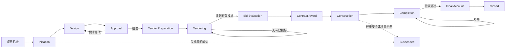

# GBA 建设项目多智能体仿真系统规范：模型与运行环境

| 文档属性 | 内容 |
|---|---|
| 文档编号 | `GBA-MAS-SPEC-01` |
| 所属文档集 | [GBA 建设项目多智能体仿真系统技术规范总册](./gba_multi_agent_simulation_specification.md) |
| 文档状态 | 公开技术规范 |
| 规范版本 | `1.0` |
| 适用范围 | GBA Construction Simulation 的主体模型、项目生命周期及场景输入 |
| 运行入口 | `gba_construction_sim.backend.simulation.simulation_engine.SimulationEngine` |
| 请求模型 | `gba_construction_sim.backend.models.simulation.SimulationCreateRequest` |

本分册说明多智能体仿真系统中的主体类别、独立决策过程、项目全生命周期、可传入场景参数及状态所有权。外部模块的接入方式见 [`GBA-MAS-SPEC-02`](./agent_module_integration_guide.md)，Operation 的逐项输入输出格式见 [`GBA-MAS-SPEC-03`](./agent_operation_contracts.md)。

本文使用“必须”“不得”表示强制性要求，使用“应”“建议”表示推荐性要求。

## 1. 模型范围与原则

系统遵循以下建模原则：

1. **主体独立决策。** 每个 `agent_id` 对应独立的身份、背景、资源、记忆、信念、策略和模型会话。系统不得以一个共享角色实例替代多个企业或机构作决定。
2. **判断与计算分离。** 智能体负责机会判断、接受或拒绝、候选选择及理由说明；成本、工期、质量、风险、合同和状态迁移由仿真核心计算。
3. **候选可见性不等于统一分配。** 仿真核心仅依据资格、区域、资源和网络关系形成可见候选集。候选主体分别决定是否参与，再由有权主体从已接受的候选中作选择。
4. **有限动作与合法性校验。** 每次最终决策均包含允许动作、候选项和禁止写入字段。仿真核心在应用状态变化前验证主体、项目、动作和候选 ID。
5. **事件可追溯。** 已提交的决策和状态变化形成事件记录，并回传相关主体更新情景记忆。

## 2. 每月仿真执行顺序


每个 tick 的执行顺序为：

1. `MacroEnvironmentUpdater` 更新当月宏观指数。
2. 在启用项目生成时，`ProjectGenerator` 发布一组候选项目机会。
3. 具有可用资源的业主分别执行 `evaluate_project_opportunity`。
4. 通过独立判断的业主确认是否立项；项目创建后，银行分别提出融资判断，业主选择融资方案或自有资金。
5. `ProjectLifecycleEngine` 按项目逐一执行当前阶段的主体决策和阶段规则。
6. `ProjectStateUpdateEngine` 计算项目进度、成本、质量、供应、索赔和风险状态。
7. 未被项目任务完全占用的主体执行 `decide_monthly_operation`。
8. 系统保存事件、主体参与关系、协作网络、项目绩效和仿真指标。

## 3. 主体通用模型

### 3.1 主体状态

所有主体均使用 `EnterpriseAgentProfile`。字段按用途分为以下几组：

| 字段组 | 主要字段 | 含义 |
|---|---|---|
| 身份 | `agent_id`, `name`, `role`, `region`, `enterprise_type` | 主体唯一标识、角色、属地和组织类型 |
| 通用能力 | `qualification_level`, `financial_capacity`, `technical_capability`, `management_capability` | 资格、财务、技术和管理基础能力 |
| 行为偏好 | `risk_preference`, `collaboration_preference`, `cross_region_experience`, `policy_adaptability` | 风险取向、合作倾向、跨区域经验和政策适应能力 |
| 专业能力 | `design_capability`, `cost_estimation_capability`, `construction_capability`, `supervision_capability` 等 | 与主体角色相关的专业履约能力 |
| 可靠性 | `supply_reliability`, `material_quality`, `payment_reliability`, `decision_speed` | 供应、材料、付款和决策可靠性 |
| 资源 | `total_resource_capacity`, `occupied_resource` | 总资源、已占用资源及可用资源 |
| 活动范围 | `active_regions`, `preferred_partners` | 可运营区域和偏好合作方 |
| 记忆 | `semantic_memory`, `episodic_memory` | 稳定背景知识和按 tick 累积的事件记忆 |

除资源容量外，能力、偏好和可靠性指标建议使用 `0-1` 标准化值。`available_resource()` 由总资源减去已占用资源计算，不由语言模型直接返回。

### 3.2 决策上下文

外部智能体在一次最终决策中可以接收以下信息：

| 上下文 | 内容 |
|---|---|
| `agent_profile` | 当前主体的身份、地区、能力、偏好和可用资源 |
| `agent_background` | 主体的组织背景及长期语义信息 |
| `agent_memory` | 认知服务保存的近期记忆 |
| `agent_recent_episodes` | 当前主体最近的仿真事件 |
| `agent_belief` | 主体对市场、合作方和项目的当前信念 |
| `agent_strategy` | 当前经营或参与策略 |
| `project_snapshot` | 项目阶段、预算、复杂度、参与方、投标和合同摘要 |
| `stage_rule_snapshot` | 当前阶段、所需角色、允许动作和退出条件 |
| `policy` | 当前政策制度参数 |
| `macro_environment` | 当前宏观环境参数 |
| `candidate_options` | 本次允许选择的主体、方案或报价 |
| `recent_messages` | 当前受控交互会话中的近期消息 |
| `risk_inputs` | 区域摩擦、合作历史、投标评估和其他风险证据 |
| `constraints` | 允许动作、候选数量、状态所有权和禁止写入字段 |

### 3.3 决策输出边界

智能体输出包括动作、接受状态、效用、行为概率、理由、解释因素和 Operation 规定的数据字段。以下正式状态由仿真核心拥有，智能体不得直接修改：

- 项目阶段和阶段迁移；
- 项目成本、进度、质量和风险；
- 合同金额、支付和最终结算；
- 主体资源占用及项目参与关系；
- 投标、授标、供应商和融资关系的正式登记；
- 协作网络边及结果指标。

## 4. 主体类别与决策职责

### 4.1 业主 `Owner`

| 项目 | 规范 |
|---|---|
| 角色目标 | 在资本、市场需求、交付能力和风险约束下形成可执行的项目组合 |
| 独立决策 | 项目机会评估、融资方案选择、顾问选择、投标邀请名单、首选投标人和合同授标 |
| 主要 Operation | `evaluate_project_opportunity`, `select_financing_offer`, `select_appointment`, `select_tender_invitees`, `select_preferred_bid`, `decide_contract_award` |
| 主要输入 | 项目位置、类型、规模、预算、市场需求、融资条件、政策、现有项目负荷、候选主体及其判断 |
| 主要输出 | 立项或暂缓、选定银行、顾问、投标邀请对象、承包商及授标态度 |
| 生命周期参与 | 机会发现至最终结算；项目阶段、预算和合同的正式修改仍由仿真核心执行 |

### 4.2 银行 `Bank`

| 项目 | 规范 |
|---|---|
| 角色目标 | 在信贷风险、资金占用、收益和借款人偿付能力之间形成融资判断 |
| 独立决策 | 是否为指定项目提供融资及融资条件 |
| 主要 Operation | `consider_financing` |
| 主要输入 | 申请金额、业主财务能力、项目风险和融资环境指数 |
| 主要输出 | `approve_financing` 或 `reject_financing`，以及批准金额、利率和条件 |
| 生命周期参与 | 项目创建后的融资安排；业主从已接受融资的银行中选择，也可以保留自有资金模式 |

### 4.3 建筑师 `Architect`

| 项目 | 规范 |
|---|---|
| 角色目标 | 在能力、工作负荷、区域经验和设计责任约束下提供满足审批及施工要求的设计服务 |
| 独立决策 | 是否接受设计委任 |
| 主要 Operation | `consider_appointment` |
| 主要输入 | 项目类型、地区、复杂度、政策、宏观环境、资源需求和合作适配度 |
| 主要输出 | 接受或拒绝委任及其专业依据 |
| 生命周期参与 | 设计、审批文件、审批退回修改和施工阶段设计澄清；设计质量的正式变化由状态引擎计算 |

### 4.4 工程师 `Engineer`

| 项目 | 规范 |
|---|---|
| 角色目标 | 提供与项目复杂度和技术标准相匹配的工程支持 |
| 独立决策 | 是否接受工程顾问委任 |
| 主要 Operation | `consider_appointment` |
| 主要输入 | 项目快照、技术复杂度、资源需求、区域经验和既有合作适配度 |
| 主要输出 | 接受或拒绝工程委任及其理由 |
| 生命周期参与 | 工程顾问为可选专业角色；当前版本在立项阶段完成选择，并为后续技术扩展保留接口 |

### 4.5 工料测量师 `QS`

| 项目 | 规范 |
|---|---|
| 角色目标 | 维护成本信息完整性，控制招标评估和结算的专业一致性 |
| 独立决策 | 是否接受委任、投标是否合格及其评估分数 |
| 主要 Operation | `consider_appointment`, `evaluate_bid` |
| 主要输入 | 项目预算、信息质量、政策、市场价格、投标价格、承包商能力和合作历史 |
| 主要输出 | 接受或拒绝委任、`evaluate_bid` 或 `exclude_bid`、标准化评估分数 |
| 生命周期参与 | 设计成本计划、招标文件、投标评估、变更和索赔评估、最终结算 |

### 4.6 政府及监管机构 `Government`

| 项目 | 规范 |
|---|---|
| 角色目标 | 在辖区、资源、制度要求和风险约束下执行审批与合规监督 |
| 独立决策 | 是否接受审批或检查任务，以及批准或要求修改 |
| 主要 Operation | `consider_review_assignment`, `decide_approval` |
| 主要输入 | 项目属地、设计或完工证据、质量与风险、政策参数、工作负荷和机构记忆 |
| 主要输出 | 接受或暂缓监管任务，`approve` 或 `request_revision` |
| 生命周期参与 | 设计审批、施工检查及竣工验收；审批退回触发设计修改，验收未通过触发整改 |

### 4.7 承包商 `Contractor`

| 项目 | 规范 |
|---|---|
| 角色目标 | 在利润、资源、资格、交付能力、区域摩擦和风险之间决定是否投标及履约 |
| 独立决策 | 是否投标、投标价格及风险判断、是否接受合同条款、供应商选择 |
| 主要 Operation | `consider_tender`, `decide_contract_terms`, `select_supplier` |
| 主要输入 | 项目预算和复杂度、材料和人工指数、政策成本、资格互认、区域摩擦、资源和供应报价 |
| 主要输出 | `submit_bid` 或 `decline_bid`、报价和预期利润、合同态度、选定供应商 |
| 生命周期参与 | 招标、合同谈判、施工、进度申报、变更与索赔、竣工申请和最终结算 |

### 4.8 供应商 `Supplier`

| 项目 | 规范 |
|---|---|
| 角色目标 | 在库存、材料质量、交付可靠性、区域条件和资源容量约束下决定供货 |
| 独立决策 | 是否接受指定项目的供货订单 |
| 主要 Operation | `consider_supply_order` |
| 主要输入 | 项目、承包商、材料需求、资源需求和既有合作适配度 |
| 主要输出 | 接受或拒绝订单、交付可靠性和材料质量依据 |
| 生命周期参与 | 合同授标后由承包商选择；施工阶段影响材料可得性、质量和供应延误风险 |

在主体规模不超过 1,000 时，未被项目任务完全占用的主体还可以执行角色特定的 `decide_monthly_operation`。该 Operation 仅更新经营行为记录和有限的能力学习，不直接推动项目阶段。大规模数据库场景采用事件驱动模式，背景经营行为按角色聚合记录，不对每个空闲主体逐月调用语言模型。

## 5. 项目全生命周期

### 5.1 阶段关系



### 5.2 阶段说明

| 阶段 | 主要主体与独立判断 | 仿真核心处理 | 退出或回退条件 |
|---|---|---|---|
| 项目机会 | 业主分别评估位置、类型、规模、预算和当前环境；银行分别评估融资 | 生成候选项目，校验业主资源，创建获确认项目并登记融资 | 业主确认立项后进入 `Initiation`；否则机会暂缓 |
| `Initiation` | 建筑师、QS、工程师分别决定是否接受委任；业主从接受者中选择 | 登记项目参与关系和资源占用 | 建筑师和 QS 必须选定；工程师可选；关键顾问不足时项目暂停 |
| `Design` | 参与主体依据职责执行设计和成本计划 | 状态引擎更新设计质量、信息质量、成本计划和延误 | `design_quality >= 0.70` 且 `information_quality >= 0.65` 后进入审批 |
| `Approval` | 监管机构分别决定是否承接审查；选定机构决定批准或要求修改 | 记录审批、延误和参与状态 | 批准后进入招标准备；要求修改时增加延误并返回设计 |
| `Tender Preparation` | 业主和 QS 完成采购策略、招标文件及评审标准 | 形成招标文件就绪标志 | 至少 2 个 tick 且 `information_quality >= 0.60` 后进入招标 |
| `Tendering` | 业主选择邀请对象；每个受邀承包商分别决定是否投标 | 登记邀请、投标、报价、资源和澄清会话 | 至少 1 份有效投标进入评标；无有效投标时增加延误并重新招标 |
| `Bid Evaluation` | QS 对每份投标作合规和专业评估；业主从有效投标中选择首选投标人 | 形成排名、合同金额和未中标释放 | 首选投标人确定后进入授标；无有效投标返回招标 |
| `Contract Award` | 业主决定是否授标；承包商决定是否接受合同条款 | 管理合同谈判会话、正式合同和资源状态 | 双方接受并签约后进入施工；失败时返回评标或继续谈判 |
| `Construction` | 承包商履约并协调供应商；供应商供货；业主、QS、建筑师和监管机构按需参与 | 每月计算进度、成本、质量、安全、供应、变更、索赔和争议风险 | 进度达到 `1.0` 且总体质量不低于 `0.60` 后进入竣工；严重安全或质量问题触发暂停 |
| `Completion` | 监管机构接受验收任务并决定批准或整改 | 记录缺陷、整改延误和角色释放 | 至少 2 个 tick、检测缺陷率不高于 `0.35` 且验收批准后进入结算 |
| `Final Account` | 业主、承包商和 QS 处理变更、索赔、付款和最终金额 | 最终金额取合同额与实际成本中的较高值，并登记结算事件 | 至少 2 个 tick 后结算并进入 `Closed` |
| `Closed` | 无新增项目决策 | 保存最终结果并释放项目角色 | 终止状态 |
| `Suspended` / `Failed` | 无常规阶段推进 | 保存暂停或失败原因 | 终止状态，恢复机制需由扩展规则定义 |

## 6. 可传入场景参数

### 6.1 仿真控制参数 `SimulationCreateRequest`

| 字段 | 类型 | 默认值 | 作用 |
|---|---|---:|---|
| `name` | string | `GBA baseline simulation` | 场景名称 |
| `ticks` | integer | `60` | 仿真持续月数 |
| `random_seed` | integer/null | `42` | 随机过程的可复现种子 |
| `policy` | object | `{}` | 覆盖 `PolicyRegime` 默认值 |
| `macro_environment` | object | `{}` | 覆盖 `MacroEnvironment` 初始值 |
| `agents` | array | `[]` | 直接传入主体；为空时按 `agent_source` 获取 |
| `initial_projects` | array | `[]` | 直接传入初始项目 |
| `enable_project_generation` | boolean | `false` | 是否在仿真过程中发布新项目机会 |
| `agent_source` | string | `default` | `default` 使用内置主体；`database` 从主体数据库读取 |
| `agent_count` | integer/null | `null` | 数据库主体数量上限 |
| `agent_roles` | array[string] | `[]` | 数据库主体角色筛选 |
| `agent_regions` | array[string] | `[]` | 数据库主体区域筛选 |
| `agent_source_types` | array[string] | `[]` | 数据库主体来源类型筛选 |
| `max_tender_invites` | integer | `40` | 单次招标邀请承包商上限，运行时最小为 1 |
| `use_prior_network_edges` | boolean | `true` | 数据库模式下是否加载先验协作网络 |
| `store_full_agent_snapshots` | boolean | `false` | 是否保存完整主体月度快照 |
| `target_project_count` | integer/null | 自动计算 | 动态项目生成的目标项目数 |
| `max_active_projects` | integer/null | 自动计算 | 同时处于活动状态的项目上限 |

当 `initial_projects` 为空且 `enable_project_generation=false` 时，系统创建一个默认基准项目。当 `enable_project_generation=true` 时，系统从空项目集开始并由业主决策产生新项目。

### 6.2 宏观环境参数 `MacroEnvironment`

下表中的“建议范围”用于场景设计和校准，不代表当前 Pydantic 模型已对所有输入执行范围拒绝。

| 字段 | 默认值 | 建议范围 | 当月含义 | 运行时变化 |
|---|---:|---:|---|---|
| `current_tick` | `0` | 非负整数 | 当前仿真月份 | 由引擎覆盖，不应作为外部控制变量 |
| `market_demand_index` | `1.0` | `0.6-1.4` | 建设需求和项目机会强度；`1.0` 为基准 | 每月增加 `U(-0.03, 0.03)` 并限制在 `0.6-1.4` |
| `material_price_index` | `1.0` | `0.7-1.6` | 材料价格相对基准；影响预算、报价和实际成本 | 每月增加 `U(-0.02, 0.04)` 并限制在 `0.7-1.6` |
| `labor_price_index` | `1.0` | `0.8-1.5` | 人工价格相对基准；影响报价和施工成本 | 每月增加 `U(-0.01, 0.03)` 并限制在 `0.8-1.5` |
| `financing_condition_index` | `1.0` | `0.5-1.3` | 融资可得性和资金环境；较高值表示条件更有利 | 每月增加 `U(-0.03, 0.02)` 并限制在 `0.5-1.3` |
| `regulatory_pressure_index` | `0.5` | `0-1` | 宏观监管压力场景信号 | 当前基础版本保持静态，供扩展决策模块使用 |
| `policy_stability_index` | `0.5` | `0-1` | 政策连续性和可预期性 | 当前基础版本保持静态，并进入业主等主体的决策上下文 |
| `regional_friction_matrix` | `{}` | 每格 `0-1` | 来源地区到目标地区的制度、信息和协作摩擦 | 当前基础版本保持静态；建议为研究涉及的地区提供双向完整矩阵 |

`regional_friction_matrix` 的建议格式如下：

```json
{
  "Hong Kong": {"Shenzhen": 0.20, "Guangzhou": 0.28},
  "Shenzhen": {"Hong Kong": 0.20, "Guangzhou": 0.08},
  "Guangzhou": {"Hong Kong": 0.28, "Shenzhen": 0.08}
}
```

受控比较实验应显式提供相关地区的双向值。矩阵单元缺失时，不同计算模块可能采用各自的缺省摩擦值，因此不应以不完整矩阵执行校准研究。

### 6.3 政策环境参数 `PolicyRegime`

| 字段 | 默认值 | 建议范围 | 含义 |
|---|---:|---:|---|
| `policy_id` | `POLICY_BASELINE` | string | 政策场景标识 |
| `name` | `GBA baseline policy` | string | 政策场景名称 |
| `entry_waiting_time` | `30.0` | `>=0` | 市场进入或准入等待时间 |
| `approval_success_prob` | `0.7` | `0-1` | 基准审批成功概率 |
| `procedural_uncertainty` | `0.3` | `0-1` | 程序不确定性和行政风险 |
| `compliance_cost` | `0.2` | `0-1` | 合规成本负担强度 |
| `scope_breadth` | `0.8` | `0-1` | 政策覆盖范围 |
| `cross_region_qualification_recognition` | `0.5` | `0-1` | 跨区域资格互认强度 |
| `tax_or_subsidy_intensity` | `0.0` | `0-1` | 税费或补贴强度；政策方向应在场景元数据中明确 |
| `regulatory_intensity` | `0.5` | `0-1` | 监管和检查强度 |
| `information_transparency` | `0.5` | `0-1` | 信息公开、规则清晰和可见性水平 |

`PolicyRegime` 对象作为统一政策上下文传入决策与状态模块。当前基础版本直接使用的字段主要包括 `approval_success_prob`、`procedural_uncertainty`、`compliance_cost`、`scope_breadth`、`cross_region_qualification_recognition`、`regulatory_intensity` 和 `information_transparency`。`entry_waiting_time` 与 `tax_or_subsidy_intensity` 已纳入场景模型，但其完整动态效应仍需由相应扩展机制实现。场景报告不得将尚未进入行为或状态方程的字段解释为已产生仿真影响。

场景对比应一次只改变研究问题所需的政策组合，并保留基准场景用于识别差异。

### 6.4 主体输入参数

`agents` 可以直接传入完整的 `EnterpriseAgentProfile` 列表。以下字段为最小身份字段：

```json
{
  "agent_id": "OWNER_HK_001",
  "name": "Example Owner",
  "role": "Owner",
  "region": "Hong Kong",
  "enterprise_type": "developer"
}
```

未提供的能力和偏好指标默认值为 `0.5`，`total_resource_capacity` 默认为 `1.0`，`occupied_resource` 默认为 `0.0`。直接传入主体集合时，系统会补齐 MVP 运行必需但缺失的支持角色；工程师和银行仍可作为可选角色显式传入。

### 6.5 初始项目参数

`initial_projects` 中每个项目使用 `ConstructionProject`。核心输入包括：

| 字段 | 类型 | 说明 |
|---|---|---|
| `project_id` | string | 项目唯一标识 |
| `name` | string | 项目名称 |
| `project_type` | string | 项目类型，默认 `building` |
| `region` | string | 项目所在地区 |
| `owner_id` | string | 必须对应已存在的业主主体 |
| `current_stage` | enum | 初始阶段，默认 `initiation` |
| `technical_complexity` | number | 技术复杂度，建议 `0-1` |
| `initial_budget` | number | 初始预算，必须为正数 |
| `performance.planned_duration` | integer | 计划工期，单位为月 |
| `selected_*_id` | string/null | 已预设的顾问、承包商、供应商或银行关系 |
| `flags` | object | 场景扩展和阶段辅助标记 |

## 7. 完整请求示例

```json
{
  "name": "HK-Macao coordinated delivery scenario",
  "ticks": 60,
  "random_seed": 42,
  "enable_project_generation": true,
  "target_project_count": 12,
  "max_active_projects": 5,
  "max_tender_invites": 20,
  "agent_source": "database",
  "agent_roles": ["Owner", "Architect", "Engineer", "QS", "Contractor", "Supplier", "Government", "Bank"],
  "agent_regions": ["Hong Kong", "Macau", "Shenzhen", "Guangzhou"],
  "macro_environment": {
    "market_demand_index": 1.08,
    "material_price_index": 1.03,
    "labor_price_index": 1.05,
    "financing_condition_index": 0.92,
    "regulatory_pressure_index": 0.60,
    "policy_stability_index": 0.75,
    "regional_friction_matrix": {
      "Hong Kong": {"Shenzhen": 0.20, "Guangzhou": 0.28},
      "Shenzhen": {"Hong Kong": 0.20, "Guangzhou": 0.08},
      "Guangzhou": {"Hong Kong": 0.28, "Shenzhen": 0.08}
    }
  },
  "policy": {
    "policy_id": "POLICY_HKMO_COORDINATED",
    "name": "Hong Kong-Macao coordinated delivery",
    "entry_waiting_time": 15,
    "approval_success_prob": 0.82,
    "procedural_uncertainty": 0.18,
    "compliance_cost": 0.14,
    "scope_breadth": 0.88,
    "cross_region_qualification_recognition": 0.78,
    "tax_or_subsidy_intensity": 0.16,
    "regulatory_intensity": 0.58,
    "information_transparency": 0.76
  }
}
```

## 8. 当前未作为请求参数开放的设置

以下设置目前由代码常量或内部规则控制，不属于 `SimulationCreateRequest` 的可传入参数：

- 不同项目类型和地区的机会生成权重；
- 各项目类型的预算、工期和复杂度生成区间；
- 宏观指数每月随机漂移区间；
- 各项目阶段的最短持续时间和质量阈值；
- 顾问、监管机构、承包商和供应商的候选可见数量；
- 单次 LLM 并发上限及部分模型提供方调用预算。

需要对上述设置开展实验时，应先将其提升为版本化场景配置，并补充输入校验、结果元数据和基准测试，不应通过未记录的代码修改改变实验条件。

## 9. 实现追溯

| 规范内容 | 实现位置 |
|---|---|
| 仿真请求与场景参数 | `gba_construction_sim/backend/models/simulation.py` |
| 主体状态 | `gba_construction_sim/backend/models/agent.py` |
| 宏观环境 | `gba_construction_sim/backend/models/environment.py` |
| 政策环境 | `gba_construction_sim/backend/models/policy.py` |
| 项目状态 | `gba_construction_sim/backend/models/project.py` |
| 项目绩效 | `gba_construction_sim/backend/models/project_performance.py` |
| 项目阶段规则 | `gba_construction_sim/backend/simulation/stage_rule_registry.py` |
| 项目生命周期 | `gba_construction_sim/backend/simulation/project_lifecycle_engine.py` |
| 项目机会生成 | `gba_construction_sim/backend/simulation/project_generator.py` |
| 宏观环境更新 | `gba_construction_sim/backend/simulation/macro_environment.py` |
| 智能体决策上下文 | `gba_construction_sim/backend/simulation/decision_request_collector.py` |
| Operation 契约 | `gba_construction_sim/backend/agents/operation_specs.py` |

## 10. 规范导航

- 上一册：[技术规范总册](./gba_multi_agent_simulation_specification.md)
- 下一册：[GBA-MAS-SPEC-02 智能体模块集成规范](./agent_module_integration_guide.md)
- 函数契约：[GBA-MAS-SPEC-03 Operation 函数契约规范](./agent_operation_contracts.md)
