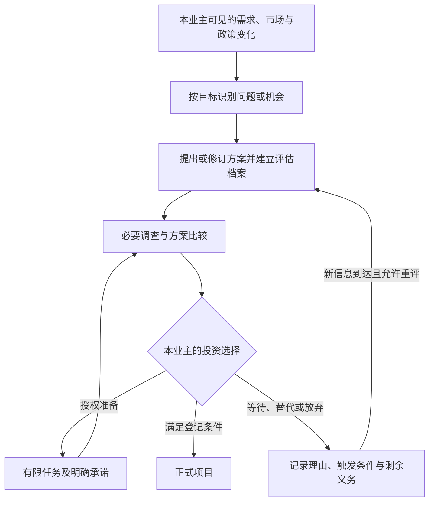

# Owner｜业主主体完整行为规范

定义业主在大湾区仿真中的投资目标、提案、委托、资金、采购、工程接收及持续经营行为。本文是角色开发规范；方法支持范围和待选参数见第 7 节，实现与验证证据单独记录。

[总体运行框架](../02_world/world_runtime.md) · [共同对象与状态](../02_world/domain_objects.md) · [跨主体交接](../03_projects/collaboration_flow.md) · [模型决策](../07_experiments/model_decisions.md)

<!-- page-nav:start -->
**本页导航**

[1. 职责、目标与权限](#1-职责目标与权限) · [2. 信息、状态与业务对象](#2-信息状态与业务对象) · [3. 行为卡与执行契约](#3-行为卡与执行契约)

[4. 专业工作与跨主体交互](#4-专业工作与跨主体交互) · [5. 状态转换、失败与恢复](#5-状态转换失败与恢复) · [6. 验收场景](#6-验收场景)

[7. 参数、方法与配置依赖](#7-参数方法与配置依赖)
<!-- page-nav:end -->

## 1. 职责、目标与权限

### 1.1 主体身份与授权

Owner 是承担开发或建设任务、作出投资与采购选择并承担相应义务的组织角色。业主、土地权利人、借款人、付款人、资产最终使用人可能相同，也可能不同；通过显式关系表达，不能仅凭 Owner 标签推定。

| 项目 | 必须表达的内容 |
|---|---|
| 组织身份 | `agent_id`、组织、注册地与经营地区、数据来源、独立认知；项目地和机关辖区另列，每个实例分别保存 |
| 职能与权限 | 哪个项目/评估档案的投资、委托、付款、变更和接受权限；金额及范围限制 |
| 目标 | 收益、使用需求、交付时点、预算、风险、公共服务等；来源与相互权衡 |
| 约束 | 土地及开发权、批准要求、可用资金、已承诺义务、管理能力、有效合同和信息 |
| 持续经营 | 多项目组合、到期付款、融资义务、组织存续与可用资源；项目结束后继续存在 |

**OWN-001**：公共业主的投资批准或采购职能，与 Government 的监管决定分开。同一组织兼任时，按授权职能使用不同动作和信息边界，不产生额外资金或资源。

**OWN-002**：仿真实验希望产生多少项目，不直接成为业主必须投资的动机。主体目标来自场景中有来源的任务或模型假设；业主可以调查后不投资，也可以连续多个周期不发起项目。

#### 1.1.1 三类目标模板

**OWN-011｜保留三类目标。** 共用业主行为流程，但分别表达建设动机、比较依据及约束；类型不代表三家固定企业，也不以角色复制增加组织资金。

| 目标模板 | 值得评估的信号示例 | 需要比较的结果 | 不能省略的约束 |
|---|---|---|---|
| 投资收益型 | 获准获知的需求、交易/租赁、存量、预期供给、成本和融资变化 | 有来源的预期收益、现金流、资金占用和风险 | 可实施权利、可负担性、承诺、需求及收入预测的不确定性 |
| 自用需求型 | 自身业务、人员或使用需求变化，现有空间不匹配 | 功能满足、交付时间、使用效果与全生命周期支出 | 实际需要、可用资金、经营连续性、场地和管理能力 |
| 公共服务型 | 有来源的服务缺口、资产状况、公共任务或预算变化 | 服务覆盖、可达性、交付和全生命周期支出 | 投资/预算授权、职责、持续运营能力和适用程序 |

具体目标可以混合，但应记录组织目标与本项目建设目的的关系；三种模板并不与住宅、厂房、公共设施一一绑定。目标权重、收益/服务评价方法与阈值尚未确定，不能把公共服务分数直接换成可支用现金。

#### 1.1.2 项目产生也是研究对象

**OWN-012｜业主主动形成项目提案。** 在市场、需求与政策条件变化后，业主可以在场景允许的地区、用途、规模及权利路径内形成新提案，也可以继续研究已有机会、修改旧方案或不行动。项目数量、规模、类型、地区和发起时间是待解释的结果，不强制补足预设项目数。

外部已知机会可继续作为输入，但不能成为完整模型唯一的新项目来源；固定项目/机会集可用作机制核查的辅助实验，不能代替项目产生研究。允许自主提案不表示主体可以创造土地权利、需求事实、补贴资格、资金或即时产能。

#### 1.1.3 业主先界定需要，再逐步选择技术

**OWN-017｜初始自主范围。** 业主提出建设目的、候选地区、规模区间和期望交付时间。技术与建造方式保留候选，由获授权的专业方和供应方分别提供依据后逐步细化；提出偏好不等于已完成技术选择或验证。

业主仍负责建设目标、商业取舍、投入授权及投资选择；专业结论、产品声明、适用规则和正式权利各有来源。供应商可以说明产品和制造/交付条件，不能凭自报替代专业核查。Contractor 可按所选模板提前提供施工意见，但不因此默认所有项目必须先选定总包。

### 1.2 独立判断与经营取舍

业主需要在当期投入与未来目标、快速交付与证据充分、低价与履约风险、单项目收益与整个组织承受力之间选择。三类目标改变比较依据，但不改变他方独立决定和共同账本约束。

**OWN-034｜管理决定也受容量约束。** 私有候选排序不等于正式排期。形成多个实际承诺时，连同已有项目复核可用资金、管理任务和所需条件；资源优先机制依 D-05 明确。某一案件等待银行或政府答复，不停止同一业主其他合法的经营任务。

## 2. 信息、状态与业务对象

### 2.1 可见信息与权限边界

| 状态/资料 | 使用方式 | 正式变更边界 |
|---|---|---|
| 公开需求、机会、政策和价格观察 | 形成判断，保留来源、时间与不确定性 | 不修改共享机会的权利和有效期 |
| 私有评估档案 `owner_case_id` | 保存方案、调查、预算、风险判断与下一次触发条件 | 只作用于本业主档案；多业主可分别评估同一机会 |
| 组织现金、受限资金、债务和承诺 | 使用最小资金账本比较跨项目可承担支出；具体机制待 D-02 | 从正式账本读取，不能由能力评分或自然语言增加 |
| 项目职责及有效合同 | 决定可向谁发出哪类请求或指令 | 不越过合同权限指挥非本方供应商或替代监管批准 |
| 已收到的报价、报告、通知 | 比较明确版本，形成接受、拒绝或补充要求 | 未获授权的竞争报价、伙伴私有记忆不得进入上下文 |
| 私有经验与偏好 | 更新风险估计和伙伴判断 | 不反向修改历史结果、正式质量或账户余额 |

**OWN-003**：需求、共享机会、本业主评估档案、正式项目分别存在。延后或放弃评估不删除其他主体仍可利用的共享机会；实际排他权的取得、到期和转让由权利规则处理。

**OWN-004**：已承诺给其他项目的资金和资源必须参与本次可行性判断。方案分别看起来可行，不表示可以同时全部批准；提交前按共同冲突规则复核。

分别保存：评估状态、投资授权、融资状态、设计状态、采购状态、工程状态、许可状态、移交状态和剩余义务。不要用一个 `project_status=completed` 覆盖这些状态。

### 2.2 正式状态与私有判断的所有者

| 状态组 | 业主自身维护/判断 | 正式状态所有者与边界 |
|---|---|---|
| 评估与预测 | 本组织目标、候选、预测、风险容忍、资料缺口 | 私有档案；不是区域真实需求或已兑现收益 |
| 投资与任务授权 | 是否继续、授权哪项范围、限额和条件 | 有权主体决定，经核心提交；不能创造缺失的法定/组织授权 |
| 合作与合同 | 邀请、议价、接受、退出或接续意图 | 同版有效接受和条件由合同入口核对；双方共享正式结果 |
| 资金与管理资源 | 现金预测、支出顺序和拟安排管理人员 | 资金/资源入口保存实际余额和承诺，不私建第二本正式账 |
| 工程和交付 | 读取报告、判断取舍、在权限内接收 | 工程、许可、成果、接收及资产状态各有入口，业主不能直接改成全部通过 |
| 后续经营与责任 | 运营/持有/处置及合作意愿 | 仅已纳入机制可形成实际交易；剩余义务和组织存续独立于项目汇总阶段 |

### 2.3 关键对象及字段

共同标识、金额/币种、时间、来源及版本遵循 OBJ-001/011。下列最小字段说明需要保存什么；行为输入输出的目标类型随第 3 节各动作定义，第 3.2 节集中维护局部类型，存储结构由工程实现选择。

| 记录 | 最小字段与引用 | 不应合并的状态 |
|---|---|---|
| 投资授权 | `authorization_id`、`owner_case_id/project_id`、方案版本、授权人、允许范围、限额/单位、条件、期限、依据 | 提议、附条件、有效、暂停、被替代/撤销；不代表合同全已生效 |
| 管理待办 | `task_id`、责任主体、对象/版本、依赖事项、所需资源、待处理原因、下次触发、完成证据 | 待就绪、可处理、执行、受阻、完成/取消；不能取代正式合同状态 |
| 客户取舍/变更 | `decision_id`、原基准、新候选、权限、受影响范围、各方接受、成本/时间意见、正式变更引用 | 研究、已决定客户偏好、待对方接受、正式生效、撤回/拒绝 |
| 分范围接收 | `acceptance_id`、范围/数量/单位、验收和许可引用、接收者权限、条件、尾项、实际生效时间 | 申报、待查、接受/拒绝、待整改；分期接收不等于全部关闭 |
| 暂停/接续 | `case_id`、受影响任务/合同、权利依据、现场保管方、释放/保留资源、未结义务、恢复条件 | 拟暂停、已生效、补救中、恢复/终止；以合同/授权为依据 |

## 3. 行为卡与执行契约

行为卡定义触发、选择和结果边界；执行矩阵集中说明跨行为的资源、时间、阻塞与接收方。正式输出均须经共同提交入口校验；模型回复不代替业务任务投入。

以下行为卡统一采用“触发—可见输入—主体选择—核心后果—等待/失败”结构。主体选择先经过权限、版本、候选和条件校验；只有 committed event 表示正式变化。输入不齐或技术调用失败，不推定同意。

<!-- action-nav:start -->
**动作定位**：[OWN-A01](#own-a01--观察机会与建立评估档案) · [OWN-A16](#own-a16--从需求和条件形成或修订项目提案) · [OWN-A02](#own-a02--授权有限调查与前期服务) · [OWN-A03](#own-a03--比较方案并作投资决定) · [OWN-A04](#own-a04--确定采购安排并委任专业服务) · [OWN-A05](#own-a05--制订资金计划并选择融资安排) · [OWN-A06](#own-a06--申请提款组织付款与偿还) · [OWN-A07](#own-a07--委托设计并确认业主需求与取舍) · [OWN-A08](#own-a08--授权申请及回应监管事项) · [OWN-A09](#own-a09--组织招标与比较投标) · [OWN-A10](#own-a10--授予合同并建立履约关系) · [OWN-A11](#own-a11--管理变更付款事项与履约冲突) · [OWN-A12](#own-a12--接收工程并处理缺陷和结算) · [OWN-A13](#own-a13--暂停缩减终止及接续) · [OWN-A14](#own-a14--管理项目回款及持有资产) · [OWN-A15](#own-a15--企业经营与经验更新)
<!-- action-nav:end -->

### OWN-A01 · 观察机会与建立评估档案

- **触发**：新机会、需求变化、政策变化或本业主定期检视。
- **输入**：可见需求/市场信号、已有机会、政策及权利/用途限制、三类目标、管理负荷和已开展评估；地区 × 用途指标按 OBJ-017 保留版本、时点、单位和本主体获知范围。
- **选择**：忽略、要求信息、跟踪已有机会、建立/更新评估档案、触发自主提案或延后评估；不能直接宣称项目已成立。
- **核心后果**：建立稳定档案身份并关联已有机会或本业主提案、需求/信号来源和版本；相同通知不重复建立同一档案。
- **等待/失败**：记录缺失事实、下次触发或到期；机会失效时重新评估，而非无条件沿用旧判断。

**函数与类型契约**

- **函数**：`roles.owner.a01(ctx: ActionContext, input: OwnerA01Input) -> ActionResult<OwnerA01Payload>`。
- **输入记录**：`OwnerA01Input = {scope_ref: ScopeRef, objective_ref: Ref<OwnerObjective>, observations: List<Ref<DemandObservation>>, opportunity_refs: List<Ref<Opportunity>>, existing_case_refs: List<Ref<OwnerCase>>, capacity_ref: Ref<ManagementCapacity>}`。
- **输出分支**：`OwnerA01Payload`：`{choice: ignore / follow / create_case / revise_case / propose, basis_refs: List<Ref<Evidence>>, note: string}`；`follow` 含 `target: OwnerFollowTarget`；`revise_case` 含 `case_ref: Ref<OwnerCase>`；`create_case/propose` 含 `source_refs: List<Ref<Observation>>`。
- **来源、接收与核心效果**：市场可见观察/组织状态 → A16/A02；登记私有档案，不建正式项目、不占权利。
- **分支前置与约束**：首次观察使用组织 ScopeRef，不能要求先有评估档案或项目。follow 可跟踪现有机会或已有档案；create_case/propose 的来源非空，核心产生档案后再触发 A16。没有外部机会不阻止有来源的自主提案。
- **业务出口与验收**：缺依据请求信息；无兴趣是业务 `ignore`；重复观察关联原档案。CHECK-OWN-001/020/026/044。

### OWN-A16 · 从需求和条件形成或修订项目提案

- **触发**：OWN-A01 识别出值得处理的需求、使用问题或投资可能，或已有方案需要实质调整。
- **输入**：本业主目标与授权、可见市场及政策、存量/可知在建情况、已有档案、候选地区/用途、权利路径、资金和能力约束；引用本主体已收到的地区 × 用途指标，私人自用需要另有内部状态依据。
- **选择**：在允许范围内提出新建、改造/扩建或可行非建设替代，形成若干可比方案、修改旧方案、请求调查或不提出方案；候选数和参数边界待定。
- **核心后果**：校验引用、单位、允许参数与版本后建立私有提案/评估记录；它不自动成为共享机会、有效土地权利、融资安排或正式项目。
- **等待/失败**：无法证实的需求、权利、价格和资格保持待查；允许研究不等于允许后续承诺；跨业主相似提案可以并存，但同一排他权和资源的正式授予仍要处理冲突。

A16 保留稳定编号，动作按业务依赖排列。

**函数与类型契约**

- **函数**：`roles.owner.a16(ctx: ActionContext, input: OwnerA16Input) -> ActionResult<OwnerA16Payload>`。
- **输入记录**：`OwnerA16Input = {case_ref: Ref<OwnerCase>, objective_ref: Ref<OwnerObjective>, demand_refs: List<Ref<DemandObservation>>, internal_need_refs: List<Ref<InternalNeed>>, candidate_space_ref: Ref<ProposalSpace>, funding_ref: Ref<FundingPosition>}`。
- **输出分支**：`OwnerA16Payload`：`{choice: propose / revise / no_proposal, note: string}`；`propose/revise` 含 `briefs: List<OwnerBriefDraft>`，非空且数量服从候选空间；`revise` 还含 `prior_brief_refs: List<Ref<OwnerBrief>>`。
- **来源、接收与核心效果**：A01及内部需要 → 专业咨询/A03；只形成提案版本，不创造需求、土地和项目。
- **分支前置与约束**：propose/revise 只形成候选，不登记排他权；no_proposal 不要求已有方案。revise 的 prior_brief_refs 非空并逐项关联本次变更，不能换版本号重复建立同一项目。
- **业务出口与验收**：缺候选空间上限或方法返回 `unsupported`；缺资料请求调查；不提案不补造项目。CHECK-OWN-021/022/029/048/067。

### OWN-A02 · 授权有限调查与前期服务

- **触发**：现有资料不足以作投资判断，且业主愿意支付有限调查成本。
- **输入**：已有需求简报或明确的待调查问题、调查目标、工作范围、研究投入上限、已授权人员、潜在服务方及时间；财务计算深度见 D-02。
- **选择**：内部研究、有限外部委托、缩小研究范围、等待或停止。
- **核心后果**：建立有上限的任务/外部合同、必要资源安排和费用义务，可关联评估档案而无需虚构正式项目。
- **等待/失败**：研究失败或最终不投资仍保留实际费用及未结义务；资料缺失不自动填成有利结果。

**函数与类型契约**

- **函数**：`roles.owner.a02(ctx: ActionContext, input: OwnerA02Input) -> ActionResult<OwnerA02Payload>`。
- **输入记录**：`OwnerA02Input = {case_ref: Ref<OwnerCase>, brief_ref: Option<Ref<OwnerBrief>>, issue_refs: List<Ref<Issue>>, service_candidates: List<Ref<ServiceOffer>>, study_profile_ref: Ref<StudyProfile>, spending_limit: Money}`。
- **输出分支**：`OwnerA02Payload`：`{choice: internal_study / commission / narrow / stop, note: string}`；`internal_study/commission/narrow` 含 `task_scope: OwnerScopeChoice, expenditure_cap: Money, window_ref: Ref<TimeWindow>`；`commission` 另含 `offer_ref: Ref<ServiceOffer>`；`internal_study` 另含 `allocations: List<OwnerAllocation>`；`narrow` 另含 `prior_study_ref: Ref<StudyPlan>`。
- **来源、接收与核心效果**：档案/授权/报价 → 受托方；可提出有限任务，外部委任待对方接受。
- **分支前置与约束**：brief_ref=null 仅表示尚未形成完整简报，此时以已登记档案和 issue_refs 中非空的研究问题限定前期调查。commission 才要求已取得有效服务报价；internal_study 不需要外部报价。实际支出仍经核验发生；缩小范围不撤销已完成服务费用。
- **业务出口与验收**：无适用服务可延期；上限不足可缩小或停止；不投资不删实际费用。CHECK-OWN-003/036/037/040。

### OWN-A03 · 比较方案并作投资决定

- **触发**：关键研究结果可用，或成本、需求、融资、权利等发生实质变化。
- **输入**：按三类目标形成的同版需求/候选方案及不建设替代比较、专业与供应意见、带依据和不确定性的需求/收益/服务预测、资金时序、项目组合、风险和适用批准要求。
- **选择**：否决、延后、补充研究、修改方案、附条件授权准备、满足条件后正式投资。
- **核心后果**：记录选择版本、证据与未选方案理由、授权范围及条件；只有达到选定模板的项目登记条件才建立正式项目，技术候选的逐步细化单独留痕。
- **等待/失败**：附条件投资只允许明确授权的准备活动，不能自动签订全部建设合同；同时批准多个方案时统一复核资金和能力。

**函数与类型契约**

- **函数**：`roles.owner.a03(ctx: ActionContext, input: OwnerA03Input) -> ActionResult<OwnerA03Payload>`。
- **输入记录**：`OwnerA03Input = {case_ref: Ref<OwnerCase>, comparison_ref: Ref<OptionComparison>, objective_ref: Ref<OwnerObjective>, funding_lines: List<OwnerFundingLine>, portfolio_ref: Ref<OwnerPortfolio>, registration_profile_ref: Ref<ProjectRegistrationProfile>}`。
- **输出分支**：`OwnerA03Payload`：`{choice: reject / revise / study_more / authorize_preparation / invest, note: string}`；`revise/study_more` 含 `target_option_refs: List<Ref<ProjectOption>>, issue_refs: List<Ref<Issue>>`；`authorize_preparation/invest` 含 `option_ref: Ref<ProjectOption>`；授权/投资另含 `scope: OwnerScopeChoice, conditions: List<OwnerCondition>`。
- **来源、接收与核心效果**：同版专业/财务结果 → 登记核心/A04/A05；投资授权不放行全部合同、付款和施工。
- **分支前置与约束**：revise/study_more 可针对整个比较集而不选定单个方案；此时 target_option_refs 为空且 issue_refs 非空，并引用输入 comparison_ref 的范围。authorize_preparation/invest 必须选定比较集中的方案；invest 仅适用于已定义的登记路径，非建设替代交相应交易入口。
- **业务出口与验收**：不可比需补证；现金时序/管理冲突保留；附条件不当无条件投资。CHECK-OWN-004/019/030/032/038/055。

### OWN-A04 · 确定采购安排并委任专业服务

- **触发**：前期或正式项目需要建筑、工程、造价或其他授权服务。
- **输入**：项目目标、采购模板、服务范围、责任矩阵、资格、候选能力和可见报价。
- **选择**：邀请、澄清、比较、接受明确条款、拒绝全部候选、重新采购或内部安排。
- **核心后果**：双方有效接受后形成外部委任；内部工作形成任务授权。记录雇主、专业范围、费用、交付物、期限及权限。
- **等待/失败**：未找到合格或愿意服务者时等待/调整；不自动把角色标签当资格，也不因只剩一位候选强制成交。

**函数与类型契约**

- **函数**：`roles.owner.a04(ctx: ActionContext, input: OwnerA04Input) -> ActionResult<OwnerA04Payload>`。
- **输入记录**：`OwnerA04Input = {scope_ref: ScopeRef, procurement_profile_ref: Ref<ProcurementProfile>, service_scope_ref: Ref<ServiceScope>, candidate_provider_refs: List<Ref<EligibleProvider>>, candidates: List<Ref<ServiceOffer>>, authority_ref: Ref<Authorization>, capacity_ref: Ref<ManagementCapacity>}`。
- **输出分支**：`OwnerA04Payload`：`{choice: invite / clarify / accept / reject_all / retender / internal, note: string}`；邀请/澄清含 `recipient_ids: List<EntityId<Organization>>, issue_refs: List<Ref<Issue>>`；接受含 `offer_ref: Ref<ServiceOffer>, terms_ref: Ref<ContractTerms>`；内部含 `allocations: List<OwnerAllocation>`。
- **来源、接收与核心效果**：采购/资源投影 → 专业方；只提交己方邀请、接受或内部任务，不代对方接受。
- **分支前置与约束**：首次邀请从 candidate_provider_refs 选择服务方，允许 candidates 为空；accept 才要求同版报价和条款。internal 只对本组织已有职能与容量有效；reject_all/retender 不因零报价触发空候选选择。
- **业务出口与验收**：空候选可拒绝全部/重采；失效报价重选；资格未知不放行。CHECK-OWN-010/015/058/061。

### OWN-A05 · 制订资金计划并选择融资安排

- **触发**：投资或履约计划需要现金，或原计划不再可行。
- **输入**：自有资金可用范围、预测付款、现有债务、银行有效报价及条件、其他已批准资金来源。
- **选择**：自有资金、申请融资、接受某银行某版本报价、协商、缩减/延期项目或不融资。
- **核心后果**：关联真实借款主体；接受的银行 ID、报价 ID、金额、期限及条件必须属于同一版本，满足生效条件后形成相应安排。
- **等待/失败**：银行全部拒绝、报价过期或最终决定被拒绝时，不形成有效融资。选择自有资金仍检查可用余额，不因没有银行自动成功。

**函数与类型契约**

- **函数**：`roles.owner.a05(ctx: ActionContext, input: OwnerA05Input) -> ActionResult<OwnerA05Payload>`。
- **输入记录**：`OwnerA05Input = {scope_ref: ScopeRef, borrower_id: EntityId<Organization>, funding_lines: List<OwnerFundingLine>, debt_refs: List<Ref<Debt>>, offers: List<Ref<FinanceOffer>>, funding_profile_ref: Ref<FundingProfile>}`。
- **输出分支**：`OwnerA05Payload`：`{choice: own_funds / apply / accept_offer / negotiate / resize / no_finance, note: string}`；自有资金含 `source_refs: List<Ref<FundingSource>>`；申请含 `application: FinanceApplicationDraft`；`accept_offer` 含 `offer_ref: Ref<FinanceOffer>`；`negotiate` 含 `offer_ref: Ref<FinanceOffer>, questions: List<OwnerQuestionDraft>`；缩减含 `revised_lines: List<OwnerFundingLine>, change_scope: OwnerScopeChoice`。
- **来源、接收与核心效果**：组织账本/报价 → Bank A02/A05；可申请或接受同版条款，不写到账与本金。
- **分支前置与约束**：apply 将本主体编制的申请草稿交资金申请入口生成 FinanceApplication，再由 Bank A02 受理，不要求已有银行报价。owner 与 borrower 不同时核验代表借款人的授权；仅获投资授权不能替另一法人借款。
- **业务出口与验收**：全拒绝可改计划；缺币种/路径方法返回 `unsupported`；不得沿旧建议接受别家。CHECK-OWN-005/006/007/039/065。

### OWN-A06 · 申请提款、组织付款与偿还

- **触发**：有效融资安排下出现资金需要，或已成立义务到期。
- **输入**：提款条件证据、有效额度、已核证应付、到期债务、受限资金和收款方。
- **选择**：申请合规提款、授权付款、提出争议/补充、调整计划或申请债务协商；哪些付款可依既有授权例行执行另行注明。
- **核心后果**：提款申请不等于到账；实际支付清偿对应义务。银行直接支付供应商时，记录借款义务及该收款，不重复增加业主现金。
- **等待/失败**：余额不足、资料不足或资金执行状态未知分别处理；未知结果先核对，不重复扣款。未来预计放款不追溯消除已经发生的迟付。

**函数与类型契约**

- **函数**：`roles.owner.a06(ctx: ActionContext, input: OwnerA06Input) -> ActionResult<OwnerA06Payload>`。
- **输入记录**：`OwnerA06Input = {scope_ref: ScopeRef, account_refs: List<Ref<Account>>, arrangement_refs: List<Ref<FinanceArrangement>>, due_refs: List<Ref<Obligation>>, evidence_refs: List<Ref<Evidence>>, pending_execution_refs: List<Ref<PaymentExecution>>}`。
- **输出分支**：`OwnerA06Payload`：`{choice: draw_request / pay / repay / dispute / negotiate / reconcile, note: string}`；提款含 `arrangement_ref: Ref<FinanceArrangement>, amount: Money, beneficiary_id: EntityId<Organization>, condition_refs: List<Ref<Evidence>>`；支付/偿还含 `account_ref: Ref<Account>, lines: List<OwnerPaymentLine>`；争议/协商含 `obligation_refs: List<Ref<Obligation>>`；核对含 `execution_refs: List<Ref<PaymentExecution>>`。
- **来源、接收与核心效果**：核证/账本 → Bank/执行核对/债权人；实际收付、清偿只由核心依据回执提交。
- **分支前置与约束**：draw_request 只需有效安排及该批条件；pay/repay 只需对应账户和已成立义务，不因无融资安排被阻断；reconcile 只读取原执行，不能要求重新满足当前提款条件。lines/金额须非空/正数且在未清与授权范围内。
- **业务出口与验收**：余额不足仅按授权部分执行；未知先核对；合法追加另有授权，技术重试不重付。CHECK-OWN-012/017/018/042/043。

### OWN-A07 · 委托设计并确认业主需求与取舍

- **触发**：方案、专业成果或需求变更需要委托人决定。
- **输入**：Architect、Engineer、QS 在各自权限内提交的版本、问题、替代方案、成本和进度影响。
- **选择**：确认需求与商业取舍、请求修改、接受合同成果、分范围授权用途或暂缓。
- **核心后果**：把业主确认与专业检查、法定批准、可用于采购/施工的发布分别记录，追踪依赖版本。
- **等待/失败**：业主喜欢某方案不能替代结构核查；成本超预算不自动修改合同价；版本变化仅触发有依据的受影响项重检。

**函数与类型契约**

- **函数**：`roles.owner.a07(ctx: ActionContext, input: OwnerA07Input) -> ActionResult<OwnerA07Payload>`。
- **输入记录**：`OwnerA07Input = {brief_ref: Ref<OwnerBrief>, submission_refs: List<Ref<DeliverableSubmission>>, comparison_refs: List<Ref<OptionComparison>>, authority_ref: Ref<Authorization>, issue_refs: List<Ref<Issue>>}`。
- **输出分支**：`OwnerA07Payload`：`{choice: confirm_need / choose_option / request_revision / accept_service / authorize_use, note: string}`；需求确认含 `brief_ref: Ref<OwnerBrief>`；方案选择含 `option_ref: Ref<ProjectOption>, comparison_ref: Ref<OptionComparison>`；修订含 `change_scope: OwnerScopeChoice, requirement_refs: List<Ref<Requirement>>`；接受/用途含 `submission_ref: Ref<DeliverableSubmission>, scope: OwnerScopeChoice`，用途另含 `use_ref: Ref<RequestedUse>`。
- **来源、接收与核心效果**：专业提交 → 编制/发布方；只作有权取舍/服务接收/用途授权，不代技术及法定核验。
- **分支前置与约束**：confirm_need 不要求已有专业提交；choose_option/accept_service/authorize_use 分别要求该分支引用的比较、提交及权限已存在。RequestedUse 表示拟授权用途，只有核心核验后才产生用途放行；不得把请求字段命名为已获许可。
- **业务出口与验收**：缺授权/必要技术结论不放行；修订保留旧成果及受影响依赖。CHECK-OWN-008/015/031/035。

### OWN-A08 · 授权申请及回应监管事项

- **触发**：项目模板要求许可、补件、条件落实、变更申请或复核。
- **输入**：有权机关、事项与地区、申请人资格、受托权限、成果版本和已收到通知。
- **选择**：自行或授权代理提交、补充、修改、撤回、按规定提出复核；可以等待。
- **核心后果**：形成申请、代理授权或条件完成证据；是否受理、批准及许可效力由有权机构及核心规则决定。
- **等待/失败**：不把“已提交”“业主批准”写成许可；没有覆盖某项行动的有效许可时，该行动不能借其他许可放行。

**函数与类型契约**

- **函数**：`roles.owner.a08(ctx: ActionContext, input: OwnerA08Input) -> ActionResult<OwnerA08Payload>`。
- **输入记录**：`OwnerA08Input = {scope_ref: ScopeRef, regulatory_requirement_ref: Ref<RegulatoryRequirement>, applicant_id: EntityId<Organization>, authority_candidates: List<Ref<CompetentAuthority>>, submission_refs: List<Ref<DeliverableSubmission>>, notice_refs: List<Ref<RegulatoryNotice>>, case_refs: List<Ref<RegulatoryCase>>}`。
- **输出分支**：`OwnerA08Payload`：`{choice: authorize_agent / submit / supplement / withdraw / request_review, note: string}`；`authorize_agent` 含 `delegate_id: EntityId<Organization>, delegated_scope: OwnerScopeChoice`；`submit` 含 `authority_ref: Ref<CompetentAuthority>, application: OwnerRegulatoryApplicationDraft`；`supplement/request_review` 含 `authority_ref: Ref<CompetentAuthority>, case_ref: Ref<RegulatoryCase>, evidence_refs: List<Ref<Evidence>>, response_items: List<OwnerQuestionDraft>`；`withdraw` 含 `case_ref: Ref<RegulatoryCase>, basis_refs: List<Ref<Evidence>>`。
- **来源、接收与核心效果**：许可要求/通知 → Government/代理；可申请、补证或撤回，不登记许可通过。
- **分支前置与约束**：初次 submit 的 case_refs 可以为空，由受理入口生成案件；后续动作绑定已有案件。授权代理不等于该代理已经提交。response_items 逐项关联案件要求或争议事项，不能用 note 隐藏补件内容。
- **业务出口与验收**：机关/事项/代理权限不匹配补正；不阻塞无依赖研究。CHECK-OWN-008/024/066。

### OWN-A09 · 组织招标与比较投标

- **触发**：采购范围、资金安排和必要成果已满足所选模板的招采准备条件。
- **输入**：同版采购包、评审规则、资格、授权可见候选、报价有效期及明确的投标条件。
- **选择**：确定邀请范围、回应澄清、修订并公平发布采购包、评标、议价、废标或重新采购。
- **核心后果**：保存轮次、版本、可见性和评审依据；修订后按规则通知受影响投标人，不把旧版报价直接当新版有效承诺。
- **等待/失败**：零投标、全部不合格或报价不可负担是可表达的结果；不强选空候选，不伪造投标人接受。

新旧轮次的替代/续办/合法并行、原轮次停止授标、临时预留处置及迟到接受，统一遵循 [FLOW-018](../03_projects/project_lifecycle.md)。业主处理自己包件范围的有权决定；更换轮次不自动终止已成立合同，也不解除既有付款义务。

**函数与类型契约**

- **函数**：`roles.owner.a09(ctx: ActionContext, input: OwnerA09Input) -> ActionResult<OwnerA09Payload>`。
- **输入记录**：`OwnerA09Input = {package_context: OwnerProcurementContext, round_refs: List<Ref<TenderRound>>, bidder_refs: List<Ref<EligibleBidder>>, bid_refs: List<Ref<Bid>>, evaluation_profile_ref: Ref<TenderEvaluationProfile>, funding_ref: Ref<FundingPosition>}`。
- **输出分支**：`OwnerA09Payload`：`{choice: publish_package / invite / clarify / revise_package / evaluate / negotiate / cancel_round / retender, note: string}`；`publish_package` 含 `package: OwnerProcurementPackageDraft, bidder_ids: List<EntityId<Organization>>`；`invite` 含 `bidder_ids: List<EntityId<Organization>>`；`evaluate` 含 `ranked_bid_refs: List<Ref<Bid>>, rejected_bid_refs: List<Ref<Bid>>, evidence_refs: List<Ref<Evidence>>`；`revise_package/retender` 含 `package_draft: OwnerProcurementRevisionDraft, replaced_round_refs: List<Ref<TenderRound>>`；`clarify` 含 `target: OwnerTenderClarificationTarget, responses: List<OwnerQuestionDraft>`；`negotiate` 含 `bid_ref: Ref<Bid>, questions: List<OwnerQuestionDraft>`；`cancel_round` 含 `round_ref: Ref<TenderRound>`。
- **来源、接收与核心效果**：招标资料 → 投标人/QS/A10；可建轮次/通知/评审，不自动授标或解旧合同。
- **分支前置与约束**：首次发布使用 preparation 上下文与 publish_package，核心核验草稿并登记采购包；其他分支使用 published 上下文，禁止把待建采购包 ID 当已有 Ref。投标前澄清引用采购包/询问，不要求 Bid 已存在；议价才要求收到具体投标。评审的入选及拒绝列表互斥、覆盖本次评审范围，零投标可以评审为空后明确取消/等待。重招的原轮次、临时预留与迟到接受按 FLOW-018 接续，不解除已成立合同。
- **业务出口与验收**：零投标可业务废标；修订需通知；迟到接受按原轮次处理。CHECK-OWN-009/010/057。

### OWN-A10 · 授予合同并建立履约关系

- **触发**：拟接受的采购方案已具备必要条件。
- **输入**：最终投标/协商版本、双方授权、合同范围和风险条款、预算及资源承诺。
- **选择**：按权限接受、要求修订、拒绝、延后；授标、签约和生效节点按模板区分。
- **核心后果**：有效合同、义务、参与关系及相应资源/资金承诺一致提交；默认不由单方“选中”替代对方已生效的接受。
- **等待/失败**：对方拒绝、版本不一致或提交前资源已变时不保留虚假的活动合同；重招沿新轮次处理，历史仍可追踪。

**函数与类型契约**

- **函数**：`roles.owner.a10(ctx: ActionContext, input: OwnerA10Input) -> ActionResult<OwnerA10Payload>`。
- **输入记录**：`OwnerA10Input = {round_ref: Ref<TenderRound>, selected_offer_ref: Ref<Offer>, final_terms_ref: Ref<ContractTerms>, party_acceptance_refs: List<Ref<PartyAcceptance>>, authority_ref: Ref<Authorization>, commitment_snapshot_ref: Ref<CommitmentSnapshot>}`。
- **输出分支**：`OwnerA10Payload`：`{choice: accept / revise / reject, note: string}`；接受含 `offer_ref: Ref<Offer>, terms_ref: Ref<ContractTerms>, condition_refs: List<Ref<Requirement>>`；修订含 `requested_change_refs: List<Ref<ContractChangeRequest>>`。
- **来源、接收与核心效果**：成套接受/承诺快照 → 合同核心/对方；只表达己方接受，满足条件才原子建立关系与承诺。
- **分支前置与约束**：party_acceptance_refs 可为空表示对方尚未有效接受；业主可提交己方接受，但核心不能在形成条件未齐时建立有效合同。selected_offer_ref 只是有权待审候选，不是预写中标状态；reject 不残留选中和资源占用。
- **业务出口与验收**：失效/拒绝/资源竞争不建合同；拒绝不残留选中字段。CHECK-OWN-004/010/058。

### OWN-A11 · 管理变更、付款事项与履约冲突

- **触发**：施工报告、付款申请、偏差、设计变更、索赔或违约通知到达。
- **输入**：可见工程事实、合同、顾问意见、责任证据、资金和相关许可条件。
- **选择**：权限内指令、接受/争议、要求核实、批准有效变更、协商补救或启动争议路径。
- **核心后果**：授权变更形成具体范围及价款/工期影响；付款核证、业主授权、应付成立和实际付款各按合同处理，不能合成一句“已付款”。
- **等待/失败**：承包商成本上升不直接转成业主应付；可以先处理无争议部分，具体规则取决于合同；争议存在不默认全项目停工。

**函数与类型契约**

- **函数**：`roles.owner.a11(ctx: ActionContext, input: OwnerA11Input) -> ActionResult<OwnerA11Payload>`。
- **输入记录**：`OwnerA11Input = {contract_ref: Ref<Contract>, issue_refs: List<Ref<ContractIssue>>, assessment_refs: List<Ref<ProfessionalAssessment>>, evidence_refs: List<Ref<CommittedEvidence>>, authority_ref: Ref<Authorization>, funding_ref: Ref<FundingPosition>}`。
- **输出分支**：`OwnerA11Payload`：`{choice: instruct / verify / agree_change / dispute / accept_undisputed / remedy, note: string}`；指令/核实/补救含 `scope: OwnerScopeChoice, requested_requirement_refs: List<Ref<Requirement>>`；变更含 `change_ref: Ref<ContractChangeProposal>, terms_ref: Ref<ContractTerms>`；争议/无争议接受含 `component_refs: List<Ref<ClaimComponent>>`。
- **来源、接收与核心效果**：工程事实/意见 → Contractor/QS/设计/争议方；指令及有效变更按权限提交，付款另走A06。
- **分支前置与约束**：本动作仅处理已成立合同；成本/付款/变更提议保留其原性质，agree_change 不替对方必要接受。无争议组成须明确来源和边界，不能让 accept_undisputed 把未核证金额自动变成现金支付。
- **业务出口与验收**：成本超支不是调价权；分项争议不隐含全项目停工。CHECK-OWN-011/015/041/057。

### OWN-A12 · 接收工程并处理缺陷和结算

- **触发**：分部/整体完工申报、使用许可、移交资料、缺陷、最终账目或保留款事项。
- **输入**：适用的验收、测试、交付物、许可证、遗留问题和合同义务。
- **选择**：接受符合条件的范围、要求补充/整改、确认结算取舍、提出争议、办理有效释放。
- **核心后果**：分别记录工程接受、允许使用、资产移交、缺陷责任、最终应付和实际清偿；有条件接收须保留责任清单。
- **等待/失败**：接管资产不自动还清银行贷款；结算一致不代表已经付款；缺陷期结束不清除已经成立但尚未履行的义务。

**函数与类型契约**

- **函数**：`roles.owner.a12(ctx: ActionContext, input: OwnerA12Input) -> ActionResult<OwnerA12Payload>`。
- **输入记录**：`OwnerA12Input = {scope_ref: ScopeRef, handover_refs: List<Ref<HandoverSubmission>>, verification_refs: List<Ref<Verification>>, permit_refs: List<Ref<Permit>>, defect_refs: List<Ref<Defect>>, settlement_refs: List<Ref<SettlementProposal>>}`。
- **输出分支**：`OwnerA12Payload`：`{choice: accept_scope / request_rectification / agree_settlement / dispute_settlement / release_retention, note: string}`；接收含 `handover_ref: Ref<HandoverSubmission>, accepted_scope: OwnerScopeChoice, remaining_issue_refs: List<Ref<Issue>>`；整改含 `defect_refs: List<Ref<Defect>>`；结算/保留款含 `component_refs: List<Ref<SettlementComponent>>, basis_refs: List<Ref<Evidence>>`。
- **来源、接收与核心效果**：交付/验收 → 交付方/资产核心/账本；工程、资产、结算各自提交，不清空贷款或现金义务。
- **分支前置与约束**：accept_scope 必须绑定对应移交申请和必要核验；纯结算/保留款判断允许尚无移交申请，但只能使用合同允许的范围。release_retention 仅决定保留款到期/解除限制，实际付款由 A06 执行，不以释放状态宣称已付。
- **业务出口与验收**：整体未连通只接收可独立范围；尾项/债务继续调度。CHECK-OWN-013/059/069/070。

### OWN-A13 · 暂停、缩减、终止及接续

- **触发**：资金、权利、需求、风险或合作方状态使原计划无法继续。
- **输入**：替代方案、违约/退出条款、现场安全需求、资源、沉没成本和剩余义务。
- **选择**：按权限暂停、缩减、补救、替换合作方、转让或终止，并说明原因与范围。
- **核心后果**：相应任务停止/调整，资源按实际释放条件处理，必要现场保护、费用、债务和权利继续跟踪。
- **等待/失败**：暂停可恢复与不可恢复分别表达；替换合作方不抹除原责任，项目删除不能用作清空欠款的手段。

**函数与类型契约**

- **函数**：`roles.owner.a13(ctx: ActionContext, input: OwnerA13Input) -> ActionResult<OwnerA13Payload>`。
- **输入记录**：`OwnerA13Input = {scope_ref: ScopeRef, risk_refs: List<Ref<RiskObservation>>, contract_refs: List<Ref<Contract>>, resource_refs: List<Ref<ResourceCommitment>>, obligation_refs: List<Ref<Obligation>>, continuation_profile_ref: Ref<ContinuationProfile>}`。
- **输出分支**：`OwnerA13Payload`：`{choice: suspend / reduce / remedy / replace / transfer / terminate / resume, scope: OwnerScopeChoice, retained_obligation_refs: List<Ref<Obligation>>, note: string}`；替换/转让含 `successor_id: EntityId<Organization>, transfer_basis_refs: List<Ref<Evidence>>`；暂停/终止含 `protection_task_refs: List<Ref<Task>>, release_candidate_refs: List<Ref<ResourceCommitment>>`；恢复含 `readiness_refs: List<Ref<Verification>>`。
- **来源、接收与核心效果**：风险/权利/承诺 → 履约方/接续核心；分范围暂停释放，转让另核验，不删除责任。
- **分支前置与约束**：retained_obligation_refs 是核对声明，最终剩余义务由核心读取全量正式账本计算，不能通过漏列删除债务。恢复和替换均需新的有效就绪/转移依据，原未知执行保留核对身份。
- **业务出口与验收**：无权限不强行终止；恢复重查资源/许可；未知执行不释放占用。CHECK-OWN-014/056/060。

### OWN-A14 · 管理项目回款及持有资产

- **触发**：拟销售、出租、运营、转让资产，或收到实际交易/拨款等资金结果；只在场景明确纳入时执行。
- **输入**：实际资产权利、适用许可、交易范围、收款主体、有效合同及市场/需求信息；公共项目可有有来源的拨款或服务收入。
- **选择**：权限内选择持有、处置或经营方案，提出交易条件、等待或调整；对手行为若未建模须明确由何种外生机制提供。
- **核心后果**：预测收入、有效交易、应收和实际到账分别记录，款项归属真正的收款主体；是否可用于还贷继续检查限制和合同。
- **等待/失败**：预测收益或项目完工不自动增加现金；未纳入销售/运营时，偿还来源须显式设为有依据的外生回款、既有资金或未覆盖缺口，不能隐含生成。

需求满足、交易、义务、付款与共同资金来源引用 [OBJ-017](../02_world/domain_objects.md#obj-017--地区与用途维度的需求存量和在建记录)。本业主不能在每个项目复制聚合买方的完整预算；收益、自用和公共目的分别声明持续资金边界。固定外生回款是模型假设，不能据此宣称已解释市场购买力或真实公共拨款行为。

**函数与类型契约**

- **函数**：`roles.owner.a14(ctx: ActionContext, input: OwnerA14Input) -> ActionResult<OwnerA14Payload>`。
- **输入记录**：`OwnerA14Input = {asset_ref: Ref<Asset>, right_refs: List<Ref<AssetRight>>, operating_profile_ref: Ref<AssetOperationProfile>, market_refs: List<Ref<DemandObservation>>, transaction_refs: List<Ref<AssetTransaction>>, receipt_refs: List<Ref<ReceiptEvidence>>}`。
- **输出分支**：`OwnerA14Payload`：`{choice: hold / offer_sale / offer_lease / operate / transfer / reconcile_receipt, scope: OwnerScopeChoice, note: string}`；`offer_sale/offer_lease/transfer` 含 `terms_ref: Ref<AssetTransactionTerms>, revenue_forecast: ValueState<Money>`；运营含 `service_plan_ref: Ref<ServicePlan>`；核对含 `receipt_refs: List<Ref<ReceiptEvidence>>, beneficiary_id: EntityId<Organization>`。
- **来源、接收与核心效果**：资产/交易机制/回执 → 市场/资产/账本；提交易或服务方案，现金和需求满足依据实际结果。
- **分支前置与约束**：offer_sale/offer_lease/transfer 需交易条款，operate 需已覆盖服务机制，reconcile_receipt 只核对实际收款。任一交易的可用资产范围与现存权利由核心复核；持有不默认自动产生租金。
- **业务出口与验收**：未覆盖运营返回 `unsupported`；预测不能支用；分币种/权属核对。CHECK-OWN-017/018/027/052/054。

### OWN-A15 · 企业经营与经验更新

- **触发**：企业经营周期或收到新的结果观察。
- **输入**：本组织可见的项目组合、到期义务、资金与管理负荷、已核对结果和市场观察。
- **选择**：调整投资偏好、研究投入、项目组合和后续合作意愿；具体可执行经营动作单列授权与机制。
- **核心后果**：正式动作分别提交；私有判断进入本主体认知。完整业主经营不等于每期必须发起新项目。
- **等待/失败**：不把“更积极投资”的自然语言直接加成正式资金或项目绩效；记忆变化不自动证明学习有效。

**函数与类型契约**

- **函数**：`roles.owner.a15(ctx: ActionContext, input: OwnerA15Input) -> ActionResult<OwnerA15Payload>`。
- **输入记录**：`OwnerA15Input = {organization_ref: Ref<Organization>, portfolio_ref: Ref<OwnerPortfolio>, obligation_refs: List<Ref<Obligation>>, observation_refs: List<Ref<Observation>>, operating_profile_ref: Ref<OwnerOperatingProfile>, learning_method_ref: Option<Ref<LearningMethod>>}`。
- **输出分支**：`OwnerA15Payload`：`{choice: retain_policy / revise_preferences / revise_research_budget / rebalance_tasks, basis_refs: List<Ref<Observation>>, note: string}`；偏好含 `preference_profile_ref: Ref<OwnerPreferenceProfile>`；预算含 `proposed_limit: Money`；排期含 `allocations: List<OwnerAllocation>`。
- **来源、接收与核心效果**：私有观察/经营约束 → 认知/下期经营/正式资源入口；学习不改历史，预算及分配仍需授权。
- **分支前置与约束**：learning_method_ref=null 仅表示未启用学习，仍可 retain_policy、处理到期义务和已有授权排期；只有依赖学习的偏好调整须有已选方法。预算是授权上限，不因 revise_research_budget 增加现金。
- **业务出口与验收**：缺学习方法保持原判断或返回 `unsupported`；无项目不停止义务处理。CHECK-OWN-016/028/037/053/058。

### 3.1 全行为执行与交接矩阵

共同字段和执行类别遵循 OBJ-018，不以每行调用一次模型作为实现要求。任务用时与资源单位由 D-04/D-07 的配置明确；等待不默认免费，也不默认始终占满团队。

| 行为 | 最小输入与允许选择 | 正式输出/交接 | 时间资源与异常 |
|---|---|---|---|
| OWN-A01 观察 | 可见指标、已有档案；跟踪/忽略/研究 | 观察引用及私有档案 → A16/A02 | 占用获授权分析任务；缺资料保留未知，不重复建档 |
| OWN-A16 提案 | 目标、地区/用途/规模空间；提出/修订/不提案 | 带版本简报和候选 → 专业咨询 | 提案数量及投入待定；不得占有他方土地/客户 |
| OWN-A02 调查 | 信息缺口、有限授权与服务候选；自办/委托/停止 | 任务/合同 → 受托方独立接受 | 人员、费用与交期有依据；失败仍保留实际消耗 |
| OWN-A03 投资 | 同版方案、三类目标与组合限制；选择/调整/等待/退出 | 范围明确授权；满足登记条件才建项目 | 条件变化重新核对；拒绝不沿用旧选择承诺 |
| OWN-A04 委任 | 服务范围、模板和有效报价；邀请/接受/重选 | 委任或内部任务 → 对应专业方 | 核对管理负荷和费用；无合适候选可等待 |
| OWN-A05 融资 | 预测资金时序、真实来源、有效报价；自有/贷款/调整 | 同版接受与安排关联 → Bank | 未满足条件仅保留待办；无贷款不默认自有资金充足 |
| OWN-A06 支付 | 有效依据、提款/到期对象与收款方；申请/授权/争议 | 指令及执行后清偿 → 银行/真实债权人 | 占用资金；未知先核对，未执行不减义务 |
| OWN-A07 需求取舍 | 专业输入、范围和影响；确认/修订/暂缓 | 客户取舍/用途授权 → 获授权编制/发布方 | 修订关联增量任务；不替技术核查和监管批准 |
| OWN-A08 监管申请 | 事项、辖区、资格、输入版本；申请/补件/撤回 | 申请与代理授权 → Government | 等待有案件范围；未许可不阻塞所有无关研究 |
| OWN-A09 招采 | 同版采购包、规则、可见报价；澄清/评审/重招 | 招采轮次和有权比较 → 投标人/评审方 | 修订通知对应范围；零投标不强选或复制旧轮次承诺 |
| OWN-A10 合同 | 最终条款与接受、权限；接受/修订/拒绝 | 合同、义务及参与关系一致提交 → 对方 | 提交前复核竞争资源；接受失效不保留假合同 |
| OWN-A11 履约管理 | 工程事实、变更/索赔和授权；指令/核实/协商 | 范围指令、变更/争议结果 → 权利人和履约方 | 管理投入有排期；成本偏差不自动形成调价权 |
| OWN-A12 接收 | 范围内验收、使用条件、资料和尾项；接收/整改 | 分范围接收、资产与尾项关联 → 交付方 | 接收可与结算并行；未验收范围不提前视为供给 |
| OWN-A13 暂停接续 | 风险、合法权限、替代与责任；暂停/缩减/终止/恢复 | 范围与生效依据 → 各相关责任方 | 现场保护与必要保管继续；恢复须重查资源/版本/许可 |
| OWN-A14 资产经营 | 权利、已纳入市场/交易机制；持有/经营/处置 | 有效交易及实际使用/收付各自提交 | 使用不自动变收入；没有执行机制时保留未覆盖 |
| OWN-A15 组织经营 | 本组织组合、义务、可见结果；调整偏好/后续投入 | 私有经验及另行提交的合法经营动作 | 不因项目结束就停止处理到期义务；经验不改历史结果 |

### 3.2 局部类型与共同约定

本节是目标接口，不表示函数已经实现。公共包装、引用解析、空值及失败类别遵循[接口契约](../06_engineering/interface_contracts.md)。`ctx: ActionContext` 由宿主绑定；`completed` 只说明产出可用，各动作提交均由宿主再次校验。`note: string` 只解释决定，不能隐藏流程必读条件。已有授权下的核对、转交和支付不必再次调用模型。

各行为卡定义对应的 Input、Payload 和函数；`choice` 只能取列明枚举，分支不适用的专用字段不得携带。引用须解析到指定版本及有权可见内容，不能由模型重建正式账本或他方接受记录。`List<T>` 为空表示已知没有该类项，未知需返回 `needs_information` 或使用 `ValueState<T>`。本地类型如下：

| 类型 | 字段与校验 |
|---|---|
| `OwnerScaleRange` | `{lower: ValueState<Measured>, upper: ValueState<Measured>, basis_ref: Ref<ScaleMethod>}`；已知边界同单位且有序，不替道路/桥梁选房屋面积 |
| `OwnerBriefDraft` | `{purpose_ref: Ref<PurposeProfile>, region_ids: List<EntityId<Region>>, intervention: new_build / alter / extend / non_build, scale: OwnerScaleRange, delivery_window_ref: Ref<TimeWindow>, alternatives: List<Ref<TechnologyCandidate>>, rights_refs: List<Ref<RightsEvidence>>, unresolved_refs: List<Ref<Issue>>}`；地区与技术来自允许候选，技术候选不等于已选 |
| `OwnerFundingLine` | `{window_ref: Ref<TimeWindow>, source_ref: Ref<FundingSource>, available: ValueState<Money>, planned_use: ValueState<Money>, restriction_refs: List<Ref<FundingRestriction>>}`；预测不等于余额，缺额不填零 |
| `OwnerPaymentLine` | `{obligation_ref: Ref<Obligation>, payee_id: EntityId<Organization>, amount: Money, component_refs: List<Ref<SettlementComponent>>}`；拟执行量与同一义务绑定，抵扣不重复分配 |
| `OwnerCondition` | `{requirement_ref: Ref<Requirement>, responsible_id: EntityId<Organization>, evidence_refs: List<Ref<Evidence>>, verification: met / unmet / unknown}`；`met` 必须有有权核验引用 |
| `OwnerAllocation` | `{resource_ref: Ref<ResourcePool>, window_ref: Ref<TimeWindow>, quantity: Measured, task_target: OwnerTaskTarget}`；拟分配不是已占用 |
| `OwnerScopeChoice` | `{scope_ref: ScopeRef, basis_refs: List<Ref<Evidence>>, condition_refs: List<Ref<Requirement>>}`；只覆盖明确范围 |
| `OwnerFollowTarget` | `{kind: opportunity, opportunity_ref: Ref<Opportunity>} / {kind: case, case_ref: Ref<OwnerCase>}`；跟踪机会不要求自己的档案已经存在。 |
| `OwnerQuestionDraft` | `{local_key: string, subject_ref: Ref<BusinessObject>, issue_ref: Option<Ref<Issue>>, request: string, requirement_refs: List<Ref<Requirement>>, evidence_refs: List<Ref<Evidence>>}`；issue_ref=null 仅表示新问题；local_key 在本输出内唯一，核心登记问题身份，request 不能隐含金额、授权或其他结构化决定。 |
| `OwnerTaskTarget` | `{kind: existing, task_ref: Ref<Task>} / {kind: proposed, local_key: string, scope_ref: ScopeRef}`；proposed 只在有权新建任务的分支使用，核心为同一 local_key 生成一次任务，不能引用尚不存在的 Task。 |
| `OwnerRegulatoryApplicationDraft` | `{requirement_ref: Ref<RegulatoryRequirement>, applicant_id: EntityId<Organization>, scope_ref: ScopeRef, submission_refs: List<Ref<DeliverableSubmission>>, evidence_refs: List<Ref<Evidence>>, requested_matter_refs: List<Ref<RegulatoryMatter>>}`；事项非空，提交需要的具体材料依事项 schema 核验，申请人授权由宿主核对。 |
| `OwnerProcurementRevisionDraft` | `{prior_package_ref: Ref<ProcurementPackage>, requirement_refs: List<Ref<Requirement>>, scope_ref: ScopeRef, submission_window_ref: Ref<TimeWindow>, evaluation_profile_ref: Ref<TenderEvaluationProfile>, basis_refs: List<Ref<Evidence>>}`；形成完整新包件版本及原版关系，不用不明 changed 字段隐式删范围。 |
| `OwnerProcurementContext` | `{kind: preparation, scope_ref: ScopeRef, technical_submission_refs: List<Ref<DeliverableSubmission>>, quantity_basis: ValueState<Ref<QuantityBasis>>, procedure_ref: Ref<ProcurementProcedure>, requirement_refs: List<Ref<Requirement>>} / {kind: published, package_ref: Ref<ProcurementPackage>}`；首发输入来自获授权范围/成果与采购规则，不要求待建包件已经存在。 |
| `OwnerProcurementPackageDraft` | `{scope_ref: ScopeRef, technical_submission_refs: List<Ref<DeliverableSubmission>>, quantity_basis_ref: Ref<QuantityBasis>, procedure_ref: Ref<ProcurementProcedure>, requirement_refs: List<Ref<Requirement>>, submission_window_ref: Ref<TimeWindow>, evaluation_profile_ref: Ref<TenderEvaluationProfile>}`；按采购模板要求检查数量/计价依据与成果用途；完整输入未齐时保留研究/补件，不伪造包件。 |
| `OwnerTenderClarificationTarget` | `{kind: package, package_ref: Ref<ProcurementPackage>, request_refs: List<Ref<ClarificationRequest>>} / {kind: bid, bid_ref: Ref<Bid>, request_refs: List<Ref<ClarificationRequest>>}`；前者支持投标前澄清，回复可见范围遵循采购规则。 |

**统一分支规则。** 每个 Payload 都是由 `choice` 判别的封闭联合：共同字段每个分支都必填，只有文字明确列到该分支的专用字段才可出现；无专用字段的分支只带共同字段。Input 默认必填，`Option<T>` 的 null 仅有逐字段声明的含义；列表可为空表示已知没有，未知不能塞空列表。输出的引用必须来自获授权输入或明确已登记的准备成果，不能引用本动作尚未创建的回执、合同或任务。新内容用已定义 Draft，由核心校验后赋予正式 ID/版本。

需要有权接收方、实际选择项、付款行、执行目标或工作范围的分支，相应列表非空；空候选仅允许忽略、拒绝全部、补资料或等待等有定义的出口。金额与实际量须遵守类型、单位和正值/上限规则；note 不携带隐式价格、条件或状态。核对/恢复保留原执行身份，真实新增范围或返工另有业务任务、授权和实际投入。

`FinanceApplicationDraft` 的唯一字段定义及申请登记入口见[系统接口](../06_engineering/system_interfaces.md)；本角色可作借款人或获授权代理，实际银行仍独立受理。

## 4. 专业工作与跨主体交互

### 4.1 跨主体输入与输出

| 对方文档 | 业主交出 | 业主接收/等待 |
|---|---|---|
| [Bank](bank.md) | 申请、条件证据、明确报价接受、提款及偿还指令 | 决定、报价、资金执行和债务通知；不接收对方私有风控记忆 |
| [Architect](architect.md) | 需求、委任、授权、取舍和付款 | 建筑成果、协调意见、版本及问题 |
| [Engineer](engineer.md) | 专业范围、输入及授权决定 | 专业成果、检查与技术风险，限于受托职能 |
| [QS](qs.md) | 成本目标、资料及合同授权 | 成本计划、评审、计量与价款建议/授权核证 |
| [Government](government.md) | 合规申请、授权、补充与条件证据 | 案件通知、正式决定、范围及条件；业主不决定审批结果 |
| [Contractor](contractor.md) | 采购包、正式合同、有效指令及付款 | 独立投标、计划、工程申报、索赔及交付 |
| [Supplier](supplier.md) | 仅在直接采购或有效授权下发出订单与支付 | 有效报价、批次交付、检验资料及售后责任 |

跨主体的时序和前置关系见交接索引；在本文件修改业主行为后，同步核对上表对方的接收条件。

### 4.2 观察与投资路径

环境生成、存量/在建反馈和政策通道的共同定义见 WORLD-003—005、WORLD-017—018。图中不存在“政策一发布就自动新增项目”的提交路径。

**OWN-013｜比较建设与可行替代。** 建议把维持现状、等待、租用/购买已有资产、改造/扩建、共享服务及新建列为按情境筛选的候选。不是每个场景都有全部选项；未知或未建模的替代应标为未覆盖，不能当作不可行，亦不能选中后凭空得到资产/服务。建设类有效方案进入相应项目模板；非建设交易有单独的对象和执行依据，其首批覆盖仍待确定。

**OWN-014｜私有判断与公共条件分开。** 两个业主可对同一需求形成不同预测或提案，但它们不因此各自获得一份独占土地、确定买家或公共资金。允许基于不完全信息作出有风险的投资选择；核心校验保证权限、余额和承诺一致，不替业主保证盈利或供需平衡。

每份提案至少覆盖以下语义内容；具体动作字段见第 3 节，落库结构由实现绑定记录维护：

| 信息组 | 内容及用途 |
|---|---|
| 关联身份 | 业主、需求/信号引用、可选机会引用、评估档案、方案版本；尚无外部机会时可先关联私有提案 |
| 目标与范围 | 目标模板、要解决的需要、地区、用途、规模范围、预计窗口和暂定实施方式 |
| 依据 | 观察来源/时间、政策条款与适用性、已知信息、推断及待查项 |
| 替代关系 | 哪些方案互相替代、哪些可组合，及“不开展建设”的比较基准 |
| 使用/收益预测 | 需求、收入或服务效果假设、预测期、单位、区间及可能的需求重叠 |
| 投入与约束 | 初步成本、资金时序、管理能力、已有承诺、土地/使用权及资格现状 |
| 权限与承诺 | 目前只授权研究还是已形成投资授权，允许做什么、上限及尚待条件 |
| 决定与下次触发 | 行为、理由、引用证据、下一待办、等待条件及已有费用/义务 |

场地、需求数量或成本未知时可以开展有授权的研究；不能把“尚未证明可建设”误写成永久禁止研究，也不能从研究授权跳到已允许开工。

### 4.3 环境与政策反馈

**OWN-015｜政策通过具体条件进入判断。** 业主引用已收到的政策信息及版本，判断本方案的资格、权利路径、费用、融资、处理时间或目标约束如何变化；公告形成的预期与已生效权利分开。业主不能自行确认补助到账、审批通过或银行承诺，具体结果由有权主体和正式执行产生。

同一已计入成本/现金流的政策效果不再以无依据的“政策奖励分”重复加成。政策导致条件改善、恶化或没有变化均可成为结果，不预置每项政策必然增加项目数量。

**OWN-016｜有依据地重新评估。** 新报价、业务/服务需求变化、政策生效、融资回复、研究成果、其他项目占用变化或周期性检视均可触发重评。复用原档案、方案及已发生费用，不每期重新生成同一个项目。事件触发和周期频率、资料过期标准、决策投入及预算上限仍待 D-04/D-11。

业主只使用观察截止时已取得的信息；本期决定之后才产生的结果不能提前进入该决定。缺少模型执行机会记录技术待办，不当作业主选择等待；仿真资源上限也不能被解释为现实中没有建设需求。

### 4.4 需求简报与方案比较

以下细化 OWN-A02/A03/A07/A16，不另建一套与角色行为并行的流程。共同对象见 OBJ-016，各专业主体怎样工作见其主文件。

| 简报信息 | 业主需要说明 | 不应推定 |
|---|---|---|
| 目的与使用 | 建设目的、使用/服务对象、三类目标的项目侧表达 | 公共或自用项目必须依靠销售收入获利 |
| 地区与场地 | 可研究的地区/地点、已知场地及权利状态、不可接受范围 | 列入候选即取得土地或使用权 |
| 规模 | 数量/能力区间、单位、可分期性及允许调整范围 | 住宅面积与服务人数可以直接相加比较 |
| 交付时间 | 目标日期/时间窗、使用需求、弹性及必要依赖 | 期望交期是施工方或工厂已接受的承诺 |
| 约束与偏好 | 有依据的必需条件、可协商目标、偏好及理由 | 把业主偏好伪装成法定条件；或把硬条件当可加权抵消的分数 |
| 投入与授权 | 前期研究范围、支出/资源上限、责任人及信息披露许可 | 研究资金上限等于建设预算、现金或已获贷款 |
| 未决问题 | 技术/建造方式候选、资料缺项、需要哪类专业意见 | 默认每种技术已可实施，或预先删除不熟悉的方案 |
| 版本与用途 | 稳定简报 ID、版本、关联评估档案、允许用途和接收方 | 后续草稿自动覆盖既有合同、许可或采购发布 |

**OWN-018｜分范围请求意见。** 业主把具体问题、输入版本、所需输出和授权发给有能力的主体；服务内容、时间和费用先按相应委任/任务规则处理。有限前期工作可发生在正式项目成立前，不要求一开始组成完整后期团队。明确免费交流不虚构费用，实际有偿服务不能因未立项被清零。

业主接收的主要信息接口如下；其他主体的决定仍由其主文档定义：

| 意见来源 | 业主取得的方案依据 | 接收时检查 |
|---|---|---|
| Architect | 功能、空间及建筑方案，协调范围内的接口与备选 | 是否回应本版简报；整合结论是否附各专业限制 |
| Engineer | 相应专业方案、约束、调查需求及技术问题 | 专业范围、输入/方法、未验证项；不是全项目安全保证 |
| QS | 同功能/范围下的估算、费用组成、价格依据及不确定性 | 地区、单位、币种、时点、排除项；估算不是固定成交价 |
| Supplier | 产品可供范围、接口、制造/交付条件及有依据的候选报价信息 | 自报/核验程度、有效期、产能是否承诺；市场咨询不等于中标 |
| Bank | 可申请性、融资条件与资金时序方面的初步反馈 | 初步意见、有效报价、安排和到账分别接收 |
| Contractor（按需要） | 可建造性、现场组织、人员设备、工期及供货接口意见 | 有无前期授权；不能无依据绑定后续总包选择 |
| Government（按事项需要） | 有权范围内的适用程序和资料要求 | 咨询答复不代替后续正式许可 |

**OWN-019｜比较同版、同范围的方案。** 每个候选方案引用对应简报、专业评估、成本和供应资料版本。共用输入可以复用，但不能把 A 方案的技术结果、B 的低成本和 C 的最快交期无条件拼成新方案；组合须明确接口、重新核验受影响部分。

技术和建造方式可按系统、工序或区段组合，不把 MiC、其他预制、现场施工等名称直接当作必然互斥或已校准的优劣排序。共同功能基准以外的额外服务或减配应单列，不能靠缩小范围伪造方案更便宜。

**OWN-020｜保留分歧并明确下一步。** 意见不一致时，记录争议对象、依据、负责回应者和下次动作，可请求调查、修订范围、增加候选、延后或放弃。不要求所有角色投票一致，也不让多数意见抵消已经确认的必要条件；模型未覆盖或证据不足与已证实不满足分别记录。

如业主愿意改变地区、规模、时间或功能目标，先形成新简报版本，再请求受影响意见更新。改变目标不自动解除既有承诺，成本/时间后果继续关联旧版本及相应任务。没有变化的有效研究可复用，是否适用需检查，不能重复收费或假定一切修改免费。

**OWN-021｜成熟度与授权逐步增加。** 建议区分“可继续研究”“当前证据足以作某项取舍”“附条件投资准备”“满足登记条件的正式项目”；这些是决策用途，不是全部项目必须按固定次数通过的评分关卡。

批准调查不要求已获得所有施工许可或最终融资到账；批准后续承诺则复核该动作所需的权限、版本、资金和资源。具体投资登记条件待 D-01/D-02/D-06，不以一次综合分数或所有角色均发言作为自动放行条件。

**OWN-022｜选择记录包含被放弃的理由。** 业主的最终输出记录所选方案及版本、决定类型、依据引用、已知风险、授权范围与条件、未选方案主要理由和下次待办。允许暂不排序或全部不选；确定偏好不自动提交合同、冻结技术、占用制造产能或开工。

### 4.5 资金计划与清偿

基础财务范围包含现金、应收应付、贷款和到期义务，共同金额和提交语义由 OBJ-011/012 维护。业主负责自身计划、授权与合法选择，不在私有认知中维护另一份正式余额。

**OWN-023｜先比较现金时序，再决定承诺范围。** 方案比较除总成本外，还列明已知支出窗口、已有到期义务、可用现金、受限资金、有效融资安排及尚未确定的回款。预测情景能支持投资判断，但不能提前充当可用资金；尚未选定的费用、回款或汇率机制不得默认为已实现。

初步资金可行不要求全项目现金一次到齐；它说明未来缺口和依赖条件。每笔后续服务、合同或支付仍按当时状态检查，不能凭过去“资金计划可行”永久放行。反过来，缺少最终贷款不自动禁止有资金和授权的有限研究。

**OWN-024｜付款依据与实际清偿分开。** 接收顾问/承包商/供应商申请时核对合同、范围、版本和有权核证，沿用同一义务记录；申请、核证、到期、争议和部分清偿不反复生成全额应付。实际收款方可能是本业主直接合同对方或合法受益人，不能从项目图上任意选一个主体转账。

**OWN-025｜缺钱时仍须作出有后果的选择。** 资金不足可触发调整支出计划、申请提款、与对方协商、在权限内部分付款、暂停特定新增承诺或处理违约风险。具体优先规则和补救条款待定；不能自动拖欠所有合同、取消全部施工，也不能靠删除项目消除欠款。

**OWN-026｜组织与项目之间核对一次。** 多项目共用组织资金时，每笔承诺和付款有真实归属与一次总账后果；项目视图只是关联。转为正式项目、变更方案或更换顾问不自动移转债务人、再次支付前期费用或使未清义务消失。预付款首次支付按实际执行清偿相应预付义务；后续抵扣单独引用已付、未使用且未退款的有效余额，属于非现金抵扣，不再把同一笔现金分配为第二次支付或清偿。

**OWN-027｜还贷与工程付款各有对象。** 到期贷款付款引用同一贷款债务及本金/利息/费用分配；不因把到期分期展示为应付而重复增加债务。银行直接支付货款时，业主债务和合同付款清偿关联实际执行，业主账户不重复收到同额现金。

### 4.6 需求与存量观察

共同对象 OBJ-017 表示地区与用途的需求、存量和可见供给信息；不建模住户/使用企业需求侧智能体。
本节只定义业主如何接收和使用指标，不在 Owner 私有状态里复制一套正式市场总量，也不预先选择数值反馈函数。
指标来源、分类、观察与更新范围见[共同对象](../02_world/domain_objects.md)；实际政策/市场变化的产生方式仍由环境规则维护。

**OWN-028｜读到的指标具有口径和时间。** 每次观察引用地区、用途、单位、统计/生效时点、主体实际获知时间、来源和场景版本。
统计期末数据在稍后才公布时，只能从本主体获知以后用于决定；事后修订可触发新判断，不能回写早期决策时已知的证据。
未知、缺测和未覆盖的指标保持相应状态；不能以零需求、零空置或零在建默认补齐，以此制造投资机会或否定项目。
区域汇总不自动等于候选地块的条件；地块可达性、权利与服务适配仍要在相应方案范围核实。

| 接收的语义字段/记录 | 用于本主体的什么判断 | 不应推定 |
|---|---|---|
| `region_id`、`use_type` | 锁定地区、用途及分类版本 | 不同用途相互替代，或地区平均值适用于每个场地 |
| `as_of`、`observation_time` | 区分数据所描述时点与主体获知时点 | 系统已有最新数据就意味着全部业主已经知道 |
| `unit`、口径和范围 | 判断指标是否可比及需要何种转换依据 | 面积、人数、床位或服务次数可以直接相加减 |
| `source`、`scenario_version`、数据版本 | 追溯观测、合成假设及修订 | 模型生成值等于真实测量，后续版本自动替换历史输入 |
| 需求水平及其适用期 | 形成使用、市场或服务需求假设 | 总需求等于本业主的独占客户、有效订单或确定收入 |
| 存量可用、利用及不可用信息 | 比较现有供给、使用情况和可调整空间 | 总存量全部可出租、立即可用或属于本业主 |
| 可见在建承诺及交付预期 | 估计未来供给和交付不确定性 | 在建规模已增加当前可使用能力，预期等于已承诺交付 |

**OWN-029｜存量、利用和未来供给分开判断。** 读取总存量及可用、利用、不可用信息时，先核对分类关系、单位和统计范围；不同统计口径不能机械相减得到空置量。
可用容量与已利用容量、资产不可用状态和未来恢复预期各有依据；对外可供应份额也不必等于物理可用容量。
在建信息区分已知项目承诺、预计交付时间和不确定性，未公开项目不能由核心隐藏记录直接注入业主认知。
同一项目从在建转为可用时，本业主按新观察更新预期；共同状态只登记一次真实转入，不把原在建预测与交付容量重复相加。

**OWN-030｜三类目标使用共同指标，但目标不同。** 指标提供外部条件，不替每个业主生成相同的建设目的或统一的收益标准。

| 目标模板 | 指标与内部状态怎样连接 | 需要保留的区别 |
|---|---|---|
| 投资收益型 | 根据可见需求、可用/利用情况和未来供给形成需求吸收与经营假设，再结合成本与融资比较 | 假设的市场份额、价格或收入均未被保证，具体形成方法待定 |
| 自用需求型 | 先读取本组织已有人员、业务、设施和计划形成使用需要，再利用区域指标比较地区与外部替代 | 地区需求上涨不自动使每家自用业主扩张；本组织内部需求不公开给所有业主 |
| 公共服务型 | 将有来源的服务需要、覆盖情况和适用存量与本机构职责、任务和可支用预算联系 | 区域缺口不自动授予建设权限或预算，也不能只按销售利润决定服务价值 |

一个组织同时承担多种目标时，记录本次提案的目标及其依据；不复制指标或组织资源以满足多个模板。
自用需求记录可以是现有 Owner 组织的内部业务状态；这不等于新建一个会向市场自主采购的需求侧智能体。

**OWN-031｜共同信号可以产生不同判断。** 同一区域的业主可因观察滞后、信息权限、预测假设、项目组合和风险偏好作出不同选择。
各自保存观察引用和推断过程；一致数据也不强制不同选择，异质性不能只靠无来源的随机理由伪造。
业主对需求的乐观估计不改变共同需求；多个业主都看好同一市场可以形成相互重叠的投资预测，而非多份已分配需求。
若收入、入住或服务分配机制尚未选定，只保留预测与未覆盖说明，不为填补现金流自动生成购买者、租金或实际服务结果。

**OWN-032｜地区与用途间替代需要依据。** 跨区需求可达性、跨境服务范围和用途替代按有来源的场景模板表达，附时间、空间、功能及制度条件。
不能把邻区未满足需求任意搬到本项目，也不能把床位、工业空间、住宅面积等通过一个默认系数换成共同可赚取的需求。
模板允许替代时引用具体关系和范围；本主体可以研究新的替代假设，但在得到有效机制支持前，不把假设提交为实际转移或已满足需求。

**OWN-033｜市场预测允许重叠，正式履约不可重复。** 总市场需求是判断依据；排他权、有效订单、租用或实际服务记录各需相应授权与正式对象。
允许合法但事后过度投资的项目存在，不能用全知需求总量提前禁止所有竞争性提案或保证每个项目都盈利。
涉及同一实际空间、服务容量、订单或具有排他性的权利时，按对象、时间和范围核对正式占用/履约，不能重复分配或重复统计同一事实。
需求可按模板被周期性持续满足，也可作为存量缺口处理；何时扣减、恢复或更新仍待口径明确，不因有项目立项就直接扣除区域需求。
过度投资是否导致低利用、价格变化或现金缺口，须通过后续获选的反馈/交易机制产生，不保证特定结果。

### 4.7 工程类型与分段接收

**OWN-040｜工程类型与业主目标分别选择。** 统一工程对象及有限模板见 [工程类型与有限模板](../02_world/project_types.md)。投资收益型、自用需求型、公共服务型仍是目标模板；建筑、道路、桥梁或隧道不自动指定业主类型、政府身份或融资方式。公共业主可以有已获授权的预算和实际资金，也可以存在缺口，均依输入事实判断，不默认其无钱；自用或公共服务需要不被强行改写成租售需求。

OWN-A01/A16 继续读取地区 × 用途指标，但简报同时注明工程对象、受服务范围及计量口径。基础设施可关注通行、连通、服务可靠性或替代路径等需要；长度、工程容量、实际流量、使用人数和经济收益不能互换。跨区候选以同一总项目及其实际区段/服务范围关联观察，不把两城收到同一走廊需求记录解释成两份独占市场。

OWN-A02/A03 比较同功能范围的建设、改造、分期和被支持的非建设替代；专业任务按对象与部位方法委任，不用一个通用“建筑能力分”证明道路、桥梁或隧道方案已获支持。没有交通分配或运营反馈方法时，可比较有依据的建造、接口、资金与交付条件，但交通收益、收费收入和需求迁移保留外生假设或未覆盖状态。预期收费或拨款仍不是可支用现金；现金路径依 OWN-A14 和共同账本处理。

**OWN-041｜分区接收不代替整体功能成立。** 对混合大项目，Owner 依 02 的总项目—子工程/区段—工作包引用确定研究、合同、付款和接收范围；层级不是额外工程量。每项委任、专业核验、机关事项和必要接口有各自授权与条件。OWN-A07/A12 对局部完成、局部合法投用、跨段连接和整体服务分别作有权取舍/接收，不能由一次总批准代替其他主体决定。

两端道路已完成但中间桥梁接口或必要投用条件未齐时，不接受为已经具备全线功能；具备独立用途且合法可开放的部分可按其自身模板处理。若方案增加隧道或超出当前方法的结构/系统范围，先标出新增支持缺口，不能只提高复杂度系数就宣称方案完整。局部验收/付款、全线投用和未清贷款仍沿各自对象更新；母项目与子项不各增加一次相同应付或占用。

### 4.8 投资地域与授权

地域关系是需要校验的业务输入，不以组织名称、地区标签或一条政策评分替代；以下字段定义所需引用，正式对象由[共同对象与状态](../02_world/domain_objects.md)维护。

**OWN-036｜组织所在地不代替项目所在地或投资权限。** 主体注册地、实际经营地区、候选项目地、权利所在范围和受理机关辖区分别表达。一个注册地的企业可否在另一候选地开展特定活动，要依据所选场景中的资格、权利和授权判断；既不默认湾区内全部通行，也不因跨地区直接判定不可能。资料不足时允许有范围的研究，正式承诺仍等待必要依据。

| 输入或引用 | 最小语义 | 用于哪项判断 |
|---|---|---|
| 组织地域与身份 | `organization_id`、`registered_region_id`、`operating_region_ids`、生效版本及来源 | 识别承担合同、付款和投资责任的主体；同集团或同品牌不自动合并资金 |
| 备选地点 | `owner_case_id`、`alternative_id`、`candidate_project_region_id`、候选场地/范围及成熟度 | 区分尚待调查的地区与已确定场址；无场地证据不虚构土地权利 |
| 建设目的与边界 | 三类目标、`use_type`、规模区间及单位、期望交付窗口、需求/存量观察版本 | 让同版专业意见和不建设替代围绕可核对的需要形成 |
| 活动资格与权利 | 活动范围、权利/资格引用、持有人、有效期、限制和未知项 | 区分可调查、可委任、可取得权利及可建设，不以投资意愿替代 |
| 项目适用关系 | 项目地、事项、有效制度/政策引用、主管机关及待确认项 | 为后续专业核查和申请定位接收方，不由业主自行认定获批 |
| 资金与执行范围 | 出资/借款/付款主体、金额币种、账户/安排引用、授权和已承诺义务 | 核对跨项目可用性；地区相同不代表资金可互用，地区不同不自动产生兑换能力 |

**OWN-037｜从地区与用途信号形成方案，再独立决定投资。** 地区 × 用途指标只是可见证据。投资收益型业主将其与预期需求、竞争供给及现金时序比较；自用型结合自身业务需要；公共服务型结合职责内服务缺口和投资/预算授权。三类都可以调整、等待或不建设，不能把指标增长、政策鼓励或公共需求直接映射成固定项目数。

业务依赖为：带口径的可见观察 → 本业主评估档案 → 候选地区/用途/规模/交付窗口 → 有限调查与专业方案 → 同版比较 → 本业主投资及授权决定。它表达前置关系，不规定所有咨询串行完成，也不强定技术路线、候选数量或单一评估函数。

| 行为交接 | 主体接收什么并可作什么决定 | 经校验的正式后果 | 拒绝、等待或恢复 |
|---|---|---|---|
| OWN-A01/A16 形成需要与候选 | 按各自获知时点读取地区 × 用途指标及自身目标；提出、修订、跟踪或不提出候选 | 建立/修订本业主档案和候选版本；记录建设目的及尚未知技术条件 | 未知需求/地点/权利列明待查；没有可行提案是允许结果 |
| OWN-A02/A04 请求专业输入 | 对选定候选授权有限服务，向建筑、工程、造价和供应方提供相同需求版本 | 分别建立有范围的委托/信息请求和实际费用义务；技术方案仍由对应主体负责 | 无合格服务方、费用无覆盖或资料不足时缩范围、排期或等待；不能假设免费完成 |
| OWN-A03 比较并决定 | 比较功能、可建造性、成本/现金时序、交付、适用制度与风险，并考虑可行非建设替代 | 记录选中或不选中的同版方案、投资决定、范围和条件；只提交已满足门槛的授权 | 专业冲突、融资不确定或权利缺口触发补充/改案；不自动选最低报价或强行开工 |
| OWN-A05/A06 落实资金 | 接收适用产品的银行意见/报价及真实自有资金信息，选择筹资与获授权付款路径 | 融资安排、债务、到期义务和实际结算分别引用 OBJ-011/012；批准不产生现金 | 银行拒绝不等于现金自足；未知执行先核对回执，不重复支付 |
| OWN-A08/后续变更 | 按项目地及具体事项授权合格主体准备、提交或修订申请 | 形成可追查申请/版本及授权，不生成 Government 的批准结论 | 主管不明、制度不适用或跨地区改址时，先确认管辖与受影响证据，再重新提交 |

**OWN-038｜改址与改用途是有影响范围的方案变更。** 每个候选保留自己关联的需求、成本、专业成果、权利、政策、融资和事项依据。变更地点、用途或规模时逐项判断哪些依据仍有效、哪些需重审；不能把另一地区的许可、资格、补贴假设或银行意见直接搬过来，也不无区别作废可复用的全部工作。已成立的合同、费用与债务按有效条款处理，不因候选切换消失。

**OWN-039｜公共目的、监管权与资助权分别判断。** 公共服务业主可提出建设需要、组织专业研究和在权限内投资；Government 的许可、其他机关的预算/拨款，以及 Bank 的授信仍有各自的依据与提交者。政策使某方案更值得研究，不等于任何一方已经出资、发证或承担交付。主体注册/经营地变动也不自动移转上述授权。

地域与身份核对仅增加适用性边界，不开启未确认的跨境结算、税务或集团担保模型。首批地区 × 用途口径、候选空间、资格与权利模板仍按 D-01/D-03/D-06 选择；资金与跨项目约束按 D-02/D-05。

## 5. 状态转换、失败与恢复

### 5.1 提交、版本与持续约束

**OWN-005**：收到专业报告、选定方案、发出授标意向、签约、生效及实际履行分别记录。最终选择拒绝或技术失败时，不使用旧 Proposal 的 payload 提交选择。

**OWN-006**：业主可以授权例行履约；已有效授权的支付或任务按条件执行，不必为每次自动执行再虚构一次新谈判。但授权范围、余额、到期条件和去重仍须检查。

**OWN-007**：预算、成本、合同价、核证额、应付与现金分别跟踪。价格调整和争议结果具有权限与条款依据；明细与组织/项目汇总不重复计算。

**OWN-008**：项目经理或其他代理能否代表 Owner，取决于明确授权。平台暂不独立建模的真实角色须标注由谁代理及丢失了什么行为，不能无声省略职能。

**OWN-009**：业主仅在合同或合法授权范围内指令供应和施工；供应商服务于承包商时，付款和指令链按实际当事方建立。

**OWN-010**：运行时间结束时保存业主尚未完成的评估、项目和义务；不为了报告完整而伪造全部结清。

### 5.2 对象转换与剩余责任

| 当前状态/事件 | 必要检查与动作 | 下一结果/保留事项 |
|---|---|---|
| 研究中，资料达到某项决定需要 | A03 在自身授权内决定 | 等待、拒绝或分范围授权；没有全项目一次放行 |
| 附条件准备，条件取得或改变 | 核对条件版本、范围和可用投入 | 条件成立后允许相应承诺；否则保持受限准备/修订 |
| 已选合作方，对方拒绝新条款 | A04/A10 分清未生效条款与原有效承诺 | 返回协商/重选；已成立义务不自动消失 |
| 履约中，成本或交期预测恶化 | A11/A13 比较保留、修订、补救及退出 | 有权范围的后续决定；其他角色独立回应 |
| 局部施工暂停，其他范围仍就绪 | 核对公共依赖、安全、许可、资源 | 合法独立范围可继续；被暂停范围保留必要保护任务 |
| 请求恢复，原人员/许可已经变化 | 重新取得满足条件的投入和授权 | 可恢复范围才重启；不能假定召回即有空 |
| 部分交付且仍有缺陷/贷款 | A12 分范围判断，A06/A14继续 | 资产和供给按实际范围处理；缺陷、资金分别未结 |
| 终止或转让后有人接续 | 逐项核对权利、资料及合同/债务转移依据 | 有效接续记录；未转移义务仍归原责任人 |

**OWN-035｜改变项目意愿不等于改变他方权利。** 取消某个候选方案、拒绝一份新报价或终止投资准备，只影响其合法范围；已生效合同、已完成服务、付款和必要现场责任另行处理。项目需要等待，也必须明确是哪项依赖和哪些任务受阻。

### 5.3 正常路径与失败恢复

- **正常路径**：收到聚合需求 → 形成简报 → 授权有限专业研究 → 按三类目标之一比较 → 取得必要投资权限 → 分范围委任/融资/申请/采购 → 履约中处理报告和付款 → 依据有效证据接收 → 持有或执行已纳入的交易 → 持续处理贷款、缺陷及组织经营。每个他方结果都来自其自己的决定或正式执行，不由业主一次选择代办。
- **失败与恢复路径**：履约中收到提款缺证通知 → A06补证并更新现金预测 → A11与真实债权人协商已到期款项 → A13按权限调整受影响工作，保存现场保护任务 → 银行独立复核并实际执行后确认资金 → 与履约方重查资源/版本/许可和恢复条件 → 分范围继续。若仍无可行方案则处理缩减或终止；已发生迟付与费用不因后来恢复而抹除。

路径是待验证的业务预期，不承诺所有申请必获批准、所有主体必同意补救，也不默认上述行为各占一个时间步。

## 6. 验收场景

下列场景规定实现应满足的结果，须以实际检查记录判定是否通过。流程一致性、真实决策行为、方法校准和现实工程或制度验证分别报告；示意数据不作为真实项目参数。

### 6.1 全生命周期边界

| 编号 | 情形 | 预期 |
|---|---|---|
| CHECK-OWN-001 | 连续多个周期认为无合适机会 | 不强制投资，保留观察与原因 |
| CHECK-OWN-002 | 两位业主评估同一机会，一位退出 | 只结束自己的档案和义务处理，另一位档案保留 |
| CHECK-OWN-003 | 前期调查付费后不投资 | 成本及未结义务保留，不虚构正式项目 |
| CHECK-OWN-004 | 两个项目分别可负担但合计超出可用资金 | 提交前发现竞争，不重复承诺 |
| CHECK-OWN-005 | 全部银行拒绝且自有资金不足 | 等待、调整或停止；不自动成功 |
| CHECK-OWN-006 | 最终融资选择拒绝或技术调用失败 | 不依据旧建议写入银行及融资安排 |
| CHECK-OWN-007 | 最终选择改选另一银行 | 银行、报价版本和条款一致，无混搭 |
| CHECK-OWN-008 | 技术报告通过但法定许可未满足 | 仅允许已有授权覆盖的活动 |
| CHECK-OWN-009 | 零投标或全部报价超出授权 | 有等待/重招/调整结果，不强选候选 |
| CHECK-OWN-010 | 授标后对方尚未有效接受 | 不产生虚假的生效合同和交付占用 |
| CHECK-OWN-011 | 承包商实际成本超支但无有效调价依据 | 不直接增加业主应付 |
| CHECK-OWN-012 | 同一提款或付款指令重试 | 只产生一次资金变化，未知执行先核对 |
| CHECK-OWN-013 | 工程移交仍欠款、有缺陷或有银行债务 | 各项剩余义务保留 |
| CHECK-OWN-014 | 项目暂停后申请恢复 | 重新核对资金、资源、许可、版本；不直接沿用旧可用量 |
| CHECK-OWN-015 | 某顾问只被授权建议 | 其意见不会自动变成业主商业接受或支付指令 |
| CHECK-OWN-016 | 运行达到期限但项目未收尾 | 报告真实未完成状态及义务 |
| CHECK-OWN-017 | 预计销售/租赁收入尚未实际到账 | 不增加可用现金，不能据此直接支付或还本 |
| CHECK-OWN-018 | 项目回款归属另一法人或属于受限款项 | 进入正确账户及限制范围，不自动转成此业主可用现金 |
| CHECK-OWN-019 | 相同外部条件下三类目标主体评估方案 | 上下文和比较依据体现各自目标；不要求三者必然选择不同，也不以销售利润统一替代全部目标 |
| CHECK-OWN-020 | 无预先生成的完整项目，但出现可见需求与可研究条件 | 允许本业主形成受约束提案；提案不直接增加正式项目数 |
| CHECK-OWN-021 | 市场暂不支持新建或可行替代更符合目标 | 允许替代、等待或放弃，不补足实验项目数 |
| CHECK-OWN-022 | 多个业主识别同一需要或同一场地 | 私有判断可并存，排他权和正式承诺不复制；不能把每个预测都记成确定需求 |
| CHECK-OWN-023 | 项目在建但尚未形成可用资产 | 可影响有权获知者的未来供给判断，不直接增加当前可用服务或入住能力 |
| CHECK-OWN-024 | 政策已公告但未生效/未取得相应资格 | 可形成带不确定性的预期，不提前记入权利、补助现金或已获批准 |
| CHECK-OWN-025 | 同一政策费用影响已进入方案金额 | 不再以无依据的奖励重复计入；比较记录可追溯到同版条件 |
| CHECK-OWN-026 | 相同信号重复到达或下一周期重新检视 | 更新原关联档案，不重复生成相同项目、研究费用或资源承诺 |
| CHECK-OWN-027 | 租用/共享等替代被选中但其交易机制未覆盖 | 明确未覆盖或待处理，不凭空增加可用空间/服务 |
| CHECK-OWN-028 | 提出一个市场判断最终错误但当时合法的方案 | 保留原预测和实际后果；核心不回写预测使其正确，也不以全知信息事前保证盈利 |
| CHECK-OWN-029 | 初始需求只有目的、地区、规模和交期 | 可开展获授权评估；不提前指定已确认建造方式 |
| CHECK-OWN-030 | 收到不同需求/方案版本的成本与工期意见 | 明示不可直接比较或要求补齐，不拼成虚假最优方案 |
| CHECK-OWN-031 | 业主期望交期超出当前有依据的能力 | 保留冲突并调整、调查、等待或放弃；不改写供应承诺使其可行 |
| CHECK-OWN-032 | 多方偏好一致但一项必要条件已证实不满足 | 不由投票或综合分绕过；允许修订方案或停在研究阶段 |
| CHECK-OWN-033 | 供应方提供积极意见但尚无正式报价/预留 | 仅作为限定依据，不自动中标或占用生产交付产能 |
| CHECK-OWN-034 | 为追求更低成本而减少功能范围 | 明示范围变化并由业主选择，不包装成同功能价格优势 |
| CHECK-OWN-035 | 需求修订只影响某一专业/区段 | 更新相应依赖，检查可复用内容，不全量重做或无依据免除费用 |
| CHECK-OWN-036 | 已取得足够前期信息但尚无最终施工许可/到账融资 | 可在授权范围内继续研究；正式承诺逐项检查所需条件 |
| CHECK-OWN-037 | 无新事实但每轮重复咨询同一问题 | 保留已有结果，依明确重评条件处理，不无依据重复计费或制造状态进展 |
| CHECK-OWN-038 | 方案总成本可负担但某期现金缺口未解决 | 明示时序缺口，不能只看总额就批准所有后续支付 |
| CHECK-OWN-039 | 两个项目同时使用同一组织可用现金 | 统一复核承诺/执行，不各自使用全额初始现金 |
| CHECK-OWN-040 | 研究档案转正式项目但仍有顾问费未清 | 继承来源和真实债务人，不重复生成费用或自动视为结清 |
| CHECK-OWN-041 | 资金不足但另一个工作包条件齐备 | 各依赖分别判断；付款义务不消失，也不无依据全项目停工 |
| CHECK-OWN-042 | 已付预付款在工程款核证时抵扣 | 通过非现金抵扣消耗已付未用且未退款余额，不二次扣现金或把同款重复清偿 |
| CHECK-OWN-043 | 到期还款同时涉及本金和利息 | 引用同一贷款及条款分配，避免本金与分期应付重复记债 |
| CHECK-OWN-044 | 指标属于上一期、下一期才发布给本业主 | 保留统计与获知时点，只在获知后使用，不注入早期决定 |
| CHECK-OWN-045 | 同地区两用途分别按面积与服务人数统计 | 不直接相减/相加，缺少转换依据时保留不可比范围 |
| CHECK-OWN-046 | 有总存量但可用、利用和不可用口径不完整 | 不把总量当全部可供空间，也不默认缺项为零 |
| CHECK-OWN-047 | 可见在建项目尚未交付，随后转为可用 | 前期只用于供给预期，实际转入只记一次，不叠加旧预测 |
| CHECK-OWN-048 | 两个自用业主收到同一地区需求上升信息 | 各自依据内部需要与资源判断，不自动产生相同扩张目标 |
| CHECK-OWN-049 | 多个投资业主对同一市场各有乐观预测 | 保留重叠预测和竞争风险，不生成各自独占客户或保证回款 |
| CHECK-OWN-050 | 两业主观察时间和可见在建信息不同 | 决策使用各自实际可见版本，不强制共享全知最新状态 |
| CHECK-OWN-051 | 候选项目试图使用邻区或跨境需求 | 核对适用服务范围/替代模板，缺依据不直接转移需求 |
| CHECK-OWN-052 | 两项目重复申报同一实际订单或服务履约 | 按正式对象、时间和范围去重；不能用两份主观预测证明两次实际结果 |
| CHECK-OWN-053 | 合法项目集中投资后出现供给过剩风险 | 允许保留投资结果；反馈依选定机制，不提前全知禁止竞争或保障盈利 |
| CHECK-OWN-054 | 项目刚立项但没有实际使用或服务事实 | 不直接减少区域需求，也不生成现金或已满足人数 |
| CHECK-OWN-055 | 一项公共服务项目有需求缺口但未获预算授权 | 可以开展已有权限和资金覆盖的研究；不把服务需要变成自动投资或付款权限 |
| CHECK-OWN-056 | 某工程范围停工，另一范围具备独立施工条件 | 明确范围与依赖；允许的其他任务继续，但不绕过共用安全、许可或资源限制 |
| CHECK-OWN-057 | 因涨价提出新合同条款，对方尚未接受 | 保留原有效条款及待定变更，不能凭业主选择单方改价或认为原义务全部取消 |
| CHECK-OWN-058 | 已签约但管理能力不足以同时推进全部项目 | 表达排期冲突与后续调整，不能把一次投资批准当作无限管理资源 |
| CHECK-OWN-059 | 分期交付中第一期可用、第二期未验收 | 只在第一期范围登记接收/供给；贷款和合同义务仍按实际对象保留 |
| CHECK-OWN-060 | 终止项目后更换主体接续 | 权利、资料、资源、合同和欠款按有效接续依据分别处理，不因换人自动转移全部义务 |
| CHECK-OWN-061 | 注册地与项目候选地不同，但适用资格尚未确认 | 可以在已有授权内调查；正式委任/投资/建设分别核验，不默认全部允许或全部禁止 |
| CHECK-OWN-062 | 同一需求比较两个地区，只有其中一个已取得专业与制度依据 | 保留两个独立版本和未知项，不能把已查方案的许可或技术结论复制到另一方案 |
| CHECK-OWN-063 | 三类业主收到同一地区 × 用途缺口指标 | 各自结合收益、内部需要或公共职责判断，允许不同方案或全部不投资，不强制产生三个项目 |
| CHECK-OWN-064 | 政策鼓励某技术但专业比较尚未完成 | 保留技术候选和适用资格，政策不代替方案验证、投资权限或真实资金 |
| CHECK-OWN-065 | 两项目在不同地区使用同一业主资金且币种/路径不同 | 汇总同一组织的正式义务，按有效资金路径核对，不复制余额或自动按一比一兑换 |
| CHECK-OWN-066 | 公共业主获准研究，但监管许可或拨款仍待处理 | 只执行已获授权且有资金覆盖的研究，保留独立许可/资金门槛 |
| CHECK-OWN-067 | 道路/桥梁需求仅有服务或连通信号，无租售交易 | 按所选目标及方法形成提案，不强造房屋面积、销售收入或住户智能体 |
| CHECK-OWN-068 | 公共业主有授权预算和已到账资金 | 正常检查适用义务与资金范围，不按主体类型默认资金不足或自动取得许可 |
| CHECK-OWN-069 | 两端道路完成、中间桥梁接口未满足 | 可接收已获支持的独立范围，不把局部接收当作全线可用或自动产生交通收益 |
| CHECK-OWN-070 | 总项目和子区段均引用同一合同付款范围 | 只沿同一义务核对，地区/层级展示不重复承诺、支付或生成需求 |

### 6.2 输入装配与分支接续

| 编号 | 情形 | 预期 |
|---|---|---|
| CHECK-OWN-071 | 首次观察/前期调查尚未有评估档案或完整简报 | A01 从组织范围建立档案；A02 可针对有界问题调查，不伪造 Project/OwnerBrief，也不跳过投入授权。 |
| CHECK-OWN-072 | 首次发布尚无采购包，或澄清发生于任何投标提交之前 | A09 用 preparation/publish_package 生成采购包，再用 published 操作；投标前澄清使用 package 分支，不要求先造 Bid。 |
| CHECK-OWN-073 | 尚无移交申请但合同允许处理部分结算或保留款 | A12 只处理有据金额组成，工程接受仍等待移交核验；实际付款继续走 A06。 |

## 7. 参数、方法与配置依赖

具体资格、权利、事项、合同和融资条件须选择适用于研究对象的模板；现实依据、机制推断与实验假设分开记录。

需要配置的依赖包括：D-01 的需求/存量/在建口径与映射、提案空间、机会与权利机制；D-02 的账户、产品及财务机制；D-03 的法人/代理/公共业主权限；D-04 的时间安排；D-05 的跨项目冲突；D-06 的用途、非建设替代与采购模板；D-08 的反馈函数；D-10 的退出与剩余义务；D-11 的决策与例行执行边界。

三类业主目标使用共同的地区 × 用途指标，但分别形成收益、内部使用或公共服务判断；需求侧不增加住户/使用企业智能体。配置不能把这些指标直接当作独占客户、确定收入或自动投资指令。

未选定的方法、阈值、时间粒度、资格和产品条件须显式保持待定；不得以示例值、角色标签或未覆盖范围补成正式结论。具体选择登记在[模型决策](../07_experiments/model_decisions.md)，使用前绑定方法、数据和参数版本。
