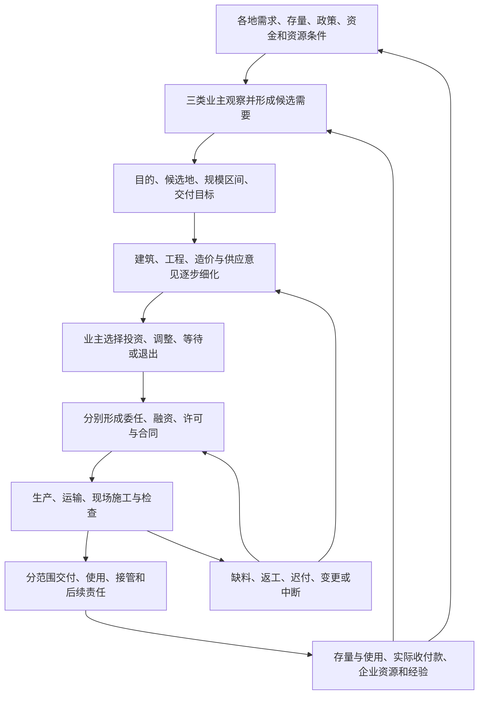

# 研究范围与总体逻辑

定义平台的研究问题、地域与主体边界、建设活动的反馈关系，以及结果能够支持的解释范围。

[总入口](../README.md) · [世界运行](../02_world/world_runtime.md) · [共同对象](../02_world/domain_objects.md) · [项目推进](../03_projects/project_lifecycle.md) · [贯通场景](../07_experiments/reference_scenarios.md) · [工程类型与模板](../02_world/project_types.md)

<!-- page-nav:start -->
**本页导航**

[1. 研究问题](#1-研究问题) · [2. 地域边界：湾区内的 11 个城市/地区](#2-地域边界湾区内的-11-个城市地区) · [3. 六种“地点”必须分开](#3-六种地点必须分开)

[4. 从社会条件到项目结果的完整因果链](#4-从社会条件到项目结果的完整因果链) · [5. 八类主体各自的主动性](#5-八类主体各自的主动性) · [6. 环境更新怎样调节这条链](#6-环境更新怎样调节这条链)

[7. 地区协作怎样进入模型](#7-地区协作怎样进入模型) · [8. 结果与证据的边界](#8-结果与证据的边界) · [9. 设计约束与配置边界](#9-设计约束与配置边界)
<!-- page-nav:end -->

## 1. 研究问题

研究大湾区内的业主、银行、建筑师、工程师、造价顾问、政府机构、承包商和供应商，怎样在各地需求、政策、资金、专业能力、产能和项目条件下作出不同决定；这些决定怎样形成建设项目、跨地区合作和实际履约，又怎样影响后续投资、企业经营与区域供需。

核心研究问题：**大湾区内的地区差异与制度安排，如何通过主体选择、资源竞争和项目履约，改变建设活动的空间分布、合作结构及项目绩效？** 这是待检验的问题，不预设跨地区合作必然有利，也不预设某一种技术必然优于其他技术。

完整逻辑指模型边界内的起因、行为、工作、反馈和异常接续完整；不意味着重建全部社会、全部法规或每一个施工动作。政策效果由被明确启用的机制产生，不能直接把预期结果写成系统输出。

### 1.1 工程对象与计算范围

框架覆盖房屋建筑（含超高层）、道路、桥梁等工程。统一目录及隧道、其他专项工程扩展方式见[工程类型与方案模板](../02_world/project_types.md)；启用哪些工程对象、建设任务与计算方法，由模型配置声明，未决选择见 D-06/D-07。

**SCOPE-005｜研究目录与计算覆盖分开。** 房屋用途、业主目标、工程对象、几何规模及建造方式分别表达；超高层属于建筑特征，不是与住宅或桥梁并列的用途。大型项目可含多种子工程／区段，单体项目无需虚构层级。分类清单不意味着每种类型已经具备工程量、施工、质量或服务产出方法；局部方法不自动代表完整工程。

建筑、道路与桥梁等可共享委任、合同、资金和协作机制；数量转换、专业任务、工程依赖和功能交付由相应模板提供。每项工程按实际任务绑定主体，不要求所有工程都经过 Architect 或齐备八角色。

## 2. 地域边界：湾区内的 11 个城市/地区

粤港澳大湾区包括香港、澳门，以及广州、深圳、珠海、佛山、惠州、东莞、中山、江门、肇庆。地域清单依据[香港特区政府的大湾区概要](https://www.bayarea.gov.hk/sc/about/overview.html)；这里只据此确认地域，不据此推出具体准入、审批、收费或资格互认规则。

以下标识用于模型内部，不是官方行政区划代码：

| region_id | 地区 | 制度模板分组 |
|---|---|---|
| GZ | 广州 | 广东内地九市 |
| SZ | 深圳 | 广东内地九市 |
| ZH | 珠海 | 广东内地九市 |
| FS | 佛山 | 广东内地九市 |
| HZ | 惠州 | 广东内地九市 |
| DG | 东莞 | 广东内地九市 |
| ZS | 中山 | 广东内地九市 |
| JM | 江门 | 广东内地九市 |
| ZQ | 肇庆 | 广东内地九市 |
| HK | 香港 | 香港 |
| MO | 澳门 | 澳门 |

制度分组只是检索规则的入口，不表示组内全部城市采用同一规定。具体适用性由地区、事项、主体资格、项目/产品范围、日期和证据版本共同确定；任何“互认”“简化”“豁免”都需有适用依据或标明情景假设。

**SCOPE-001｜研究项目与内生主体。** 模型内建设地点、内生生产节点、被解释的合作活动限定在上述区域。研究中的组织实例须有明确湾区内经营/履职单元；注册地、组织归属、经营地和实际作业地分别记录，不能仅凭“来自湾区”推定能在全部地区开展全部活动。是否研究境外母公司的行为不因设有湾区分支自动纳入。

**SCOPE-002｜模型边界与外部输入。** 不建立湾区外项目或外部组织的自主决策网络。湾区外原料来源、金融基准等若是所选机制必要输入，可登记为有来源的价格/供给/冲击边界，或在场景中明确不纳入；不把它们扩成研究对象，不默认为无限、免费或即时可得。湾区内但未单列智能体的物流等服务也可由明确过程表达，须区分“地域之外”与“没有单列智能体”。

**SCOPE-003｜范围不等于覆盖率。** 平台允许 11 地区配置；一次实验可以选定其中若干地区和用途，但须说明覆盖。不要求每座城市必定生成项目，也不为凑八类角色×11 地区而虚构真实机构或强迫成交。局部实验的结论不能自动外推为整个湾区的结论。

## 3. 六种“地点”必须分开

| 地点/归属 | 控制什么 | 不能替代什么 |
|---|---|---|
| 组织注册地与组织身份 | 主体来源及有关适用资格的输入 | 不等于项目地、生产地或具有全部当地权限 |
| 经营单元/人员服务地 | 可提供服务的实际资源与有效经营范围 | 不以新增分支视图复制资金或人员 |
| 项目／子工程／区段所在地 | 建设对象、需求覆盖、适用事项和当地投入；跨区工程关联各范围地点 | 不随业主所在地自动改变，不以一个主地区覆盖全部区段 |
| 工厂/仓库所在地 | 制造产能、物料和库存位置 | 不随供货商总部位置移动库存 |
| 交货/施工地点及路线 | 运输段、到达窗口、现场可用材料与执行资源 | 不因供货合同已签而把货物视作在现场 |
| 决定机关辖区和事项权限 | 哪个机构有权处理何种申请/检查 | 不能由“Government”角色标签推定统一全湾区批准权 |

工程实体跨地区与企业跨地区服务／生产分别记录：前者由工程范围覆盖的地点判断，后者由真实参与与履约地点判断。跨城、跨制度适用范围、跨组织合作分别统计。香港主体参与香港项目但使用东莞工厂，可以同时有本地合同主体关系和跨城生产物流；不能只比较合同双方注册地就概括全部跨区域活动。

## 4. 从社会条件到项目结果的完整因果链

箭头表示依赖和反馈，不是保证成功的顺序脚本。每一条“同意”必须属于有权主体，每一笔现金或工程量必须有实际来源。企业可以不参与、拒绝、误判或失败；没有项目时仍有经营、到期义务和观察行为。

三类业主的起点不同，但共享真实约束：投资收益型关注可见需求与预期回报；自用需求型关注本组织功能与供给不足；公共服务型关注被明确赋予的服务目标与预算/授权。公共服务目标不等于市场销售收入，业主提出需要不等于取得建设许可。

## 5. 八类主体各自的主动性

| 主体 | 自己掌握的主要选择 | 不由其单方决定的事实 |
|---|---|---|
| Owner | 是否调查/投资、候选地与规模、取舍、委任/采购及自身资金安排 | 技术通过、银行放款、法定许可、他方同意 |
| Bank | 自身产品/组合范围内受理、条件、报价、提款判断、监控与补救 | 借款人接受、工程实际进度、无限资金来源 |
| Architect | 接单、受托方案变量、建筑接口意见、成果编制/修订及有权发布 | 他专业结论、客户投资决定、通用法定批准 |
| Engineer | 接单、支持方法、分析/检查范围、专业判断、补查与复查 | 隐藏缺陷全知、无数据的安全结论、擅改工程真值 |
| QS | 接单、估算/计量方法、成本比较、权限内核证及价款意见 | 实际付款、他方接受全部费用、无数量基础的精确造价 |
| Government | 辖区和事项内的受理、补件、许可、检查及有权措施 | 全湾区统一通过、自动替业主融资或确定项目数量 |
| Contractor | 是否投标、资源/工序组织、采购、现场履约和调整方案 | 缺材料仍完成工程、单方确认新价款、替供应方承诺 |
| Supplier | 报价/接单、产能排期、批次、材料/产品与运输安排 | 无原料生产、发运即到场、客户必然接收替代品 |

每一角色的目标、信息、动作与异常仍只在其[角色主文档](../README.md)定义；本表用于检查主体是否具有独立作用。

## 6. 环境更新怎样调节这条链

环境分为“地区状态”“地区间联系”“持续生效规则”，而不是一个全国通用景气度乘数。

| 环境内容 | 作用到哪个行为/事实 | 后续怎样反馈 |
|---|---|---|
| 地区×用途需求、已有可用存量与在建预期 | Owner 观察需要、形成方案和投资判断 | 真实投用与使用更新对应需求池/供给；预期可以落空 |
| 候选地块/既有资产范围和可用条件 | 地区/规模可行性、授权及投资选择 | 有效承诺、取消、开发或改造更新同一范围，不能重复占用 |
| 专业、施工和制造能力分布 | 可见候选、报价、排期和真实履约 | 合同、实际投入、释放及企业状态改变后续可用量 |
| 物流路径与交付窗口 | Supplier/Contractor 的路线、批次和现场计划 | 在途、到达、拒收和拥堵记录进入后续可见信号 |
| 资金条件、到期义务和实际现金 | 授信、提款、接单、付款和停复工判断 | 实际收付和债务更新后续资金约束；预测不等于现金 |
| 地区/事项政策规则 | 谁可做什么、需要哪些证据、何时生效、是否改变限定成本/时间输入 | 记录真正受影响的任务/决定和结果；不直接填政策收益 |

外生路径、内生交易和反馈函数分别维护。政府读取结果不自动启用自主政策调控；要研究调控时再给有权机构明确工具、触发、时滞及比较基线。一般主体读取的是其可见版本，不能瞬时知道全湾区全部真实条件。

政策准备完整链见 [政策量化与情景生成](../05_policy/quantification.md)：来源与条款 → 机制识别 → 参数/规则 → 组合情景 → 审阅冻结 → 仿真交接。具体干预见 [工具目录](../05_policy/instrument_catalog.md)，不把五类干预模块、八个作用环节误作新的主体或统一串行审批流程。

## 7. 地区协作怎样进入模型

**SCOPE-004｜先找具体约束，再建合作机制。** 一项跨地区合作至少记录谁与谁、哪项服务/产品、服务与生产地点、项目地、有效委任/合同、需要什么资格/证据、占用什么资源以及怎样交付。熟人关系、咨询、报价、正式合同与实际共同履约分别留痕。

政策/机制实验每次说明：改变哪项资格/证据可复用条件、候选可见性、实际工作投入、排队/运输条件或资金条款；哪些对象受影响；何时生效；怎样观察变化。未改变任何决定、约束或计算的政策字段不能被称为有效政策实验。

候选研究假设可以包括：更多可参与企业是否缓解瓶颈；更广候选是否增加协调成本；设计或产品接口可复用是否减少重复投入；生产集中是否同时降低制造成本并加重运输/排期压力。它们均是待检验机制，不作为模型必然结果。技术方式保持候选，不预先选定 MiC 或传统建造为唯一模式。

## 8. 结果与证据的边界

| 结果类别 | 至少分别报告 |
|---|---|
| 项目产生 | 提案、调查、正式投资、开工的数量/规模/时点；不能合成一个“项目数” |
| 空间分布 | 项目地、实际生产/工作地、组织来源分别统计，说明本次覆盖地区 |
| 合作 | 正式合同、实际履约、重复合作、主观信任分别定义；跨城与制度边界口径分开 |
| 项目履约 | 实际成本、交付时间、完成量、质量/发现、返工及未结责任；保留失败和未完项目 |
| 企业经营 | 实际现金/债务、待收/待付、产能利用、订单/队列、退出与剩余义务 |
| 地区供需 | 可用存量、实际使用、未满足需求/空置、在建预期；同一供给或需求不重复归集 |
| 作用过程 | 受某条规则影响的具体事项、决定与执行变化；支持追踪为何发生差异 |

一次情景比较解释的是该模型和假设下的结果。要支持真实行为或政策结论，还需参数/机制校准、数据或独立观察验证及相应识别设计；代码一致性通过不能替代这些证据。

本节维护研究所关心的结果类别；具体指标/样本/分母、合作网络和跨地区投影、数据用途隔离及验证证据由 [整次运行与结果](../07_experiments/run_and_results.md)唯一维护。三种研究对象层次（组织身份、实际履约地点、制度适用边界）不能混成一个“跨区合作率”。

## 9. 设计约束与配置边界

业务规则以本套规范为依据；软件模块、API 与数据结构服务于这些规则。前端和仿真核心按同一领域模型开发，不受既有程序的单阶段、固定时间步长或展示数据限制。

平台采用三类业主、最小资金账本和地区×用途聚合需求，八类角色各有独立行为规范。工程粒度、时间模型、金融产品、合同模板及政策实例须在[模型决策](../07_experiments/model_decisions.md)中明确其适用范围与方法，不能由目录覆盖推定已经支持。[贯通场景](../07_experiments/reference_scenarios.md)用于检查角色、资金资源及环境反馈的连接；正式计算和行为仍由各自主文档定义。
