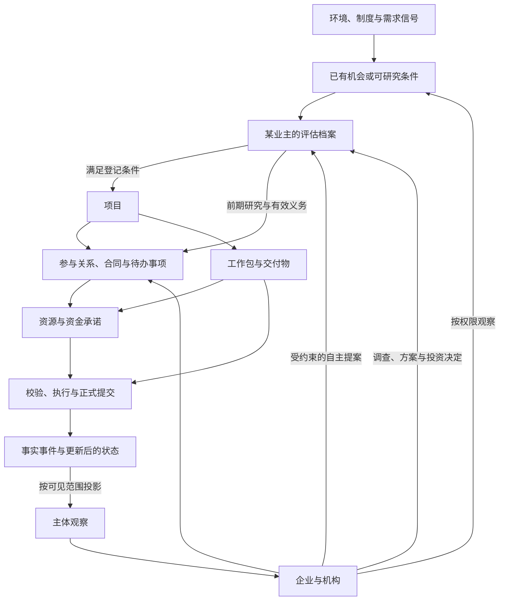

# 领域对象、状态与提交契约

规范性质：目标开发契约。字段定义与业务不变量不等同于既有 API、数据库结构或实现证据。

[返回总入口](../README.md) · [总体框架](world_runtime.md) · [项目运行与推进](../03_projects/project_lifecycle.md) · [交接索引](../03_projects/collaboration_flow.md) · [待定规则](../07_experiments/model_decisions.md)

本文维护六类共同对象的身份、字段语义、状态、关系和变更权限。基础范围包括现金、应收应付、贷款和到期义务的最小账本，以及地区 × 用途的聚合需求；财务产品、资源粒度、时间尺度、角色组合与具体政策实例见[模型选择](../07_experiments/model_decisions.md) D-01—D-12。

本文定义状态是什么及谁维护；单项目怎样组合这些对象形成依赖、等待、放行和收尾，在 [项目运行与推进](../03_projects/project_lifecycle.md) 维护。正式工程/资金计算仍遵循本章边界，具体函数和参数需按已选模型另行细化，不能从推进图直接取得数值。

工程对象目录、用途/高度/材料/建造方法的分离、有限建造方案模板及支持状态由 [工程类型与建造方案模板](project_types.md)维护。本章只定义这些模板引用的共同范围、状态与归集关系，不凭类型名称补出计算方法或默认专业责任。

政策来源、工具定义、参数绑定、组合情景、生效与作用记录的专用契约由 [政策量化](../05_policy/quantification.md)维护，具体工具见 [工具目录](../05_policy/instrument_catalog.md)。这些记录引用本章的主体、资格/事项、任务、资金和资源；不能另建政策专用现金或工程真值，也不把工具生成的建议当作已提交事件。

<!-- page-nav:start -->
**本页导航**

[1. 对象之间的关系](#1-对象之间的关系) · [2. 主体：谁行动，谁承担后果](#2-主体谁行动谁承担后果) · [3. 机会与项目：从可能发生到正式承担](#3-机会与项目从可能发生到正式承担)

[4. 工作包与交付物：实际做什么，依据哪个版本](#4-工作包与交付物实际做什么依据哪个版本) · [5. 合同与事项：谁对谁负有什么义务](#5-合同与事项谁对谁负有什么义务) · [6. 资源与资金账本：承诺怎样形成真实约束](#6-资源与资金账本承诺怎样形成真实约束)

[7. 事件与观察：事实怎样成为下一次判断的依据](#7-事件与观察事实怎样成为下一次判断的依据) · [8. 谁拥有状态，谁有权改变](#8-谁拥有状态谁有权改变) · [9. 跨项目资源约束示例](#9-跨项目资源约束示例)

[10. 业务验收场景](#10-业务验收场景)
<!-- page-nav:end -->

## 1. 对象之间的关系

图中箭头表示关系与处理路径，不赋予所有对象互相修改的权限。事件记录也不意味着可以把全部事实公开给全部主体。

### OBJ-001 · 共用标识与版本信息

运行内正式业务对象具有稳定 ID、所属运行、对象版本、创建时间、最近变更事件和适用规则版本。运行创建前的数据、政策、情景和实验计划属于工作区命名空间；装配时保留来源映射，不能先伪造运行引用。各类引用按 [输入输出契约](../06_engineering/interface_contracts.md) 解析，不能跨空间仅凭相同 ID 直接关联。名称用于阅读，ID 用于关联；改名不能创建新的主体或新的债务。

时间至少区分事件发生/生效时间与系统记录时间。是否采用日、周、月或事件时间尚待 D-04 确定，不能混用没有单位的 tick、天和现实模型调用耗时。

金额记录币种，工程量和资源记录单位；评分明确量纲、范围和计算定义。未知数量保持未知并说明补全方法，不能自动填成 0。

数据保留 `real_user`、`real_public`、`synthetic`、来源及补全标记。真实企业的推断字段不成为真实观测，合成初始关系也不成为真实合作证据。

## 2. 主体：谁行动，谁承担后果

### OBJ-002 · 组织、角色模板与项目职能

一个企业或机构具有持续身份。角色模板定义可以承担的行为类型；项目职能定义该主体在某个项目中获得的任务与权限。三者关联但不应互相替代。

基础角色为 Owner、Bank、Architect、Engineer、QS、Government、Contractor、Supplier。Owner 使用投资收益型、自用需求型、公共服务型三类目标模板，详见其主文档；目标模板不增加独立组织或资源。多角色组织、分支机构及项目公司怎样建模仍待 D-03 决定，不能复制一个组织来增加资金、能力或记忆。

| 信息组 | 最小语义内容 | 主要用途 |
|---|---|---|
| 身份与资格 | 主体 ID、组织名称、地区、组织类型、角色、资质/备案及有效范围 | 确定谁能参与哪些事务 |
| 目标与偏好 | 经营/公共职责目标、风险、流动性、合作等偏好及其依据 | 主体权衡，不能默认所有角色都只追求利润 |
| 能力与资产 | 专业能力、设备/产能、组织资源及产权或使用权 | 为候选筛选与实际执行提供证据 |
| 当前承诺 | 当前项目、有效合同、预留及占用资源、期限与未完成义务 | 避免跨项目超额承诺 |
| 经营状态 | 当前业务状态、资金账本引用、可用授信及限制 | 参与、履约、融资和退出判断；精度待 D-02 |
| 认知状态 | 私有记忆、收到的信息、主观信念、伙伴评价与置信度 | 根据自身历史作决定 |
| 授权关系 | 哪些决定可由其作出，哪些需要其他人确认 | 区分建议、核证、批准与执行 |

企业没有项目时仍可存在；某项目关闭后，企业和其他项目不会随之关闭。企业退出或偿付困难也不自动消除其未履行义务。

运行任务将角色要求解析为具体主体、职能、范围和授权引用，逐步责任契约见 [项目推进第 4 节](../03_projects/project_lifecycle.md)。跟进任务不改变法律责任或债务人；分派不自动授予资格、法定权力或使商业委任生效。任务换人保留原责任绑定版本与正式履约历史，多方不同决定分别绑定，不把整个项目交给一个全能负责人。

业务对手引用区分 `AgentParty(agent_id)` 与 `ExternalParty(external_party_id)`。后者仅标识未独立建模的真实/场景对手，不增加智能体或自动产生其决定。执行来源另分为主体动作、既有授权下的例行执行、显式外部过程；外部过程须引用提供者/场景规则、证据及内部跟进责任。未配置其机制时记为未覆盖，不能用空 ID、自我交易或临时虚构一个 Supplier 代替。纳入的外部过程按 D-02/D-03/D-06 确定。

### OBJ-003 · 主体只依据其可获得的信息作决定

候选上下文由明确的信息权限和观察截止点生成。公开招标信息、项目内部资料、私有报价、银行授信判断、主体偏好与系统隐藏真值分别处理。

主体记忆是它接收到或推断出的内容，不是整个世界状态的副本。监管机构和银行也没有默认的全知权限；具体权利来自适用规则与授权。

个人或组织的预测、承诺和自报数据可以影响其他主体判断，但不能直接替换核心账本中的实际结果。

核心可用正式状态检查身份、授权、资金、资源、版本等硬约束，但专业意见的可提交性按该主体的可见证据、方法及声明范围核对。潜在未发现缺陷不能被通用校验器偷读后变成“有缺陷就拒绝通过意见”的全知判定。保存意见这一事实，表示“该主体依据这些资料作了此判断”，不等于意见描述必然真实；实际状态、已发现证据、专业判断及允许用途分别维护。已知且适用的必要条件仍须满足；发现率、误差与检查方法见 D-07/D-09/D-11，不默认完美检查。

#### 候选暴露契约：检索不是中性的传递步骤

候选记录归属于一次主体任务，使用稳定的 `exposure_id`、任务/请求身份、主体及授权、查询时点和观察截点；调用重试不重新生成一组未说明的候选。新的资料、有效规则或合法再次搜索可以产生新版本，保留其触发、实际调查投入与旧版本引用。

| 记录 | 必须区分的内容 | 约束 |
|---|---|---|
| 适用性与知识 | 实际规则下已核实的资格/适用状态及证据；主体已获知的资料和自己的判断 | 两者不是必然嵌套的集合，未知不当作不合格；审计真值不进入角色上下文 |
| 检索范围 | 来源/索引版本、允许读取范围、查询条件、检索方法及输入版本 | 不默认覆盖全湾区全部企业；候选企业、设施和产品保留各自身份 |
| 排序与筛选 | 使用字段及其可见依据、方法/版本、并列处理、排除理由 | 不用隐藏真实质量、未来履约或其他客户私密价格排序 |
| 返回与曝光 | 检出总数或明确未知、返回 ID/顺序、实际展示 ID/顺序、截断规则及调用/注意预算 | 未展示、未邀请、未响应、主动拒绝分别记录；检索没找到不证明不存在 |
| 后续行为 | 澄清/调查、邀请、响应、报价、最终决定及各自时间/对象引用 | 曝光不是邀请，邀请不是接单；提交仍复核最新权限、资格及资源 |

有完整许可范围索引时，可保存审计用集合或可重建引用；资料源只返回局部结果时，记录覆盖未知，不能事后把所有未选企业归类为“主体主动排除”。候选的真实不适用可能后续才获知，先前的咨询或意见不据此改写；要求硬资格的正式动作仍由相应入口检查。

对比信息撮合与主体偏好时分别保存暴露和选择。更换检索方法是机制变化；交换等价候选显示顺序属于偏差检查，不能把主体改名产生的偶然变化解释为真实地区效应。具体搜索、排序和截断方法由所选模型组合显式选择，行为评估见 [运行结果](../07_experiments/run_and_results.md)。

## 3. 机会与项目：从可能发生到正式承担

### OBJ-004 · 机会是尚未成立的候选事项

| 字段组 | 最小语义内容 |
|---|---|
| 来源 | 需求、公共任务、存量改造或业主提案；来源证据或场景假设 |
| 对象 | 地点、土地/物业引用、潜在用途、规模范围与限制 |
| 可实施条件 | 权属或使用权、规划约束、接入条件、预算或回报依据 |
| 可见与竞争范围 | 谁知道机会、谁可提出方案、机会是否排他 |
| 时效与版本 | 发布、生效、到期、修订及替代关系 |
| 机会状态与权利 | 发布、有效、修订、撤回、过期，以及适用的排他权/分配状态；由有权限的来源方或程序维护 |

“看到需求/机会”“自主提案”“决定研究”“决定投资”“项目成立”“项目获准开工”分别记录。需求/市场信号本身不授予权利；私人提案不自动变成向所有业主公开的共享机会。主体可以提出新方案，具体数量、排他性、来源及权利机制见 D-01；不默认所有机会都能同时被任意数量业主开发。

### OBJ-015 · 业主评估档案承接正式项目之前的行为

在“机会与项目”这类对象内部，某业主的评估档案以 `owner_case_id` 关联业主、已有机会或自主提案、需求/信号依据及版本。自主提案尚无外部机会 ID 时不能伪造一个已获权利的共享机会。它保存该业主的研究、互斥/可组合方案、证据、授权、暂缓/放弃决定和前期义务；不同业主的档案独立，私有信息不会因此共享。

关注、研究、暂缓和放弃属于该业主的评估状态；一个业主结束评估不改变共享机会对其他人的有效性。机会本身撤回、过期或授予排他权，通过其有权来源和适用程序另行提交。

前期研究可关联任务、顾问合同、支出授权、资源与资金记录，无须先创建一个已投资项目。每项义务明确承担主体及归属档案/项目/企业业务；适用时再关联合同或任务。后续项目成立时建立可追踪关联，不能重复生成费用或自动转移付款责任。详见[业主行为](../04_roles/owner.md)。

需求/存量/在建的世界更新见 WORLD-017；业主提案内容及转换条件在 Owner 主文档维护。

### OBJ-016 · 需求简报、方案与专业评估分别关联

需求简报由业主提出目的、候选地区、规模区间及期望交付时间，技术/建造方式结合专业与供应意见逐步细化。简报、方案、评估和选择分别保存下列引用。

| 对象 | 语义字段 | 状态与使用边界 |
|---|---|---|
| 需求简报 | `brief_id`、`brief_version`、`owner_case_id`、提出者、目的、地区、规模及单位、交期、约束/偏好、授权、可见范围 | 由有权业主确认/修订；不自动生成土地、许可、现金或承包义务 |
| 候选方案 | `option_id`、`option_version`、简报版本、提出者、拟议工程范围、[工程模板](project_types.md) 的 `profile_id/version` 及关联 `design_profile_ref`、技术/工序组合、假设、成熟度、替代/组合关系 | 可由获授权主体提出；前期拟议范围不自动登记正式项目，未取得证据与已证实不符合分别保存 |
| 评估任务 | `task_id`、委任/内部授权、所需范围、输入版本、人员与时间、费用依据 | 与已有任务/合同对象复用，允许有限前期工作，不要求先有正式项目 |
| 专业/供应意见 | `assessment_id`、作者及角色、任务与方案引用、`scope`、方法/证据、`assumptions`、`dependencies`、`blockers`、`allowed_use`、`valid_until_or_trigger` | 区分自报、专业判断、计算/核验及未覆盖；签发者只有对应权限 |
| 比较与选择 | 比较对象及版本、范围/单位口径、已知差异、决定主体、理由、授权条件、待办 | 业主偏好、正式投资、合同生效与技术用途放行分别发生 |

方案修订使相关评估进入“需确认是否仍适用”，不自动全量作废或全部沿用；明确版本、范围和依赖后再复用。一次服务/任务可支撑多个方案，复用关系与计费依据单独记录，不能复制任务造成重复费用，也不因复用而抹除真实新增工作。

方案的作者、汇总者、专业核查者、商业选择者和有权许可者可不同。Architect 的整合记录不覆盖 Engineer/QS/Supplier 的原始意见；供应商的产品声明不自动成为独立专业验证。来源不同的意见发生冲突时保留各方依据和待办，不以平均分替代问题处理。

公开的共同简报与私有报价、成本底线分别授权披露。讨论线程里的最新发言不能替代当前有效版本；技术调用失败、超时与商业拒绝分开，重复结果按对象和业务标识去重。

### OBJ-005 · 项目是具有责任、目标与义务的组织对象

| 信息组 | 最小语义内容 |
|---|---|
| 身份 | 项目 ID、来源评估档案/提案或场景初始项目记录、可选来源机会引用、业主/责任主体、工程对象/交付模板引用、各范围地点与适用制度 |
| 目标与边界 | 功能、范围、投资上限、目标工期、公共效益或经营目标 |
| 实施安排 | 采购模板、设计责任、决策权限与分包/工作包结构 |
| 基线与修订 | 已确认范围、预算、计划以及每次有效调整 |
| 运行关系 | 工程范围层级、功能依赖、工作包、成果版本、审批事项、合同、参与主体及账本引用 |
| 结果 | 实际工程量、累计成本、质量、安全、时间、履约和使用结果 |

总体阶段是便于阅读的汇总。底层分别维护投资、设计、许可、采购、施工、交付、缺陷、结算和资金状态，允许合法组合并存。它们不是互不约束的自由标签，具体兼容规则由[项目生命周期](../03_projects/project_lifecycle.md)及对应模板定义。

例如，工程完成后可以仍有缺陷责任或未结款项；某项设计修改待审时，可否继续不受影响的工作包，取决于范围、依赖和权限规则。

项目取消、暂停、恢复、失败和关闭分别定义。达到仿真时间上限只表示观察停止，不证明所有项目和义务已完成。

#### 总项目、子工程或区段与工作包

`project_id` 表示有来源、责任和授权的总项目；需要分解时，可包含子工程或区段，再关联实际工作包。一个道路项目可以包含桥梁等不同工程对象，具体分类及组合模板引用 [工程模板](project_types.md)。**未分解的单体项目可直接挂工作包，把项目自身作为唯一计量范围**，不要求为填满层级建立空壳子工程。子工程不自动成为新投资项目、法人、智能体或独立资金来源。

| 共同引用 | 最小语义内容 | 状态与归集约束 |
|---|---|---|
| 总项目 | `project_id`、来源与责任、范围基线/版本、交付模板引用 | 总项目状态由对应范围的正式事实派生，不另生成一次同量工程 |
| 子工程/区段 | `scope_id/version`、所属项目、可选 `parent_scope_id`、范围种类、当前与历史状态 | 同一版本有唯一归属路径；改变归属保留原事实与映射，不复制一份新工程 |
| 物理覆盖 | `physical_scope_ref`、资产/构件/线路区间/空间范围引用、数量维度与单位、覆盖版本 | 地理相交不等于同一工作；同一计量事项的重叠覆盖必须拆分或有明确排重依据 |
| 模板适用 | 工程对象分类、[工程模板](project_types.md) 的 `profile_id/version`、适用子范围、方法支持与未覆盖项；`design_profile_ref` 引用该模板关联的设计变量子配置 | 同一总项目可组合有限模板，但不能因父模板存在就默认全部子类型已支持 |
| 地点与事项 | 各子范围的 `location_id`、线路/路径或跨区分段、事项/许可及授权引用 | 一处注册地或总项目标签不能覆盖沿线所有辖区、生产地和交付地 |
| 工作关联 | `work_package_id/version`、`scope_ref`、成果/合同/实际执行引用 | 一项工作可服务多个范围，但其投入、产出和费用不能因此各复制全量 |
| 功能与接口 | 相关范围/端点、接口版本、条件/方法、证据和依赖图引用 | 只记录如何相连和依赖；具体放行与整体使用判定在 [项目运行](../03_projects/project_lifecycle.md) 维护 |

范围树回答“属于哪一部分、往哪里归集”，功能依赖图回答“哪些范围及接口共同支持某项功能”，二者分别保存。相邻区段、桥与道路连接、共用系统可以跨树分支有依赖；一个设施被多个范围使用时引用同一实体，不为画树复制资产。功能网络中的连通关系不等于任务先后，实际执行前置继续由选定方法和 [项目运行](../03_projects/project_lifecycle.md) 的节点契约表达。

同一桥梁或其他子工程横跨多个湾区地区时，可在该 `scope_id` 下关联多个地点及可追踪的事项覆盖，不要求为行政分界切断连续物理构件，也不能按城市把整项工程复制两次。许可/审查覆盖关联具体范围、行动和有效版本，跨区接口分别指定证据和有权责任方；缺少另一地区的事项依据不由总项目的一条 approved 状态代替。

范围基线由相应有权项目/合同决定形成，正式结构通过共同提交入口维护。拆分、合并、增减或换模板保留覆盖映射、已完与剩余范围、旧成果适用性和承诺/义务引用；不能用换 `scope_id` 将历史产出重新变为待建，或让父子两层分别消耗同一资源。预算和合同可以跨范围关联，但不因层级分解增加现金、债务或接受权限。

### OBJ-017 · 地区与用途维度的需求、存量和在建记录

需求侧采用“地区 × 用途”的需求与存量指标，不新增住户、使用企业等需求侧智能体。自用需求型 Owner 保留自身内部需求；聚合市场数据不替它决定目标或共享私有信息。

| 对象 | 最小语义内容 | 正式更新与观察边界 |
|---|---|---|
| 区域用途单元 | `region_id`、`use_type`、`unit`、时间/期间口径、适用服务对象与可替代关系 | 同一地理标签并不保证跨用途或跨单位可加；未知转换保持未知 |
| 需求记录 | `demand_pool_id/version`、覆盖范围/组成、指标类型、数量/区间、`as_of`、来源、情景版本、外生变化及已启用反馈 | 当前水平、累计待满足需求、每期服务流量或新增需求分别定义，不能每期重复累积同一个水平 |
| 资产/供给记录 | 资产或聚合批次身份、基准时点、是否已纳入存量、物理数量、适用使用条件、可用范围 | 分开追踪物理存在、可用性及占用；初始资料为聚合时也要定义模拟新增项目与基准的排重边界 |
| 在建与拟供给 | 来源项目/阶段/范围、预计规模、交付窗口、可见性与不确定性、实际状态 | 预期不是当前供给；仅经符合条件的实际事件转入相应供给范围 |
| 使用与吸纳 | `fulfillment_id`、所满足需求池及版本、对应供给范围、期间、实际使用/服务或交易量、规则依据、剩余缺口或过剩 | 可用量不自动全部被使用；同一满足事实不因多份报表重复归集；需求满足和交易/回款分别登记 |
| 存量调整 | 事件 ID、原资产/范围、变动原因、用途转入/转出、数量、单位、时间、重复处理标识 | 新建、扩建、拆除、改造停用、恢复和用途转换保留不同语义，按对应净变化更新 |
| 主体观察 | 观察者、数据版本、`observation_time`、可见字段、来源/误差或推断标记 | 世界正式记录不自动实时全量发给所有业主；不同观察不改写共同存量 |

只在同口径且已定义含义的比较中计算差额；当前可用空间、实际占用、空置、服务能力和已满足需求可能存在包含关系，不能当作互斥独立量直接求和。库存/水平与期间流量分开，床位、面积、人数和每期服务人次不直接相加。

地区基准是否包含已建模自用业主的内部需要，应在需求池覆盖表显式说明，不能默认为包含或另加。该覆盖选择仍待 D-01/D-08；未知时不发布把二者相加的总需求或总满足量。核心的归集引用不要求向其他主体泄露私有需求；多个项目竞争同一需求池的分配方法另定，不能各自消耗一份完整剩余需求。

适用使用条件未满足时，竣工物理资产可存在，但相关范围不能自动进入实际可用供给。改造后的整栋面积不无依据再次新增；临时停用/恢复只改变相应可用性，扩建新增部分单列。用途转换关联同一资产，按原用途减少、目标用途增加及转换方法记录，不制造第二份资产。

没有需求侧个体智能体时，吸纳/使用可由明示聚合规则、外部数据或场景过程产生；方法和参数按 D-01/D-08 选择。需要真实资金后果的销售/租赁等交易必须有明确的外部对手与执行记录，不从一个使用率直接创造现金；资产转售本身不增加物理存量。

#### 聚合需求、交易与边界资金的共同约束

每个启用交易的需求池须引用一个 `demand_transaction_binding`：需求口径及版本、供给范围、使用/分配方法、交易方法、价格来源、外部对手、资金来源、是否允许信用、取消/退出及下一期更新规则。单位、时间覆盖和方法缺失使相应计算不支持；不自动补成永久消耗需求或每期重新购买同一资产。

`fulfillment_ref`、`transaction_ref`、`obligation_ref`、`payment_fragment_ref` 与 `funding_source_ref` 通过有范围/数量/金额的分配记录相连，允许一项交易分期付款、一次付款覆盖多项交易，不能强造一对一关系。租赁使用按期间记，资产出售引用同一权属范围；对“首次占用”“转售”“公共服务流量”分别声明是否、怎样改变需求池。修订不删除已经发生的使用或现金。

| 资金边界方式 | 必须提供的内容 | 可以解释的范围 |
|---|---|---|
| 有限聚合资金 | 同一来源身份、币种、有效期间、期初可支用额、外生到账/信用、已有承诺与实际支出 | 在明确购买能力与信用限制下的交易；多个项目共用该来源 |
| 明示外生资金路径 | 来源及外部对手、各次到账/执行规则、适用对象和重复覆盖；是否有共同上限 | 给定外部支付条件下的建设与经营，不声称支付能力由本模型内生形成 |
| 暂不覆盖交易/经营 | 声明所覆盖的使用、交付或工程结果 | 不输出虚构销售现金、投资收益或完整市场均衡 |

边界资金记录不是新的智能体或平行账本：有限来源的资金/承诺变化仍由 OBJ-011/012 的正式入口维护，内外收付有对应边界流量。所谓“外部有来源”不赋予每个项目一份独立全额预算；相同来源 ID 的限制跨项目共同核对。预算、信用额度、已获付款授权和实际到账保持分离；结果未知的占用不提前释放。后续确认实际越额付款时保留事实及差额待办，不为了守预算删除真实收款。

运行组合须分别声明三类业主的持续资金边界：收益型的销售/租赁、收款与持有支出；自用型的组织经营资金及是否允许补充；公共型的预算授权、实际拨付及服务运营资金。可以选择有证据的外生过程或“无后续注资”的实验假设，不能留空后把资金耗尽解释为政策或主体偏好。自用满足和免费公共服务不自动产生销售收入。仍不新增住户或使用企业智能体。

共享资金的竞争优先及需求分配取决于 D-05/D-08，不在本对象中暗定赢家。独立合成核对：单价 2、需求 10、共享可支用资金 12、无信用、无其他占用且即时全额交易，两项目合计有付款购买量不超过 6；允许部分未成交，不要求自动花完预算。

世界更新规则见 WORLD-017/019—021，业主响应见其主文档；本对象仅维护共同记录，不替各主体作投资选择。

## 4. 工作包与交付物：实际做什么，依据哪个版本

### OBJ-006 · 工作包及必要投入

工作包可以表示设计任务、制造批次、现场工序、检查或整改等可归责工作。具体拆分深度见 D-07。

申请新工作、授予权限、建立业务任务和取得实际资源分别发生。调查、培训或营销等工作允许属于组织业务；前期研究可属于评估档案。请求包含拟做范围、投入和目的，由有权方决定后，宿主按已满足依赖创建业务任务。调度一次智能体输出所用的 DecisionTask 与实际履约的 WorkTask 分开；前者存在不证明后者已获授权或完成。具名类型和登记/授权/创建入口只在 [系统接口](../06_engineering/system_interfaces.md) 维护。

| 内容 | 需要明确的语义 |
|---|---|
| 工作范围 | 要产生的成果或工程量、计量单位、所属组织业务、评估档案或项目、`scope_ref` 及适用授权/合同；未分解项目可直接引用项目范围，组织自有研究/培训不要求伪造项目或外部合同 |
| 前置关系 | 哪些任务、成果版本、许可和移交条件先完成 |
| 执行主体 | 谁负责，谁提供资源，谁有权确认完成 |
| 必要投入 | 不可缺少的人、设备、材料、产能及场地条件 |
| 时间与产出 | 计划窗口、实际开始/结束、产出或生产率计算依据 |
| 质量与验收 | 检查内容、接受标准、问题清单和复检要求 |
| 状态 | 未就绪、可执行、执行中、受阻、待验收、完成或取消等 |

必要材料或资源缺失时，依赖它们的工作包受阻；不受影响的工作包可按自身条件继续。能力、协调与随机风险作用于有条件执行的活动，不能用正的进度底数隐含补足缺失投入。

实际履约另有任务级执行分片：工作包及版本、分片身份、实际起止边界及边界约定、投入分配引用、已确认覆盖范围、结果状态、产出/成本事件和剩余范围。恢复及跨窗口执行先核对已执行和结果未知范围；只有可证明尚未执行且不存在未决结果的范围才计算新执行增量；仅换分片 ID 或 tick 不能重计已经消耗的人机、材料、专业工时和产出。新增投入可以并行发生，须有独立投入与分配依据；并非把同一时段内所有任务一概互斥。非均匀投入按实际记录计算，不用半段时间自动推断一半产出。

这里的实际工作 `actual_work` 记录在所选范围分解的**最小可计量叶范围**，并引用原工作包、执行分片和物理覆盖。跨多个叶范围的一次真实执行使用可核对的数量/投入分配，不给每个叶范围都记完整执行量；父范围和总项目只汇总这些唯一事实。共同设计/管理工作可有明确的公共工作范围及自身计量依据，不为分摊费用虚构已安装实物。原来未分解的项目后来细分时，映射已计量覆盖与剩余量，保持原执行身份，不再生成历史执行。

时间精度、工作是否可分、生产率及失败分片怎样产生消耗由 D-04/D-07 的选定模型补齐。执行去重包括业务覆盖与资源使用校验，不仅比较事件 ID；同一窗口部分成功后恢复，不再整窗计费。资金分片及外部结果未知另遵循 OBJ-011/012。

### OBJ-007 · 成果版本与问题关闭

图纸、技术方案、成本计划、试验记录和竣工资料记录成果 ID、版本、提交者、依赖版本、适用工作范围、审查者、审查结果和未解决问题。

编制/提交、接收、专业检查、合同接受、委托人取舍、法定决定及按用途发布是不同维度；具体项目只采用适用维度，不以单个 approved/completed 覆盖全部含义。发布记录指定成果版本、适用范围、允许用途及权限；下游引用具体版本和发布依据。修订后按范围与依赖核查哪些批准仍有效，不默认全部沿用或全部作废。各专业的成果责任见 [Architect](../04_roles/architect.md)、[Engineer](../04_roles/engineer.md) 和 [QS](../04_roles/qs.md)。

设计变更和整改不能仅由日志中的“已解决”结束。它们需要对应的工作、更新成果及有权主体的确认；变更是否影响价款、工期或义务须另走相应授权。

## 5. 合同与事项：谁对谁负有什么义务

### OBJ-008 · 参与关系、谈判与合同分别存在

| 对象 | 保存什么 | 状态后果 |
|---|---|---|
| 参与关系 | 主体—评估档案/项目—职能、邀请轮次、当前有效状态 | 说明候选、受邀、投标、活动、待命、退出等关系 |
| 沟通会话 | 参与者、消息、主题、发送与可见时间 | 提供信息；不直接改变正式合同 |
| 要约/方案 | 范围、价格、期限、条件、提出者、版本及有效期 | 可被接受、拒绝、修改或失效 |
| 合同 | 当事方、有效范围、价款机制、工期、付款、风险、变更和退出条款 | 产生经校验的正式义务 |
| 义务 | 谁应向谁完成什么、何时到期、依赖条件、完成证据 | 跟踪履约、等待、违约、替代履行及解除 |

邀请、投标或讨论不自动等于签约。是否需要预留资源及预留量见 D-05，不能把所有受邀者都默认为已交付占用。

前期顾问合同可以关联评估档案；合同当事方、付款义务人和履行范围仍须明确。档案转为项目或结束评估不会自动移转合同、变更债务人或消除合同义务。

组织内部团队通过有效任务/岗位授权获得职责，仍使用共享资源与成本记录，不虚构同一组织对自己的外部服务应收应付。外部委任、内部任务、项目职能和真实资格分别表达，详见 [Architect](../04_roles/architect.md)、[Engineer](../04_roles/engineer.md) 和 [QS](../04_roles/qs.md) 各自的身份与接单规则。

### OBJ-009 · 事项是需要处理并留下结果的业务对象

审批申请、付款申请、变更、索赔、检查发现和缺陷等可以共用“事项”框架，但保留各自合同/制度语义。

每项至少记录类型、提出者、责任人、有权决定者、相关评估档案/项目/合同及版本、依据、期限、当前状态、决定与执行结果；按实际对象填写，不强制尚未成立的项目 ID。

事项处理链：提出 → 受理/校验 → 评估/补充 → 有权决定 → 执行后果 → 核实关闭。哪些节点可以合并由具体行为规定。

“决定通过”与“已经执行”分开。批准付款不等于现金到账，批准变更不等于已完成变更工程，要求整改不等于问题已消除。

商业协议须满足相关主体的有效接受和其他生效条件；适用的行政决定、合同指令或裁决按其权限生效，不能泛化为所有正式变化都需各方一致同意。

审批申请/案件、专业意见、正式决定和有效许可分别关联。许可保存有权机构、事项、所依据版本、范围/用途、条件、生效与到期；条件说明约束哪项行动。依据见[Government](../04_roles/government.md)，不以 Government 标签或一个 approved 值代表所有权限与许可。

## 6. 资源与资金账本：承诺怎样形成真实约束

### OBJ-010 · 资源按类型、单位和时间记录

最小资源记录包括持有/可使用主体、资源类型、容量或数量、单位、可用窗口、限制及来源。劳动力、设备、工厂产能、材料库存和运输窗口不可默认相互替代。

每条预留或占用记录明确持有主体、归属评估档案/项目/企业业务，以及适用合同/任务、数量、时间区间、状态及释放条件。预留如何转成正式承诺、延期如何处理、投标预留何时失效，见 D-05。

新建或扩大资源承诺时，按当前已知有效能力与已有承诺检查不得超配；实际执行时，获派投入总量不得超过该窗口真实可用能力。有效履约承诺、计划分配和当前可执行投入分别记录，可用量由对应记录计算，主体汇总与明细能够核对，不能截断汇总值掩盖缺口。

停机、资格限制、损坏或前序延期等有依据变化造成能力下降或窗口重叠时，保留变化事实与原承诺，标记分配失配及尚未满足的数量/时段；不能拒收故障事实、删掉义务或继续满额执行。只对未执行范围按有效规则暂停、改排、替代或解除；恢复时重核资源竞争，原计划不自动恢复成可同时执行。能力变化本身不等于商业违约，责任依对应条款与事实判断。

例如虚构产线原窗口能力 10，已合法承诺 A=5、B=5，停机后实际能力为 6：保留两个各 5 的承诺及缺口 4，实际分配合计最多 6。具体先做谁仍依 D-05，不自动把某合同改成 1，也不假装产线仍能生产 10。

材料区分计划采购、已订购、生产/在途、到场待检、可用、已耗用和不合格数量。收到订单不代表现场库存增加；使用、损耗、退换和补供留下独立记录。

### OBJ-011 · 财务对象分开记录，不以成本替代现金

最小资金账本覆盖现金、应收应付、贷款及到期义务。账户归属、产品细节、利息费用、币种转换和回款机制按 D-02 选择；完整企业报表、税务和监管资本模型不由本账本隐含启用。

| 对象/金额 | 含义 |
|---|---|
| 投资预算或批准上限 | 支出授权与计划边界，不等于账户现金 |
| 合同价与有效调整 | 当事方按合同形成的价款基础，不等于承包商实际成本 |
| 实际成本 | 已消耗的资源或确认的成本；与支付时点可以不同 |
| 付款申请与核证金额 | 提出要求与按授权确认的金额，二者可以不同 |
| 应收应付 | 已成立的支付权利和义务，带到期日、争议及清偿状态 |
| 实际支付 | 从付款方到收款方的资金变动，关联凭证及所清偿义务 |
| 融资 | 咨询/申请、报价及双方接受、额度与条件、实际提款、本金、利息和偿还分别记录；关联借款主体、用途和条款版本 |
| 项目收入与回款 | 销售/租赁/运营或拨款的预测、有效交易、应收和实际到账分别记录；关联真正收款主体和限制，是否纳入待 D-02 |
| 现金与受限资金 | 实际可用余额及用途限制，不能从“财务能力”评分直接推导 |

同币种内部支付应有可配对的付款和收款记录；费用、税费、外部注资及跨币种转换单独列示，不凭空产生或消除差额。项目账和组织账关联，避免在汇总时重复计入同一笔钱。

撤销、更正、退款和债务减免通过可追溯的调整处理；具体会计粒度按 D-02 选择。

工程已完工、结算金额已确定、款项已结清和融资已偿还分别判断。项目关闭不表示企业在其他项目的资金和义务也清零。

融资双方的行为分别见 [Owner](../04_roles/owner.md) 和 [Bank](../04_roles/bank.md)。项目不自动成为借款法人；银行直接支付收款方时，不再给借款人重复增加现金。本金清偿与利息/费用支付分开，核销与有效免债分开；非循环或循环额度的恢复按选定条款处理。条件、提款批次和资金执行沿用事项与事件的统一版本和去重边界，不维护另一套正式余额。

#### 最小账本记录与引用

| 记录 | 最小语义内容 | 共同约束 |
|---|---|---|
| 资金归属/账户 | 持有人、币种、项目关联、用途限制、期初余额及来源 | 项目视图引用真实持有者；同一资金不因组织账/项目账展示两次变为两份 |
| 收付义务 | 义务 ID、债务人、债权人、来源合同/决定、金额币种、成立及到期条件、剩余未清额、争议/限制 | 付款方应付与收款方应收可追踪到同一义务；外部对手明确边界 |
| 付款申请/核证 | 申请、依据、授权核证及版本、对应义务或待形成义务的依据 | 未成立的请求不当作欠款；核证修订只改变有权范围，避免全额再次增加应付 |
| 支付指令 | 指令/业务标识、付款与收款方、金额币种、授权、关联义务/融资批次、有效限制 | 指令不是实际支付；批准未执行需防止同一资金再次支出 |
| 执行与清偿 | 执行 ID、实际金额和时点、结果/凭据、匹配义务及清偿分配、未分配/预收/待退款归集、退款/更正关联 | 同一回执只记一次；同一现金的清偿分配与未分配等互斥归集可核对到实际金额，超额/未归属到账不强塞给已清义务 |
| 贷款安排与债务 | 当事方、条款版本、承诺、提款批次、实际债务、本金与利息/费用、到期及清偿引用 | 未提款额度不是现金或已提款债务；到期分期是同一债务的计划/到期视图，不再增加一份债务 |
| 预测与计划 | 未来成本、回款、支持资金、融资及其假设/概率/时点 | 与实际账本分开，不用于凭空支付；可用于主体判断和资金缺口预测 |

现金余额来自有依据的期初状态与已提交现金变动。可用资金针对本次付款的主体、项目、用途、币种和时点计算：符合用途条件的限定资金可用于对应付款；冻结等不可支用资金、不符合本次用途的资金，以及被其他有效指令占用的部分不可重复支出。限制与占用引用具体资金范围，重叠部分不重复扣除；执行原指令时核对并消耗自身预留，不把自身预留误判为资金不足。未启用的限制类型明确为不支持，不自动开放。不得靠负余额隐含提供贷款；透支若纳入须有明确产品、额度与债务记录，未纳入时表示资金不足。

义务的“成立/到期/部分清偿/清偿/有效调整”、争议及限制分别表达；到期未清可能触发通知或补救，是否构成违约取决于条款和程序，不能由一项技术错误直接生成。部分付款是否允许、由谁决定优先次序及如何分配都须有授权，不默认容器遍历顺序决定谁获得资金。

付款按“提出或到期 → 确认依据/授权 → 检查资金及限制 → 指令/占用 → 执行 → 核对 → 正式账本与事件”连接已有 OBJ-009/012。既有有效授权可执行例行付款，不必每次让所有角色重新协商。技术拒绝、业务拒绝、资金不足、执行未知和成功分别记录；未知结果保留核对与相应占用，不立即再付一笔或无依据释放资金。

预付款实际到账只有一次现金变化；若当时已有到期预付义务，现金只清偿该义务一次，并记录可在后续抵扣的预付余额。后续核证中的抵扣是独立的非现金抵扣记录，消耗尚未抵扣且尚未退款的有效预付余额；不得再次把同一现金分配成第二笔支付或清偿。保留款、扣减与争议款依据合同分别跟踪，不重复生成全额应付。

无法归属或超额收到的真实款项保留为互斥的未分配/预收/待退款状态，再按有权依据匹配或退付；本次分配给每个义务的现金清偿和合法非现金抵扣合计不得超过其提交前的有效未清额，累计金额与原义务及有权调整保持可核对。退款、撤销或更正用关联记录处理，不删除原付款；已支付金额超过修订后义务时形成需处理的差额，而非静默把历史余额改对。后续分配或退款同步归集余额，不能把同一款既留在待分配余额又全额用于清偿。

贷款到账和向供应方支付属于不同业务变化；贷款直接支付则在同一执行链中记录贷款债务及指定收款，并按有效支付授权清偿相应交易义务。本金、利息和费用有各自金额与清偿关系；代扣费用或净额到账若纳入，列明拆分，不把净现金当作全部合同债务，也不重复计费。

以下纯示意用于后续一致性测试，金额以同一虚构单位表示，不是参数建议：业主已知可用现金为 100，已成立顾问费为 20；银行批准 50 但未放款时，现金仍为 100。实际支付顾问 8 后，业主现金为 92、顾问对应现金增加 8、同一服务义务未清为 12。在无手续费/扣收的这个例子中，贷款 30 实际到账后，业主现金为 122，新增贷款本金为 30；再次收到相同到账回执不再增加任何余额。

外部资金流入必须有来源、授权和边界记录；主体不可通过一句“已获支持”自行生成外部现金。

#### 部分执行与回执

支付指令、执行尝试、结算片段和收到的回执使用不同身份：`instruction_id` → `execution_id` → `settlement_fragment_id`，回执另有 `receipt_id` 及版本/序号。内部正式入账以唯一结算片段的**新增实际金额**为单位；重复回执不重复入账，同一执行可以有多个互不重复的片段。每个片段分别列本金变化、各方现金收付、费用/义务清偿及币种，不用单个 `amount` 同时代表本金和净到账。

外部累计回执须由明确适配协议核对计量范围、版本和此前已确认额，再转换为新的片段。例如同币种、无费用的执行先确认累计 60、后确认累计 100，只新增 40；重复 60 或乱序旧版本不再新增。若回执无法确定是新增还是累计，保留待核对，不猜测入账；更正/退款另有关联事件，不借负差额改写已发生历史。

同一指令可同时有“60 已确认、40 未知”等金额分区；批次的部分完成标签只是派生视图。对指令的同一计量范围，已确认、未知、尚未执行及已确认失败等分区非负且互不重叠，合计可与有效指令金额核对。费用及多收款现金分拆另按产品模板核对。只有确认未执行且仍获有效授权的范围才可新建执行尝试；未知部分不能改 ID 重付，迟到失败回执不能抹去已核实成功片段。

分区表示指令授权范围的**当前处理归属**，不把历次尝试金额累加；确认失败的 40 进入合法新尝试后，当前归属转入该尝试状态，原失败记录只留历史。若实际误付超过授权，授权内归属仍按原范围核对，额外实际金额另记异常事实及待处理差额，不为守分区等式截掉真实现金；异常入账不等于补发授权。

### OBJ-012 · 多对象变化以一次业务提交保持一致

正式承诺在提交前复核身份、权限、对象版本、有效接受、候选范围、资源/资金及阶段条件。复核必须覆盖决定形成后到提交前的状态变化。

上述实时门控适用于形成新承诺或派发新执行；核对已发生结果使用另一入口。结果入口检查原指令与绑定版本、发生时点、可信证据、唯一片段及已确认范围，不因当前合同关闭、权限过期或承担者更换而丢弃有依据的历史现金或交付事实。若执行越权、超额或不再匹配当前义务，保留事实并形成异常/差额待办，不据此补发授权或强行清偿；未知真伪继续待核对。确认过去未执行也不意味着今天可以绕过新执行条件重发。

同一业务变化涉及合同、参与关系、资源和事件时，需要一致的提交边界，具体采用 [实现契约](../06_engineering/implementation_contracts.md) 定义的正式写入与本地事务协议。领域方法只准备拟变化；不能各自选择独立写入方式，也不能只恢复 tick 而保留部分变化后无条件重试。

资金结算片段的最小一致写集包括模型边界内现金各方、相应债务变化、清偿/未分配归集、指令占用变化、片段去重记录及 committed event；对外资金的对应边界记录一并保留。观察投递进度单独记录，通知失败可重试投递，不能重做已成功的付款。具体事务和恢复协议见[实现契约](../06_engineering/implementation_contracts.md)；账本一致写集不等于全 tick 自动回滚。

每次业务提交具有去重标识。重复收到同一有效决定、支付指令或到货记录，不能再次扣款、占资源或增加库存。合法的下一轮投标或新的付款申请需要不同标识，不能被历史记录误挡。

冲突不能静默改成另一个决定；返回当前状态与原因，由流程安排重试、调整或退出。技术性延迟不自动生成业务违约或拒绝，是否超过业务期限须依时间规则判断。

## 7. 事件与观察：事实怎样成为下一次判断的依据

### OBJ-013 · 意图、决定、提交与观察

| 层次 | 举例 | 能否直接改正式状态 |
|---|---|---|
| 消息/专业建议 | “建议选择某供应商”“预计下周交货” | 否；作为有来源的信息 |
| 主体最终决定 | “接受该版本订单和交期” | 需经过提交前校验 |
| 已提交事实 | “订单已生效”“到货已检验接收”“支付已完成” | 是相应状态变化的记录 |
| 主体观察 | 收到的订单确认、公开延误信息、自己的到账通知 | 更新该主体可见状态与认知，不反向改写已提交事实 |

事件记录：事件 ID、类型、主体与对象、发生/生效/记录时间、规则版本、关联决定、前后状态或变更摘要、因果关联及可见范围。

观察记录：接收主体、来源事件或消息、观察时间、可见字段及任何推断标记。主体未获知的事实不得提前进入它的决策上下文。

### OBJ-014 · 主观关系与客观关系分别维护

合同关系与历史共同参与属于可核对事实；信任、满意度和对未来履约的估计属于有主体视角的评价。评价可以具有方向性，不要求双方相同。

网络结果要区分当前有效关系、历史合作、重复合作、交易/资金关系与主观信任。指标注明时间窗、边的定义和分母；不能用关系存在直接宣称合作成功。

学习规则见 D-09。记忆保存、模型输出了理由或一次选择变化，均不能单独证明已形成有效学习。

## 8. 谁拥有状态，谁有权改变

下表定义业务提出/决定、正式维护与信息可见性的分工；软件模块对应关系见[实现契约](../06_engineering/implementation_contracts.md)。

| 状态 | 业务上提出或决定的主体 | 正式状态维护者 | 可见性 |
|---|---|---|---|
| 外部环境与有效政策 | 场景给定；如内生调控则由有权限的机构决定 | 环境/制度更新入口 | 按公开范围和观测规则 |
| 主体决定及私有认知 | 对应主体 | 决策记录与该主体认知入口 | 默认该主体私有；授权内容例外 |
| 机会有效性与排他权 | 有权限的机会来源方或权利分配程序 | 机会/权利提交入口 | 按发布及竞争规则 |
| 业主评估档案 | 对应业主及授权协作方 | 评估记录及关联义务提交入口 | 按业主授权和信息来源权限 |
| 项目成立 | 业主及适用批准主体 | 项目提交入口 | 按项目权限 |
| 成果与审批事项 | 编制者、提交者和有权审查者 | 成果/事项状态入口 | 按项目及职责权限 |
| 合同与义务 | 当事方或有权作出决定者 | 合同/义务提交入口 | 合同相关方及依法有权者 |
| 资源、库存、资金 | 有权分配或支付的主体；执行事件提供事实 | 对应账本提交入口 | 主体与获授权方 |
| 工程实际结果 | 已提交的动作和实际投入 | 工程计算及验收入口 | 通过结果与观察规则发布 |
| 事件、指标与前端展示 | 来源于已提交变化 | 事件记录与结果投影入口 | 展示不另算或补造正式事实 |

### OBJ-018 · 八类角色使用同一行为契约结构

每个角色的完整行为在自己的主文档定义。相同结构用于发现缺项，不要求它们拥有相同目标、动作或决定权。下列结构约束角色行为定义，不代替提示词、API schema 或执行配置。

具体的共同类型、字段生产责任、ActionResult、CommandEnvelope和提交回执由[输入输出契约](../06_engineering/interface_contracts.md)统一维护。各角色逐动作定义Input/Payload；正式成果、主体提交请求、核心提交事实分别建模。接收者必须能从上游的有类型输出取得必要字段，不能靠阅读解释文本补造正式状态。

| 契约项 | 必须回答的问题 |
|---|---|
| 行为与实例 | 哪个 `operation_id`，哪个主体以什么项目职能处理哪个事项？没有正式项目时关联评估/任务，不伪造项目 ID |
| 触发与可见输入 | 什么事件或检视触发？引用何版资料、截止时点及权限？缺少哪项输入？ |
| 可选动作 | 允许提出、接受、拒绝、修订、等待或退出哪些选项？哪些候选确实可选择？拒绝不附带接受的后果 |
| 提交条件 | 谁有权决定？对象版本、有效接受、资金/资源及业务条件是否仍成立？ |
| 输出与状态 | 输出建议、最终选择、执行指令还是正式事实？哪些对象字段允许变化？哪些只能通知对方处理？ |
| 时间与资源 | 需要哪个任务、什么资源单位/数量/占用窗口？业务用时、等待、截止日与模型调用耗时如何分别表达？ |
| 异常与恢复 | 业务拒绝、缺证、资源竞争、技术失败、执行未知分别去哪里？何时重试、升级、替换或退出？ |
| 交接与观察 | 谁收到什么版本的结果，何时获知，以什么权限继续？通知重发不能重复提交事实 |
| 验收与依据 | 对应哪些可判真假的预期、待定参数、来源和实现位置？规则描述本身不证明实现 |

各角色的完整行为表覆盖其全部 A 编号，详细专业对象和恢复路径继续放在该角色文件。组织偏好、任务优先判断可以属于私有认知；已接受的合同、正式排期和实际投入只从共同对象读取。

一次行为还应区分下列执行方式；不把所有活动都转换成一次模型发言：

| 执行方式 | 例子 | 正式后果 |
|---|---|---|
| 需要主体判断 | 接不接单、选哪一方案、如何补救延误 | 输出受限选择，提交前检查合法性；允许合理但事后不成功的选择 |
| 有效授权下的例行履约 | 到期处理、已批准指令的执行、状态通知 | 依原授权与当前条件执行，不虚构重新议价或重新获得同意 |
| 核心计算与核对 | 工程增量、库存去重、资金清偿、条件检查 | 按选定规则/输入计算，不用自然语言直接指定正式结果 |

具体哪个操作属于哪一类仍须逐项在实现映射中指定；规则提供者、离线替身与真实模型分别标记。缺模型调用机会不能记成主体主动拒绝、专业报告已完成或实际工期自然消耗了相同计算秒数。

### OBJ-019 · 主体同时处理多个对象，不共用一个流程状态

银行可以同时收到新申请、等待一笔提款资料并处理另一贷款的逾期；供应商可以同时制造一批产品、运输另一批并处理退货。因而主体经营状态、事项状态、合同状态和任务状态分别存在，不能用一个 `agent_status=waiting` 阻塞全部业务。

| 共同要求 | 各角色文档必须落实的位置 |
|---|---|
| 本组织有限资源共同核对 | 任务人员、管理能力、产能、现金等正式承诺；多项目不能各拿一份全额可用量 |
| 优先次序可解释 | 私有拟排期与正式可执行排期分开；资源冲突机制待 D-05，不用容器遍历次序暗中裁决 |
| 等待有对象和理由 | 记录等待哪份资料/决定/资源、责任方、下次触发与适用期限；可以被新事实唤醒，不能无条件每期重做全部动作 |
| 循环依赖可报告 | A 等 B、B 等 A 时，记录相互依赖并交有权主体调整、补充或退出；系统不靠伪造许可/资金打破死锁 |
| 退出保留必要尾项 | 关闭某任务或停止新业务不删除欠款、保管责任、质量事项、在途执行或接续资料 |
| 未覆盖角色有接口 | 尚未纳入的物流、分包、土地、用户等职能标明外生机制或未覆盖；不因八类文档齐全而宣称模拟整个社会 |

若一个组织承担多个职能，组织身份与资源归属继续唯一；部门信息隔离、兼任和利益冲突范围见 D-03。本文不自动启用新的角色类型、监管权或法人层级。

### OBJ-020 · 大湾区地点、路径与事项适用性

地区枚举和制度模板分组只在 [研究范围](../01_overview/research_scope.md)维护。本节维护所有角色共享的引用，不能让每个角色自行编码一套不同城市或默认全区适用。

| 对象/字段组 | 必须明确的内容 | 共同约束 |
|---|---|---|
| 地点引用 `location_id` | `region_id`、位置类别、所属经营/生产/资产单元、来源及版本 | 内生地点属于湾区集合；注册地、经营地、工厂/仓库、项目和交付地分别引用 |
| 经营单元 `operating_unit_id` | 所属组织、地点、有效经营/服务范围、共享资源/账户引用 | 分支不复制组织资金、人员或产能；可参与资格与资源可用性分开 |
| 路径 `route_id/version` | 有方向的起止地点、途经/交接段、适用货物或服务、时窗、容量/时间/成本方法、证据要求 | 反向不默认对称；费用、时间和容量来自规则/数据或明示假设，空字段不解释为零 |
| 事项适用性 `applicability_id` | 对象/动作/范围、地区、日期、模板/规则版本、依据、状态及待补问题 | 状态区分适用、不适用、未确定、超出研究范围；未知不是自动豁免 |
| 权限/资格依据 | 有权来源、主体或成果、可做事项/产品、有效范围/期间、可复用条件 | 主体能力分、所在城市与他地批准都不自动产生本地权限 |
| 模型边界类别 | 湾区内建模主体、湾区内未单列主体的过程、湾区外边界输入 | 外部 PartyRef 与是否地域之外分开；边界过程有独立来源/约束，不创建隐含自主智能体 |

同一合同可涉及多地：分别记录委托方/服务方身份、实际服务和生产地点、项目地、交货地点及支付条款。项目许可与供货路径许可/检验证据不互相替代；同一证据仅在明确适用范围内复用，不默认跨城市或跨用途通用。

### OBJ-021 · 场景期初状态与候选建设载体

初始化建立地区、主体实例、资源、账户/义务、已有合同/工作、存量/在建和候选建设载体的同一版本快照；先给来源与单位，再建立互相引用。能力评分不能当期初现金，企业数量不能当产能；资料不足用明确合成假设或未知，不包装成实测。

每个关键期初字段保留数据集/版本、原记录/字段或片段、原值与标准化值、单位/范围、测量/有效/发布/取得时点、变换或补全方法及输入引用、值的性质和不确定性。组织身份映射、来源冲突和资料截止的装配流程见 [整次运行](../07_experiments/run_and_results.md)，不因真实企业名称而把其补全现金/产能认定为真实观测。

期初快照声明截点及各余额已经包含的业务范围。导入贷款、应收应付、预付余额或已履约数量是建立期初状态，不重新执行放款、付款、生产或收费。为后续操作所需的累计核证、既往清偿/非现金抵扣、已计息期间和未决执行，保留可核对的历史摘要与原业务身份映射，不虚构完整历史事件。期初已计入的结果后来送达，只补证据/核对状态；明确未计入的未知结果核实后由正式入口补记并核对占用。不能只按发生日期早晚判断是否入账；无法区分已有量和新增量时，依赖的续办返回期初覆盖缺口。

虚构核对例：期初现金 100 已含历史提款 D1 的 30、本金为 30，再收到 D1 回执后仍为 100/30。另有累计核证 100、既往清偿 60、未清 40，下一版累计核证为 110且无其他变化，则仅增加义务 10、未清变 50；只知道未清 40 而缺累计覆盖依据时不能猜出该增量。

候选建设载体以 `site_or_asset_id` 表示地块、既有建筑/区段或有明确数量边界的聚合范围，关联地区、可供调查信息、用途/规模约束、现有占用、权利/授权依据和有效时段。该对象不要求建立独立土地交易智能体，但要说明载体条件由哪个场景过程或有权角色维护；不能仅写一个城市就得到无限无成本建设用地。

提案可引用尚未落实权利的候选，保留其不确定性；取得咨询资格、投资授权、排他占用或实际施工放行分别检查对应依据。两个互斥方案或项目争用同一载体范围时，按所选竞争规则处理，不各自创建一块同名地块。未建模取得权利过程时标明前置场景假设和解释范围，不能自动“获地”。

初始化还登记运行/实验命名空间、认知新建或继承依据、规则/方法/参数版本、随机状态、外部边界提供者及未覆盖机制。已包含在地区基准中的在建或已用资产要有映射，后续项目交付不重复增量；没有足够期初条件的相关动作返回配置缺项，其他独立对象仍可处理。

### OBJ-022 · 工作包、订单和实物流转的共同引用

工作包、订单行与实物不是一一对应：同一工作包可用多个批次，一个批次也可按可追踪子范围服务多个工作包。关联记录至少包含 `work_package_id/version`、`order_line_id/version`、`product_ref/version`、数量/单位、用途范围、分配依据、`production_fragment_ref`、`shipment_ref/fragment`、`receipt_fragment_ref` 和 `consumption_fragment_ref`；某环节尚未发生就保留未发生，不提前补完成引用。

生产转换引用材料清单/方法和实际投入，分别核对输入与输出单位；运输只转移同一实物子范围及实际位置，不再生产产品。父批次与子批次是谱系/汇总关系，不是可相加的库存。实物在各位置及可用、隔离、已领用、安装/消耗、损失等分区须可核对，累计搬运量不作为净新增量。所有权、保管责任、风险和实际位置分别引用选定合同/规则，不因物品移动自动按同一时点转换。

换产品、改路线或改派未执行工作时保留原谱系与实际状态，再复核相应设计/证据、窗口、权限和价格条件。退货须有真实反向移动；替件须有独立于原件、尚可用的实物来源及有效授权，可来自现货、有效外购或新生产。新增投入按实际路径记录，不复用原件或已消耗材料；替件与原件不能各自重复清偿同一交付义务。成本、质量接受、订单满足、实际安装和现金清偿沿各自对象核对，不通过单一“完成”状态互相推定。

资源能力池若代表已枚举人机/设施的汇总，注明成员和覆盖，不再与成员叠加。若只建聚合池，注明其独立范围及资源单位；各项目的预留/占用引用同一底层资源身份。

成本记录关联承担主体、实际活动/投入、覆盖范围、数量单位、单价/估值方法及来源。主体生产成本、客户采购价、核证额、应付和现金分别保存；区域全链资源成本要消除内部交易的重复归集，不能把供应商制造成本与下游购买同一产品的全额价款相加后称资源消耗。未能区分覆盖或缺价格时保留未知/不完整，不以零补齐。

父子归集以 OBJ-005 的范围版本和 OBJ-006 的实际工作分片为依据：能相加的同口径叶范围量只计一次；已汇总的父值不再与其子值相加。道路长度、桥梁长度、建筑面积、件数和服务能力不能直接合成一个物理总量；若某桥梁长度已含在走廊长度中，另按工程类别展示不增加走廊净长度。总体进度如需权重，登记指标/基线和剩余范围，不能用各子工程百分比的任意平均代替真实结果。

共同费用先记录唯一成本事实和覆盖/分配依据，分摊投影与原始成本不能叠加；尚不能分配时保留未分摊及未知覆盖，不给每个子工程一份全额。组织经营费、融资费用等非物理产出费用保留自身类别与归属，不为归集造工程量。合同跨多个范围时继续由真实当事方持有同一义务/付款身份，按范围分配的展示不生成第二笔应付或清偿。

#### 工程转换与质量状态的方法链

一个支持的工程方法组至少连通 `brief/option_version → quantity_basis → material_and_process_requirements → actual_execution → functional_output`。数量依据保留范围、单位、转换方法与版本，不能仅凭“MiC”“传统”标签推出物料或工效。制造投入、运输子范围、安装/消耗引用同一谱系；工程范围外的余项单列支持方法或未覆盖，不按一个切片的成本比例自动代表整栋建筑。实际方法分别由 Architect/Engineer/QS/Contractor/Supplier 主文档负责；贯通的合成接线实例见 [贯通场景](../07_experiments/reference_scenarios.md)。

真实质量状态由工程/实物领域维护，意见与检验记录不代写它。采用单件、子范围或聚合数量均可，但必须有声明的方法和可追踪覆盖：`quality_state_id/version`、实物/工作范围及单位、缺陷类型/数量或特征、成因执行/暴露、有效时点、方法版本和随机结果引用。每件可以有多个问题，缺陷条数与不合格实物数量不是同一指标；聚合拆分时保留数量分配方法，不能复制同一批次的全部缺陷。

| 方法类别 | 输入与输出 | 正式状态和观察边界 |
|---|---|---|
| 生成/损伤 | 实际制造、运输暴露、安装等执行范围＋原质量状态＋选定方法 → 质量增量 | 绑定真实执行身份；重检、重复通知或改 ID 不重新生成缺陷 |
| 检查/观察 | 获授权检查范围、实际投入、方法与受控抽样 → 可见检验结果和不确定性 | 内部检查模型可以依真值生成有限证据；主体只得到结果，不得到完整隐藏状态 |
| 修复/替换 | 已授权任务、实际新增投入、原问题与方法 → 原实物质量变化或独立替件 | 提出修复、支付修复费或意见通过均不自动消缺；方法允许修复失败和剩余问题 |
| 功能影响 | 已实现实物/工作及其真实状态＋功能方法 → 实际可供服务/性能 | 物理可用能力与法定允许使用、主体已知风险分别保存；不以隐藏真值偷改专业意见 |

多次检查可以产生不同证据，检测误差/误报须由方法明确；同次检查的技术重试复用结果。可重复试验须有新的业务任务与实际投入。原缺陷在搬运或安装中延续；新损伤关联新的暴露，修复、更正或报废以新事件调整当前状态并保留历史，不能靠转移位置重置为合格。

抽样以运行、方法、实际执行或检查身份、物理范围和相应随机来源标识，记录结果或可恢复状态；共同冲击通过同一事件和各对象的暴露作用，不以所有批次共用同一个 seed 代替相关结构。随机来源和共同冲击引用 [世界运行](world_runtime.md) 的更新协议。

局部机制验证可以使用固定缺陷输入检查检验/返工，但该组合不能解释技术或赶工如何改变缺陷发生率。未选择检测或修复方法时，相应结果为未覆盖/不支持，不默认完美。质量放行仍依合同和适用事项判断，不强制所有潜在缺陷都被主体提前发现。

## 9. 跨项目资源约束示例

一家承包商同时参与项目 A 和 B。A 的返工使原定释放的专业队伍继续占用；B 的某工作包依赖同一队伍。

1. A 产生有依据的缺陷事项与返工任务，并确认其责任和范围。
2. 资源排期反映延长占用，B 的相关工作包因此受阻，其他具备条件的任务可继续。
3. 承包商基于合同、成本、可用替代队伍和信息决定是否调整排期、寻求替代或提出请求。
4. 需要其他主体同意或授权的变化完成相应程序，再更新合同、资源和计划。
5. 实际施工与资金事件产生结果；A、B 的参与方只收到各自有权知道的信息。
6. 结果进入企业后续选择和伙伴评价。是否进一步影响地区价格，取决于 D-08 定义的反馈机制。

该示例用于说明对象关系；不对应真实项目，也不提供工程、时间或市场参数。

## 10. 业务验收场景

以下为目标验收预期。执行记录、代码版本与结果另行登记，不能以场景描述代替验证证据。

| 编号 | 场景 | 应检查的目标行为 |
|---|---|---|
| CHECK-001 | 主体明确拒绝一个方案 | 不产生该方案的正式合同、选择或交付资源占用；另行约定的投标准备成本仍按规则处理 |
| CHECK-002 | 两个项目争用同一时段的有限资源 | 不超配；冲突按已确定机制处理，并向相关主体反馈 |
| CHECK-003 | 必要材料未到或不合格 | 依赖该材料的工作包受阻；其他可执行工作不被无依据地全部停止 |
| CHECK-004 | 同一支付或到货事件重复提交 | 只发生一次正式资金/库存变化，记录可解释 |
| CHECK-005 | 设计版本发生变化 | 追踪受影响范围，按规则重新核查批准与任务依赖 |
| CHECK-006 | 工程完成但仍有欠款或缺陷 | 工程完成与其他状态分开，未结束义务继续存在 |
| CHECK-007 | 决策模型失败或预算不足 | 记录技术状态，不虚构主体同意、拒绝或事实提交 |
| CHECK-008 | 决策后资源已被另一事务占用 | 提交前发现冲突，不沿用过期可用量；按规则重试或调整 |
| CHECK-009 | 运行达到时间上限 | 记录未完成项目、义务与排队事项，不伪造项目全部关闭 |
| CHECK-010 | 某主体无权知道竞争对手报价 | 其上下文中不含该私有报价，即使核心中存在记录 |
| CHECK-011 | 一次提交中途失败 | 不留下不可解释的部分正式变化；恢复或重试遵循明确一致性边界 |
| CHECK-012 | 成本超支但没有有效价款调整 | 不直接把超支额增加为业主应付；按合同和事项规则确定责任 |
| CHECK-013 | 同一交易形成双方应收应付投影 | 关联同一义务，金额币种与调整可核对，不在组织/项目汇总重复加计 |
| CHECK-014 | 贷款批准但未执行，或预计补助/收入尚未到账 | 只进入安排或预测，不增加现金和实际已提款本金 |
| CHECK-015 | 只清偿一部分有效义务 | 双方实际现金按执行金额变化，剩余未清额继续存在；部分支付需符合授权 |
| CHECK-016 | 支付结果未知且重试或收到重复回执 | 核对同一业务，避免重复付款、清偿或提前释放占用 |
| CHECK-017 | 预付款在后续核证中抵扣 | 引用原付款与相应分配，不第二次减少现金或全额重复增加应付 |
| CHECK-018 | 同一贷款生成多个到期分期 | 分期引用原债务，不把借款本金与分期应付再次相加形成重复负债 |
| CHECK-019 | 资金不足且未建模透支安排 | 表达未支付及后续选择，不以负现金默默融资，也不自动免除义务 |
| CHECK-020 | 银行直接支付收款方且存在相关货款义务 | 贷款债务、实际收款及货款清偿对应，不再给业主同额现金或第二次收款 |
| CHECK-021 | 已支付后原核证金额被有权修订 | 保留原现金事实，关联更正及退款/差额，不删除记录伪造余额 |
| CHECK-022 | 示例现金100、应付20、先支付8，再实际到账无扣费贷款30 | 业主现金122、服务义务未清12、贷款本金30；批准未执行或重复回执不再增额 |
| CHECK-023 | 实际收到款项超过当前可清偿额或暂无匹配义务 | 保留真实现金及待核对/退付归集，不超额清偿、不删除真实到账 |
| CHECK-024 | 预付款已清偿预付义务，后续核证使用抵扣 | 生成非现金抵扣、减少有效预付余额，不二次分配同一现金；累计抵扣/退款不超有效余额 |
| CHECK-025 | 初始存量已包含某资产，又收到其交付通知 | 根据来源与基准排重，不重复增加供给 |
| CHECK-026 | 既有资产临时停用、恢复或改造 | 只改变对应维度/净变化，恢复不被当成第二次新增资产 |
| CHECK-027 | 床位容量、建筑面积与每期服务人次进入同表 | 保留单位和期间，未经有依据转换不相加或强算缺口 |
| CHECK-028 | 在建规模增加但尚未投入使用 | 更新可见管线/预期，不提前增加实际可用供给或使用量 |
| CHECK-029 | 市场使用量增加但尚无有效交易或实际回款 | 不自动增加业主现金，公共服务满足不自动产生销售收入 |
| CHECK-030 | 多个业主基于相同市场数据同时投资 | 允许预测错误和后续过剩；共同资产/实际使用不因多个预测而重复登记 |
| CHECK-031 | 银行某申请待补件，同时另一贷款到期 | 只阻塞相应申请；其他合法任务可继续并核对共享资源 |
| CHECK-032 | 三份顾问任务同时依赖同一专业人员 | 共享排期不超配；待选优先机制显式记录，不按文件或遍历顺序隐含决定 |
| CHECK-033 | 一轮通知重复送达并触发同一行为 | 可更新接收状态，但合同、付款、库存与工程事实不重复提交 |
| CHECK-034 | 相互依赖的事项均等待对方先完成 | 可定位依赖与责任人；没有合法解锁动作时保留受阻事实，不自动通过 |
| CHECK-035 | 模型暂不可用但已有有效授权的例行任务到期 | 按既定执行边界处理；不把技术故障当作主体反悔，也不越过必要的新决定 |
| CHECK-036 | 企业停止新接单，但尚有保管、缺陷和应付款 | 新业务资格、任务投入与剩余义务分别表达，不因经营状态改变一并清零 |
| CHECK-037 | 现金 100，其中 60 限项目 A 使用；分别尝试支付 A 或 B | 按付款用途计算可用范围；冻结、他指令占用与用途限制不重复扣除 |
| CHECK-038 | 同一执行先累计确认 60，后确认 100，并重放或乱序旧回执 | 正式新增依次为 60、40、0；未决部分不换 ID 重付，已成功不被迟到失败抹去 |
| CHECK-039 | 有效期内执行成功，但在换人或合同关闭后收到可信结果 | 保留已发生事实与原授权引用；不冒用新绑定，也不把历史批准当作再次执行权 |
| CHECK-040 | 结算片段写入中失败，或记账成功后观察投递失败 | 写集保持一致；分别恢复提交或投递，不出现半笔余额或重复付款 |
| CHECK-041 | 同一自用需求可能已包含在地区需求中 | 按显式覆盖关系归集；覆盖未知不强算总量，同一满足事实只计一次 |
| CHECK-042 | 贸易商向已配置的外部上游采购 | 外部对手与内部跟进人可追溯，不新增假智能体、自我交易或无依据供给 |
| CHECK-043 | 实际存在但本次未发现的缺陷，专业方提交范围内意见 | 不用隐藏真值偷偷拒绝该意见或泄漏缺陷；意见不消除真实缺陷，后续发现另成事件 |
| CHECK-044 | 工作窗口部分成功，恢复窗口与其重叠且换了执行 ID | 按投入和已确认覆盖去重，只计算新增部分，不重复工程量、资源消耗与成本 |
| CHECK-045 | V2 仅为草稿，或另有有效限制先于 V2 发布生效 | 前者不自动废止 V1；后者按限制范围阻塞用途，未受影响范围继续独立核对 |
| CHECK-046 | 主体注册地在广州、工厂在东莞、项目在香港 | 分别引用实际地点、资源和适用事项；不把广州能力自动变香港权限或现场库存 |
| CHECK-047 | 两个项目同时选择同一排他建设载体范围 | 前期研究可保留候选；正式占用依有效权利/规则只提交合法范围，不复制载体 |
| CHECK-048 | 模板缺少某地区事项的适用结论或所需证据 | 返回待确定/未覆盖和责任人，不因资料为空自动批准或豁免 |
| CHECK-049 | 外部边界输入无数量、价格或交期依据 | 保留缺项及机制覆盖边界，不产生无限免费即时供给或新增外部自主主体 |
| CHECK-050 | 仿真基准已包含某在建项目，后续该项目完工 | 按同一资产/项目引用更新在建与已交付状态，不在两侧重复累计总供给 |
| CHECK-051 | 同一批货拆成多个运输批次并分配给多个工作包 | 沿谱系和不重叠子范围核对，父子批次、实收和实际消耗不重复增加实物 |
| CHECK-052 | 企业成本和区域全链成本同时汇总同一产品 | 主体口径分别成立；全链资源口径排除内部交易重复，未知覆盖不发布虚假完整总额 |
| CHECK-053 | 期初现金 100 已含 D1 提款 30、本金 30，首轮又收到同笔回执 | 仍为现金 100/本金 30，只核对证据；不能变成 130/60 |
| CHECK-054 | 期初累计核证 100、清偿 60、未清 40，后续累计核证 110 | 无其他变化时仅增义务 10、未清为 50；缺历史覆盖则明确待核 |
| CHECK-055 | 窗口能力从 10 降到 6，已有合法承诺 A=5/B=5 | 保留故障事实和两个承诺、显示缺口 4，实际投入合计不超 6；不暗定赢家或抹除义务 |
| CHECK-056 | 检索只展示局部结果，未出现某企业 | 记录查询/索引、已展示与截断/覆盖；未知不能记为主体拒绝或确定不合格 |
| CHECK-057 | 两项目面向需求 10、单价 2、共享资金 12 的无信用即时交易 | 合计有付款购买量不超 6；每个项目不能各复制 12，成交需另满足有效分配规则 |
| CHECK-058 | 公共预算 12、实际拨付 4；自用项目满足需求 3 | 前者现金只增加真实到账 4，后者不自动形成销售现金；三类业主的资金来源均有明示边界 |
| CHECK-059 | 固定 10 件中 1 件潜在缺陷，取消检查或重复投递检验 | 真实缺陷仍为 1；取消只改变发现过程，重复投递不重抽，意见不得偷读真值 |
| CHECK-060 | 同一缺陷件转运、拆批并接受一次有投入的修复 | 缺陷沿实物范围追踪，不复制或自动消失；修复依选定方法改变真实状态，替件有独立来源 |
| CHECK-061 | 技术名称或销售报价变化，但功能范围、物理方法、实际投入与估值相同 | 真实工程量/资源成本不获标签加成；合同/利润变化单独记录，不称物理效率改善 |
| CHECK-062 | 未分解的单体项目直接拥有工作包 | 可关联原项目范围，无须空壳子工程；不因新增层级增加项目数、资金或参与主体 |
| CHECK-063 | 同一实际工作跨两个叶范围，父范围另有汇总 | 子范围分配可与原执行核对，父值不再加一次；共同费用原值和分摊值不叠加 |
| CHECK-064 | 同一桥梁范围跨两个湾区地区，并被走廊总量引用 | 地点/事项按子范围核对，整桥不按城市复制；已含长度不再加到走廊净长度 |
| CHECK-065 | 已有工程事实后拆分范围或更换父节点 | 保留版本、覆盖映射和原执行/义务身份，已完与剩余量可核对，不重做历史工程或付款 |
| CHECK-066 | 主体尚无项目，申请一项有范围的组织调查工作 | 可以先提交请求；有权授权及必要条件满足后建立业务任务，不先要求它自己的完成结果，也不以决策调用任务代替工作授权 |

这些场景检验模型内部一致性。真实行为是否合理、参数是否可信及政策效果是否可识别，需要另行开展对应研究验证。
