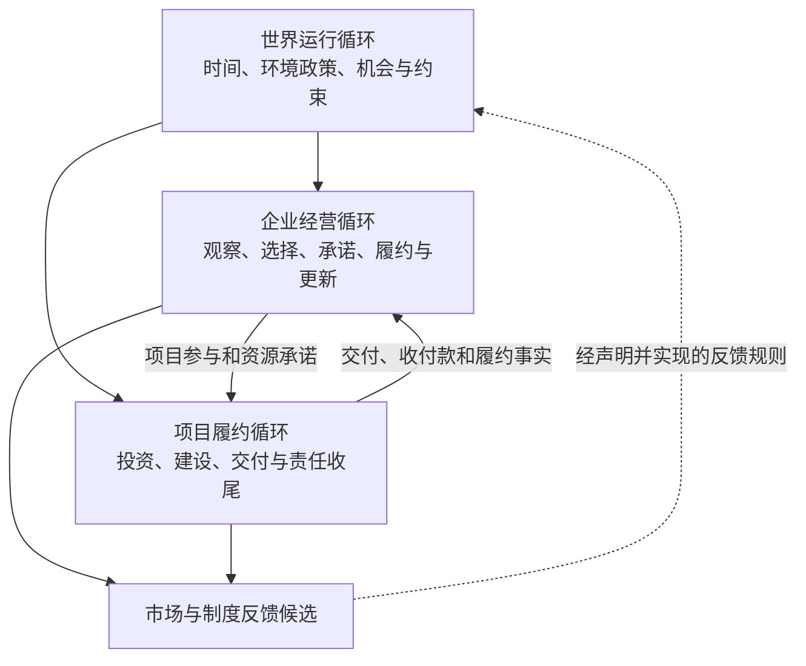

# 世界运行与调度规范

规范性质：目标开发契约。模型选择、能力实现与验证证据分别登记；本文不以规则存在证明能力已实现。

[总入口](../README.md) · [领域对象](domain_objects.md) · [协作交接](../03_projects/collaboration_flow.md) · [项目生命周期](../03_projects/project_lifecycle.md) · [模型选择](../07_experiments/model_decisions.md)

运行涉及的时间、需求/背景负载、环境、行动机会、共享资源裁决与观察反馈，按[系统接口目录](../06_engineering/system_interfaces.md)的有名输入输出接线；[共用类型与函数规范](../06_engineering/interface_contracts.md)限定只读、准备、正式提交与技术失败。函数接口不替代本文件的业务时序，也不替选 D-04/D-05。

<!-- page-nav:start -->
**本页导航**

[1. 规范用途与主规则归属](#1-规范用途与主规则归属) · [2. 世界、企业与项目三个循环](#2-世界企业与项目三个循环) · [3. 模块责任边界](#3-模块责任边界)

[4. 世界环境、制度和市场怎样变化](#4-世界环境制度和市场怎样变化) · [5. 模型事实、主体观察与正式提交](#5-模型事实主体观察与正式提交) · [6. 时间、事件与调度](#6-时间事件与调度)

[7. 多项目并行、异常与运行结束](#7-多项目并行异常与运行结束) · [8. 关联规范与验收依据](#8-关联规范与验收依据)
<!-- page-nav:end -->

## 1. 规范用途与主规则归属

本文维护世界条件更新、业务时间、跨项目调度和反馈触发。各类主体的目标与行为由[角色规范](../README.md)维护；正式对象、账本与提交边界由[领域对象](domain_objects.md)维护；项目依赖、责任绑定与放行由[项目生命周期](../03_projects/project_lifecycle.md)维护；[协作交接](../03_projects/collaboration_flow.md)只作索引。运行作业、恢复能力、指标与比较结果由[运行与结果规范](../07_experiments/run_and_results.md)维护。

**ARCH-001｜范围。** 平台研究粤港澳大湾区内各地区企业与机构，如何在环境、制度、项目和资源约束下作出决定、履行承诺并形成合作结果。地域、边界输入和研究对象依[研究范围](../01_overview/research_scope.md)。
世界持续运行，企业可以跨项目经营；单个项目从机会形成到责任收尾，具有自己的生命周期。

**ARCH-002｜规则与支持状态。** 规则编号用于稳定引用目标约束、适用范围及验收。明确标为候选的方案须经[模型选择](../07_experiments/model_decisions.md)确定后才能进入运行配置；未知参数不采用隐含默认值。目标规则、实现覆盖、验证证据与已知差异分别登记，不根据流程图推断实现完成度。

## 2. 世界、企业与项目三个循环

**ARCH-003｜循环分工。** 三个循环处理不同对象的持续变化，通过正式事件和明确的共享状态连接。

| 循环 | 主要过程 | 主要输出 |
|---|---|---|
| 世界运行 | 时间推进 → 环境政策变化 → 机会、约束和待办形成 → 主体与项目运行 → 汇总市场反馈 | 当期制度、外部条件、机会和可执行事项 |
| 企业经营 | 观察 → 投资与参与判断 → 报价、合作和资源承诺 → 履约与收付款 → 更新资源、经验和判断 | 参与选择、承诺、履约结果、持续经营状态 |
| 项目履约 | 机会与可行性 → 投资 → 团队、融资、设计、审批与采购 → 合同与施工 → 交付、缺陷、结算及责任收尾 | 项目交付物、工程状态、合同结果和剩余义务 |

**ARCH-004｜循环关系。** 企业可同时参与多个项目；项目可处于不同阶段；没有项目的企业仍可观察机会和处理既有义务。
团队、融资、设计、审批与采购之间的并行、前置条件和返工关系，在[单项目运行规则](../03_projects/project_lifecycle.md)展开；[主体交接索引](../03_projects/collaboration_flow.md)保留链条检索。
图中的市场与制度反馈仅通过已选定的方法启用；模型选择见 D-08，不能据连线推定市场价格或政府政策自动内生变化。

## 3. 模块责任边界

**ARCH-005｜模块分工。** 模块代表模型责任边界；软件归属和接口见[实现契约](../06_engineering/implementation_contracts.md)。

| 模块 | 负责什么 | 主要输入 → 输出 |
|---|---|---|
| ① 场景与数据 | 确定研究范围、数据来源、主体、初始状态及实验配置 | 证据和假设 → 可追溯场景与初始对象 |
| ② 环境与制度 | 表达地区环境、市场外部条件、制度规则和政策生效范围 | 场景及已生效变更 → 机会、约束和参数 |
| ③ 主体与行为 | 维持独立身份与认知，形成专业建议和受限选择 | 主体可见信息、候选和行动契约 → 建议与决定 |
| ④ 项目与交互流程 | 组织项目阶段、工作包、业务往来和条件门控 | 项目状态及合法决定 → 待办、提交请求和流程转移 |
| ⑤ 履约计算与状态账本 | 计算工程状态，处理资金、资源、合同及交付物的正式变化 | 有效输入和提交请求 → 已提交状态与履约事实 |
| ⑥ 时间与事件调度 | 安排发生时点、依赖、冲突与执行机会 | 事件、计时条件和资源承诺 → 当期可处理事项 |
| ⑦ 反馈、结果与验证 | 形成主体观察、汇总指标、检查一致性和反馈规则 | 已提交事实及来源 → 观察、结果、验证和受控反馈 |

**ARCH-006｜决定与执行。** 主体提出建议和选择，流程模块判断业务条件，履约计算与账本入口提交正式变化。
LLM 可判断是否行动、选择谁、提出何种允许的条款；工程量、资源占用和实际收付款由对应计算与账本规则处理。
自然语言理由可以作为判断证据，但本身不形成合同、付款、设计批准或资源预留。

**ARCH-007｜对象连接。** 七个模块共享明确的对象标识和版本，避免分别维护互相矛盾的“项目事实”。
对象分为主体、机会与项目、工作包与交付物、合同与事项、资源与资金账本、事件与观察六类，详见[领域对象](domain_objects.md)。

## 4. 世界环境、制度和市场怎样变化

**WORLD-001｜外部条件。** 场景应说明区域、主体范围、研究期及模型之外的供给、需求和服务；记录其是否固定、按计划变化或受外部冲击影响。
已建成资产、未进入模型的企业以及外部金融市场，可按研究需要作为边界条件，不要求全部建立为智能体。

**WORLD-002｜三类变化来源。** 每个变化规则注明来源、作用对象、生效时间、单位、适用范围和证据状态。

| 来源 | 例子 | 处理要求 |
|---|---|---|
| 外生输入 | 预设政策、外部需求、材料价格路径、天气或运输冲击 | 使用场景、数据或受控随机过程；保留来源与 seed |
| 内生业务结果 | 企业报价、项目接受、资源承诺、交付、付款和退出 | 由主体决定及正式履约状态产生；可追踪到事件 |
| 可选反馈机制 | 订单积压影响交期，资金压力影响报价，市场供需影响价格 | 明确函数、时滞、适用范围及证据或假设；选定并完成相应软件检查后可在声明范围内启用，校准与现实验证另行登记 |

**WORLD-003｜机会与需求。** 模型研究市场与政策怎样促使新项目产生，允许三类业主基于可见条件主动形成提案；不以预置项目清单作为完整模型唯一来源。
区分需求/使用问题、可评估机会、某业主提案与档案、投资授权和正式项目；需求或机会出现不保证投资发生。
世界机制维护需求、存量、适用条件及反馈；业主文档 OWN-A01/A16/A02/A03 定义其观察、提案、调查和选择。对项目数的研究目标不直接指令业主建设。
外部需求路径、已有机会与内生提案可以有不同来源；具体用途、需求单位、形成机制及权利分配待 D-01。政府是否自主改变政策仍待 D-08，不随项目产生机制自动启用。

**WORLD-004｜市场反馈。** 先记录实际进入模型的报价、订单、产能占用和交易，再决定是否将其汇总为影响下一期的市场信号。
单个报价不直接改写全市场价格，合作消息不直接增加可用产能，风险评分不直接等于违约事实。
项目自主发起属于研究范围；内生定价、企业进入退出、银行授信调整和需求变化的反馈函数、深度及参数仍待定，不预设所有市场已形成均衡。

**WORLD-005｜政策作用。** 政策应指向明确作用点：资格、可选行动、审批规则、成本/资金条件或计算参数。
保存和展示政策字段不能证明政策已生效；结果应能回溯政策版本、受影响主体及具体规则。
同一政策可因地区、项目类型或既有合同安排具有不同适用范围，具体规则需证据支持。

政策作用通道及其边界如下，不表示任何具体政策必然产生效果：

| 通道 | 进入什么条件或行为 | 正式后果的边界 |
|---|---|---|
| 需求、任务与信息 | 服务目标、需求观察、预期或已授权的公共建设任务 | 目标/预测不自动成为实际购买、拨款或强制投资 |
| 地点、用途、资格与权利 | 可评估/可实施范围、取得权利的条件 | 提案和资格判断不代替权利授予或项目许可 |
| 费用与支持 | 成本项目、支持资格、申请与支付条件 | 预期支持、有效承诺与实际到账分别记录 |
| 融资 | 银行可采用的条件、风险承担或资金安排 | 不直接批准每笔贷款，Bank 仍按其权限决定 |
| 程序与处理能力 | 办理要求、合法处理步骤、人员或服务安排 | 不把效率目标直接改成所有申请立即通过 |
| 协作与供给 | 候选可达范围、相容标准或有依据的物流/交易条件 | 企业选择、承诺及实际履约仍须分别发生 |

政策通道登记版本、依据状态、适用范围、发布/生效/获知时间、直接作用对象与间接传导。一个政策可以有多个真实通道，但同一金额或时间变化不再次无依据加成；尤其不能既减少成本又把同额支持再次增加收益而不核对定义。

**WORLD-017｜需求、存量与在建反馈。** 世界更新读取 OBJ-017 的共同记录，并按 WORLD-019—021 维护需求、资产/可用供给、在建预期和使用反馈。用途、单位、服务对象与替代关系必须明确；在建信息只在允许范围影响未来供给预期，不提前成为可用供给。退役、停用、空置、修复、改造及用途转换按原资产关联处理；反复预测不产生多份确定购买或服务承诺。需求迁移、价格或运营吸纳未建模时保留解释边界，不由全知核心保证每项投资正确。区域间资金、产能及需求移动有明确来源和去向，不复制资源。

**WORLD-018｜项目产生的实验比较。** 世界保留外生输入/初态、主体和政策配置、提案/方案版本、研究授权、投资/延期/退出、正式登记、开工、实际交付及未完义务的事件链；重评不计作新项目，累计事件与时点活动数分别记录。比较允许政策作用后项目数量、规模、地区/用途、主体选择及反馈分化，不强制两组具有相同最终项目。

共同初态、外生冲击与可区分随机来源的比较设计由[政策比较定义](../05_policy/quantification.md)维护；指标单位、样本、截尾、不确定性、实际运行配对与有效结果由[运行与结果规范](../07_experiments/run_and_results.md)维护。共同项目子集只能辅助解释，不替代包含取消、失败和未完的完整世界范围；相同 seed 不保证外部模型复现，机制检查、校准和现实因果识别分别报告。

### 聚合需求与存量反馈

需求侧采用地区 × 用途的需求与存量指标，不增加住户、使用企业等需求侧智能体。聚合指标提供观察与世界反馈，业主仍独立提出和比较方案；自身内部需要、私有认知与区域数据分开。

**WORLD-019｜同口径的需求和供给。** 一个区域用途单元至少注明地区、用途、单位、时点/期间、来源、情景版本及服务对象。地区可使用行政或适用市场边界，但不能未声明就把二者等同。

需求水平、新增需求、累计未满足需要和每期服务流量分别定义；同一需求水平不能每期作为新增需求再次累加。建筑面积、可容纳人数、床位、每期服务人次，以及基础设施服务需要、通行能力和实际流量按各自口径使用，转换需要来源或显式假设。跨地区/用途替代和重叠服务范围需有映射，不把相邻地区当作需求必然可迁移的依据。

物理存量、具备使用条件的范围、实际占用/使用、空置和在建属于不同维度；如果空置已包含在可用存量中，不再额外相加。缺口必须明确比较的是需要与实际满足、可用能力或其他同口径量，并保留过剩；不能只截掉负值后丢失过剩信息。零分母的利用率等指标标明未定义/不适用，不填成正常比例。

**WORLD-020｜存量与管线更新有唯一来源。** 初始存量/在建清单记录基准截点、范围及与模拟项目的包含关系；资料仅能提供聚合批次时，也须有明确的来源排重规则。

| 发生事项 | 世界记录的变化 | 不应发生的变化 |
|---|---|---|
| 外部需求或任务变化 | 按该指标定义更新水平、期间流量或目标，并保留来源 | 自动增加同等数量项目、拨款或购买合同 |
| 业主提出/修订方案 | 记录主体侧候选；是否公开另按权限 | 增加正式在建或可用供给 |
| 项目成立或开始实施 | 分开更新已承诺待建、施工中的规模与预计窗口 | 未交付就计为当前可用空间/服务 |
| 分期实际完成及满足适用使用条件 | 按该范围登记物理新增和/或可用能力变化，去重 | 每次总进度消息都把项目全规模再加一次 |
| 改造、临时停用、恢复或用途转换 | 关联原资产，分别登记净物理变化与可用性、用途转入转出 | 把原资产整体重复新增，或仅恢复使用就生成新资产 |
| 吸纳、使用或服务提供 | 根据显式聚合机制登记实际使用/满足及剩余量 | 自动生成租售收入、实际现金或抹去长期服务需要 |
| 资产转售、项目取消或退役 | 转售改变权属/交易；取消处理管线与已有实物；退役处理对应存量 | 转售增加物理供给，或取消项目便抹去已形成资产/债务 |

正式状态改变通过有效事件驱动，最新预测修订不回写历史交付。实际吸纳规则、交付到投用的处理机制、外生需求路径及弹性仍待细化；没有住户智能体不等于不需要这些规则。

**WORLD-021｜反馈时序与初始数据可核对。** 在每个已选业务观察时点，依次读取此前已提交且已生效的需求/政策/存量变化，生成按权限可见的指标版本；业主据此选择；后续合同、施工、资金及实际投用事件再进入规定的反馈时点。精确频率及同刻排序仍待 D-04，不能从该依赖顺序推定已改用日或月。

模型可以发生投资偏差、超额建设、空置或服务不足；共同记录不重复产生资产和真实服务，主体预测不被强制修正为必然正确。价格、需求迁移或政策自身的反馈未定义时标为未覆盖，不通过暗中调参实现供需配平。

场景初始化需逐项登记：区域用途与单位映射、需求基准及外生路径、存量可用性、在建范围与交付预期、初始主体/资金和项目义务、政策版本及作用入口、观察权限/滞后、吸纳/使用机制、随机来源及缺失数据处理。可以使用明确标记的情景假设，不能把补全数值当作真实观测；不存在的输入保持缺口或有依据的不适用状态。

世界输出分别保留新增/退出、在建/交付、实际可用/使用、缺口/过剩及资金/未清义务的正式记录；其数量、存量、流量与比例由运行与结果规范按各自口径统计，运行完成不证明反馈已校准。

### 工程对象不等于需求指标或收益模式

**WORLD-029｜建筑与基础设施按对应服务口径反馈。** 工程对象分类和有限方法组合由 [工程类型与交付模板](project_types.md)维护；地区 × 用途的聚合需求范围继续保留，“用途”不限定为房屋租售。总项目、子工程/区段、工作包的归属依 [共同对象](domain_objects.md)，功能放行依 [项目运行](../03_projects/project_lifecycle.md)；跨区工程的服务范围可跨多个地区，不能为每个城市复制同一需求或整项工程。

| 工程与服务范围 | 可以分别记录的观察 | 需有方法才能推定的结果 |
|---|---|---|
| 房屋建筑及其具体用途 | 有口径的面积、使用需要、可用空间和占用 | 人员/服务容量、实际使用、租售与回款各自另有依据 |
| 道路、桥梁及其所在走廊 | 工程长度/区段、连接关系、获准开放范围、按方法计算的工程通行能力 | 实际交通流、需求转移、拥堵或通行时间变化，不由竣工长度直接生成 |
| 隧道及关联系统 | 已形成实体、适用专业/系统条件、与相邻区段的功能接口 | 实际服务能力须按对应工程和运营方法计算，不把贯通开挖等同完成全部使用条件 |

网络连通、工程容量、合法可用、实际流量和需求满足是不同状态或计算结果。没有交通分配/服务反馈方法时，可以报告已支持的工程与接口事实，不能宣称仿真已经计算交通收益、减少出行时间或区域经济增益。外部研究给定的收益只能作为带来源的输入/情景，不能改名为本模型内生结果。服务范围、时间/方向和单位由所选方法声明，不因增加工程对象类型而新增住户、车辆或使用企业智能体。

验收要求：一段桥梁未完成必需接口时，两端道路完工不会生成全线可用；同一跨区走廊的服务事实不在两城重复消耗需求池；仅有连通判断方法时，交通流和出行收益保持未支持。具体工程/服务方法见 D-06/D-07/D-08；目录出现某类工程不等于该类已能运行。

### 大湾区的地区状态、联系和规则

**WORLD-025｜每个地区有自己的状态。** 按 [研究范围](../01_overview/research_scope.md) 的地区集合维护地区×用途需求/存量、候选建设载体、可用专业/现场/制造资源、适用事项规则和有版本的市场观察。企业共享资源依真实经营/生产单元登记；同一资源在城市表和企业表只是不同投影，不能叠加成两份容量。

地区间联系按有方向的服务/生产/运输路径记录，包含起点、终点、适用产品/工作、必要资格/证据、时段、成本/持续时间方法和实际限制。内地城市之间与涉及香港/澳门的路径均按相应模板检查；不能用一项通用“跨区摩擦系数”代替所有实际条件。

**WORLD-026｜政策改变具体可执行条件。** 政策条目至少关联发布者/有权来源、适用地区与事项、受影响主体/对象、有效区间、过渡安排、证据/假设版本和作用规则。改变时只重评受影响候选、任务、报价或许可，保留未受影响工作与既有事实。具体法律权利和期限须有来源；测试情景可明示假设，不冒充现实法规。

政策怎样产生这些条目，由 [政策量化主方案](../05_policy/quantification.md)维护；宏观、混合和原子路径分别适用，具体工具见 [工具目录](../05_policy/instrument_catalog.md)。世界循环接收选定版本的工具/参数、有效/过渡安排和作用范围，记录适用、触发和实际执行；不重新从自由文本临时猜参数，也不因情景名含“强”而提高结果。政策准备工作台不等于 Government 自主调控，后者仍依 D-08。

| 环境变化 | 直接唤醒谁/什么 | 正式后果要等什么 |
|---|---|---|
| 某地区某用途需求或可用存量更新 | 可获得该观察的 Owner 调查/提案任务 | 业主有效投资和后续履约，不能立刻增加项目/供给 |
| 企业/工厂资源窗口被占用或释放 | 有相关报价、订单和工作包的主体重新评估 | 相应有权决定和有效资源分配，不能任意挤占原承诺 |
| 一条交付路线的能力/条件变化 | 受影响批次与 Contractor 的现场待办 | 有效改期/改派、实际运输和到达，不按通知补齐材料 |
| 融资或支用条件变化 | Bank/Owner 的受影响申请、预测或到期任务 | 所需接受、授权与实际现金执行；既有条款是否变更依有效依据 |
| 某事项证据要求或有效条件变化 | 申请/核验责任方和有权 Government | 按适用范围处理的新证据/决定，不能整湾区统一刷新为批准 |

未列作用点的环境字段只能作描述或观察，不能宣称已经影响结果。政策信息到达主体的时点与政策正式生效时点分别保存。

## 5. 模型事实、主体观察与正式提交

**ARCH-008｜四类信息。** 模型中的正式状态和主体对状态的认识分别保存，具体字段见领域对象文档。
这里的“事实”指模型内已提交状态；模拟交易和交付不因此成为现实观测或政策效果的证据。

| 信息类别 | 含义 | 可产生的影响 |
|---|---|---|
| 模型事实 | 已提交的项目、资源、合同、交付及账本状态 | 作为后续执行与校验依据；不自动对所有主体公开 |
| 私有观察 | 某主体在特定时间收到、测得或推断的信息 | 改变该主体判断；可存在延迟、不完整和错误 |
| 意图与建议 | 参与意向、拟议报价、谈判意见、专业建议 | 进入候选或协商；有效承诺需进一步满足提交条件 |
| 正式提交 | 有权主体的有效决定经校验后形成状态变化 | 产生事实事件和面向相关主体的观察 |

**WORLD-006｜信息可见性。** 每次决策说明可见对象、版本、接收时间和来源；企业按各自身份与记忆判断。
招标中的竞争者底价、其他企业现金或私有策略，只有模型明确规定可见时才进入上下文。
模型运行方可持有完整审计状态，但不能因此让所有智能体获得全局信息。

**WORLD-007｜提交条件。** 提交前校验身份与权限、当前阶段、候选有效性、承诺版本、资源和资金条件，再提交业务状态。
拒绝、等待、调用失败和预算不足应具有不同状态；任何一项都不能仅因建议中残留候选 ID 而形成接受。
提交后记录事件、接收范围和观察；需要撤销时用可追踪的撤销或补偿过程处理。

**WORLD-008｜并发承诺。** 企业向多个项目报价、表达意向和正式预留资源，分别具有不同效力。
正式承诺记录资源类型、数量、适用期间、优先级及释放条件。新建或扩大承诺按当时已知有效容量和已有承诺校验；实际执行分配不超过该窗口真实可用能力。故障或延期使既有承诺超过后来容量时，保留原承诺、变化事实和缺口，按 [OBJ-010](domain_objects.md#obj-010--资源按类型单位和时间记录) 调整履约；不能拒收故障、删除义务或继续满额执行。
同刻申请冲突时采用何种排序、竞价或协商机制仍待定；处理规则必须公开，避免默认遍历次序决定结果。
资金承诺、实际余额和未到期收款也要分开，具体承诺强度与检查粒度见待定决策文档。

## 6. 时间、事件与调度

本节定义整个平台把世界、主体和多个项目连接起来的目标调度规则，不要求把每个主体和项目在每个 tick 中全部调用一次。

**WORLD-009｜时间语义。** 区分模型时点、业务持续时间、信息传递时间、模型调用耗时和界面播放速度。
日、周、月或混合时间尺度需依据待研究机制选择；汇总周期不自动等于最小业务时间单位。
合同期限、审批等待和生产运输时间不应被消息条数替代；等待期间仍可能发生费用和其他项目活动。

**WORLD-010｜多时间尺度。** 可考虑宏观环境较慢更新、企业周期经营、项目事项按事件发生的组合，但这是建议方案。
采用组合方案时，明确跨尺度的生效时点、取样方式、期间累计与重复执行防护。
时间步长和同刻事件优先级会影响结果，应作为版本化运行配置，并检查对结论的敏感性。

**WORLD-011｜事件类别。** 调度器统一登记以下事项，并保留发生时间、可执行条件及处理结果。

| 类别 | 例子 | 执行前应检查 |
|---|---|---|
| 外部变更 | 政策生效、天气冲击、需求路径更新 | 适用范围、版本和生效时间 |
| 到期义务 | 应付款到期、报价到期、合同通知期限 | 义务是否仍有效，是否已经履行或撤销 |
| 工作完成 | 设计提交、材料交付、任务完成、检验结果 | 前置条件、实际投入和交付对象 |
| 主体决定 | 接单、报价、审批、选择合作方 | 主体权限、可见信息和候选有效性 |
| 业务异常 | 断供、资金不足、拒绝、暂停或终止 | 受影响承诺、恢复条件和后续责任 |

### 6.1 世界推进的依赖骨架

以下只表达应衔接的责任和依赖，不是已经选定的循环算法。D-04 仍需确定时间粒度、同刻排序、决策读取批次、反馈延迟、同周期连锁触发及处理轮数；各项选择需留下版本，不能由文件列举顺序偷偷确定。

| 处理环节 | 需要读取什么 | 形成什么及与下一环节的关系 |
|---|---|---|
| 确定世界处理窗口 | 当前模型时间、下一已知事件、运行期及所选时间规则 | 该次推进待处理的时点/期间，区分待处理窗口与已完成进度 |
| 核对到期及生效事项 | 有效合同/义务、报价/许可效力、已有完成或撤销记录 | 适用的到期、失效、通知或工作事项；到期本身不自动完成付款或批准 |
| 更新适用环境 | 已生效政策、外生需求/冲击、截至此时有效的存量和反馈 | 有版本的世界条件；冲突事件按所选时序处理，不反写过去 |
| 准备主体观察 | 已提交且在该主体可见范围内的事件、资料和延迟规则 | 明确截止时点的上下文；最新全局事实不自动成为主体已知信息 |
| 汇集可执行待办 | 各角色行为触发、单项目任务依赖、已有授权及当前条件 | 跨项目候选集合，区分需新决定、例行执行和等待事项 |
| 处理争用与新决定 | 候选的权限、资源窗口、资金/承诺及信息版本 | 按已选规则分配处理机会；需要选择的才交给相应主体 |
| 校验并提交业务变化 | 最终合法决定或既有授权、提交时的最新正式状态 | 有效任务、合同、资源预留或执行授权；建议和拒绝不形成承诺 |
| 执行工程与资金业务 | 已放行工作、实际投入/期间、资金指令及已有执行结果 | 可核对的工程完成量、交付、现金和债务变化；授权不是已履约 |
| 反馈与安排续办 | 该次推进已提交事实、接收权限和观察时点规则 | 主体观察、世界反馈候选和后续待办，何时可用按既定时序 |
| 记录与检查停止条件 | 一致性结果、实际处理位置、未结事项及运行限制 | 指标、检查点/快照与后续位置；不以“项目完成”替代全局停止规则 |

图表示依赖，不能推断环境一定在所有到期事件之前/之后更新，也不能推断所有项目先集中决定后统一施工。涉及同刻报价失效、许可生效与申请提交的具体裁决仍需 D-04 选择。
已有合同下的到货、生产或例行计算，不必每次重新调用智能体。是否需要新的付款决定或其他授权，由对应行为与合同规则确定；工程、资源和资金执行仍经其正式计算/账本入口校验并提交事实，不能由调度器直接写成成功。

### 6.2 谁获得行动机会，谁继续等待

**WORLD-022｜待办与信息截止明确。** 角色行为定义“能做什么”，项目规则定义“本项目需要什么”，调度器据触发和条件形成当前候选。每个主体只对自己的可见资料、允许动作与候选范围作判断；提交阶段再检查最新真实状态，过期决定需重审而非直接套用。

| 待办字段语义 | 需要表达的内容 |
|---|---|
| 身份和来源 | `task/event_id`、实际主体 ID 及有效项目职能/授权、可选的项目/事项 ID、触发事件与行为契约 |
| 执行依据 | 前置依赖、授权/决定版本、对象状态版本和业务去重标识 |
| 时间和可见性 | 最早可执行时点、适用期限、信息截止时点、资料接收版本 |
| 争用及阻塞 | 所需资源/资金窗口、关联承诺、`blocked_by`、责任接口与等待原因 |
| 续办条件 | `next_trigger`、有依据的复核时点及当前处理/提交/执行状态 |

业务待办引用 [项目推进第 4 节的责任绑定](../03_projects/project_lifecycle.md)，区分发起/跟进、执行、独立决定、核验和结果接收，不能仅按角色名称随意调用一个实例。未选定或无有效权限时保留待分派，由对应有权职能处理补齐。
时间推进、外生环境更新、汇总指标和保存快照等系统工作，写明负责的核心模块、输入规则与触发；不为每个计算步骤虚构一个企业或“总指挥智能体”。依据有效授权自动处理的业务仍保留真正当事方与授权来源，不必再次要求它发言。

同一个银行、承包商或供应商同时服务多个项目时，候选共享其实际能力和账本；不能每个项目分别读取同一空余额并全额承诺。具体串行、批量或其他裁决方式仍待定，任何方式都需说明冲突如何处理、哪些决定需要重新核验。
没有新信息、到期义务、例行任务或有效触发的主体可以不行动；等待主体也可能仍需支付既有费用、处理其他项目或响应后续事件。“当前没有模型调用”不代表企业停止存在。
发现前置循环、无人有权接续或长期无触发时，记录具体阻塞链；可形成有权主体的重新方案/协商待办，但不能由调度器自动放宽条件或假造批准来解锁。

### 6.3 实际履约、反馈和重复执行

**WORLD-023｜推进不等于遍历一次就完成工作。** 工程完成量取决于适用期间内的实际资源、材料、前置和生产规则；任务被选中、消息已发送或模型已回答，不等于已经发生相应工作。资金执行依据正式指令和核实结果，批准额不等于实付额。

一次处理窗口内再次扫描同一任务时，不重复消耗相同期间的投入、计算相同完成量或扣款；有新增有效事实才能产生相应增量。已确认、部分执行、确认失败和结果未知分别核对，技术重试沿原业务标识续办。
该约束同样适用于不同窗口重叠、部分完成后恢复以及更换执行 ID；任务级覆盖与实际投入记录按 OBJ-006，付款分片按 OBJ-011。最新正式状态校验不赋予主体全知判断，专业意见、隐藏实际状态与观察证据按 OBJ-003 区分；已发生结果核对与新执行授权按 OBJ-012 区分。
已提交结果先形成事实，再按权限和明示滞后形成观察；运行方可以审计全局，主体不能读到尚未获知或未来的事实。反馈是否当期可用于另一个决定由已选规则决定，不默认“最后处理的主体知道最多”。

**WORLD-012｜调度权限。** 调度器决定哪些事项当前可以处理，执行既定排序与预算规则，维护计时和防重复处理。
它不能代替业主同意投资、银行提供贷款、监管批准设计或合同各方接受条款。
未获得执行机会应被记录为待处理或技术延期；模型调用预算不足不自动构成业务拒绝。

**WORLD-013｜政府权限。** 政府主体的行政或监管动作受辖区、职责、程序与证据约束；政府主体与调度器分开。
监管承接和项目审批属于具体业务决定；改变全局政策需要另有政策权限、生效规则和可见信息。
政府是否根据市场反馈自主调整政策仍待定；启用前需限定可用政策工具、反馈时滞与实验比较基线。

### 6.4 推荐的事件处理协议（候选，D-04/D-05 尚待选择）

**WORLD-027｜业务事件与周期汇总分开。** 建议使用可记录业务时点的事件队列，定期汇总运行结果；以下为候选处理协议，时间精度、汇总频次和资源裁决算法须按 D-04/D-05 选定后形成运行配置。

1. 取下一有效事件/汇总边界时点 `t`。先按执行记录区分已确认、可证明尚未执行、执行结果未知的范围。已授权工作仅对可证明尚未执行且无未决结果的区间增加真实投入和结果；未知部分先核对原执行，不从窗口起点重做。此刻新生效的规则不倒改先前区间。
2. 处理截至 `t` 应核对的实际结果、规则生效/失效、到期及其他事件；事件发生时间和收到时间分别保留。迟到证明经核对补记事实，不把主体过去未知的信息补进过去决定。
3. 固定一轮观察截点 `(t, wave)`，按权限与传播延迟生成各主体上下文，并形成有版本的待办集合。没有触发者不必发言。
4. 各主体独立形成决定；工作方法或已授权的例行履约按各自入口执行。候选、意见和最终命令分别保留，模型故障形成技术待办。
5. 按所选资源/资金竞争机制核对命令，再以最新正式状态校验和提交；不能让收集返回的快慢或数组顺序隐含决定商业优先权。
6. 提交事件生成可见通知和后续待办。允许同刻续办时进入下一 `wave`，不能读取同轮尚未提交的他方结果；业务持续时间不能因多一轮对话而被压成零。
7. 当前时点无可处理事项后转入下一已知事件；若达到技术处理上限，保存待办与实际位置，按既定续办规则继续，不把它伪装为项目拒绝或虚增业务等待时间。
8. 到汇总时点才按事件/正式状态统计本期增量与期末存量；保存未结事项和运行上下文。汇总不再执行一遍生产、付款或政策更新。

同刻的报价到期与接受、规则生效与正在执行的工作、资金到账与到期支付，仍必须在场景时间协议中给出明确裁决和过渡规则。若不同机制依赖彼此，记录因果先后；未确定不能用上述段落行号推导优先级。协议选定后对先后顺序和时间精度做敏感性检查。

**WORLD-028｜更新责任和反馈频次显式分配。** 外生环境提供者负责输入路径；工程、物流、账本和资源入口负责真实业务变化；市场聚合器按已选口径读取已提交结果形成观察版本；政策决定仅由明示启用且有权的机构作出。四者不相互代写状态，不用“环境更新”一口气决定主体行为和结果。

每个更新器登记触发/频次、读取截点、正式写集、观察可用时点、缺数据结果、去重及参数来源。需求/价格/吸纳的反馈函数在未选定时不自动启用；宏观输入与内生交易若同时解释同一变量，要指定各自组成，避免同一冲击重复作用。

#### 更新器、共同冲击与预算的接入契约

更新器以 `updater_id/version` 登记所需输入/截点、触发事件或频次、输出对象、领域处理入口、下一次唤醒规则及未覆盖结果。外生输入提供者产生有身份的输入事件；真正改变现金、工程或库存仍调用相应领域入口。汇总器读取已提交事实生成新观察版本，不在汇总时再生产或结算一次；软件写入归属和提交协议见 [开发契约 第 7 节](../06_engineering/implementation_contracts.md)。

共同冲击使用 `shock_id` 关联作用范围（地区/路径/设施/期间）、发生和通知时点、强度及单位、持续/恢复过程、来源/假设、受影响输入和方法版本。各对象分别引用自己的暴露、脆弱性与实际影响；共享天气事件不表示每条路线遭受相同损失。冲击更新可用能力后，其订单积压与后续延迟可由真实排期产生；不得再以同一理由独立叠加一份已经覆盖的延误。独立项目风险使用另有意义的随机来源；若参数间有相关性，明示联合方法和依据，不把“使用相同 seed”当作相关结构。

同一冲击的重送沿原身份和有效范围核对；延期、强度修订或提前恢复是有关联的新版本/事件，不能覆盖已发生投入。主体按实际通知知道冲击，物理暴露按发生时点作用；晚收到通知不重写过去的主体判断。没有相关结构证据时，可比较明确标为假设的压力情景，而不伪造实测概率。

模型调用预算另有 `decision_budget_policy`：任务范围、计量单位、上限、分配/并列规则、已消费/在途占用、重试记账、待办续办和全局停止条件。预算单位可以是已授权的次数或资源耗费，不能混同企业现金。具体分配方法随运行组合记录，网络回答速度不得暗中分配商业优先；耗尽后的技术暂停/待办不隐式消耗业务时间。若要把真实业务反应时滞建入模型，另由明确的行为/任务方法产生。政策比较同时记录各组主体得到的决定机会及未完成调用，见 [运行结果](../07_experiments/run_and_results.md)。

虚构契约检查：同一路段上的两个订单引用同一关闭事件，重复收到关闭通知不再关闭第二次；恢复后按有效运力和已选排期推进，不能为每单自动各补一份全额运力。此例只检验共同来源与去重，不规定本平台时间尺度、冲击强度或先后分配算法。

## 7. 多项目并行、异常与运行结束

**WORLD-014｜项目并行。** 项目按各自条件推进，企业在不同项目中的承诺通过共同资源和资金账本发生联系。
项目内互不依赖的工作可以并行；项目间可因共享主体、物流或资金发生约束传递，不能仅靠阶段名称推断并行关系。
同一时点读取的状态版本及提交后的可见性需明确；采用顺序或批量提交的方案仍待定。

**WORLD-015｜异常与恢复。** 分别处理业务拒绝、等待前置条件、资源冲突、技术失败、暂停和终止。
暂停需记录原因、资源保留、持续费用、恢复责任人与条件；终止需处理合同、材料、欠款和剩余义务。
一次执行失败不代表已恢复全部状态；重试前应确认已提交内容，并避免重复付款、重复占用或重复交付。
单个 tick 失败也不表示本 tick 的全部操作已回滚：须记录已提交、未提交、执行未知和待反馈的部分，以及模型时间实际推进到哪里。未经确认，不从窗口起点重新执行所有动作；需要更正时引用原事实和有效调整依据。

**WORLD-024｜快照、检查点和恢复能力分别声明。** 展示快照可用于查看结果，但只有保存并能恢复足够状态的检查点才支持继续执行；需要说明其是否包含任务/事件队列、私有认知、账本、资源占用、时间位置、随机状态及规则版本。
外部模型回复、外部执行结果或认知存储未被完整保留时，注明续跑/复现限制；不能把存在历史快照或相同 seed 称为完整引擎恢复。记录动作本身失败也需保留可核对的失败位置，不伪称快照已保存。

整次运行的准备/启动/暂停/恢复/结束，以及重放、续跑和分支实验的区别见 [运行结果](../07_experiments/run_and_results.md)。局部未知只隔离其依赖和占用，独立事项可以继续；全局状态无法可靠确定时才进入全局恢复。数据装配、结果字典与网络投影也由 [运行结果](../07_experiments/run_and_results.md) 维护，本文件继续负责业务时间与调度。

**WORLD-016｜运行终点。** 达到研究期、明确设置的全局运行预算或运行控制命令的停止条件，表示该运行停止推进，不表示项目已经完工。
单次决定或当期模型调用预算不足，先按技术延期规则处理，不自动终止整个仿真。
输出应保留未完成项目、未结事项、未清偿债务和仍有效承诺，并说明指标是否受观察期截断影响。
工程完成、允许使用、移交、缺陷关闭、结算确认、实际清偿与责任解除，采用可分别查询的状态。
某个项目进入终态，不自动停止其他项目、企业经营、存续贷款或待处理监管事项；全局停止也不替剩余合同作出终止决定。

### 调度验收场景

- 同一主体跨两个项目的重叠申请超过容量：按明示冲突规则处理，不出现双重占用，也不默认循环先后成为商业优先权。
- 某主体没有触发，另一主体因报价将到期而需要行动：只调度相应待办，信息截止和效力判断可追查，不全员强制发言。
- 任务因缺材料/资金或循环依赖等待：不生成虚假工程量/付款；收到有效补充后按原任务身份重查并续办。
- 一次窗口中前笔支付已提交、后续模型调用失败：保留已发生现金和未完成部分，重试不重复支付，也不宣称全 tick 已回滚。
- 项目收尾但存续债务尚未清偿，或研究期先结束：项目、债务和全局运行状态分别保留，快照注明能查看与能恢复的边界。

## 8. 关联规范与验收依据

| 需要回答的问题 | 主规则与验收依据 |
|---|---|
| 一个对象由谁创建、谁读取、谁修改？ | [领域对象](domain_objects.md)：对象标识、状态所有者和版本关系 |
| 项目每步如何进入、通过、退回或结束？ | [单项目运行规则](../03_projects/project_lifecycle.md)：工作包、依赖、门控、等待及异常恢复；[主体交接索引](../03_projects/collaboration_flow.md)用于检索 |
| 哪些选择仍会改变模型结论？ | [模型选择](../07_experiments/model_decisions.md)：备选方案、影响与选择状态 |
| 一个配置是否真正进入模型？ | 实现映射连接配置 → 生效规则 → 提交事件 → 结果指标 |
| 多主体活动是否形成一致结果？ | 检查资源不重复占用、收付款对应、版本一致及终止后剩余义务 |
| 是否证明了研究机制？ | 分别报告工程正确性、参数校准、预测表现和机制识别；通过代码测试不足以替代后三项 |

文档、代码和结果均应记录所用规则版本。尚未决定的细节保留为待定，不因代码已有某个默认值就自动成为目标设计。
