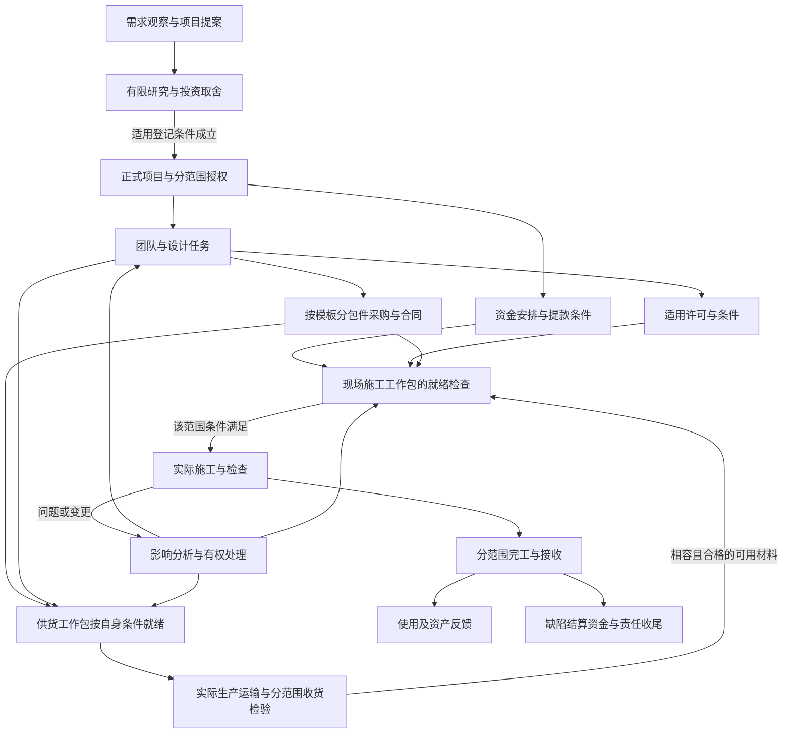

# 项目生命周期与责任绑定

规范性质：目标开发契约。项目模板、业务时间、专业粒度与计算方法按[模型选择](../07_experiments/model_decisions.md)登记，未选项不自动继承实现默认值。

[总入口](../README.md) · [平台运行与环境](../02_world/world_runtime.md) · [共同对象和账本](../02_world/domain_objects.md) · [工程类型与建造方案模板](../02_world/project_types.md) · [主体交接索引](collaboration_flow.md) · [待定选择](../07_experiments/model_decisions.md) · [公共接口协议](../06_engineering/interface_contracts.md) · [系统函数目录](../06_engineering/system_interfaces.md)

本文维护项目及子范围的依赖、放行、责任绑定、等待、异常恢复和关闭条件。各角色规范维护主体的判断与行为；本文引用银行授信、政府许可、专业服务和施工供货等动作，不重写其选择规则。

每个业务步骤还要落实到具体责任主体：写作时说明承担职能的角色，运行时绑定实际 `agent_id`、项目职能及授权范围。第 4 节维护逐步责任与实例绑定；仅写“进行审批”“系统推进”“顾问负责”不足以构成可执行步骤。

<!-- page-nav:start -->
**本页导航**

[1. 项目流程与世界调度的职责](#1-项目流程与世界调度的职责) · [2. 项目状态维度](#2-项目状态维度) · [3. 生命周期的主链与并行关系](#3-生命周期的主链与并行关系)

[4. 推进节点与责任契约](#4-推进节点与责任契约) · [5. 事实驱动的推进流程](#5-事实驱动的推进流程) · [6. 异常、变更与恢复](#6-异常变更与恢复)

[7. 分范围关闭与剩余责任](#7-分范围关闭与剩余责任) · [8. 流程变更与版本控制](#8-流程变更与版本控制) · [9. 推进验收场景](#9-推进验收场景)
<!-- page-nav:end -->

## 1. 项目流程与世界调度的职责

**FLOW-001｜项目是共同业务对象，不增加一个全能智能体。** 各主体提出方案、选择或履约；项目流程检查依赖并形成待办；世界调度给予合法事项执行机会；正式状态入口核验并提交结果。项目流程不能替任何主体同意，也不能凭“需要推进”生成合同、贷款、许可或工程量。

| 要改变什么 | 写在哪一份主文档 | 本文承担什么 |
|---|---|---|
| 主体为什么选择、能选什么 | [八类主体](../README.md#角色规范)的相应主文档 | 引用行为及其输入/结果，不代替主体选择 |
| 工程类型、适用方法与交付模板支持哪些范围 | [工程类型与建造方案模板](../02_world/project_types.md) | 绑定已选模板的实际依赖、责任及适用事项，不另列工程类型目录 |
| 项目何时能继续、等待或回到某项工作 | 本文 | 维护依赖、门槛、受影响范围、后续待办和收尾关系 |
| 时间、环境、多项目调度和全局停止 | [总体框架第 6—7 节](../02_world/world_runtime.md) | 向调度提供待办、阻塞和后续触发 |
| 正式对象、资源、资金和工程记录 | [对象与账本](../02_world/domain_objects.md) | 引用唯一状态和提交入口，不另造项目内的第二套余额/库存 |
| 谁向谁交什么 | [P01—P23 交接索引](collaboration_flow.md) | 用索引检查连接，不把其序号当作项目状态 |

**FLOW-002｜时间推进与业务推进分开。** 项目等待时，业务日历可能继续，报价/许可可能到期，费用和到期义务按有效规则处理；但是没有实际工作投入就不生成对应完成量。模型回复、发出请求和经过一个周期都不能单独证明工程完成。具体日/月/事件粒度由 D-04 选择。

## 2. 项目状态维度

总体阶段用于阅读和汇总。正式执行读取具体范围的任务、成果、合同、许可、资源及义务状态；同一项目可能同时设计、采购和施工。

| 状态维度 | 需要独立表达的内容示例 | 不应自动推出 |
|---|---|---|
| 评估与投资 | 私有评估、有限研究、附条件准备、有效投资授权、项目登记 | 有提案就有正式项目；有投资授权就能全面开工 |
| 委任与合同 | 受邀、报价、有效委任/合同、变更、暂停、终止 | 某方被选中等于全部条款已经生效 |
| 设计与成果 | 编制、提交、检查、允许用途、适用范围与版本 | 设计整体“完成”就适用于每一批采购和施工 |
| 许可与条件 | 各事项/区段的待审、有效、待条件、受限、失效 | 一个许可代替其他事项，或补件自动阻塞全部项目 |
| 融资与付款 | 安排、提款条件、执行、现金、到期义务与清偿 | 有融资安排就有现金；工程完工等于还清贷款 |
| 供应与现场 | 每批物料、每项工作包的就绪、投入、检查、问题和实际结果 | 发货等于到货；到货等于可用；返工等于再次新增净工程量 |
| 接收与责任 | 分范围交付、合法使用、缺陷、结算、剩余义务 | 接收一个区段就结束整个项目及所有合同 |

**FLOW-003｜正式事实组合成阶段视图。** 展示“施工中”可以同时列出“某区段待设计补充、某付款逾期”。阶段汇总是派生结果，不能反过来成为不经检查的放行依据。维度之间依具体事项/工作包相互约束，不是可以任意拼接的自由标签。

**FLOW-017｜每个推进事项带实际地区与适用范围。** 运行节点通过 OBJ-020 关联项目/工作地点、必要时的生产地/路线、相关规则/事项版本，以及有权主体的资格和授权。行政、专业、供货与运输条件分别核对；不能仅因为所有参与者在大湾区内就自动判为相互适用。适用、不适用、未确定和超出研究范围分别返回；缺必要证据只阻塞相关动作，并向具体跟进人生成补齐/改选任务。

### 2.1 总项目与子范围按已选模板分别推进

范围身份和父子归集沿 OBJ-005/006/022：总项目可包含子工程、区段与工作包，单体项目也可不增加中间层。运行读取所选 [建造方案模板](../02_world/project_types.md)的 `profile_id/version` 与支持范围，将下列事项绑定到实际对象；不因一个 building、road、bridge 或 tunnel 标签就加载假定已支持的全套流程。

| 绑定项 | 推进时必须明确什么 |
|---|---|
| 工程范围与方案 | `project_id`、实际 `scope_ref`、物理覆盖、方案/数量/工作包方法及有效版本；父项目和每个子范围所用模板的适用关系 |
| 专业责任 | 哪个受托主体负责编制、整合、核验和用途发布；依任务专业、方法支持、资格与授权绑定，不由工程名称或父项目负责人自动取得 |
| 地点与事项 | 各区段地点、跨区接口和生产/交付路径；每项许可覆盖的范围、行动、时效及有权机关，不以总项目一张许可覆盖全部子项 |
| 实际依赖与接口 | 哪些成果、前序实物、共同系统和衔接证据是本任务必要条件；引用范围树之外的功能/接口依赖和具体版本 |
| 分段与整体交付 | 可单独完成/接收/使用的范围、整体功能条件、剩余工作与责任；所需组合和不适用依据必须由模板给出 |

道路、桥梁等工程不统一强制 Architect 作为方案前置或总设计负责人；相应专业设计/整合可绑定到具备该任务方法、资格和授权的 Engineer 或模板明确支持的专业职能。Architect 仅在实际存在其受托建筑/空间任务时参与；未知专业方法不能通过改角色名假装支持。多专业意见、Owner 的目标/商业取舍、Bank 的融资判断、Government 的事项决定及各合同接受继续独立，模板不把这些权力交给同一“项目总负责人”。

同一总项目可以使用不同子工程模板。相邻或跨区子范围共享接口时，明确接口提供/接收者、当前有效证据和失效影响；某一子工程方案变更，只重查真正依赖该接口的工作。不同模板对同一物理范围或门槛有冲突时返回覆盖冲突，不能默认最后加载者生效，也不能复制工程去满足两份模板。

## 3. 生命周期的主链与并行关系

下面是依赖示意，不是强制线性工作流，也不表示每项活动只出现一次。尚无正式项目时，前期活动关联业主评估档案。

箭头表示可能存在的依赖，具体适用边由项目模板实例化。融资可先于登记开展咨询，顾问可先于完整投资接受有限委任；部分采购可与设计并行，供货/施工按工作包相互衔接。自有资金项目不强制借款，某项不适用的许可须有适用性依据，不能因缺定义默认豁免。

供货任务先按自身规格、订单/工作授权、材料、产能与资金条件推进；不默认等待全部现场许可或施工就绪。随后，实际到货及必要检验提供施工所需的可用材料。图中压缩显示了生产、运输与检验，三者仍是各有条件和用时的工作，分批结果分别触发对应现场任务。

| 工作范围/里程碑 | 本文检查的进入/继续依据 | 成立后的结果与后续接口 | 未成立时 |
|---|---|---|---|
| 前期研究 | 业主有相应研究权限和投入，受托方有效接受适用服务 | 带版本的研究任务/意见 → 投资或补查 | 等待、缩小研究、换候选或结束档案；保留费用 |
| 正式项目登记 | OWN-A03 的有效决定及所选模板登记条件 | 稳定项目身份和来源档案/授权关系 | 仍留档案或附条件准备，不伪造全部权利 |
| 设计/融资/许可事项 | 对应任务授权、输入与适用资格 | 分别产生任务、意见、安排、案件或有效结果 | 仅阻塞依赖该缺项的事项；其他合法任务可继续 |
| 发布采购包 | 该包件范围/版本、发布权限及模板的成熟度条件 | 同轮邀请与独立报价 → 有权评审和接受 | 补资料、改范围、延期或重招；不强选候选 |
| 有效合同与供应承诺 | 对应版本接受、成立条件、资金/资源承诺核对 | 正式义务、参与关系及可追踪承诺 | 返回协商/重新选择；拒绝不遗留假承诺 |
| 工作包开始/续作 | 有效授权、依赖成果/许可、场地、必要投入和限制逐项满足 | 按正式分配与真实投入执行 → 工程/库存事实 | 建立具体阻塞；不填正进度作为保底 |
| 检查认可与分范围交付 | 完成证据、检查权限、接受标准和所需资料 | 对应认可/接收、尾项和适用使用流程 | 保留未检/不合格部分，进入补证/整改/复查 |
| 责任收尾 | 本范围每类义务分别满足其结束依据 | 对应关闭、释放和继续经营 | 列出责任人、未清金额/数量、下次事项，不强制清零 |

各项按实际参与角色的相应 A 行为推进，参与方及次序由 [工程模板](../02_world/project_types.md) 的工程/交付模板以及 D-03/D-06 的职能/采购安排确定；八类角色是平台能力范围，不要求每个工程或局部工作都调用八类主体。通用交接位置查 P01—P23。

## 4. 推进节点与责任契约

**FLOW-004｜节点写成有条件的转移契约。** “完成审批后施工”仍不够具体；应指明哪个事项、哪个区段、哪个动作需要什么证据。不把未知条件或不适用情况硬填成通过。

| 必须写的内容 | 示例：某安装工作包开始执行 |
|---|---|
| 规则/节点身份及版本 | 稳定节点 ID、已选工程/交付与流程模板版本、所属项目、`scope_ref` 及工作包 |
| 触发 | 必要批次到货、用途发布生效、资源可用或获授权恢复等相关事件 |
| 前置事实与版本 | 该工作包要求的前序完成、设计用途、许可条件、场地和材料可用范围 |
| 主体与动作 | 绑定本工作包实际承包商的 `agent_id`、履约职能/授权及 CONTRACTOR-A07；已有有效安排则按既定授权执行 |
| 分工与交接 | 分别写发起、跟进、执行、有权决定、核验及接收结果的主体；详见下述责任契约，不以 Contractor 标签代替实际当事方 |
| 可选择空间 | 在允许范围安排投入、调整合法次序、请求补齐或等待；不能选择“忽略必要许可” |
| 核心就绪检查 | 投入相容、同一时段资源不超配、对象仍有效、无覆盖该范围的禁止状态 |
| 时间与消耗 | 采用选定工作包模型的持续时间/投入和单位；报价总工期不能直接变成实际增量 |
| 成立后的正式变化 | 任务执行记录、实际资源/材料消耗、工程计算结果及事件；开始不等于完成 |
| 条件不满足的结果 | 阻塞对象、缺什么、负责补齐者、可继续部分和下一触发 |
| 重复/失败处理 | 稳定业务标识和提交记录；响应未知先核对，避免二次消耗或生成工程量 |
| 后续与验收 | 哪项检查/计量/交付可以得到新输入；覆盖正常、缺料、版本变化和重复事件 |

节点实现须按[实现契约](../06_engineering/implementation_contracts.md)补齐正式类型、单位、动作枚举、条件表达式、代码入口和可执行测试。节点定义不直接成为执行配置；业务判断仍由对应角色负责，不在节点中复制角色偏好或提示词。

### 4.1 主体、职能与授权层级

**FLOW-013｜角色、实例与职能逐层落实。** 角色文档定义一类主体能做什么，项目责任表定义某一步需要什么职能，运行中的任务引用实际承担者。银行 A 与银行 B 不能因同为 Bank 就互换客户报价、借款安排或私有信息；总包自己的 Supplier 也不自动成为业主的直接合同相对方。

| 层次 | 需要写清什么 | 示例的含义 |
|---|---|---|
| 角色模板 | Owner、Bank、Architect 等与具体 A 行为 | “Bank 核验提款条件”只说明行为种类 |
| 项目职能/当事方 | 哪项服务、合同、许可事项或融资安排中的哪个职能 | “该融资安排的贷款人”限定候选来源；不是所有银行 |
| 具体主体实例 | 实际 `agent_id`、组织引用、有效任务/职能授权 | 绑定获得该项职责的具体银行智能体；名称只是显示标签 |
| 具体任务与权限 | 哪个项目/档案、区段/批次、版本、金额/时间范围及有效期 | 同一家机构不因此获得该项目所有核验和决定权 |

基础模型以企业/机构为主体，任务绑定到**具体智能体及其授权职能**，不自动增加每家企业内部的经理、设计人员或审批人员智能体。若研究确实需要个人层级，再在 D-03 明确人员身份、组织授权、资源与信息边界；人员资源可以建模，不必每个人都另建决策智能体。

**FLOW-014｜一个粗步骤拆成多个责任明确的任务。** “融资”“审批”“付款”等是工作范围，内部包含多个不同主体的决定。不要为了给整个范围填一个负责人，就把对方的权力也交给他；每个原子业务任务分别记录以下职责。

| 责任位置 | 该主体承担什么 | 不能据此取得什么权力 |
|---|---|---|
| 发起方 | 提出申请、请求、提案或问题；事件自动触发时记录事件来源 | 发起不等于对方受理、接受或批准 |
| 跟进负责方 | 跟踪当前待办、接收阻塞通知、组织本权限内的下一动作 | 不是所有问题的最终决定者，也不因此承担他方债务或新增法律责任 |
| 执行/编制方 | 完成明确任务、提供成果或组织实际投入 | 执行者自报不自动等于有权核验通过 |
| 有权决定方 | 对明确的决定类型、对象和范围作独立选择 | 不能从“负责项目”推导出授信、许可或任意合同变更权 |
| 核验/接收方 | 按自己的职能检查证据或接受交付范围 | 专业核验、合同接受和法定许可分别表达，互不替代 |
| 结果接收方 | 在权限范围收到结果，并在满足触发条件后办理下一任务 | 收到通知不自动接受新条款，也不获得全部底层私有资料 |
| 正式提交入口 | 核心检查并更新对应正式对象，留存业务决定和事实来源 | 技术入口不是新增业务主体，不代以上各方作选择 |

不是每项任务都需要七个不同主体，也不是每步都要另设审批人。可合并的职能应有依据；独立性要求适用时不得兼任。多方签约分别记录各自接受；行政决定按有权机关及适用程序生效，不能要求被监管方同意才算数。

### 4.2 从责任表绑定到运行任务

**FLOW-015｜分派先核对身份与权限，提交时再核对有效性。** 以下是任务责任的最小语义字段；业务对象复用 OBJ-002/006/009，不预定数据库结构。

| 字段组 | 最小内容 | 用途 |
|---|---|---|
| 节点与对象 | `node_instance_id`、工程/交付与流程模板版本、`scope_ref`（组织业务、前期档案或项目）、事项/工作包/合同及作用范围 | 确定究竟是哪一个任务，不能只有阶段名称；单体项目可直接引用项目范围 |
| 触发与跟进 | `trigger_ref`、适用时的 `initiator_agent_id`、本任务 `followup_agent_id` | 自动触发可无业务发起人，但来源与后续处理归属仍可追踪 |
| 执行绑定 | `executor_bindings`：主体 ID、职能、任务范围、所需能力和资源引用 | 多执行方拆分可归责工作；不凭多个名字虚增资源 |
| 决定绑定 | `decision_bindings`：决定类型、有权主体 ID、授权依据、对象范围及必要接受关系 | 分开客户取舍、技术核验、核证、许可和商业接受 |
| 核验与接收 | `verification_bindings`、`recipient_bindings`、职能及可见范围 | 可不适用但要写明依据；不把接收一封通知当核验完成 |
| 依据与有效性 | 合同/委任/岗位/法定权限引用、版本、适用期间、候选/待确认/有效/暂停/结束状态 | 分派记录本身不授予权力，角色标签不能替代资格 |
| 阻塞与接续 | `blocked_by`、具体 `response_agent_id` 或待分派职能、下一触发、升级路径 | 等谁补什么；跟进负责方与负责补件者可以不同 |
| 提交与轨迹 | 正式提交入口、原业务标识、责任绑定版本、原/新承担者及交接记录 | 拒绝、换人或重试不丢失历史，不冒用旧权限 |

每条绑定还须具有 `binding_id/revision`、职责槽位 `binding_slot`、决定/工作类型和适用范围。排他的槽位在同一有效窗口只能有一个承担者；共同执行拆成可归责的子任务，各自核对资源，不能只列多个名字。业务对手按 OBJ-002 区分实际智能体与外部对手；外部过程另引执行机制和内部跟进人，不向虚构的 `agent_id` 派发决定。

节点完成条件须逐项引用必要的决定槽位和证据版本，显式写出“全部需要”或有依据的替代路径。商业接受、技术核验及法定许可分别判断，不采用“任一 accepted=true 即完成”，也不要求所有列名者都作商业接受。模板未定义必要组合时标记配置缺口，只限制依赖该组合的动作。旧绑定迟到的建议/决定保留历史且不能自动满足新绑定；已实际发生结果按 OBJ-012 核对，不因换人直接删除。

还未选中供应商、未找到有权机关或未委任核验人时，任务可以保留“待分派”，但不能以空 ID 或随便挑选同角色主体执行。由已明确的发起/采购/申请职能负责形成选择、查询或补齐任务；该职能自身缺失时把配置缺口报告给运行方，不虚构业务身份，不阻塞其他独立合法工作。

依法或按模板分派机构任务，与需要商业接受的外部委任分别检查；不能将给对方发送任务直接当成对方承诺提供服务。尚未签订合同的投标、咨询和主体自有研究，只需其各自适用的有效授权，不强制先虚构后期合同。

**FLOW-016｜责任随有效交接变化，历史不随名字改写。** 换承包商、顾问或贷款安排时，重新核对任务范围、资格、资源、授权及未结事项；已完成工作的作者、原决定者和债务人保留。新承担者收到移交不等于自动接收所有旧责任、私有记忆或未被转移的权利。

### 4.3 示例：把“申请并执行提款”拆到具体主体

下表只演示分工；所有名称/ID 均为说明用占位值，不是真实机构或已创建主体。假设 `owner_01` 是该安排的借款方，`bank_02` 是安排中已经绑定的银行，款项支付到借款方账户；是否采用该产品、直接支付或其他路径仍由模板决定。

| 子步骤 | 发起/当前跟进 | 实际执行或独立决定 | 明确结果及下一接收者 |
|---|---|---|---|
| 提出本批提款 | `owner_01` | `owner_01` 依据 OWN-A06 提交安排、用途及证据 | 提款申请 → `bank_02`；提交不是到账 |
| 核对本批条件 | `bank_02` 跟进本行任务 | `bank_02` 依据 BANK-A06 核验本安排的条件/额度及可见证据 | 批准、部分批准、补件或拒绝 → `owner_01`；不读取其他银行的私有判断 |
| 条件缺项时补证 | `owner_01` 跟进借款方响应 | 由该证据任务真正有权的主体提供材料；需要 QS/Engineer 时绑定已获相应委任的具体 ID | 原问题的版本回应 → `bank_02`；材料不是由系统假装顾问已签发 |
| 再核验并给批次结果 | `bank_02` | `bank_02` 独立核验新证据和当前正式状态 | 对应批次决定 → 借款方及银行执行待办；不每次补件新建一整笔贷款 |
| 执行已有效批准范围 | `bank_02` 跟进执行/核对 | `bank_02` 的 BANK-A07 或既有有效授权下执行；核心处理实际资金与债务 | 实付、部分、失败或未知结果 → 相关当事方；未知先查原交易 |
| 接收结果与后续安排 | `owner_01` 跟进自身资金计划 | 借款方读取正式到账/债务；下游付款仍使用实际债权人和相应授权 | 更新自己的付款待办；贷款入账不等于已经支付工程款 |

即使只涉及两个企业智能体，也包含申请、审查、补证、决定、执行与接收等不同责任。未决期间银行和业主各自继续其他合法任务；银行不同意时由借款方决定调整、等待或退出，核心不能代替双方完成融资。

### 4.4 P01—P23 的逐步责任表

本表维护 P01—P23 各交接范围的责任绑定；每行可包含多个独立决定、执行和核验节点，不设置贯穿整行的唯一批准者。表中角色必须进一步解析为实际任务配置。
演示关系为：在包含受托建筑设计的项目中，业主分别委任建筑师、工程师及 QS，总包采购供应，银行融资可选，政府按具体事项参与。该说明不预设统一采购基准，也不适用于所有工程对象；道路、桥梁等按第 2.1 节绑定实际专业职责，其他采购模式须替换真实委托、合同、付款及授权关系。
表中的角色在运行时必须绑定“具体 agent_id＋该项目/事项中的职能＋有效授权”；多名工程师、多家供应商、多家银行或多个机关按专业/包件/事项分别绑定，不只写一个角色名称。暂未绑定时保留“待委任/待确定”及跟进方，不能自动交给任意同角色主体。
这里具体到组织或机构智能体，不新增企业内部自然人智能体；组织内分工可作为资源和授权记录。业务责任方不等于状态直接写入者：正式工程、资金、资源及许可事实均经各自核心入口校验提交。

| 交接范围 | 发起/跟进责任方 | 实际执行/编制方 | 独立决定或核验方 | 结果交给谁；阻塞由谁接续 |
|---|---|---|---|---|
| P01 需求与条件变化 | 世界更新机制维护已选数据路径；各 Owner 负责自己的观察（OWN-A01） | 系统按来源/场景更新地区用途指标并投影可见信息；有权机构仅处理自身政策事项 | 系统检查口径/版本；Owner 独立判断信号是否值得行动，不能批准或改写市场总需求 | 发给各有权观察主体；数据缺口由已指定的数据/场景维护入口处理，Owner 自行决定调查或等待 |
| P02 提案与机会评估 | 各 Owner 跟进自己的评估档案（OWN-A01/A16） | Owner 提出目的、地区、规模和期望时间，编制私有候选及依据 | Owner 在自身投资/研究权限内选择跟踪、研究、修改或不参与；权利归属仍由权利程序确定 | 交本业主投资/研究待办；缺权利或信息由本业主请求相应有权来源，不删除其他业主档案 |
| P03 前期需求与咨询 | 实际委托方发出有限任务并跟进缺项；演示为 Owner（OWN-A02） | Architect/Engineer/QS/Supplier 各按 A13 编制自身意见；需要时 Bank/Contractor 提供有限咨询 | 各服务方独立决定是否承接；本专业有权核查者只核查自身范围，咨询机关 GOV-A01 只给适用性意见 | 各方交委托方及获授权专业接收者；缺项回具体资料提供者，扩大研究由有权委托方决定 |
| P04 可行性比较 | Owner 跟进同版方案及未决问题（OWN-A03） | QS 编成本比较，Architect/Engineer 编专业依据，Supplier 提供限定供应资料；汇总者须获明确委任 | 各专业意见独立；Owner 作商业/使用/公共目标取舍，Bank 只判断自己的融资意见 | 比较结果交 Owner；技术冲突回对应作者，商业冲突由 Owner 调整目标或等待，不以多数投票代替专业条件 |
| P05 投资授权 | Owner 提出并跟进投资事项（OWN-A03） | Owner 准备选择、风险、资金时序与范围；受托方只提交相应支持材料 | 具备该投资/预算权限的具体主体作决定；其他适用批准若模板要求则另设节点 | 交项目登记入口及获授权后续负责人；未满足登记条件仍由 Owner 处理评估/附条件准备，不生成全面开工权 |
| P06 采购安排 | 有权采购方跟进；演示中 Owner 决定项目采购组织，Contractor 决定其受权下游采购（OWN-A04；CONTRACTOR-A05） | 采购方编责任/包件安排，QS 与专业方按委任提供计价和技术范围 | 对应采购权限主体确认安排；顾问意见不自动改变雇主、设计责任或既有合同 | 交各包件采购负责人及拟受托方；职责缺口由该采购方补委任或调整模板，不强制 Owner 包办下游 |
| P07 专业委任 | 真实雇主发起选择并跟进；演示为 Owner（OWN-A04） | 各专业方 A02 编服务报价/范围，双方核对最终版本 | 雇主决定选择；每家专业方独立接受本方委任（A03），资格/独立性按相应条件核验 | 交具体受托 agent 的任务入口；无人接受由雇主调整/重选，顾问不被单方强行委任 |
| P08 融资安排与执行 | 实际借款人跟进申请、条款接受与提款；每家 Bank 跟进自己的申请/批次（OWN-A05/A06；BANK-A02—07） | 借款人编申请/条件证据；Bank 执行本行审查与授权指令，系统执行核对现金/债务记录 | Bank 独立决定报价及提款；借款人独立决定接受哪一版；专业证据提供者不代替银行审批 | 报价/条件交借款人，证据缺项交指定提供者；资金交真实受益人，未知执行由指令/核对责任方沿原标识处理 |
| P09 设计与成本计划 | 各受托专业方跟进自己的任务；仅明确受委任者协调跨专业接口 | 按模板选择实际需要的 Architect A04—09、Engineer A04—09、QS A04，分别编其受托专业成果及修订 | 获授权专业核查者检查；Owner 作需求/商业取舍；用途发布者及必要签署者另按权限绑定 | 交授权接收者及相应采购/许可任务；问题回具体作者/资料方，Architect 无默认全部协调与批准权 |
| P10 规划与法定事项 | 合法申请人或获授权代理跟进提交/补件（OWN-A08）；具体机关跟进本案处理 | 申请方组织材料，具相应资格/授权的专业方编制/签署；Government GOV-A02—06 办理本案 | 具有该辖区及事项签发权的 Government 作 GOV-A07—09 决定/核验；征询方不自动取代签发方 | 决定交合法申请人和有权执行方；补件由申请人协调具体作者，审查待办由该机关续办，不默认由 Owner 解决机关排队 |
| P11 采购准备 | 对应包件采购方跟进；演示中工程招标由 Owner、供货询价由 Contractor 组织 | 受托 QS A05 编量价资料，Architect/Engineer 提供适用技术版本；采购方整包发布 | 有权采购人确认发布范围/程序；专业方只核验受托内容，许可仍由相应机关处理 | 交合法候选与评审方；资料不足回原编制者，发布/延期/修订由该采购方决定 |
| P12 独立投标与评审 | 采购方跟进轮次；每个投标人跟进自身投标 | Contractor A01—03 或 Supplier A01—03 独立编报价；QS A06 及有权专业方分别评审 | 投标人独立决定投/改/撤；评审方按权限核实或排除，采购方作选择；推荐不等于授标 | 评价交采购方，澄清交对应投标人；零有效候选由采购方决定调整/重招/等待，不强选或代填接受 |
| P13 合同形成 | 每一对真实合同当事方分别跟进本方条款接受 | 当事方核对最终范围/价格/期限/条件；核心校验身份、授权与共享承诺 | 各当事方独立有效接受；Owner—Contractor、Contractor—Supplier、顾问委任分别成约 | 交双方履约负责人及共同账本；版本失配回当事方，资源冲突回承担该承诺的主体重排，不自动改选 |
| P14 供应、制造与物流 | Contractor 跟进所订批次与接收窗口；每个 Supplier 跟进自身订单（CONTRACTOR-A05；SUPPLIER-A04—09） | Supplier 自产或组织真实上游采购/运输；运输外部机制须明确；Contractor 或授权接收方实际收货 | Supplier 自检与客户/独立检验分开；Engineer/Architect 仅核验获委任的技术接口，采购方决定有权商业变更 | 批次、证据及实收交接收方/库存入口；生产缺料由 Supplier 跟进，接收/替代问题由采购方协调具体专业和现场方 |
| P15 施工准备与放行 | Contractor 跟进具体工作包就绪（CONTRACTOR-A06） | Contractor 安排人机料场和提交证据；Owner、专业方、Government 仅提供各自有权完成的前置 | 对应许可/技术/合同有权方分别作自己的决定；核心就绪入口核对全部适用条件，不能由 Contractor 自报完成覆盖 | 合法就绪范围交 Contractor 执行；缺什么回该前置责任方，现场接续由 Contractor 跟进，独立工作包不无故等待 |
| P16 持续施工与管理 | Contractor 跟进施工；设计、变更、付款、融资及监管事项各有自己的跟进方 | Contractor A07—10、Supplier 依订单履约；专业方处理受托问题，核心按实际投入计算工程结果 | 工程核验、Owner 权限内商业指令、QS 有权核证、Bank 条件核验、Government 监管各自决定 | 工程/批次交检查计量，问题交具体有权处理者；承包商协调现场依赖，不统一替其他角色批准或清偿 |
| P17 完工检查与测试 | Contractor 发起分范围报验并跟进资料/整改（CONTRACTOR-A11）；Supplier 跟进自身设备/产品配合 | Contractor/Supplier 提交实际完成和试验依据；Engineer/Architect 按委任执行检查或复核 | 具相应范围的核验者作技术结论；合同接受另由有权接收者决定，作者自报不代替独立核验 | 交合同接收/使用申请负责人；缺证回资料方，不合格回实际责任方整改，再交原有权核验流程 |
| P18 法定使用条件 | 合法申请人/代理跟进使用申请；具体机关跟进受理和决定 | 申请方组织竣工/试验证据，专业签署方按权限编制；Government GOV-A11 处理事项 | 具有本辖区、用途和事项权限的机关决定；Owner 接收不代替使用决定 | 决定与持续条件交申请人/合法使用方；补件回具体作者、待审由机关续办，不默认所有项目适用同一许可 |
| P19 移交接管 | Contractor 跟进合同交付，实际资产/资料接收方跟进接管；演示为 Owner（OWN-A12） | Contractor、Supplier 和专业方提交各自实物、有效资料及剩余责任清单 | 具接收权限的主体按范围接受；技术、法定使用与资产接收各自成立 | 交真实资产持有/使用接口及残余责任方；缺项回相应交付人，有条件接受保留具体责任，不自动清账 |
| P20 缺陷与保证 | 合法通知人提出问题；对应合同责任方跟进处理，不能一概交 Owner | Contractor/Supplier 按有效义务整改，专业方承担其获委任设计修订/复查工作 | 技术关闭由有权检查者决定；费用/责任由合同授权主体或明确争议机制处理，Government 只管其职责事项 | 处理证据交检查/接收方；责任争议交适用决定者，整改未通过由责任方继续，离场不抹除义务 |
| P21 最终计价与争议 | 每份合同的双方分别跟进账目/主张；受托 QS 跟进其计价任务（QS-A09） | Contractor、Supplier、顾问各编自身结算资料；QS 仅在委任范围核对量价及差额 | 双方按条款接受，或由具有明确权限的决定者处理；QS 报告、核证和法律裁决不同 | 确定范围交实际债务人/债权人及资金入口；未决项交具体争议责任节点，不统一挂给业主或 QS |
| P22 支付与义务解除 | 每笔义务的实际付款方跟进清偿、收款方跟进核对；借款人与 Bank 各跟进贷款事项 | 有权主体发资金指令，系统按实际执行记账；Bank A09—11 处理其债务/承诺核对 | 付款授权者、有权核证者及收款核对者各管自己的环节；银行直付另关联借款人和交易义务 | 结果交真实双方及共同账本；不足由实际付款方处理，未知由执行核对责任方续办；不能总从 Owner 账户划款 |
| P23 归档与后续经营 | 八类主体各自跟进本组织资料、剩余责任与后续经营；系统负责运行汇总 | 各主体整理获授权业务记录/私有认知；系统保存正式事件、指标及声明范围内快照 | 各有权责任方确认自己范围的关闭；系统只检查一致性与运行停止条件，不替合同当事方免责 | 私有经验留在各主体；残余事项保留具体责任人；运行汇总交用户/分析入口，不因归档结束其他主体业务 |

本表覆盖交接范围；每个实际任务继续按第 4.2 节绑定具体实例，不能把一行涉及的多方独立决定合并。建筑师协调权、工程师职能、QS 核证权、机关辖区，以及每份合同的债务人和收款人都需显式绑定；未建模的有权外部参与方保留接口/未覆盖说明，不临时给现有角色扩权。

### 4.5 责任表怎样接入有类型的函数

P01—P23逐步责任不等于程序已接线。每一步的生产者、正式数据、消费者及失败去向按[接口接线表](collaboration_flow.md#8-p01p23-的接口接线表)登记；所有目标函数和输入输出类型在[系统接口目录](../06_engineering/system_interfaces.md)维护，角色动作仍在对应角色主文档。

节点执行顺序为：读取同一版本和权限下的前置 → 按明确字段绑定生成角色Input → 取得有类型输出或执行已有授权的例行工作 → 对应领域prepare → 统一提交 → 获得正式对象/事件引用 → 向有权消费者投影并唤醒后续任务。prepare返回的拟变化、模型的“已完成”文本和发送成功都不能满足下一个节点的事实前置。

同一节点可拆成多个命令。例如P09分别包含成果编制保存、提交审查、专业结论和用途放行；每一步都有自己的输入、权限、版本和幂等身份。业务语义、角色schema和系统schema异名时，必须使用[显式类型投影](../06_engineering/system_interfaces.md#91-正式对象与角色-input-的显式投影)，不得由下游LLM猜字段或给缺失工程量填默认值。缺字段、方法不支持、业务不满足与技术未知分别返回相应处理；只有真正改变依赖的事实才唤醒相关任务。

## 5. 事实驱动的推进流程

**FLOW-005｜事实变化触发重新判断，不按阶段编号自动加一。** 项目登记、资料到达、材料交付、资源释放、款项执行、规则生效和期限到达，都可能触发相关待办。无变化时可以等待已登记事件或到期检视，不要求八类角色每期全部发言。

1. 读取已提交项目状态和当前适用规则，定位变化影响的事项/工作包，避免每次重置整个项目。
2. 检查依赖，形成“可处理、缺条件、需新决定、已有授权可执行”的待办；可处理不等于已取得共享资源。
3. 把待办和资源/时间需求交给世界调度；跨项目争用由共同规则处理，不由单项目先占全部产能。
4. 需要主体判断时，生成有权限和截止时点的上下文并引用角色契约；已有授权的例行活动进入相应执行入口。
5. 形成新承诺或派发执行前，重查版本、权限、有效决定及实时资源/资金条件；按共同一致性边界提交。已发生结果的核对使用 OBJ-012 的原执行/证据入口，不用当前失效条件抹去历史事实。拒绝、冲突和技术失败分别保留。
6. 实际执行按所选计算/履约机制产生正式后果；向有权接收者提供观察，更新依赖事项和下一触发。
7. 重算可解释的里程碑/阶段视图，保留未决事项。是否当期继续处理新触发事项由 D-04 决定，不无限递归推进。

**FLOW-006｜并行和同步点按实际范围定义。** 互不依赖的任务可以并行；确实需要多项输入的任务应等待全部适用条件。任何条件组合包含明确“全部需要/可选路径/不适用依据”，不能用一个平均完成分数抵消必要条件。

例如 A 区材料已验收且其他必要条件齐备，B 区设计仍待补充，则可推进 A 的合法工作。若 A 的安全或结构前置实际依赖 B，则 A 仍应等待；给工作改个区段名字不能消除依赖。工程付款和贷款偿还也按各自条件并行，不以施工阶段决定它们是否存在。

实际执行增量先落到 OBJ-006 的最小可计量叶范围，再更新其祖先的派生视图；父节点没有另一次生产/安装动作。若父范围显示仍未完成，不能重新执行已完成子范围来提高父进度。公共任务、跨范围资源和多包件合同仍核对同一底层身份；范围树调整不改变已发生投入及真实债务人。

## 6. 异常、变更与恢复

**FLOW-007｜等待必须可定位、可唤醒。** 每个阻塞保留对象/版本、原因、负责方、所需结果、下次触发、适用期限、当前资源去向及可继续范围。无权保证对方必响应；相互依赖形成循环时暴露给有权主体调整，不能自动批准或生成缺失投入。

| 情形 | 流程做什么 | 不能默认发生 |
|---|---|---|
| 输入缺失/未核实 | 建补充或调查待办；有权方提供证据后重查依赖 | 未知当零、当不适用或当通过 |
| 拒贷、拒单或零有效投标 | 把结果交原有权决策方，允许调整/等待/新轮次/退出 | 自动挑选空候选、无依据切自有资金或替对方同意 |
| 同期资源冲突 | 保留未提交选择及冲突原因，按共同机制重新安排 | 按容器遍历顺序暗中选赢家，或静默改选另一家 |
| 设计/规格/合同变化 | 建影响关系，重查受影响任务、用途、许可、采购及报价 | 全项目回到起点，或所有旧依据一律继续有效 |
| 质量问题/未通过复查 | 记录范围、整改与复检任务，按权限限制相应工作 | 用一条回复、整改计划或风险分下降代替实际修复 |
| 付款迟延或执行未知 | 迟延保留真实义务及合同后果；未知核对原执行 | 立即再付、自动免债或自动令全部现场停工 |
| 合法暂停 | 指定范围和生效依据，保留保护/保管、费用及义务，按规则安排资源 | 所有资源自动释放，或一直免费永久占用 |
| 恢复或换人接续 | 重核当前资源、资金、版本、许可与剩余范围，正式交接 | 召回即刻到位、接续方再次计入前任已完工程 |
| 终止 | 结束获授权的新工作，建立资产/材料、合同、欠款和责任处理事项 | 删除历史或一键清空账本 |

**FLOW-008｜回退表示重新打开受影响工作，不是倒带事实。** 修订设计可以重新开启某项分析和许可核查；已经完成的施工、已发生费用、已付款项和原决定继续留痕。需要拆除、退款或撤销时各有相应有效依据及新事件，不改写过去为“从未发生”。

**FLOW-009｜业务失败与技术失败分开。** 受限选择明确拒绝是业务结果；超时、预算不足、解析失败或提交响应丢失是技术状态。没有有效决定时不提交旧 Proposal 的条款；未知执行先核实原业务。一次周期失败不承诺全项目自动回滚，恢复边界见共同对象及平台调度。

**FLOW-018｜新采购轮次明确旧轮次的效力。** 新轮次引用原轮次、采购包及覆盖范围，注明替代、修订续办或模板允许的并行采购。替代性重招由包件有权采购方提交原轮次处置决定，明确停止接受新投标/授标的范围和时点、未决报价/选择状态、通知对象及可按原依据释放的临时预留；不能仅靠新 ID 隐式清理旧轮。

新承诺提交时核对轮次仍可授标，并检查同一采购范围已经形成的有效承诺；允许多家分配时记各自数量/份额，不把完整需求重复授予。旧轮已成立合同、已发生投标准备成本和执行未知分别保留；需终止或转移时另走合同的有权程序。迟到旧报价/接受保存来源，不自动满足新轮条件，也不能在已结束授标的范围内形成新合同；发现关闭前已成立的合同仍须记录，不能凭当前状态抹去事实。

## 7. 分范围关闭与剩余责任

**FLOW-010｜关闭按对象和责任范围分别判断。** 使用下面的关闭向量，由模板决定何时形成汇总标签。不是所有项目都有全部事项；缺失定义不能假装已经满足。

| 维度 | 关闭/阶段结束的证据 | 仍可能继续的内容 |
|---|---|---|
| 工程工作 | 本范围完成、检查和认可条件成立 | 其他区段、未决问题、合同责任 |
| 使用及接收 | 适用使用条件与实际接收分别成立 | 持续监管、运营、资产持有 |
| 缺陷/保证 | 明确范围的有效结束依据，已成立事项已处理或有合法接续 | 超出本范围的历史责任，不自行推定免责 |
| 合同计价 | 有权确定对应最终账目，争议范围单列 | 已确定但未实际支付的款项 |
| 资金与融资 | 相应义务清偿/有效处理、在途核清、承诺按条款关闭 | 其他合同或组织层债务 |
| 资源与资料 | 不再需要的占用已释放，保管/移交有责任方和依据 | 合法持续义务下的必要任务 |

可以表达“工程已交付、资金未结”，不能把它压成完全成功或完全失败。项目终止后也可以处于责任处理中；整个世界仍按其他主体、项目和义务继续运行。

局部完工、局部接收、局部可使用和总体功能可用分别判断。按所选模板，一条走廊两端道路已完成，但桥梁及其连接接口仍是通行前置时，不能以道路完成率或已交付区段数量判全线可用；如果某范围确实满足独立使用条件，可以仅发布该范围的结果。上述是依赖例，不预定任何现实线路的法定条件或通行标准。

父项目的工程汇总读取子范围事实，整体使用还要核对有效功能接口、共同前置、适用事项和接收证据；不能取“任一子项完成”，也不能未看模板就强制所有子项相同终态。暂停、取消或变更部分范围时，有权主体须明确整体目标和功能依赖怎样调整；删除一个未完子项不能自动使原有目标成为已实现。各范围工程事实、许可效力、合同款项和缺陷责任仍有各自的结束依据。

**FLOW-011｜观察期截止保留真实状态。** 仿真到期时输出各维度、阻塞原因、未完成量、到期与未清义务、责任人和待处理事件。不为了画完整链条强制完工；完工项目之外的延期、退出、失败和未成熟结果也进入适用分析口径。

## 8. 流程变更与版本控制

例如要允许“某批合格材料先支撑独立区段施工”，修改的不是一句总体阶段名称：

1. 在本文节点/依赖规则中明确区段、批次和必要前置，补部分可执行、共同依赖不成立及重复到货的预期。
2. 在 Supplier/Contractor 主文档核对分批承诺、检验接收与实际施工行为；在 OBJ-006/010 核对批次、资源和数量语义。
3. 如果改变当期处理顺序或资源竞争，还要更新总体框架及 D-04/D-05；如果只改变一项任务的前置关系，不重写全世界调度。
4. 更新交接索引指向与影响说明，固定准备实现的模板/规则版本，再修改相应代码与验证。

**FLOW-012｜规则版本不静默替换运行中的项目。** 运行记录所用流程、场景和对象版本。修改 MD 不自动改变平台或既有实验；若允许运行中变更，需明确生效范围、未完成任务迁移、旧承诺及可重复性影响。尚未设计该机制时，不把“重载文件”当成已支持能力。

## 9. 推进验收场景

| 编号 | 场景 | 预期 |
|---|---|---|
| CHECK-FLOW-001 | 无正式项目但有限研究获授权 | 关联评估档案和真实任务/义务，不提前登记施工项目 |
| CHECK-FLOW-002 | 经过一个周期但必要投入仍未到位 | 日历及适用到期事项可变化，对应实际工程量不凭时间增长 |
| CHECK-FLOW-003 | A 区条件齐备，独立 B 区待补设计 | 按实际依赖只阻塞 B；若存在共同前置则准确阻塞受影响范围 |
| CHECK-FLOW-004 | 全部投标人拒绝或无有效候选 | 有等待、调整、重招/退出接口，无虚假合同和资源占用 |
| CHECK-FLOW-005 | 主体已选择，但提交前资源被另一项目占用 | 重新核对并返回冲突，不以旧快照提交超配 |
| CHECK-FLOW-006 | 某设计版本变化但其他成果仍适用 | 只重开受影响关系，同时防止失效版本继续用于下游 |
| CHECK-FLOW-007 | 整改重复完成通知或支付执行重试 | 原业务只记一次正式后果，不重复进度、消耗或清偿 |
| CHECK-FLOW-008 | A 等 B，B 又等 A，当前无合法解锁路径 | 报告依赖、责任人与可选处理，不靠自动通过解锁 |
| CHECK-FLOW-009 | 暂停后恢复时原队伍不再可用 | 重排并重查条件，保留保护和剩余义务，不瞬时召回 |
| CHECK-FLOW-010 | 局部工作退回且原付款已经执行 | 原事实保留，修订/返工/资金更正分别有依据 |
| CHECK-FLOW-011 | 工程接收后仍欠工程款和银行贷款 | 工程视图可结束，资金任务继续，不把项目完成当成清偿 |
| CHECK-FLOW-012 | 技术超时或响应未知但无有效拒绝 | 保留技术待办、核对正式结果，不伪造业务选择 |
| CHECK-FLOW-013 | 运行截止仍有在途、未决许可及缺陷 | 输出截点真实状态，主体和项目不被强制全部关闭 |
| CHECK-FLOW-014 | 修改 MD 后查询旧运行结果 | 旧运行规则及结果保持可追溯，不自动套用新流程 |
| CHECK-FLOW-015 | 两家银行同时存在，提款属于其中一家安排 | 按安排和具体实例绑定交给正确银行，不随机找一个 Bank 或混用报价/认知 |
| CHECK-FLOW-016 | 已生成核验任务但未委任具有所需权限的主体 | 保留待分派和补齐责任，不给任意同角色主体授权 |
| CHECK-FLOW-017 | 给供应商发送工作分派但尚未形成所需有效接受 | 请求与正式履约任务分开，不把分派记录当合同 |
| CHECK-FLOW-018 | 同一 Engineer 被指定编制和要求独立的复核 | 按适用独立性依据核验，不能凭填写两格或新建 ID 绕过 |
| CHECK-FLOW-019 | 施工由新承包商接续，原承包商仍有欠款 | 更新有效范围的任务绑定，保留历史工程作者和原未转移债务 |
| CHECK-FLOW-020 | 任务跟进人同时收到付款和许可阻塞通知 | 跟进人组织有权续办，不自行付他人款或替政府批准 |
| CHECK-FLOW-021 | 自动触发许可到期或已授权例行付款 | 来源、业务授权/责任及核心入口明确，不虚构一个必须发言的新智能体 |
| CHECK-FLOW-022 | QS 已核实但合同一方拒绝，或双方接受但必要核验证据尚缺 | 逐槽位满足模板条件；QS 不被当成商业签约方，也不由一条接受跳过其余条件 |
| CHECK-FLOW-023 | 排他责任槽位出现两个重叠有效承担者，或换人后收到旧决定 | 报告绑定冲突；旧决定不自动完成新任务，历史实际结果另走核对入口 |
| CHECK-FLOW-024 | 湾区内参与方来自不同城市且项目/生产/交付地不同 | 按具体事项、动作和地区依据核对，不能因同属湾区默认全部互认；未确定只限制依赖范围 |
| CHECK-FLOW-025 | 排他采购 10 件，R2 替代 R1 并已签 10 件，R1 接受迟到 | 不新增旧轮合同；临时预留按处置依据处理，已发生投标成本保留 |
| CHECK-FLOW-026 | R1 关闭后才核实其关闭前已成立合同 | 保留事实并阻止未授权重复授予，交有权方处理，不直接删除原合同 |
| CHECK-FLOW-027 | 模板允许两个轮次并行分配同一包件 | 记录并行依据及各自非重叠数量/范围；两轮不能各自全额占用同一排他需求 |
| CHECK-FLOW-028 | 道路或桥梁模板没有建筑设计任务 | 绑定获授权且方法受支持的相应专业职能，不强制等待 Architect；必要专业未覆盖则返回具体缺项 |
| CHECK-FLOW-029 | 总项目含多个地区区段，一处许可尚未成立 | 仅按真实范围及功能依赖阻塞相关动作，不能用另一地区许可替代，也不无依据阻塞独立工作 |
| CHECK-FLOW-030 | 两端道路已完成，但模板要求的桥梁/连接接口未满足 | 可保留道路完工事实，整体通行仍未成立；允许独立使用的子范围另按本范围条件判断 |
| CHECK-FLOW-031 | 子范围实际工作完成，父视图未完成或范围树随后调整 | 汇总唯一原始执行并重查依赖，不重做子工程、不重复投入；删除未完项不自动达成原目标 |

以上为目标验收预期，执行证据另行登记。项目/采购/地区模板、具体门槛依据、时间与竞争机制、工作包及计算粒度按[模型选择](../07_experiments/model_decisions.md) D-01—D-11 确定；规则和场景的存在不代表这些选择已完成。
