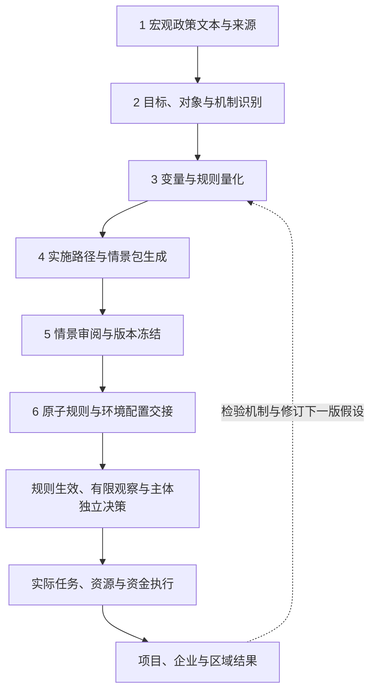

# 政策量化与情景生成规范

规范性质：政策证据、机制、情景与运行交接的目标规范。政策事实、参数校准、软件支持和效果验证分别登记，不能互相替代。

[总入口](../README.md) · [研究边界](../01_overview/research_scope.md) · [世界运行](../02_world/world_runtime.md) · [政策工具目录](instrument_catalog.md) · [开发契约](../06_engineering/implementation_contracts.md)

本文维护政策原文到仿真干预的完整定义：条款证据、宏观/混合/原子建模路径、工具与参数、组合情景、审阅交接、生效执行及结果评价。研究范围为粤港澳大湾区；参数必须有证据或明确假设，示例数值不作为默认配置。

政策建模 Skill 可辅助执行本方法，其能力、输入输出和 AI/工具/核心边界见 [技能接入规范](../06_engineering/skills.md)。本文件仍是政策业务逻辑主定义；技能输出不自动生成生效政策或现实效果，文件存在也不代表已接入平台。

条款、机制、参数、情景编译和运行应用分别使用[系统接口目录](../06_engineering/system_interfaces.md)的具名类型；统一返回及函数规范见[输入输出契约](../06_engineering/interface_contracts.md)。政策解释文本可以保留，但程序使用的阈值、条件、作用对象、时序和来源必须结构化；未量化部分不能被执行器自行猜测。

<!-- page-nav:start -->
**本页导航**

[1. 六步量化流程与执行反馈](#1-六步量化流程与执行反馈) · [2. 证据、配置、执行、响应与结果](#2-证据配置执行响应与结果) · [3. 条款结构化与三类建模路径](#3-条款结构化与三类建模路径)

[4. 工具分类与机制拆分](#4-工具分类与机制拆分) · [5. 参数量化与依据](#5-参数量化与依据) · [6. 运行交接对象与责任](#6-运行交接对象与责任)

[7. 工具组合、覆盖与资金约束](#7-工具组合覆盖与资金约束) · [8. 情景生成与比较设计](#8-情景生成与比较设计) · [9. 生效、记录和平台接入](#9-生效记录和平台接入)

[10. 政策量化验收条件](#10-政策量化验收条件) · [11. 实施选择与规范变更](#11-实施选择与规范变更) · [12. 证据与实现验证登记](#12-证据与实现验证登记)
<!-- page-nav:end -->

## 1. 六步量化流程与执行反馈

第 3 步产生参数候选，第 6 步输出选定版本，两者不是重复填数。工具可跨条款拆分，也可跨政策重组，但每个字段保留各自依据。一次宏观政策输入可以生成多个可比较环境，不直接转换成唯一“最佳方案”。

| 步骤 | 工作与输出 | 不能跳过的边界 |
|---|---|---|
| 1 宏观政策文本 | 来源档案、原文版本、条款与片段定位 | 示意文本、草案与正式来源分别标记 |
| 2 目标与机制识别 | 主体—行动—对象—条件；机制图与工具候选 | 目标和预期结果不能冒充机制或已实现效果 |
| 3 变量量化 | 有类型/单位/来源的参数；未知项与备选机制 | 不从“鼓励合作”直接生成成功率或收益百分比 |
| 4 情景生成 | 按研究问题、资源约束及优先级组合工具 | 企业采用、实施能力与政策配置分别设置 |
| 5 情景审阅 | 核对来源/假设、依赖/冲突、覆盖和比较口径；冻结选择 | 文档例行检查不新增逐步用户批准门槛 |
| 6 仿真交接 | 规则、参数、时序、作用范围、执行能力与指标清单 | 配置被保存不等于机制被支持、触发或执行 |

六步流程在工作台中分为“证据结构化／干预架构与量化／情景设计／审阅交接”四个工作组，具体页面与交接由 [前端规范](../06_engineering/frontend.md)定义。业务步骤和界面分组分别维护，不将页面数量当作执行阶段数。

**POL-001｜量化的是可追踪的干预链。** 每项工具写出：政策依据 → 直接改变的条件或投入 → 谁获得什么观察/候选 → 谁独立决定 → 哪个正式过程执行 → 哪些结果可以检验。没有作用入口的字段只作背景，不标为可执行政策。

## 2. 证据、配置、执行、响应与结果

| 层次 | 要回答的问题 | 示例语义 |
|---|---|---|
| 证据具体性 | 原文把对象、条件、时间、资源说清楚了吗？ | “期限明确，适用事项仍缺失” |
| 政策配置与力度 | 改哪些权利、程序、范围、预算或能力？ | 资格集合扩展、任务可并行、增配服务容量 |
| 实施与信息到达 | 工具是否可用、投入是否到位、谁何时获知？ | 开通服务，但处理资源尚未补足 |
| 主体响应与实际履约 | 谁申请、接受、投资、签约并履行？ | 合格企业可以不申请，银行可以拒绝融资 |
| 结果与比较差异 | 工期、成本、风险、服务及协作怎样变化？ | 在明确模型和观察窗内相对基准的变化 |

**POL-002｜证据分数不充当效果系数。** 证据画像包含五个维度：数值目标、规则、对象、时间、资源。每维记录“明确／部分／缺失／不适用”及理由；来源真实性、提取把握和核验状态另列。不使用未经校准的综合小数或通过阈值；布尔规则没有数字目标也可十分明确。示例证据分数、审批天数、参与增长和预览收益均不得直接成为运行默认值。

“弱／中／强”可以保留为某一工具或组合的配置简称，背后必须列出不同的参数向量、成本和约束。不能把所有参数统一乘倍数，也不能把“强实施”预设为效果上限。

## 3. 条款结构化与三类建模路径

**POL-003｜最小证据单元是带来源的条款和字段。** 一个条款可能含多个行动，应拆成可独立解释的单元；保留共用条件、例外、定义及交叉引用，不能拆掉限定语。最低记录如下。

| 记录组 | 必须保存的内容 |
|---|---|
| 来源 | 文档/政策 ID、版本、发布者、地址或本地原件、取得日期、来源性质、原文片段及定位 |
| 语义 | 谁、对谁/什么对象、采取什么行动；权利/义务/目标/建议/服务承诺等语义类别 |
| 范围 | 有权机关、事项、主体/项目/用途；注册地、活动地、项目地、生产地和路线分别引用 |
| 条件 | 前置资格、例外、引用规则、证据要求、适用对象集合、方向性及数量范围 |
| 时间 | 发布、生效、到期、过渡；数值期限的起算、暂停、恢复、终止与历法 |
| 资源 | 授权预算、付款来源、执行部门/能力；未知值保持未知 |
| 解释状态 | 明文、推断、歧义、缺失；逐字段证据引用、待核问题及影响范围 |

**POL-004｜路径按可建模内容选择，不按分数自动批准。** 一项政策可同时走多条路径；互相重叠的作用范围须按 POL-009 去重。

| 路径 | 适用内容 | 可交付物 | 进入定量运行的条件 |
|---|---|---|---|
| 宏观路径 | 方向性信号、可观测外生条件，尚无完整具体工具 | 有版本的信息/观察，或有依据的宏观输入/经验机制 | 数值来源、定义和行为/计算入口明确；否则只保留文字背景 |
| 混合路径 | 已识别行动，但范围、资源或实施方式有多种可能 | 明确部分＋若干标记假设的实施情景 | 每个情景补齐自己的必要参数和依赖；未补齐不得冒充现实规则 |
| 原子路径 | 对象、条件和行动足够明确的条款 | 可独立配置的资格、任务、预算、时限等规则 | 适用性与执行契约完整，目标方法已支持并通过相应检查 |

不适用大湾区研究、无法解释、尚无支持方法的条款分别保留为范围外、待解释或未支持，不能为了“全部量化”强制填数。缺口只限制依赖它的机制，其他工作继续。

三段**人为编写的示意文本**说明路由，均不是现实政策引文：

- “鼓励湾区企业加强合作”：支持合作方向这一信息；不提供合作概率、奖励金额或新增项目数。主体可通过有来源的通知获得该信号，是否改变判断需由其行为模型产生。
- “为符合条件的项目提供并联审查服务”：可识别任务重组工具；哪些项目、哪些审查能并行、共有资源和必要依赖仍待填。可比较不同实施假设，不能默认全部任务同时结束。
- “对本测试事项在完整受理后 X 个业务时间单位内作决定”：可形成期限规则；仍需给出 X、历法、起算与暂停等测试输入。规则到期产生到期/超期事实，不能直接生成批准或替代实际审查工作。

## 4. 工具分类与机制拆分

工具按三条互相独立的分类轴组织；完整工具卡见 [工具目录](instrument_catalog.md)。

| 分类轴 | 分类内容 | 用途 |
|---|---|---|
| 五个干预模块 | 市场进入、项目机会、合作形成、资源支持、治理与风险 | 说明所要解决的问题 |
| 六类工具 | 规则与权利、流程与服务、信息与协调、激励与资源、供给与能力、监管与风险 | 说明采取什么办法 |
| 八个作用环节 | 发现机会、资格判断、申请、审查、匹配/招标、签约、交付、持续监管 | 定位在主体与项目链条中的作用点 |

**POL-005｜分类不替代执行依赖。** 环节是位置索引，可并行、反复或不适用；不能强迫全部项目经过八个线性步骤。一项工具可涉及多个模块/环节，但只对其定义范围产生直接变化。

实施包可组合为六类：市场准入、审批便利、资质互认、项目机会、合作撮合、资金支持。它们是工具集合，不能凭包名直接改项目成功率。执行能力与治理工具另有能力定义，其政策依据和效果仍需单独建立。

每条机制图分别写：直接规则边、信息传递边、独立决策边、实际履约边和结果反馈边。例如：

> 资格范围变化 → 工程师进入可用候选 → 业主获知并比较方案 → 工程师独立接受受托工作 → 实际专业成果与项目执行 → 观察跨区参与、延误和质量。资格变化不直接产生委任合同。

## 5. 参数量化与依据

**POL-006｜一个参数同时具有业务语义、依据和执行位置。** “字段有数值”不足以满足量化契约。

| 字段组 | 最少内容 |
|---|---|
| 身份与类型 | 参数/规则 ID 与版本；布尔、枚举、集合、关系、数值、时序、分布或计算方法引用 |
| 原文值 | 原样文字、标准化值、比较符、边界是否包含、“最高/目标/原则上”等限定、来源片段 |
| 数值口径 | 单位/币种、分母/计量基数、每项目/主体/期间范围、舍入、日历和时钟规则 |
| 对照配置 | 基准值或规则、干预值或增删集合、时间表、适用范围与覆盖身份 |
| 依据类别 | 政策明文、确定性推导、经验估计、专家判断、机制假设、情景设定、未知；逐字段登记 |
| 方法与不确定性 | 公式/估计方法、数据样本与适用时期、区间/分布及相关性、校准状态和外推限制 |
| 执行契约 | 读取对象、触发/前置、承担/决定/核验/付款方、允许改变的字段/任务/资源、失败结果 |
| 追踪 | 来源→工具→配置版本→应用记录→正式事件→指标；未覆盖项和支持状态 |

| 参数来源 | 具体做法 | 不允许的推导 |
|---|---|---|
| 明文提取 | 规范化单位、比较符和适用条件，核对原文及交叉引用 | 把“最高支持”改成必然全额到账 |
| 确定性推导 | 从已知集合/规则计算指标，记录公式和分母 | 用一个比例反推未知具体资格名单 |
| 经验估计 | 用案件、工时、费用、运输或行为记录估计条件分布；记录样本选择、地区/时期和检验划分 | 只有目标性文件却声称校准了生产率或采用率 |
| 专家判断 | 记录专家范围、问题、判断过程、分歧及区间解释 | 把个人判断标为实测或统计置信区间 |
| 情景假设 | 明列试验值/范围、选值理由和敏感性方案 | 把探索性端点称为政策事实或发生概率 |

定量字段不只允许 0—1 分数。互认通常首先是有方向的资格关系；材料精简是材料集合及证据依赖变更；并联是任务图；补助是基数、比例/分档、封顶和预算；队列是工作量、能力及分配规则。各自使用有意义的类型。

**POL-007｜目标、期限和结果使用不同变量。** 规定期限、服务目标、主体预期、实际办理时间分别保存。生产率、排队、实际采用和信息传播需要独立参数来源。实际耗时可超过规定期限，记录其后果，不通过截断时间或到期自动批准消除违规。

宏观变量分四类：可观测外生输入、有依据的聚合代理、主体可见方向性信息、由细过程汇总的展示指标。前两类需明确计算/行为通道；第三类不能自动生成数值效果；第四类不得反过来重复控制其已经汇总的过程。LLM 可以辅助拆条款、找候选机制和解释假设，不作为参数真实性证明或正式工程/资金计算器。

## 6. 运行交接对象与责任

以下定义政策对象的语义契约；数据类、解析器及运行支持须分别登记实现证据。政策对象由本文维护；项目、资格、任务、账户等正式业务对象引用 [共同对象](../02_world/domain_objects.md)，不复制另一套权威状态。

| 对象 | 主要内容 | 唯一职责 |
|---|---|---|
| PolicySource / ClauseEvidence | 来源/版本/片段、字段解释和缺口 | 保留依据，不直接执行 |
| InstrumentDefinition | 工具 ID、机制版本、分类、适用谓词、参数类型、读写范围、依赖、检查 | 定义允许怎样干预 |
| ParameterBinding | 字段值/未知、单位、依据与方法、范围、有效期、支持状态 | 将某工具绑定到具体情景 |
| ScenarioPortfolio / ScenarioDefinition | 组合与成员各自的稳定 ID/版本；研究问题、基准、工具/参数、资源/信息/响应假设、反馈、时序与支持范围 | 第 8.4 节定义研究输入，不预填结果或创建实际运行 |
| ContrastDefinition | 稳定比较 ID/版本、所含情景、变化/控制、结果总体、时间/指标与估计目标 | 定义比较什么；实际运行集合、配对与结果由 [运行结果](../07_experiments/run_and_results.md) 维护 |
| PolicyActivation | 政策/工具/配置版本、有效时间、适用/过渡规则、通知路径 | 改变当前适用规则并产生有权观察 |
| PolicyApplicationRecord | 运行/调用/对象范围、适用判断、读入版本、行动结果、正式事件引用或未执行原因 | 证明具体机制在哪里生效或阻塞 |
| EvaluationRecord | 比较定义与 [运行结果](../07_experiments/run_and_results.md) 的 comparison_result 引用、机制应用证据、研究判断及验证记录 | 解释模型结果及证据边界，不另存一套权威比较数值 |

**POL-008｜量化工作台不是第九类社会智能体。** 它属于证据与场景准备；运行内 Government 仅处理其授权事项。研究者预先编排政策变化，与 Government 根据市场反馈自主制定政策是两种模型；后者仍待 D-08，不默认启用。

| 角色/责任方 | 接收什么、可以决定什么 | 正式变化由何处完成 |
|---|---|---|
| Owner | 可见机会、资格/程序、费用与支持条件；决定调查、提案、投资或退出 | 有效投资、合同、资金及项目对象入口 |
| Bank | 融资支持条件、合格申请和可见风险；独立授信、提款审查、补救 | 已授权金融义务与实际资金执行 |
| Architect | 资格、提交材料、成果及用途条件；接受任务和选择专业方案 | 专业成果/任务，所需许可另由有权方决定 |
| Engineer | 专业互认、证据复用范围、审查要求；独立分析及意见 | 有版本的证据、专业成果和获授权核验 |
| QS | 费用基数、减免/资助条件、计量依据；独立估价/核证意见 | 获授权金额记录；意见不自动付款 |
| Government | 有权规则、案件、工作量/能力和预算权限；处理受理、审查及监管 | 案件/许可/监管入口；资金另核拨付权限 |
| Contractor | 投标/联合体机会、履约约束与实际资源；独立报价、签约及排期 | 合同、工作包和受控执行 |
| Supplier | 产品/路线/证据规则、订单与资源条件；独立报价、排产和交付 | 订单、制造/运输/验收事实 |
| 仿真核心 | 校验生效、适用性、授权、资源和版本 | 提交状态/事件并投影给有权观察者；不替主体作商业判断 |

大湾区内资格源地→执业地、工厂→项目地、发布辖区→适用事项均显式登记。属于湾区不等于资格通用、制度相同、已获许可或不需要运输检查。

### 6.1 业务对象与程序类型的对应

上表命名表达政策业务含义；[系统接口第 5 节](../06_engineering/system_interfaces.md#5-政策证据机制编译及应用)定义其程序传输形状。以下对应关系必须保留来源与版本，不将近义名称当作可以直接互换的 `Ref.kind`。若是投影，按公共类型映射契约登记字段、范围、单位和状态。

| 业务对象 | 技术落点与生产路径 | 必须保留的区别 |
|---|---|---|
| PolicySource / ClauseEvidence | 来源登记中的 Source/Evidence；`policy.extract_clauses` 产生 PolicyClause 草案，`policy.prepare_evidence` 经提交形成正式条款 | 原文、字段解释与核验分别保存；提取成功不代表已核实 |
| InstrumentDefinition / ParameterBinding | 已登记的 Instrument/参数定义，以及 MechanismSpec 中的具名参数绑定；由结构化、编译及配置提交入口保存 | 目录能力、该情景的取值和现实依据分别版本化；不能用目录名称代替实例 |
| 编译后的规则配置 | `policy.compile_configuration` 返回编译草案，`policy.prepare_configuration` 保存机制与 CompiledPolicy | 编译检查只确认支持和一致性，不是实际生效或主体采用 |
| PolicyActivation | 冻结配置中的生效/过渡计划，由世界在对应业务时点处理并留下应用事实 | 计划、生效与主体获知分开；系统处理依据不能来自页面当前选择 |
| PolicyApplicationRecord | `policy.evaluate_applicability` 判断具体对象，`policy.prepare_applications` 同步保存适用记录及受限 PolicyEffect | applicable 表示适用；下游任务、付款或投入是否执行另有事实；不能用适用次数当履约次数 |
| 资助申请、核验与授予 | GrantApplication 由真实申请草案经 `policy.prepare_grant_application` 登记；GrantRound 保存获授权的分配结果 | 资助申请与一般政策适用记录不同；符合条件、获授、形成义务和实付分别记录 |
| ScenarioPortfolio / ScenarioDefinition / ContrastDefinition | 工作区草案保存与冻结入口；实验计划引用正式版本，运行装配保留导入映射 | 草案、冻结配置、运行实例和统计比较各有身份；不能从尚未存在的运行取准备资料 |
| EvaluationRecord | 运行结果服务的 ComparisonResult 及研究解释记录 | 定量值只引用正式比较；解释文字不生成另一份收益或现实因果结论 |

PolicyEffect 的字段和封闭类型只由系统接口维护。每项工具还须绑定下页的 [工具执行接线](instrument_catalog.md#21-工具怎样接入系统函数)：使用哪个已登记处理规则、谁读取、允许影响什么条件，以及后续哪个正式事实证明执行。政策模块不直接写入现金、工程量或任意领域字段。

## 7. 工具组合、覆盖与资金约束

**POL-009｜先解析重叠，再执行明确机制。** 每个工具登记作用对象、任务/费用/资源行和时段的覆盖身份；组合关系不能仅靠箭头或配置文件顺序解释。

| 关系 | 必须说明的含义 |
|---|---|
| 前置/依赖 | 哪项业务条件必须先满足，依据是规则还是显式模型假设；硬依赖不可有未解循环 |
| 独立 | 哪些覆盖互不重叠；仍可能通过共享资源间接影响彼此 |
| 互斥/替代 | 重叠范围采用哪条及为何；不能默认后写者获胜或优惠最大 |
| 可累计封顶 | 基数顺序、已用额度、预算/单项限制和跨期规则 |
| 有序变换 | 对同一变量先做什么再做什么；顺序作为版本化规则 |
| 互补/放大假设 | 预期怎样相互影响，随后用实验检验；不自动加协同分或相乘 |
| 未解决冲突 | 返回冲突对象/范围，阻止该组合执行；独立工具仍可形成其他情景 |

材料精简改变准备任务，线上提交改变传递任务，并联改变允许的任务依赖，增配能力改变服务资源。这些过程产生办理耗时后，不能再叠加已涵盖同一路径的“宏观审批摩擦下降”。宏观经验机制可作为替代模型，或仅覆盖有依据的不重叠残余范围。

资格集合按具体增删和优先关系解析；不能统一取并集、交集或最严规则。收费减少不必然减少人员投入；补贴不等于物理降本；实际资源成本、合同价格、核证应付和付款分别计算。

**POL-010｜财政支持有预算、承诺和现金三条约束。** 申请→核验→按明定规则分配预算→获授/成立相应义务→满足付款条件→实际执行。获授是否形成应付由工具契约规定；批准和预算不直接增加现金。付款沿 OBJ-011/012，记录真实来源、用途、增量片段和未知执行状态。直接向供应商支付不能同时给受益人增加现金；重复回执不能重复使用预算或付款。

预算竞争、部分授予、跨期结转和退款是否恢复额度需显式规定。付款只是同一获授范围从未付转为已付，不再增加第二份预算占用。补助改善受益方资金负担，真实资源节约仅由后续行为和实际执行变化产生。

## 8. 情景生成与比较设计

**POL-011｜先规定研究问题，再生成配置。** 建议生成顺序：选择问题/观察对象 → 定义结果和约束 → 找对应工具 → 检查支持与证据 → 生成组合 → 解析冲突及资源约束 → 形成基准及比较组 → 冻结版本。缺必要参数或存在未解语义冲突的候选不能伪装成可运行方案；已经定义清楚的容量不足、资金不足和预算竞争可以作为可运行压力情景，产生排队、未获授或未付款等结果，不能在准备阶段一律剔除。

| 情景类型 | 目的与控制方式 |
|---|---|
| 无新增措施基准 | 保留选定时期已有规则与环境；不是“没有任何法律和制度” |
| 单工具/消融 | 逐项启用，或从组合移除一项；依赖工具一并说明，避免生成不可行情景 |
| 综合组合 | 比较准入、程序、信息、资金等相互影响；不预写总收益 |
| 低响应 | 政策仍可用，信息到达或行为模型有明确且独立的低响应假设；不事后强改结果 |
| 能力受限 | 保持或约束办理、金融、专业、制造/现场资源，观察排队及挤出 |
| 分区/分期试点 | 明确城市、方向、适用对象、实施时点和扩围条件；观察湾区内溢出 |
| 参数/结构敏感性 | 比较有依据区间或明示探索范围，并比较互斥机制解释 |

研究路线包括审批优先、资格优先、项目/网络优先、数字入口及综合推进。它们通过选工具形成；“强化实施”是压力情景，可出现拥堵、财政压力、竞争挤出或较差绩效。

对政策与能力双因素可比较基准、仅政策、仅能力投入、两者组合。比较组须满足自身配置依赖并有明确预算/不足处理规则；运行中申请超过预算等情况可保留。简单交互量可记为 `Y(两者) - Y(仅政策) - Y(仅能力) + Y(基准)`，其解释取决于指标方向、比较单位与模型；不能自动解释为现实协同因果效应。

### 8.1 一张能区分机制的合成判别卡

下面的 `MECH-SYN-01` 是**人为构造、尚未执行的局部实验设计**，用于演示怎样把问题写实；不是选定的主研究问题、首个真实用途、资格政策或工程方法。`u` 只表示本算例同质的抽象专业工作单位，`W` 是声明的观察窗口，均不替 D-04/D-06/D-07 选择真实时间和工作粒度。

| 判别项 | 本例填实的内容 |
|---|---|
| 待检验主张 | 在新合格主体可见、愿意受托且其他投入未受限时，扩大资格增加能力受限组的完成量；既有能力充裕时可能仅替代订单 |
| 竞争解释 | H1：新增可履约能力缓解未完工作；H2：合同只是从本地 A 转给跨区 B；H3：变化来自候选暴露而非资格本身 |
| 初态与范围 | 目的地有 2 项各需 1u 的任务；A 原本具资格，B 已存在且有 1u 可用能力，基准中不具本事项资格。两者已选质量/成果范围一致；局部测试所需其他授权、资金和投入条件均满足，不据此声称整项目就绪 |
| 两个干预 | Q 只把 B 纳入本事项合格集合；E 只把 B 的可披露资料和当时资格状态加入主体候选暴露。资格与可见性分别记录，E 不授予资格，Q 不保证 B 被检索或邀请 |
| 固定行为分支 | 离线预定第 1 项委任 A；第 2 项在 B 合格且被暴露时提出委任 B，否则提出委任 A。受托方在条件和能力满足时接受，资源不足则等待；正式提交仍需校验。这是有标签的固定选择样例，不是正式主体的默认偏好 |
| 能力对照 | 受限组 A 只有 1u 可用能力；充裕组 A 有 2u。B 的 1u 从期初就存在，两组均不因政策新造主体/资源。两种初态分别成对比较，不把改变 A 的能力混入 Q 的效果 |
| 必需过程证据 | OBJ-003 的资格/获知/检索暴露记录、有效邀请与接受、原能力及实际投入、各任务完成/等待、B 的履约量和 A 的替代量；主张与结果登记依 [运行结果](../07_experiments/run_and_results.md) |

在上述固定选择、工作可在 W 内完成且无其他阻塞的**算例前提**下，预期为：

| A 的能力 | Q | E | W 内总完成量 | B 的实际履约量 | 可作的判断 |
|---|---|---|---|---|---|
| 1u | 关 | 关 | 1u | 0u | 余下 1u 等待能力 |
| 1u | 开 | 关 | 1u | 0u | 资格扩大尚未进入主体的候选暴露 |
| 1u | 关 | 开 | 1u | 0u | 看见 B 不等于有权委任 B 执行此事项 |
| 1u | 开 | 开 | 2u | 1u | 新可履约能力被实际采用，余下任务减少 |
| 2u | 关 | 关 | 2u | 0u | 原能力已经可以完成两项任务 |
| 2u | 开 | 开 | 2u | 1u | 跨区履约增加，但这里只发生订单替代 |

“B 的履约从 0u 增为 1u”在受限组和充裕组都出现，因此单看跨区履约不能区分 H1 与 H2；总完成量、等待范围及真实投入才能补足判别。资格不适用、信息未到达、B 拒绝、仍无可用能力等是主张不成立或尚未触发的条件，应分开记录。若已触发并实际增加可用投入，却没有按方法预期改变对应瓶颈，还须检查替代瓶颈或方法错误，不能仅凭一次失败直接否定所有资格工具。

随后可在相同信息和合法动作下替换为选定启发式或获授权的 LLM 分支，按 [运行结果 的行为评估](../07_experiments/run_and_results.md#81-候选暴露与行为基线评估)观察自主拒绝、选择和投入怎样改变结果，不强制复现固定选择。现实研究还需要对应事项的观测证据；模拟内部过程记录不能单独证明 H1 是现实原因，事后只选接受者也不能自动识别因果中介效果。

### 8.2 每个对比声明哪些反馈固定、响应或未覆盖

每个比较集合绑定 `feedback_profile_id/version`，逐变量登记下表模式、依据、作用范围、读取/生效时点和所比较两组的差异；具体函数、更新者和时滞引用 [世界运行](../02_world/world_runtime.md)，不在政策文件维护第二套计算。政策可以改变某些变量的模式，但这一改变本身必须作为干预列明。

| 模式 | 对比较的含义 | 必须避免 |
|---|---|---|
| 固定 | 在声明范围内保持同一数值、集合或规则；这是明确限制 | 将政策实施后的受影响变量固定，却把结果称作包含该反馈的总效应 |
| 外生路径 | 使用预先声明的数据/冲击路径，运行中的主体行为不改变它 | 用同一份已含现实政策响应的后续路径，无说明地当作所有反事实的中性环境 |
| 内生反馈 | 由指定业务结果与方法更新，注明观察与响应时滞 | 把同一响应同时作为外生冲击和内生增量计算 |
| 未覆盖 | 没有支持方法，本次不解释该通道 | 把未知写成 0 影响或通过任意默认函数闭合市场 |

至少检查需求、吸纳/使用、价格、融资条件、产能进入/退出和政策自身；不相关项说明不适用及理由。对 MECH-SYN-01：任务需求固定为 2u；实际接受、能力占用和完成量由已声明固定行为与执行方法产生；A/B 可用能力在每个配对初态固定；吸纳、价格调整、融资反馈、企业进入/退出及政府自主调控未覆盖。该例解释限定条件下的专业工作瓶颈，不解释投资产生、市场均衡或产业布局演化。

若后续比较“价格固定”与“价格响应吸纳”的有依据结构，两者另有配置身份，其他可比条件按 POL-012 保留；分别报告各自政策差值。结论反号或排序改变时记录结构敏感，不挑有利结构，也不把没有依据的函数组合当已验证模型。固定了政策可能影响的后续通道时，明确写“在这些固定条件下的变化”；声称包含反馈的总变化时列出实际覆盖通道和仍排除的部分。D-08 未选择不阻止做限定比较，也不因此启用 Government 自主政策。

### 8.3 可比运行与统计范围

**POL-012｜比较初始条件，不强制相同最终项目。** 记录初始主体/项目/资金/认知、外生路径、随机流、模型/决策提供者、预算和观察窗口。隔离各运行记忆；尽可能使用可区分的配对随机来源。政策可改变后续提案、规模、地区和合作，不能为得到同样样本而强制两组形成相同项目；相同 seed 也不保证外部模型完全复现。

每组采用多次运行，记录 seed/随机流、决策提供者与真实调用方式、失败/中断和有效重复数；重复次数或精度停止规则应在实验配置中预先声明并受已有预算约束。报告结果分布、离散程度、尾部和不确定性；明确区分运行随机性、参数不确定性、模型结构不确定性与来源缺失。配对条件成立时报告逐对差值及区间，无法配对时说明比较方法；置信区间须有相应抽样/估计依据，探索性参数范围不是统计置信区间。单次演示、相同 seed 或敏感性图均不能替代这些记录。

同时报告规则适用/资格、信息获知，以及申请/接受/承诺/履约各层状态；按具体工具定义分母、对象类型、观察期和是否可重复。自愿服务可形成参与漏斗，但资格与知晓是可独立交叉的状态，强制规则适用不以主体获知或申请为前提，不把所有工具排成同一漏斗。项目数、面积/服务量、周期、资源成本、资金负担、财政支出、未清义务、失败/取消、质量/风险、跨区协作和地区分布的指标、网络和样本口径由 [整次运行与结果](../07_experiments/run_and_results.md)维护；[研究范围](../01_overview/research_scope.md)保留研究边界，[开发契约](../06_engineering/implementation_contracts.md)保留填写标准。未完成项目记录截尾/在办状态，不只比较成功交付者。

### 8.4 从政策组合到稳定情景与比较定义

**POL-016｜情景身份与卡片名称、排序分开。** 下列 ID 是持久的非空标识，引用同时带明确版本；编码格式由实现契约固定，不用页面位置、`S0/S1`、名称或数组下标识别情景。界面可以显示这些短标签，重排或改显示名不能把旧运行改指另一方案。冻结版本不可覆盖；改变工具、参数、依据、时序、反馈或初态等语义产生新版本，并记录变更。复制为独立方案产生新 ID 和来源引用。

| 对象 | 最小语义字段 | 维护边界 |
|---|---|---|
| ScenarioPortfolio | `portfolio_id/version`、研究问题/主张、情景版本集合、基准引用、比较定义引用、共同假设及未覆盖项 | 组织一系列研究比较；成员状态可为草案/选定/撤回，旧版本仍可追溯 |
| ScenarioDefinition | `scenario_id/version`、显示名、现行制度基底引用、工具/参数绑定、实施/通知时序、方法/初态引用、反馈与资源假设、支持诊断 | 一种完整配置，不是一条运行；同情景可有多个独立重复 |
| ContrastDefinition | `contrast_id/version`、参与的情景版本及基准/干预角色、变化清单、控制条件、响应范围、结果范围、时间/指标和估计目标 | “比较什么”的权威定义；与场景卡被选中无关 |
| 执行交接 | 冻结的 portfolio/scenario/contrast 引用、必要能力/数据诊断、重复与预算要求 | 交给 [运行结果 第 8.3 节](../07_experiments/run_and_results.md#83-实验作业实际运行集合与比较结果)建立实验执行计划；不在政策页生成 run_id 或结果 |

基准引用选定时期已有规则、合法存续关系及其过渡条件；“无新增措施”只排除本次新增干预，不清空全部制度、通知、既有合同或财政责任。一个组合可以有多条比较定义，但每条须明确自己的基准和比较角色，不以第一张卡自动充当基准。

**POL-017｜变化、控制和结果范围在看结果前写清。** 每条比较至少填写下列内容；尚未填足可以保存草案，不能自动转成有因果含义的比较。

| 比较字段组 | 必须填实的含义 |
|---|---|
| 变化清单 | 哪些工具、参数、地区/方向/事项、通知/生效时序或投入改变；按引用字段列差异，不只写“强政策” |
| 控制与响应 | 共用的期初资料/认知、外生路径、方法/提供者、预算口径；允许因干预内生改变的变量与反馈；固定、外生、响应、未覆盖沿第 8.2 节 |
| 结果总体 | 完整世界中的各组自身项目/企业总体，或另有定义的固定期初队列/局部机制范围；是否含新生/退出及其判定依据 |
| 指标与时间 | RUN-009 的指标版本、单位/分母/地域归属、业务时点或窗口、对齐依据、主要/辅助指标及未完/失败处理 |
| 比较目标 | 绝对差、相对变化、消融条件差、交互或其他有依据目标；方向与含义；重复、配对/未配对及估计方法要求由 [运行结果](../07_experiments/run_and_results.md) 落实 |
| 可比性与限制 | 允许差异和不可比差异、依赖合法性、财政/执行投入的比较口径、未覆盖机制、探索或预先声明的研究性质 |

完整世界比较保留政策导致的新提案、规模/地区选择、新项目、取消、失败与正常未完，不要求两组形成相同最终项目。固定期初项目或共同来源对象可以另作辅助比较；事后只筛“两组都交付”会改变总体，应标选择限制，不能替代完整世界结果。跨运行对象身份与统计归属由 [运行结果](../07_experiments/run_and_results.md) 处理，前端没有配对项目的权力。

改变基准、成员版本、控制条件、估计目标、结果总体或窗口需形成新的 contrast 版本，保留原比较及修订原因；看过结果后新增的比较标为探索性。若只是改变已保存事实的分析口径，可以重算有新版本的结果而不重跑世界；若所需干预、初态、时间覆盖或观测从未执行/保存，则提出明确的新实验需求，不能靠筛选器补出缺失事实。

**POL-018｜包内筛选不等于工具效应分解。** 在 A+B 的运行里筛选 A 的适用记录，只能查看 A 在该组合环境中的作用与覆盖；不能把这一子集称为“单独实施 A 的效果”。`Y_AB - Y_B` 是在 B 存在条件下加入 A 的比较；`Y_A - Y_0` 是相对原制度基准加入 A 的比较，两者不可互换。

只有 0、A、B、A+B 四种配置各自依赖合法、控制条件可比且有实际结果时，才可能定义同口径交互 `interaction = Y_AB - Y_A - Y_B + Y_0`。预算/服务能力随组合改变时列入干预清单，不能冒称只改政策条文；A 不能脱离 B 合法执行时，不生成虚假的 A 组或默认其结果为 0，改用可行的条件比较并缩小主张。量纲、配对与聚合由 [运行结果](../07_experiments/run_and_results.md) 执行，交互为正也不必然有利，例如成本越高通常越不利。所有差值都是已声明模型/配置下的比较，不单独证明真实政策的因果效果。

地图和 Analytics 如何共用上述引用、保留单次查看与完整比较集合的区别，由 [前端连接契约](../06_engineering/frontend.md)维护；本文不再定义页面状态或图表算法。

## 9. 生效、记录和平台接入

**POL-013｜四种状态分别登记。** 证据状态（已核验/假设/未知）、设计状态（草案/选定版本）、技术状态（未支持/已实现/已检查）、运行状态（未加载/已加载/已生效/已触发/已执行/失效）不能合并为一个“已确认”。选定情景不是政府正式颁布政策，来源明确也不证明机制已实现。

准备流程为：来源入库 → 结构化 → 机制/参数候选 → 依赖与覆盖校验 → 情景选择/冻结 → 生成目标配置。草案允许保留缺项；冻结和执行只检查所选机制的必要条件，未启用工具的可选字段不阻止独立工作。

运行内有两条时间线：按发布/通知/送达安排形成可见观察，允许主体在正式生效前基于公告形成预期；按有效时点激活规则并依过渡条件匹配对象、更新相应待办。两条线分别触发有资格的主体决定或有权执行，再由核心校验/提交、保存应用记录/事件，并在约定时点汇总结果。提前获知不能提前取得尚未生效的权利，生效后的合法适用也不以已读通知为必需条件，除非具体规则另有要求。精确时钟与同刻排序仍依 D-04；本文不偷偷选择月制或日制。

**POL-014｜生效和获知是两件事。** 规则已生效可改变适用条件，但主体只读自己当时可见的信息。正在办理事项、存续许可和合同按明确过渡规则处理；缺失时保留待定，不默认全面追溯或永久豁免。政策到期不删除历史成本、有效债权债务、实际到账或迟到执行结果。

每次应用记录至少包含：`run_id`、政策/工具/参数版本、对象与范围、适用检查时点、读入状态版本、触发命令 ID、结果（不适用/条件不足/资源不足/已执行/未知等）、正式事件引用。幂等身份与原命令/对象范围绑定，重试复用原身份；新批次/新合法事项有新身份。条件变化引起重新评估可产生新评估记录，不能让旧执行被重复提交。

**POL-015｜配置可执行性由白名单契约控制。** 配置编译器只接收已支持的工具类型、适用谓词和计算方法；检查字段、单位、引用、权限、覆盖和依赖。未知工具/字段返回诊断，不静默忽略，也不执行 MD 内任意代码。交接包必须包含证据清单、规则/参数集、场景矩阵、时序、方法版本、数据缺口和验收清单；编译器及各工具的支持证据按第 12 节登记，未登记实现证据不得标为可执行。

## 10. 政策量化验收条件

下表是待实现验收要求；[工具目录 的两个虚构算例](instrument_catalog.md#7-两个有确定结果的虚构算例)仅检查资金和机制覆盖的逻辑，不是已运行仿真。

| 检查 | 确定预期 |
|---|---|
| CHECK-POL-001 | 方向性条款只有文本：保留信息/假设缺口，不生成任意数值效果 |
| CHECK-POL-002 | 提取值缺分母/范围/历法：依赖字段保持不完整，不以 0 或默认值替代 |
| CHECK-POL-003 | 同一机制混合明文与情景值：逐字段保留依据，不整条标成已核实 |
| CHECK-POL-004 | A 地资格用于 B 地某事项：仅按有方向、限定专业/事项的关系匹配，不自动反向或全湾区认可 |
| CHECK-POL-005 | 截止时间到但审查未完成：记录到期/超期，不能批准、完成任务或伪造服务资源 |
| CHECK-POL-006 | 线上服务开放但主体未获知或无能力采用：不强制申请/合作；保留未采用原因 |
| CHECK-POL-007 | 同一费用/时间由原子工具及宏观折扣重复覆盖：拒绝未解组合或选择有依据的替代模型 |
| CHECK-POL-008 | 两项变换作用同一变量且顺序不同：未明示顺序时无确定输出，不按遍历顺序执行 |
| CHECK-POL-009 | 补助申请超过预算：按已声明分配规则处理；获授、应付和现金分别核对 |
| CHECK-POL-010 | 部分付款、重复回执、未知执行：沿最小账本保持增量/占用一致，不换 ID 重付 |
| CHECK-POL-011 | 公示机会或资格开放：只有机会/候选变化，项目、合同仍等待主体独立决定 |
| CHECK-POL-012 | 政策已发布未生效、已生效未获知、过渡规则缺失：分别处理，不混成一次全局刷新 |
| CHECK-POL-013 | 政策撤销/到期后收到此前真实执行结果：保留事实并核对义务，不据当前失效抹掉资金/工作 |
| CHECK-POL-014 | 互认/证据复用不覆盖当前批次：不减免必要任务，其他独立工具可继续适用 |
| CHECK-POL-015 | 配置只加载未被触发：报告未触发，不能显示已执行或已产生收益 |
| CHECK-POL-016 | Government 只有制度建议且 D-08 未启用：不自主发布新政策、不自动修改实验参数 |
| CHECK-POL-017 | 政策改变内生项目集合：保留差异和未完事项；不得只选两组成功者证明政策有效 |
| CHECK-POL-018 | 增强配置后队列/预算/共享资源承压：允许效果变差，不以强弱档位保证结果单调 |
| CHECK-POL-019 | MECH-SYN-01 中只开 Q 或只开 E：A 能力 1u 时均只能完成 1u；两者都开才在固定选择前提下完成 2u，不把资格、曝光和接受合成一个步骤 |
| CHECK-POL-020 | MECH-SYN-01 中 A 能力 2u：两者都开后 B 履约增加而总完成仍为 2u，判为本例订单替代，不能仅凭跨区量证明瓶颈缓解 |
| CHECK-POL-021 | 两个反馈结构使政策差值反号：分别保留结构/参数与结果；未覆盖通道不填 0，固定条件下差值不冒称完整总效应 |
| CHECK-POL-022 | 重排 S0/S1 卡片或改显示名：冻结的 scenario/contrast 引用及旧运行不变；参数改变形成新版本，复制独立方案有新身份 |
| CHECK-POL-023 | 选择无新增措施基准：保留已选现行制度和存续责任；不把全部资格、审批和债务清空 |
| CHECK-POL-024 | A+B 运行仅筛选 A 的应用记录：只返回该组合内过程证据，不生成 A 单独组结果或把它当单项政策效应 |
| CHECK-POL-025 | 有 0/A/B/AB 的合法可比结果才接受交互定义；A 依赖 B 或某组无结果时报告条件缺口，不填 0，不相加单项收益替代组合结果 |
| CHECK-POL-026 | 看结果后改基准、观察窗或只选共同成功项目：生成新比较版本并标探索/选择范围，原完整世界比较保留 |
| CHECK-POL-027 | 情景配置已冻结但实验未执行：可以交接版本与诊断，不返回伪造 run 集合、样本数、地图差异或效果值 |

## 11. 实施选择与规范变更

资格/范围集合、申请与审查任务、信息与候选服务、有限预算支持可分别形成可检验闭环；其他工具按证据和方法支持接入，不能用通用政策分数替代。实际实施顺序依研究问题及支持范围选择，不预定现实政策包。

先选择一个湾区内具体方向、事项/用途及时间范围，建立真实来源或清楚标记的实验文本；补齐执行能力、资金、观察和过渡规则；再形成基准、单项和组合情景。该选择登记在 D-12，工程细化与内生调控选择仍保持各自独立。

修改流程：在本文改量化/组合规则 → 在 [工具目录](instrument_catalog.md) 改具体工具卡 → 同步受影响角色、共同对象和世界调度 → 更新目标结构化配置和验收预期 → 实现/检查支持方法 → 新运行引用新版本。只改参数可在已支持契约内生成新情景；增加机制、动作或正式状态需代码实现。**修改 MD 只有经过配置或代码的实现、校验与版本装配，才能改变后续运行。**

## 12. 证据与实现验证登记

本规范可以独立用于开发，不依赖界面截图、历史源代码或外部技能文件解释规则。真实政策实例仍须按 POL-003 附完整来源档案与逐字段依据；本规范中的示意文本、工具目录和合成算例不能代替政策原文，也不声明任何具体法定期限、资助标准或跨区权限。

| 登记对象 | 必须附的证据 | 缺证据时的状态 |
|---|---|---|
| 真实政策条款 | 原文/发布者/版本/取得日期、片段定位、事项与适用范围 | 待核或明确的示意文本；不填现实规则 |
| 参数与方法 | 类型/单位/基数、推导或估计方法、资料用途、适用期和不确定性 | 未知或显式情景假设；不称已校准 |
| 工具及配置编译器 | schema/工具/方法版本、配置作用入口、支持范围和失败语义 | 未实现或未支持；字段存在不证明生效 |
| 技能接入 | [技能架构](../06_engineering/skills.md) 的任务/技能/工具/权限契约、加载与调用记录 | 方法定义与运行接入分开；没有调用链则未接入 |
| 机制验收 | 输入、独立预期、实际输出、CHECK-POL 引用及运行方式 | 待执行；合成算术预期不冒充实际通过 |
| 政策比较与现实验证 | [政策量化](quantification.md) 的比较定义、[运行结果](../07_experiments/run_and_results.md) 的实际运行/样本/指标、独立数据及识别限制 | 模型内比较或待现实验证，不宣称现实因果效果 |

登记以具体能力和实例为单位，保留实际检查日期、版本与结果位置。文档一致性、程序契约、固定选择机制检查、真实主体行为、参数校准和政策效果验证分别报告。
