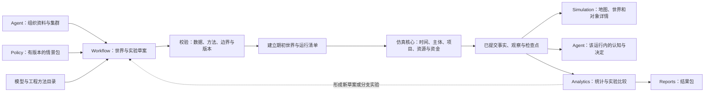
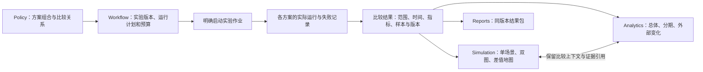

# 前端功能与交互规范

规范性质：完整目标前端的功能、交互与查询/命令要求。页面和接口的实现状态按软件契约登记，功能定义不代表已经接入仿真或完成验收。

[文档总入口](../README.md) · [世界运行](../02_world/world_runtime.md) · [共同对象](../02_world/domain_objects.md) · [项目推进](../03_projects/project_lifecycle.md) · [开发契约](implementation_contracts.md) · [整次运行与结果](../07_experiments/run_and_results.md) · [工程模板](../02_world/project_types.md)

页面业务调用对应[系统接口目录](system_interfaces.md)中的查询/命令用例，通用输入输出、错误和所有实际函数的登记要求见[接口契约](interface_contracts.md)。页面handler、HTTP client、adapter与投影函数均须绑定具体输入输出；查询不触发推进，展示不把技术回执解释为角色接受或法定批准。

<!-- page-nav:start -->
**本页导航**

[1. 功能范围与职责](#1-功能范围与职责) · [2. 端到端用户流程与权限](#2-端到端用户流程与权限) · [3. 跨页面共同上下文与状态](#3-跨页面共同上下文与状态)

[4. Agent 与 Cluster：从资料池到真实主体实例](#4-agent-与-cluster从资料池到真实主体实例) · [5. Policy：政策准备与情景交接](#5-policy政策准备与情景交接) · [6. Workflow：装配世界和编排外部变化](#6-workflow装配世界和编排外部变化)

[7. Simulation：看清世界、项目和主体怎样互相影响](#7-simulation看清世界项目和主体怎样互相影响) · [8. Analytics、Reports 与 Setting 的连接](#8-analyticsreports-与-setting-的连接) · [9. 目标接口分组：由用户操作落实到读写职责](#9-目标接口分组由用户操作落实到读写职责)

[10. 功能覆盖与集成验收](#10-功能覆盖与集成验收) · [11. 对接验收清单](#11-对接验收清单)
<!-- page-nav:end -->

## 1. 功能范围与职责

前端覆盖主体与集群、政策量化、工作流、仿真地图、结果分析、报告、设置和全局概览。页面、共享状态、组件和接口按同一仿真领域规范设计，涵盖完整功能及异常路径；视觉复用不能改变业务语义或数据来源。

本文维护页面行为、操作交接和结果呈现。[世界运行](../02_world/world_runtime.md) 维护调度与环境，[共同对象](../02_world/domain_objects.md) 维护共同状态，[项目运行](../03_projects/project_lifecycle.md) 维护项目依赖，角色文档维护主体动作，[政策量化](../05_policy/quantification.md)/[工具目录](../05_policy/instrument_catalog.md) 维护政策机制，[运行结果](../07_experiments/run_and_results.md) 维护运行和统计，[工程模板](../02_world/project_types.md) 维护工程模板。业务缺项回到对应主文件定义，界面和 adapter 不建立另一套规则。

软件模块、唯一状态归属、命令与查询客户端、响应校验、缓存和请求竞态由 [软件实现契约](implementation_contracts.md)维护。前端须呈现来源、加载、缺失、错误和支持范围，贯通准备、控制、观察、比较及导出；接口传输成功不能代替正式提交、持久保存或验收证据。

### 1.1 目标功能目录

| 功能入口 | 页面组成 | 目标职责 |
|---|---|---|
| Overview | 准备诊断、运行清单、最近结果及操作入口 | 汇总有版本的准备与运行状态，跳转到具体问题或结果；不维护新的正式账本 |
| Agent / Agent | 企业列表与筛选、创建/生成表单、Profile、Memory、Belief、Strategy、Decision Trace、交流区 | 维护主体资料与候选样本；按运行和时间查看实例及决定证据 |
| Agent / Cluster | 集群目录、构成、地图、网络、详情及创建/复制/交接 | 维护有版本的组织选择集与关系依据；集群不是拥有全体资源的额外企业 |
| Policy | 证据结构化、干预架构与量化、情景设计、审阅交接四个工作组 | 承载 [政策量化](../05_policy/quantification.md) 的六步业务链，保存可诊断的政策情景包和比较定义；缺项定位到依赖任务 |
| Workflow | 配置概要、详情、期间/政策/事件时间轨、保存/加载/校验/运行 | 装配初态、方法与外部变化计划，建立固定清单的新运行或实验作业 |
| Simulation | 大湾区地图、图层、项目/主体检查侧栏、运行控制、历史播放、时间定位与世界摘要 | 查看正式事实和实际过程；单场景、A/B 与差值模式共用比较定义 |
| Analytics | Overview、Periods Analysis、External Change Analysis | 展示有来源的指标、窗口变化、机制记录及真实实验比较 |
| Reports | 结果包配置、导出任务与文件清单 | 固定运行/比较、窗口和结果版本，导出可取得的文件并保留来源与缺项 |
| Setting | 草案默认值、支持方法/提供者及显示偏好 | 保存设置作用范围；不覆盖既有运行版本，不导出凭据 |

## 2. 端到端用户流程与权限

用户是研究者/平台操作者。选择样本、配置实验、请求暂停和查看审计信息，不等于在世界里替 Owner 投资、替银行放款或替 Government 发许可。角色决定仍通过对应动作契约和正式提交入口产生。人工参与决策须另有明确模式、角色授权和干预记录，默认研究者界面不具备角色业务权限。

一条典型使用链应是：选主体与覆盖范围 → 配置需求/资源/资金和支持的工程模板 → 选择政策及外部事件 → 检查缺项 → 建立运行 → 观察业主形成或放弃机会 → 查看专业、融资、采购和工程任务怎样推进或等待 → 查看交付、交易与后续经营 → 对照其他运行。不能让用户必须手工创建全部项目才能发生建设，也不能为了动画持续运行而补项目。

## 3. 跨页面共同上下文与状态

### 3.1 资料、草案、运行和查看位置分开

| 上下文 | 需要稳定引用的身份 | 页面含义 |
|---|---|---|
| 主体与政策资料库 | 组织/资料 ID、数据版本、来源与字段补全记录 | 编辑用于未来装配的资料，不直接改变运行中的实例 |
| 世界/实验草案 | `scenario_draft_id/version`、样本/工程/政策/工作流版本引用 | 可保存、修订、校验；保存不代表可运行 |
| 正式运行 | `run_id`、运行清单/版本、期初状态与父运行引用 | 固定本次实际使用的配置；控制与恢复沿 [运行结果](../07_experiments/run_and_results.md) |
| 查看位置 | `snapshot_id` 或已提交游标、业务时点/区间、统计版本 | 可看过去；移动查看位置不改变世界当前时间 |
| 主体实例 | `run_id` 与 `agent_id`，关联来源组织 | 同一企业的不同实验实例有独立认知、资源和结果 |
| 选中对象 | 类型、正式 ID、范围/版本；项目、工作包、事件、资产或关系 | 跨页保留对象身份，不按名称猜配 |
| 比较对象 | 实验/情景组合/比较定义的 ID 与版本、实际运行集合、配对与结果版本 | 地图和分析共用；单次运行、同运行分期和多运行比较分开 |
| 地图局部选择 | 单场景/A-B/差值模式、实际运行或运行对、图层/视角、选中对象 | 只改变展示样本；不能悄悄覆盖比较对象的完整运行集合 |

上述身份与字段语义沿用 [共同对象](../02_world/domain_objects.md)/[开发契约](implementation_contracts.md)/[运行结果](../07_experiments/run_and_results.md)；接口 schema 按明确版本实现。开始实现相应接口前固定 schema 与版本，不能把未命名字段当任意字典长期传递。

资料库未选择运行时，Memory/Belief 等应提示选择运行或展示明确标为“初始认知模板”的内容。进入 Simulation/Analytics 后，Agent 详情自动携带所选运行和查看时点；切换运行要使旧对象选择、未完成读取和缓存失效，不能把上一个运行的回复填进当前页面。

### 3.2 来源、状态与可见性

每块数据至少携带来源性质、适用范围、版本和时点。建议界面以简明标记显示“示例”“草案”“本次运行”“历史记录”“估计”“待核实”“未支持”；数值来源可展开查看。真实组织名不保证现金、能力分、地址或业绩字段是真实观测。演示资料不因 `ai_generated=false` 就标成已核实企业事实。

读取接口返回空集合、零值、缺失、未运行、未支持和读取失败的含义不同。空企业列表不自动换成示例企业；没有比较组时不生成一条基线；无真实坐标时可显示城市示意位置，但不能称为企业或工地实际位置。允许独立演示模式，整页及导出都明确标记，不能静默混入运行结果。

运行执行状态、指标分析可用性、当前请求读取状态分别维护：技术失败的运行仍可能有一段合法历史，但不能自动成为完整观察样本；页面读取成功也不改变其结束原因。反之，正常运行中业主全部选择放弃，可以有有效的“新增项目数为 0”。按指标返回覆盖/截尾/不可用原因，不能只凭 completed 或一个 success 决定是否纳入全部图表。

研究者的全局审计视图和某主体当时可见的信息分开。质量隐藏状态、其他主体资金和私有记忆不能因前端可以查看，就进入角色上下文。历史认知按当时获知内容读取，后来的核实只新增更正或统计版本，不改写当时判断。

### 3.3 提交与反馈

页面命令先显示请求中，再依据回执区分受理、已提交、业务拒绝、版本冲突、技术失败和执行结果未知。长任务可显示进度，但 HTTP 成功不自动表示工作完成。关闭页面或取消等待不等于撤销已提交业务。

同一次提交使用稳定请求身份；重复点击、超时后的状态查询与重试引用原身份。未知执行按 [开发契约](implementation_contracts.md) 查证；明确未提交后的合法修订或再校验依原动作契约办理。错误返回对象、字段/依赖、原因与合法下一步；局部缺项不令整个资料库或无关项目停用。

## 4. Agent 与 Cluster：从资料池到真实主体实例

Agent 工作区采用左侧列表、中间详情、右侧交流的组织方式，并提供 Agent/Cluster 切换。

| 功能与操作 | 读取或提交 | 业务边界 |
|---|---|---|
| 企业列表与筛选 | 资料库组织或本次运行实例的分页查询 | 明示当前范围；八类角色可分别检索。Consultant 可保留为界面分组，展开 Architect/Engineer/QS，不成为新领域角色；Bank/Government 不遗漏 |
| Profile 与能力图 | 组织属性、经营/生产地点、专业能力及来源投影 | 注册地、服务地、设施地分别展示；能力分不替现金、产能、资格或法定权限。不同 Architect 以任务经验/方法/团队/地区适用性表达差异 |
| Create Agent | 新建可审查资料草案或合成组织，保存有版本的来源记录 | 文件必须真正进入资料处理才显示“已解析”；只选文件名不算导入。字段缺项可保存草案，依赖动作另诊断 |
| AI Generate | 调用指定生成方法，产出有来源类型的候选资料 | 规则合成与模型生成分别标记；预览不是正式入库；不自动给运行补一家具备足额资源的企业 |
| Memory / Belief / Strategy | `run_id + agent_id + as_of` 的授权认知投影 | 分开初态、观察、主观推断和修订；错误/无数据不能填成示例“真实记忆” |
| Decision Trace | 请求/已有授权及实际输入 → 本次适用的建议、最终选择或例行执行 → 校验/提交 → 事件/观察引用 | 非必需环节标不适用，不补造 Proposal；能看到未采用、拒绝、等待、未知和失败，解释文字不能冒充已完成动作 |
| Collaboration Workspace | 资料问答，或明确运行中的主体交互会话 | 资料问答默认不写主体记忆、不触发业务；若选择有业务影响的会话，须有参与方、可见范围、授权和记录，仍不能用聊天直接替代合同/付款 |
| Cluster 构成、筛选与网络 | 有版本的组织选择集、角色/地区覆盖和初始关系证据 | 选择集不是新法人、联合体或既有合同；同一组织出现多次只装配一次，初始先验关系和运行实际合作边分开 |
| Cluster 创建/复制/用于仿真 | 保存或复制选择定义；向 Workflow 传递版本引用 | 复制不复制资产，选择不自动启动；保存后可重新读取才显示已保存。需要补角色时显示原因、来源与对供给的影响 |

主体进入运行后，侧栏提供“本次经营”区域：当前任务与参与关系、可用/承诺资源、现金与到期义务、等待/退出责任。正式数值来自 [共同对象](../02_world/domain_objects.md) 的账本与资源状态，不从能力雷达反推。点击具体项目或决定可跳到 Simulation 同一时点、同一对象。

## 5. Policy：政策准备与情景交接

政策工作区以四个工作组承载 [政策量化](../05_policy/quantification.md) 的六步流程，工作组之间传递稳定对象身份、版本和诊断。

| 工作组 | 对应 [政策量化](../05_policy/quantification.md) 的业务工作 | 输出与下一入口 |
|---|---|---|
| 1 Policy Evidence Structuring | 原文/来源整理、条款结构化及字段具体性判断 | 条款与条件/例外/时点、证据引用、未知与需核问题；输出到架构页 |
| 2 Intervention Architecture & Quantification | 宏观/混合/原子路径选择；工具拆分与机制、参数/方法连接 | 版本化工具实例与作用目标；保留宏观变量、场景包和原子规则之间的关系 |
| 3 Scenario Design & Generation | 按研究问题组合工具、生成基准与比较组、解析重叠和依赖 | 候选情景及各自配置差异、支持状态、资源/预算条件；不生成既定政策收益 |
| 4 Review & Simulation Handoff | 场景审阅/版本固定与仿真交接，即六步中的最后两步 | 冻结的情景包版本及诊断，交给 Workflow 选择和排期；尚有缺口的内容仍保留草案 |

**政策量化页面产生的是研究输入，政策效果来自运行。** 确认证据提取、选择假设、情景准备完成、政策在世界中生效、主体实际获知/采用以及结果变化分别展示。必要输入未定义和资源已知不足分开：后者可以形成合法压力情景，不能一律拒绝。

| 展示与编辑功能 | 含义与数据来源 |
|---|---|
| Policy Library / Mapping Summary | 来源文件、条款和映射版本；地区、适用期、事项及来源性质；资料记录统一按明确身份、来源和版本读取 |
| 参数数值、规则卡和机制图 | 引用 [政策量化](../05_policy/quantification.md) 的参数依据与 [工具目录](../05_policy/instrument_catalog.md) 的工具类型；箭头说明预期作用路径，不当作已证明因果关系 |
| 数值滑块/方案编辑 | 只能改变受支持且有单位/范围的草案字段；明文值、估计值与实验值不互相覆盖 |
| 情景卡及确认 | 保存明确版本和配置差异；当前选中卡不等于正式交接或运行中政策已改变 |
| 预览与强度 | 展示适用对象、条件、可能作用入口和缺项；如有估计方法，标方法与不确定性；没有运行时不显示实际成本降幅/合作提升 |
| 运行后的作用追踪 | 从政策版本到生效/适用记录，再到任务、候选、约束/资源、主体响应和结果；支持“有效但未触发”“触发但未采用”“采用但能力不足”等诊断 |

跨地区政策明确方向、事项和对象：企业资格、专业人员资格、产品/成果证据和项目许可分别处理；适用于 A→B 不默认 B→A，也不默认覆盖整个大湾区。前端的地区标签和勾选框不能制造权利。

Policy→Workflow 交接至少引用 `policy_package_id/version`、所含工具/参数与依据、适用范围、默认生效/失效与过渡条件、所需方法/能力/资金、冲突诊断和比较定义。Workflow 可在允许范围设置实验时序；更改机制或参数形成新版本，不能改名后沿用原包身份。

情景卡同时呈现“与谁比较、具体改了什么、保持什么条件、观察什么结果”。由 [政策量化](../05_policy/quantification.md) 的 `ScenarioPortfolio` 维护稳定 `scenario_id/version` 和 `contrast_id/version`；S0、S1 等只作排序标签。重排、改名或删除未执行草案不得把已执行的运行重新绑定到别的情景。无新增政策基准保留既有制度、资格和交易规则，并非没有监管的世界。比较如何出现在地图和分析中，见第 8.4—8.8 节。

## 6. Workflow：装配世界和编排外部变化

### 6.1 时间轴与三类变化

| 轨道 | 业务含义 | 编辑与生效边界 |
|---|---|---|
| Periods | 观察/实验期间及指定条件的区间索引 | 切分、合并、改标签首先改变分析窗口；如附带业务变化，必须有独立类型化规则。不能让全部项目在边界同时进入施工或竣工 |
| Policies | 指定政策情景包在世界中的实施时序 | 生效/终止与过渡引用版本；期限已到不自动删旧合同、取消债务或立即恢复原资源 |
| Events | 外部冲击或有定义的场景事件 | 绑定事件类型、目标资源/地区/对象、发生/结束或恢复机制、证据/假设；无类型和作用入口的备注只作注释 |

拖动政策或事件改变的是草案时序，不是改写历史。运行清单固定后，变更默认通过新草案/新运行或有父引用的分支实验比较；支持运行中受控干预须另有 [运行结果](../07_experiments/run_and_results.md) 的显式能力，不把暂停当成任意编辑许可。

时间轴从所选模型的时间协议读取单位、历法和显示格式，不能固定为月制或预设年数。报价有效期、工作日规则和工程持续时间由 [世界运行](../02_world/world_runtime.md)/对应方法计算，界面仅输入或显示有定义的量。

### 6.2 世界与实验配置

| 配置组 | 页面展示/输入 | 正式交接位置 |
|---|---|---|
| 研究与模型 | 研究问题、首批工程对象/功能、支持的方法组合及未覆盖项 | [开发契约](implementation_contracts.md) 的运行模型组合、[工程模板](../02_world/project_types.md) 的工程模板 |
| 主体与总体覆盖 | Cluster/组织选择、角色/地区分布、资料截止、实例代表范围、补足及背景业务 | [运行结果](../07_experiments/run_and_results.md) 的初始化清单、[共同对象](../02_world/domain_objects.md) 的 OBJ-021；[模型决策 的 W1 实现准备](../07_experiments/model_decisions.md) |
| 地区需求与存量 | 地区×用途/服务单位、初始需求/可用存量/在建、外生路径与已启用反馈 | OBJ-017 与 WORLD-017；不只设置“目标项目数量” |
| 建设载体与初始项目 | 有限地块/资产/区段、权利或授权前置；已有项目及历史覆盖 | OBJ-021；自主新提案范围仍由 Owner 决定 |
| 资源与经营资金 | 人员/设施/产能/库存、背景占用、现金/债务、持续收入或拨款边界 | [共同对象](../02_world/domain_objects.md) 及三类 Owner/Bank 的方法；额度与实际现金分开 |
| 环境与共同约束 | 外部价格/利率/天气等路径、运输节点与能力、日历和竞争协议 | [世界运行](../02_world/world_runtime.md)、OBJ-020 及已选择的方法 |
| 政策与事件 | 版本、目标、时间、资金/执行能力、重叠处理 | [政策量化](../05_policy/quantification.md)/[工具目录](../05_policy/instrument_catalog.md) 的交接包和 [世界运行](../02_world/world_runtime.md) 更新器 |
| 决策与计算 | 各动作支持的方法、规则/真实模型/离线替身、Skill 版本、预算、认知初态 | [开发契约](implementation_contracts.md)/[技能架构](skills.md) 与 [运行结果](../07_experiments/run_and_results.md) 运行清单；页面不暴露密钥，不静默换提供者 |
| 输出与实验 | 观察期、种子、统计窗口、结果细度、比较组及独立运行集合 | [运行结果](../07_experiments/run_and_results.md) 与 [政策量化](../05_policy/quantification.md) 的实验定义；重复次数不冒充已经完成的样本数 |

上述配置首先引用已经登记的数据/方法，详情再允许编辑相应草案，不要求用户在一个长表单里手填全部工程。D-01 至 D-12 中未选择的模型显示待配置或未支持，不以无依据默认值替代。字段必要性由选中能力决定；不要求未启用的资产经营或联合体分支先填写全部参数。

### 6.3 Save / Load / Run 的明确结果

- **Save**：保存草案版本并返回可重新读取的身份；仅保存在当前浏览器的内容明确称本地草稿。不得以成功提示替代保存。
- **Load**：载入指定版本及其引用，核对资料/方法仍可用；显示迁移或缺项，不把未知字段静默丢弃。
- **检查**：显示配置缺失、引用/单位冲突、方法不支持，以及可运行但可能等待/失败的压力条件。每项可定位到对应字段或来源。无新增政策、无冲击可以是合法基准，不因时间轴上没有政策/事件就自动警告或注入示例条目。
- **Run Simulation**：绑定准确草案和模型版本，装配并检查期初世界，得到运行身份/状态/清单；进入 Simulation。只有核心确认运行结束才显示结束，创建成功不显示完成。

可以保留一个 Run 按钮串联校验、初始化和启动，但界面必须显示当前步骤及失败位置；重复点击不能创建两次相同运行，技术重试不重复收费或生成一套新认知。新一次有意实验则使用新身份。

## 7. Simulation：看清世界、项目和主体怎样互相影响

### 7.1 地图、图层与检查侧栏

| 已有展示位置 | 目标数据与必要补充 |
|---|---|
| 大湾区底图与城市选择 | 11 地区统一引用 [研究范围](../01_overview/research_scope.md) 的枚举；选择城市查看该时点需求/存量、项目、可用资源及政策/事件暴露 |
| 企业点与角色图层 | 分开注册地、经营单元、工厂/仓库与实际服务位置；可聚合显示，但保留聚合范围和真实数量 |
| 项目标记 | 建筑可用点，道路/桥梁等可用有依据的线/范围；无几何数据标示意。总项目与区段/工作包通过范围引用连接，不能按城市复制项目 |
| Resource flow | 运输/交付、人员服务、资金等按关系类型、方向、实际量、单位与期间分别显示；承诺、在途和实际执行分开 |
| Collaboration | 读取 [运行结果](../07_experiments/run_and_results.md) 的网络定义及实际关系证据；同项目参与、共同投标、签约、履约和重复合作不能混为一类边 |
| 项目详情侧栏 | 目标/方案版本、范围层级、实际参与与授权、任务与阻塞、资源/资金、许可/成果用途、质量证据与待办、交付和尾项 |
| 企业详情侧栏 | 当前任务、接单/拒绝、共享排期、收付与义务、观察和决定；跳转 Agent 的同一运行实例 |
| 顶部/底部概览 | 世界已推进位置、当前查看位置、活动/未完/结束数量、数据覆盖与异常；不能用固定常量填充没有的事实 |

角色与项目详情采用按需展开：用户先看“发生了什么、为什么等、谁负责下一步”，再展开专业证据和账本。无需另建独立顶层页面才能查看银行、审批、设计或资产经营。

### 7.2 项目多维状态与证据

保留概览阶段标签，但明确它是摘要。详细状态沿 [项目运行](../03_projects/project_lifecycle.md) 分开呈现设计成果、融资、事项许可、采购/合同、工程执行、可用功能、交接、结算和未清责任；同一项目可同时有已完区段、待补件事项和逾期付款。

每条待办显示工作范围、发起/跟进者、执行者、有权决定者、核验者和接收者，引用实际主体与授权。工作完成、专业核验、客户接受和法定放行分别显示；不由“进度达到 100%”合成批准、清偿或合同责任消失。

方案比较展示 [工程模板](../02_world/project_types.md) 支持的有限候选、编制主体/专业、方法适用域、工程/费用/时间的估计依据及不确定性。可以看到不同 Architect/Engineer 的不同候选和意见，但比较卡不能自动形成业主接受。未有适用方法时显示未支持或需补查。

每条正式里程碑链接已提交事件；估计日期、计划、主体意图和未提交决定另用状态表达。不得根据当前阶段反推过去必然发生的事件，也不能用“本月经营活动”模板补造真实行为历史。

### 7.3 世界状态的查看入口

地图检查侧栏提供“世界/地区”视图或抽屉，复用同一时间选择，至少包括：

1. 当前有效环境与政策版本、当期外部事件及其作用对象。
2. 地区用途需求、物理存量、可用供给、在建和实际使用，按各自单位展示。
3. 共享人员、工厂、运输节点、审批服务及资金来源的容量/承诺/可用量、短缺及等待队列；容量冲击后旧承诺与有效能力分别展示，不删除旧承诺或画成负的实际使用；具体排序由所选竞争规则决定。
4. 新提案、投资/放弃/延期、资源争用、到期义务与待核事项的事件入口。
5. 未单列业务的背景负荷、未支持方法和受影响范围。

这样，用户能从“一个桥梁工作包在等待运输”追到“多个项目共用的节点受事件影响”，再追到供应方排期和本项目后续任务。世界视图只是正式状态的投影，不在前端重新分配运力或触发环境更新。

### 7.4 分开运行控制和历史播放

| 操作 | 对世界的作用 | 界面反馈 |
|---|---|---|
| 开始/继续运行 | 请求核心依已固定清单推进 | 显示受理、实际运行状态、当前处理位置及预算；不等同开始地图动画 |
| 暂停运行 | 请求在明确的一致位置暂停派发/推进；在途处理按 [开发契约](implementation_contracts.md)/[运行结果](../07_experiments/run_and_results.md) 核对 | 可先显示暂停请求中，确认后显示 paused；不假装已取消正在执行的调用或付款 |
| 推进一步 | 明确推进一个由所选协议定义的业务边界 | 返回实际抵达位置和未处理原因；“一步”不暗定一个月，也不要求每个项目各动作一次 |
| 结束本次运行 | 依 [运行结果](../07_experiments/run_and_results.md) 固定观察范围并保留未完事项 | 返回结束原因和可分析范围；不将活动项目强制完工 |
| 历史播放/播放速度 | 只改变已保存结果的浏览顺序/墙钟速度 | 当前查看时点与世界最新位置并列；0.5x/2x 不改变施工、政策或主体反应时间 |
| 拖动时间轴/回看 | 读取已有快照/投影，不执行主体动作 | 超过已生成范围时显示尚未生成；另由显式推进操作继续，不在 GET 中暗中计算 |
| 返回最新 | 读取最近已提交投影 | 不回滚、不补跑，也不自动恢复暂停 |
| 断点续跑/分支实验 | 依 [运行结果](../07_experiments/run_and_results.md) 分别要求完整检查点或新运行命名空间 | 明示支持能力；展示快照不能当作可恢复检查点 |

Play/Step 控件通过明确的“查看历史/推进运行”模式或独立控制表达作用；同一个按钮不能依据滑块位置隐式从只读切换为模型推理和状态修改。

## 8. Analytics、Reports 与 Setting 的连接

### 8.1 分析子页与解释范围

| 子页 | 读取什么 | 可以给出的解释 |
|---|---|---|
| Overview | 指定运行/窗口的指标、区域分布、正式资源流和网络投影；有比较定义时再读取对照 | 描述本次运行的状态与变化；指标趋势不能由工程进度换标题生成 |
| Periods Analysis | 所选期间定义及逐期实际事件/指标，含窗口长度、样本量、分母和缺失 | 同一世界不同时段的变化；前后差异不自动等于政策效果，长短窗口区分总量和单位时间量 |
| External Change Analysis | 实际政策/事件暴露、机制作用记录、比较定义和真实完成的运行集合 | 描述单次关联、窗口比较或指定多次实验结果，明确是哪一种；无实际重复/配对样本时不展示经验分布或样本频率。方法输出的风险概率须标方法、依据及估计性质，不冒充多运行频率 |

分析可使用矩阵、热图、桑基图、走廊排行、网络、转折说明和结论卡表达相应数据。正式统计在 [运行结果](../07_experiments/run_and_results.md) 的结果投影层计算；前端负责筛选、绘制、格式和已声明的显示变换。自然语言说明读取相同指标/证据及限制，不得预设“政策改善合作”结论。

### 8.2 指标与比较的共同约束

- 每个指标引用定义/版本、单位、期间、统计对象、分母、来源状态/事件和缺失原因；零分母与未计算不显示为零。
- 同一图比较相同含义和单位的量。资金、人数/工时、材料数量及专业服务不直接加成“总资源流量”；复合指数必须有已选方法、归一化和权重来源。
- 地区归属分别可按企业注册、实际服务/生产、工程所在和价值/费用归集选择。跨城市联系与跨制度/跨边界事项分别过滤，不能混用。
- 总项目和子范围不重复加计；面积、道路长度、桥梁数量及交通服务量分开。整体可用与局部完工采用 [项目运行](../03_projects/project_lifecycle.md) 的功能条件。
- “无新增政策基准”必须引用实际比较运行及其初态/模型/数据/预算差异，不能从一条运行曲线按比例倒算。固定项目的辅助比较和内生项目产生的总体比较分别说明。
- 多次实验列计划/已完成/失败/未完次数、实际配对和样本口径；有依据才计算分布/区间。相同 seed 不保证外部模型完全复现；缺失运行不静默补样本。
- 暴露、采用、执行与结果分层解释。政策有效但未被主体获知、无适用项目、资金或服务能力不足，都可以解释结果没有改善。

网络和指标点击后能回到对应对象/事件集合；聚合隐私或存储限制导致无法展开时说明覆盖，不能捏造个体证据。分析中的建议属于下一次实验/研究判断，不自动调整 Government 政策或运行参数。

### 8.3 概览、报告与设置

Reports 导出 [运行结果](../07_experiments/run_and_results.md) 的结果包：运行清单、来源与参数、实际配置差异、指标定义与数值、事件/决定引用、未完责任及验证状态。导出任务的生成中/成功/失败与运行状态分开；不因导出成功显示研究已验证。

Setting 保存新草案的默认值、支持方法/提供者和显示偏好。变更默认值不回写既有运行，不将凭据写进可导出的场景包。Overview 读取同一准备诊断与运行摘要，并链接到相应草案、运行、问题或结果；不重复保存业务状态。

### 8.4 一套政策实验，两种观察入口

政策页设计一系列方案及比较关系；Workflow 把选定版本装配为明确的实验计划；执行作业产生各方案的实际运行；Simulation 与 Analytics 读取同一结果。**地图回答哪里、哪些对象发生差异；分析回答差异多大、覆盖哪些运行、是否稳定以及有哪些机制证据。** 两页不分别维护自己的基线或效果公式。

下列是可编辑的比较设计示例，并未指定真实政策、参数、执行预算或重复次数。每条关系单独定义，不能只给情景卡一个“强/弱”标签。

| 比较问题 | A 参考方案 | B 比较方案 | 页面应说明的差异 |
|---|---|---|---|
| 综合政策包带来什么变化 | 现行制度基准 | 综合政策包 | 实际改变的工具、实施地区/时间，保持的初态及外生条件 |
| 资格优先与综合实施有何不同 | 综合政策包 | 资格优先方案 | 工具增删及配套能力；两组同时变多项时标为方案整体差异 |
| 执行能力是否构成瓶颈 | 综合政策包 | 同包加执行能力方案 | 额外容量、资金或人员来自哪里，额外成本也进入统计 |
| 主体响应不足会怎样 | 正常响应假设 | 低响应假设 | 标为行为假设敏感性，不能伪装成另一条政策明文 |
| 局部试点与全区实施有何不同 | 全区实施方案 | 指定地区试点 | 明确方向、事项、覆盖及区外溢出；比较仍观察声明的整个世界范围 |

选中一个对比后，两页顶部共用简明的“实验／方案 A 与 B／观察时间／指标／地区范围”选择区，详细版本和方法放在说明抽屉。一个组合可有多个 contrast；用户切换比较关系只查询已有结果。需要新运行时，显示缺哪些运行，由明确的实验启动命令处理。

### 8.5 地图：单场景、双图与差值三种模式

| 模式 | 画面内容 | 交互与真实性要求 |
|---|---|---|
| 单场景 | 指定方案的一次实际运行及其项目、主体、资源和事件 | 显示方案/运行/查看时点；可从完整运行清单切换，不默认挑结果最好的一次 |
| A/B 双图 | 两个选定实际运行在可比较业务时间的状态 | 共用缩放、平移、地区过滤、指标口径、图层和时间控制；两侧显示运行身份与实际读取时点，各自保留对象检查侧栏 |
| 差值地图 | 地区或有方向走廊的同口径 `B − A` | 由正式比较投影返回差值、单位、分母/覆盖和结果版本；用以 0 为中心的图例，缺失单独标记，不把正值一律标成改善 |

地图差值支持选定一对实际运行的地区/走廊结果，结果层记录其两个 `run_id`；多运行图层可采用已支持的地区均值、分位数或频率。两种范围必须显式区分，标题注明统计量、运行集合和有效样本数；未支持的统计图层返回诊断。**多运行聚合只能生成聚合图层，不能造出一个“平均世界”的项目点、合同或智能体历史。** 点开聚合结果先列构成运行，再进入一次实际世界。

选择的两个运行通过可比性检查后可显示描述差值；只有正式配对有效时才标为配对差并按方法纳入配对统计。地图子查询返回所用两个运行、指标/范围、投影版本和所依附的比较引用，不替换总体比较结果。四组交互等多组 contrast 可以下钻某两组实际世界，但该双图的 B−A 仍只是两组差；如显示地区交互图层，必须由正式四组结果计算并标明公式，不能把两组差改名为交互。

双图的绝对值颜色和流量线宽使用共同量纲和范围，范围按选定窗口/集合明确固定；不能两侧各自归一化，让相同颜色表示不同数量。局部一对运行的差值必须已有ResultVersion；仅选中A/B但尚未计算时显示待生成，显式生成结果任务后再读取。差值图例区分“增加/减少”与指标偏好；例如成本增加、交付增加、债务增加含义不同，无明确方向的合作结构变化只显示差值。比例指标差值用百分点；相对变化另列公式，A 为 0 时不可显示无依据的百分比。

地区归属、走廊方向、关系层和对象层级与分析页相同。地图视窗裁掉的点不改变总体分母；缩放聚合和视觉抽样显示覆盖标记，不能用于计算项目总数。跨城工程沿实际范围归集，不为每座城市复制一份总项目。

### 8.6 时间对齐与项目对应

**默认按相同绝对业务时间比较**；支持时可显式切换为相对政策实施时间，并显示各组实际日期及锚点事件。锚点不明确或某组无政策事件时，需要实验定义另给有依据的参考日期，不能自动猜测。tick 数、动画进度、项目阶段或完成百分比不能充当时间对齐依据。

存量读取同一业务时点的已提交状态，流量使用同一声明窗口及边界规则；双方实际快照/投影水位均返回并显示。没有目标时点投影时返回可用范围和缺失原因；不能通过未来 GET 推进，也不悄悄插值、补齐为完工或把提前结束的运行延长到另一侧。支持已有事件的只读状态重建时标明方法和读取水位，不调用角色决策。最终观察范围不同的运行按 [运行结果](../07_experiments/run_and_results.md) 声明可比较范围和截尾处理。

| 对象情况 | 对应与展示方式 |
|---|---|
| 相同初态中的组织/项目/资产 | 根据稳定来源或期初身份映射关联，仍保留各自运行实例和状态；组织相同不代表合同、现金或认知相同 |
| 运行中自主产生的新项目 | 默认各属自己的世界；只有明确保留来源机会/继承关系并经规则确认时才标关联，不按名称、顺序或 ID 尾号强行配对 |
| 只在 A 或 B 中存在 | 显示“仅 A 存在／仅 B 存在”及其形成/终止事实；另一侧的实体状态不填成 0，正式定义的区域计数才可为 0 |
| 因政策改变地点、规模、方法或是否立项 | 保留这些差异及放弃/取消事件，它们本身是研究结果；不能只筛选两边成功且相同的项目 |
| 来源不完整或读取失败 | 显示未知/缺失/读取失败，区别于已确认不存在；重试查询不建立新运行 |

实体关联回传依据及规则版本、两侧对象引用和未匹配原因；“仅 B 存在”只描述世界差异，不能直接标成已识别的“政策导致该个体项目产生”，也不能把另一侧虚构为零成本项目后计算节约。`commit_seq` 是各运行内部提交位置，不能跨运行按数值相等来认定同时；各自读取令牌和业务时间共同确定可比范围。

主要总体结果包含声明范围内的新增、失败、退出和未完对象。按相同期初项目做的辅助比较另列样本定义，不能替代完整世界结果。双图对象选择只关联有身份依据的对象；无法对应时另一侧说明原因，地区/时间仍继续同步。

### 8.7 Analytics 三个子页怎样承接比较

| 子页 | 具体重构内容 | 与地图的关系 |
|---|---|---|
| Overview | 方案×指标矩阵、指定 contrast 的时间曲线、地区/走廊分布、多运行差值及样本状态；每格可查指标定义、绝对值和差值 | 点击地区或走廊，带同一比较定义、指标、窗口及范围进入差值地图或 A/B 地图 |
| Periods Analysis | 每个方案使用同一窗口定义；分别显示各组期内结果、同组跨期变化、同窗组间差异；窗口长短不同按有定义的方法处理 | 点击某窗口，双图读取其存量时点或流量区间，不能把一个期间总流量当末日存量 |
| External Change Analysis | 展示政策/事件配置差异、有效与适用、主体获知/响应、实际执行及受阻记录；关联低响应、能力约束、地区试点和消融对比 | 点击作用记录进入真实运行的项目、主体、资源或事件；机制链展示已观察联系及缺口，不补造反事实 |

包内选中某项政策可过滤暴露/执行记录；**这不会自动得到该政策的独立效果**。只有基准与 A+B 两组时，只能报告组合比较；若有合法且同口径的 0、A、B、AB 设计与实际结果，结果层可按已选方法计算模型交互项 `Y_AB − Y_A − Y_B + Y_0`。缺少组别、有效样本或匹配条件时显示缺项，不用前端拆分总收益。交互为模型机制比较，不自动证明现实世界政策因果效果。

所有图表显示计划、已启动、完成、失败、未完、有效统计样本与有效配对数量；失败和未完是否能贡献某项指标由该指标规则决定，不整批删去。单次样本只作为一次模型结果；不绘制伪造的重复运行分布。随机种子相同只是一项元数据，配对有效性按 [运行结果](../07_experiments/run_and_results.md) 检查初态、外生路径、随机流/决策提供者和对齐方法。区间类型与估计方法有明确定义才显示，不能统一称为置信区间。

### 8.8 共用比较上下文，保留局部查看选择

以下是页面契约对主对象的引用，不另建立业务副本；具名字段与查询输入以[系统接口的ComparisonContext、MapSelection、RunReadPoint](system_interfaces.md#121-查询与导出类型)为准，页面的MapViewSelection对应MapSelection，不再维护同义schema；正式字段定义与有效性见 [政策方案](../05_policy/quantification.md)及 [实验执行与结果](../07_experiments/run_and_results.md)。

| 层次 | 最小内容 | 更新规则 |
|---|---|---|
| `ComparisonContext`：比较全集 | `portfolio_id/version`、`experiment_id/version`、`contrast_id/version`、参与各组的 `scenario_id/version`、`run_set_id/version`、适用的 `pairing_id/version`、`comparison_result_id/version` | 由已保存实验和结果引用装配；支持两组及四组等比较，A/B 映射属于当前展示选择；切换 contrast 或总体筛选形成明确的新读取上下文，版本不能混用 |
| 时间、指标与范围 | 对齐模式/锚点、业务时点或窗口、`metric_id/version`、单位/币种、地区归属/走廊方向、对象范围/样本规则、聚合方法版本 | 地图和分析一致；范围变化会改变统计总体时显式标识并由结果服务重新查询/计算 |
| `MapViewSelection`：局部查看 | 地图模式、当前实际 `run_id` 或 A/B 两个运行、对应快照/水位、图层、视角、选中对象及是否关联 | 换运行对或点开对象只改变证据查看；保留完整 run set，配对诊断不通过时不得称为配对样本 |
| 页面请求身份 | 上下文摘要/请求代次、结果版本、读取水位、来源性质、可用/缺失诊断 | 缓存与回复必须核对完整身份；旧比较、旧指标或旧运行的迟到回复不能覆盖当前界面 |

跨页路径示例：Analytics 的“香港→深圳某类专业服务合同数差异” → 打开同一方向、同一窗口的地图 → 从运行清单明确选择一对实际运行 → 查看某一侧合同和主体决策 → 返回 Analytics，仍保留原完整样本集合。若用户要把分析也限制为这对运行，需要显式选择“仅分析当前运行对”，形成有标题/样本说明的新范围，而不是随着地图点击偷偷改变总体。

用户主动选择旧历史或旧结果版本属于合法的新查看请求。防止迟到回复覆盖只针对同一当前请求上下文，不能以“新水位只能增大”为由阻止回看历史。刷新或内部查看链接保存可恢复的引用与视图选择，不能把主体私有记忆、原始提示或凭据放进 URL；版本不可用或无权限时明确诊断。

比较模式的时间播放只浏览已生成结果。暂停/继续等运行控制从对应运行面板操作并标明目标；联动地图不默认批量启动两边或全部重复运行。确需批量执行时进入实验作业，显示范围、数量和预算。查看一个失败样本可以保留另一侧可用内容，但差值与推断是否可用按指标/比较契约返回诊断，不能以局部页面加载成功冒充整组完整。

## 9. 目标接口分组：由用户操作落实到读写职责

以下用例由类型化查询和命令接口实现，具体传输路径在接口 schema 中固定。业务对象、校验与正式计算只在 [开发契约](implementation_contracts.md) 的所属模块完成；接口是否可用以实现与契约检查证据为准。

### 9.1 查询与公共投影

资料/情景/实验查询使用workspace上下文，不伪造run_id；各运行查询分别使用对应run的ReadContext，比较汇总使用workspace下固定ComparisonContext，各源运行水位由RunReadPoint记录。所有运行查询显式指定 `run_id`；历史/多面板查询使用同一 `snapshot_id` 或一致读取令牌，并返回实际业务时点与 `commit_seq`。服务不能在一个响应里混合前一刻现金和后一刻工程。图表额外返回统计版本、区间和样本口径。若只支持最终一致，显式记录各部分水位及过期状态，不装成一致快照。

| 查询用例 | 输入/筛选 | 必要输出与领域来源 |
|---|---|---|
| Catalog / Capabilities | 角色、地区、工程对象、方法用途及版本 | 可用资料/模板/方法、支持状态、必要字段及不支持原因；[共同对象](../02_world/domain_objects.md)/[工程模板](../02_world/project_types.md)/[技能架构](skills.md) |
| Agent / Cluster | 资料身份或运行身份、分页/过滤、查看时点和信息范围 | 组织/实例、来源、覆盖、关系；认知与决定明细按权限单独读取；[共同对象](../02_world/domain_objects.md)/角色/[运行结果](../07_experiments/run_and_results.md) |
| Policy Workspace | 政策/条款/机制/情景包身份与版本 | 证据、工具/参数、支持与缺项、交接状态；[政策量化](../05_policy/quantification.md)/[工具目录](../05_policy/instrument_catalog.md) |
| Draft / Validation | 草案精确版本、目标运行能力 | 配置、依赖诊断、压力条件、可运行范围与检查版本；[开发契约](implementation_contracts.md)/[运行结果](../07_experiments/run_and_results.md) |
| Run Status | 运行身份 | 运行状态、实际位置、待处理/预算、暂停/结束/恢复原因、可用检查点与查询范围；[运行结果](../07_experiments/run_and_results.md) |
| World / Map | 一致读取上下文、图层、地区/对象过滤 | 世界/地区摘要、项目/经营单元、类型化关系、聚合/坐标性质；[世界运行](../02_world/world_runtime.md)/[共同对象](../02_world/domain_objects.md)/[运行结果](../07_experiments/run_and_results.md) |
| Project / Task / Event | 上下文、对象/范围身份、分页或事件游标 | 多维状态、任务依赖、职责、成果/许可、资金/资源、阻塞与正式事件；[共同对象](../02_world/domain_objects.md)/[项目运行](../03_projects/project_lifecycle.md) |
| Agent Runtime / Cognition | 上下文、主体、可见模式及查询范围 | 当前任务/经营、当时认知、候选与决定/提交证据；角色/OBJ-003 |
| Metrics / Network / Comparison | 运行或实验定义、窗口、指标/网络版本和分组口径 | 数值/单位/分母/覆盖、实际样本、证据引用、估计/模拟/观察性质；[运行结果](../07_experiments/run_and_results.md) |
| Experiment / Run Set | 实验/比较/运行集合版本、各组与作业筛选 | 方案成员、实际运行清单、计划/启动/失败/未完计数、有效配对与不可比原因；[政策量化](../05_policy/quantification.md)/[运行结果](../07_experiments/run_and_results.md) |
| Comparison Map / Detail | 共同比较上下文、地图模式、实际运行选择、范围与图层 | A/B 各自读取水位、实体关联依据、地区/走廊绝对值和差值、样本/覆盖/缺失诊断；[运行结果](../07_experiments/run_and_results.md)；不合成平均个体 |
| Report / Export Status | 结果包/任务身份及版本 | 文件清单、范围、生成状态与失败原因；[运行结果](../07_experiments/run_and_results.md) |

GET、页面切换、刷新、展开详情和图表筛选均为只读，不隐含新建 demo 运行、推进未来时点、启动模型或写认知。对需要计算的昂贵报表，显式提交生成任务，再用查询读取状态；不把结果计算与业务推进混为一件事。

### 9.2 命令与职责

命令共有请求身份、提交者/授权范围、目标与预期版本、所用草案或运行引用及类型化参数。页面研究者命令与角色业务命令属于不同授权范围；不从当前选中的企业推断研究者有权替其决定。

| 命令用例 | 所需输入 | 输出/正式后果与拥有者 |
|---|---|---|
| Save / Copy Catalog Draft | 资料/选择集内容、来源、预期版本 | 保存草案/版本与诊断；资料准备层，不动运行中的现金与产能 |
| Generate / Import Preview | 材料引用、方法/提供者、允许范围和预算 | 可审查候选及执行状态，写入资料需要独立明确结果；数据准备/[技能架构](skills.md) |
| Save Policy / Prepare Package | 条款/工具/情景版本、检查与所用假设 | 新版本/冻结包及缺项；[政策量化](../05_policy/quantification.md)/[工具目录](../05_policy/instrument_catalog.md)，不直接写运行政策 |
| Save / Copy Workflow Draft | 世界配置及引用、时序、预期版本 | 可重新读取的草案版本；准备层 |
| Initialize Run | 通过检查的草案/模型/数据版本，认知与随机初态 | 运行身份、初始化清单、状态或具体缺项；[运行结果](../07_experiments/run_and_results.md) 的初始化与 [开发契约](implementation_contracts.md) 的提交协议 |
| Start / Resume / Pause / Advance / End | 运行身份、预期状态/位置、明确控制参数 | 持久回执、实际控制状态及处理位置；运行编排。逐步推进边界来自已选时间协议 |
| Branch Run | 有支持证据的基准/检查点、继承范围与变更配置 | 新运行与父引用、支持/不可比较范围；[运行结果](../07_experiments/run_and_results.md)，不覆盖原结果 |
| Save / Validate Experiment | 情景组合/比较定义、各组运行计划、方法/初态/随机与决策条件、预算上限 | 固定实验版本与有效/缺项诊断；[政策量化](../05_policy/quantification.md)/[运行结果](../07_experiments/run_and_results.md)；保存不会启动实验 |
| Start / Control Experiment Job | 实验版本、明确运行范围/次数、预算、请求身份和预期作业状态 | 作业/成员运行身份及各自受理、执行、暂停或结束状态；[运行结果](../07_experiments/run_and_results.md)；不可把单页读取变成自动补跑 |
| Agent Conversation | 会话模式、明确运行/主体或资料、消息和可见上下文 | 消息/观察记录及是否具有业务副作用；业务承诺另经角色动作和正式校验 |
| Generate Export | 运行/实验/统计版本、范围、格式 | 导出任务与结果包身份；结果层，不修改世界 |

表单输入只提供允许编辑字段与所选正式版本；身份/授权、DecisionTask、command_id及读取令牌由可信会话和宿主登记绑定，不从模型note或当前选中企业猜出权限。列表中的“生成预览/会话”等需调用工具的用例必须明确执行模式和任务预算，不属于查询。

校验结果至少区分 `configuration_missing`、`unsupported_method`、`invalid_reference`、`version_conflict`、`permission_denied` 与已定义资源不足等业务诊断。回执直接映射公共CommandAttemptResult：resolved显示正式回执；blocked显示缺项；failed_before_commit显示已知未提交的失败；pending继续读取；unknown核对原身份。不能把技术错误当业务拒绝，或把HTTP 200、提交成功当工程完成。

### 9.3 两条必须能逐字段追踪的示例

**例一：政策改变资格适用范围。** Policy 的工具实例及版本 → Workflow 的生效计划 → 核心按指定事项/方向更新有效规则 → 候选适用性与主体实际获知记录 → 独立邀请/响应/选择 → 正式委任或未成交事件 → Simulation 详情 → Analytics 的暴露、响应和合同口径。少一个环节时显示相应未支持/未发生，不直接从“政策力度”生成合作增幅。

**例二：工厂/通道能力受限。** Workflow 中资源和背景占用 → 某事件作用于共享资源 → 多项目申请产生排队/冲突 → Supplier/Contractor 作允许的排期或替代选择 → 正式运输/安装片段 → 相关工作包等待或推进 → 地图流量与项目状态 → 分析中的共同瓶颈及交付变化。地图动画只播放记录，不产生运量。

这两条接线依赖 [模型决策 的 W1/W2 实现准备](../07_experiments/model_decisions.md)，不提供现实数据或替 D-05 选择竞争规则；启用时须具备对应主契约。

### 9.4 跨页交接与刷新

| 交接 | 最小负载/引用 | 接收页怎样处理 |
|---|---|---|
| Agent/Cluster → Workflow | 资料/选择集 ID 与精确版本、明确成员或选样规则、解析摘要引用 | 显示计划与实际解析人数、角色/地区、来源和缺口；不按集群名字或另一处固定人数重造选择 |
| Policy → Workflow | 情景包 ID/版本、工具/参数引用、支持与冲突诊断、实验比较定义引用 | 添加有明确包身份的政策轨；不隐式绑定另一个页面当前选中的政策 |
| Workflow → Simulation | `run_id`、实际运行状态、清单版本、期初快照/当前提交位置及可用控制 | 读取该运行；异步初始化尚未完成时显示 preparing，不猜成完成 |
| Simulation 项目 → Agent | `run_id`、主体 ID、对象/任务引用、查看快照与信息模式 | 查看相同运行、相同时点下该主体的角色/决定；没有权限的私有内容不展示 |
| Simulation → Analytics | 单运行引用，或完整 `ComparisonContext` 加局部查看选择；对象/地区/工程范围与窗口 | 地图视角和查看的运行对不覆盖比较全集；用户明确提交总体筛选后才改变分析范围 |
| Analytics → Simulation | 同一 `ComparisonContext`、指标证据集合、实际运行选择与业务时间 | 按第 8.5—8.8 节进入双图/差值或单次证据；多运行聚合先选实际样本，不伪造个体事件 |
| Analytics → Reports | 运行或实验集合、指标/统计版本、窗口/筛选、结果包范围 | 导出与所看结果一致的内容，保留未完/缺失及来源性质 |
| 已有运行 → 新 Workflow 草案 | 父运行、可用基准/检查点、允许继承范围与变更清单 | 建新草案；历史画面位置本身不是可恢复状态，不自动开启原运行热更新 |

保存响应返回新版本后，更新引用该版本的草案显示；运行内只在正式提交或新投影水位到达后刷新对应对象。可采用轮询或事件订阅，具体传输方式留给实现选择；无论哪种，都按运行和读取上下文去重，乱序回复不能回退已显示的新版本。前端乐观反馈仅限可逆草案，正式合同、资源、工程和资金不先行显示成已执行。

## 10. 功能覆盖与集成验收

软件集成阶段由 [开发契约 第 7.4 节](implementation_contracts.md)统一维护，业务机制的就绪依赖见 [运行结果 第 9 节](../07_experiments/run_and_results.md)。本节维护页面应覆盖的功能与验收入口，不另设一套实施顺序。

| 功能范围 | 页面入口 | 必须能检查的连接 |
|---|---|---|
| 可信上下文 | 全局运行/时间提示、资料标签、加载与错误态 | 草案/运行/历史/演示分开；只读查询无业务副作用；同页水位一致；零、未知和示例可辨 |
| 准备与创建 | Agent/Cluster、Policy、Workflow | 数据/情景/实验版本可保存和读回；方法缺项可定位；初始化、启动与结束状态不混淆 |
| 世界与项目 | Simulation 地图、侧栏与对象跳转 | 多维状态、职责、资源/资金阻塞、正式事件与历史查询；按第 10.1 节贯通正常、等待和失败 |
| 主体独立性 | Agent 认知、轨迹和交流区 | 运行与主体隔离、当时可见信息、建议/决定/提交区分；问答与业务会话权限分开 |
| 政策与比较 | Policy 交接、Simulation 对比、Analytics 三个子页 | 真实作用入口、稳定比较定义、实际运行集合、时间/单位/范围一致、局部查看不改变总体 |
| 扩展机制 | 对象详情及对应配置 | [模型决策](../07_experiments/model_decisions.md) 的 W3 资产权利、W4 联合成员责任、W5 再校验按已选能力呈现；未启用时明确未覆盖 |
| 结果与默认值 | Overview、Reports、Setting | 摘要可追源；导出文件可取得且版本/范围固定；设置只影响声明范围，不回写既有运行 |

页面所呈现的正式事实只能来自契约规定的查询投影。底图、样式和组件不得夹带无来源的业务公式；演示数据使用隔离路径，不作为正式接口失败的回退。必要模型选择只限制依赖它的功能，独立上下文、响应校验及错误状态可以使用明确的离线样例验收。

整体功能验收还应覆盖刷新与深链接恢复、缺权限/缺版本、乱序响应、命令未知、导出任务及异常接续。前端构建、类型检查、接口契约、浏览器交互、真实模型运行和研究验证分别报告；离线样例通过只证明相应界面与契约行为。

### 10.1 完整世界过程的页面验收

以下是不含现实参数的贯通验收脚本，不预选工程对象或政策效果。具体场景先绑定受支持模板；融资、Architect、联合体等是否需要，按该场景职能与方法判断，不强制每项目八角色全到场。

| 世界中的变化 | 用户在哪里看见/配置 | 页面应能回答的问题 |
|---|---|---|
| 建立有限的主体、需求、场地、资金和资源初态 | Agent/Cluster 选样；Workflow 的世界配置与检查 | 包含哪些企业和背景业务，哪些方法可用，哪里仍有缺项？ |
| 新建并完成初始化；收到显式开始命令后环境按规则更新 | Workflow 创建后进入 Simulation；世界/地区侧栏 | 初始化后显示 initialized；开始后世界推进到哪里，哪些条件真的变化，哪些只是计划？ |
| Owner 观察需求并调查建设机会 | Simulation 的机会/提案列表与区域事件；Agent 的决定轨迹 | 谁提出什么目标、候选地区与范围；为何调查、延期或放弃？未立项提案不冒充正式项目 |
| 专业团队编制和核验有限方案，Owner 判断投资 | 项目/机会侧栏的任务、方案版本、专业意见与独立接受 | 由哪家组织完成什么工作；估计、核验、接受和许可分别到什么状态？ |
| 符合条件后形成项目，融资/采购/审批按依赖推进 | 项目多维状态、参与关系、事项和资金区域 | 正式登记依据是什么；哪些工作并行，谁在等谁，承诺与现金是否已到位？ |
| 两个项目竞争共享工厂/人员/通道 | 世界资源视图、供应商经营详情及各项目待办 | 一份能力怎样分配，另一项目为何等待，有无允许的替代方案？ |
| 政策或外部冲击改变适用条件/资源 | 地图事件、Policy 作用追踪、任务/候选变化 | 谁暴露于变化，谁实际获知、选择和执行；原有义务如何继续？ |
| 生产、运输、施工、质量处理和交付实际发生 | 地图类型化流、工作包执行片段、检查/返工与整体可用状态 | 实际投入/产出多少、哪些部分可用、未完成和未结责任是什么？ |
| 使用、交易、收付进入下一轮经营 | 世界需求/存量、资产/Owner/Bank 详情和到期事项 | 供给、需求满足、权利、应收应付及现金分别怎样变；为何产生或不再产生新机会？ |
| 描述变化与比较其他实验 | Analytics 三个子页，证据跳转与 Reports | 结果来自哪些运行/对象，哪些差异可归因于所选机制，哪些解释仍不能排除？ |

这张表中的每一步都应能沿第 9.4 节跳转，不能只有孤立页面。新增机会与业务失败是正常结果：即使地图没有新建项目，用户也能从提案、放弃理由、需求和资金约束理解世界为何暂时没有建设。

## 11. 对接验收清单

以下定义目标验收条件。每次实现按实际支持范围登记输入、预期、实际输出与证据；界面检查、API 契约、状态守恒和研究验证分别记录，不因清单存在而视为通过。

| 编号 | 必须可核对的行为 |
|---|---|
| CHECK-UI-001 | 无运行时进入 Simulation/Analytics，显示未运行或独立演示；不创建后台运行、不触发模型 |
| CHECK-UI-002 | 空列表、零值、缺数据、读取失败和未支持分别展示；不回填示例企业、政策收益或历史行为 |
| CHECK-UI-003 | Agent 资料编辑只产生新资料版本；既有运行的实例、认知和资源不变 |
| CHECK-UI-004 | 同一组织重复加入 Cluster 不复制现金/产能；补足主体及背景业务有明确覆盖 |
| CHECK-UI-005 | 八类角色可发现和检索；Consultant 的显示分组不替代具体专业、权限和 Bank/Government |
| CHECK-UI-006 | 同一企业在两次运行的认知分别读取；切换运行后迟到的旧响应不覆盖当前内容 |
| CHECK-UI-007 | 资料问答不暗中写入主体记忆；有业务影响的会话具备授权与记录，消息不直接生成合同或付款 |
| CHECK-UI-008 | Policy 保存、准备完成、交接、运行生效和实际触发分别可见；不同界面引用同一精确版本 |
| CHECK-UI-009 | 缺政策参数与已知预算不足分开；支持的压力情景可运行，未知方法不能因字段齐全而通过 |
| CHECK-UI-010 | Workflow 切分期间不使全部项目进入同一业务阶段；世界事件只作用于明确范围 |
| CHECK-UI-011 | 当前模型没有时间协议时不给出伪有效月度配置；已选协议的单位/日历和期限可追溯 |
| CHECK-UI-012 | Save 后重新读取同一版本内容一致；本地草稿和正式保存的反馈不同 |
| CHECK-UI-013 | Run 重复点击只建立一次同一请求的运行；初始化成功显示实际状态，不显示已完成 |
| CHECK-UI-014 | 历史播放、缩放、图层切换、详情 GET 和拖动到未来均不推进业务、不调用模型 |
| CHECK-UI-015 | 推进一步执行所选业务边界，明确推进原因和结果；播放速度不改变工程与资金方法 |
| CHECK-UI-016 | 暂停确认前有明确等待状态；取消前端请求不假装取消在途业务，未知结果沿原身份核对 |
| CHECK-UI-017 | 地图、项目详情和资金/资源数据引用同一快照；不能一致读取时标各自水位和过期状态 |
| CHECK-UI-018 | 同一跨区工程及区段不重复计数；无真实几何时标示意，城市中心不冒充工地或企业地址 |
| CHECK-UI-019 | 正式里程碑必须有事件来源；进度 100% 不自动生成许可、交接、清偿或免债 |
| CHECK-UI-020 | 用户能从项目等待追到具体共享资源、占用方及可见责任人；不能凭隐藏信息替主体作选择 |
| CHECK-UI-021 | 报价/方案估计、最终选择、正式合同、义务和实际支付分别显示；金额/单位口径一致 |
| CHECK-UI-022 | 指标可以追到定义、范围、分母和正式来源；工程进度不换名成为合作指数 |
| CHECK-UI-023 | 资金、工时和材料不直接相加成同一物理流量；复合指数有独立方法与版本 |
| CHECK-UI-024 | 分期前后差异只按其证据解释；无实际比较运行时不生成无政策基线或配对效果 |
| CHECK-UI-025 | 多运行分布来自列出的实际运行，报告失败/未完/缺失与样本数；不从类别打分补造重复运行频率。有方法的风险概率估计另标依据与性质 |
| CHECK-UI-026 | 不同统计时点的修订有新版本，主体当时认知保持历史边界；导出固定所用版本 |
| CHECK-UI-027 | 展示快照不足以恢复时禁用相应续跑并说明原因；分支实验有新身份和继承/变更清单 |
| CHECK-UI-028 | Reports 导出状态与世界状态分离，Setting 默认值不回写既有运行；生成报告不等于模型获验证 |
| CHECK-UI-029 | 无新增政策/无外部冲击的完整基准可通过相应准备检查；不为消除警告自动添加示例政策/事件 |
| CHECK-UI-030 | 需求变化后提案、调查、放弃与正式立项分别可见；初始项目为零不阻止有规则的后续机会形成 |
| CHECK-UI-031 | 情景卡从 S1 重排为 S3：稳定 scenario/contrast 版本和既有运行绑定不变；无新增政策基准仍保留已有制度 |
| CHECK-UI-032 | 保存实验、进入对比、切换组别或拖动未来时间：不创建/补跑任何运行；明确启动作业才执行声明范围与预算 |
| CHECK-UI-033 | A/B 双图使用共同空间视角、指标、过滤和颜色/线宽尺度；相同颜色不因各自归一化代表不同值 |
| CHECK-UI-034 | 两个运行 tick 相同但实际日期不同：不按 tick 直接配对；时间锚点缺失、观察期不足或投影不可用有明确诊断 |
| CHECK-UI-035 | 只在 B 中新建项目：保留“仅 B”与形成事实；无法匹配不删样本、不按名称配对，项目不存在与数据缺失分开；不虚构零成本对照项目或宣称个体因果已识别 |
| CHECK-UI-036 | 地图从一对运行切到另一对或只放大香港：分析全集与分母不变；明确提交总体筛选后才形成新范围 |
| CHECK-UI-037 | 地区差值取 B−A，正负与好坏分开；A 为 0 时不造相对改善百分比；比例差用百分点；缺值不当 0 |
| CHECK-UI-038 | 选择多运行均值图层：显示统计量/样本/版本；钻取先列实际运行，不生成平均项目或平均主体的假历史 |
| CHECK-UI-039 | 完成、失败、未完和未启动并存：计划与实际清单可核对；执行状态、指标可用性与读取状态分别呈现；正常放弃允许零新增，技术失败不填零 |
| CHECK-UI-040 | 只有基准和 A+B 运行，点击政策 A：只过滤作用证据，独立 A 效应及 A/B 交互显示不可识别；合法四组结果才按结果层方法呈现 |
| CHECK-UI-041 | Analytics 点击地区/走廊→地图→实际项目/主体→返回：比较定义、指标、方向、时间窗口和完整样本集合保持一致 |
| CHECK-UI-042 | 快速切换 contrast、指标或运行后旧请求迟到：不覆盖新上下文；主动回看旧版本仍可读取；缺少必要 schema/版本的响应显示诊断，不作为正式结果 |
| CHECK-UI-043 | 双图回放和缩放均只读；控制某一运行清楚标明目标，不因联动而自动启动、暂停或结束另一运行/全部样本 |
| CHECK-UI-044 | 同一窗口的流量和末时点存量分别查询/显示；年度总量不冒充月均，相对实施时间显示各组实际日期及锚点 |
| CHECK-UI-045 | 刷新或分享内部查看链接可恢复已保存的实验/结果版本与范围；缓存/演示隔离；导出与屏幕统计版本一致，缺少权限/版本时明确提示 |
