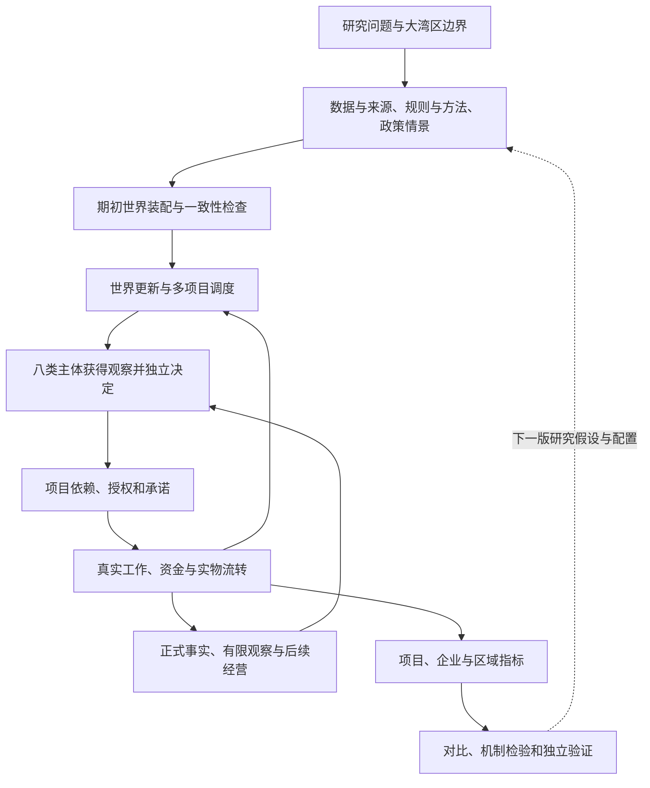

# 仿真运行、实验与结果规范

规范性质：数据装配、运行控制、实验执行、指标与研究证据的目标规范。时间、工程、金融及现实参数按模型决策落实；支持状态须由具体实现与验证证据确认。

[总入口](../README.md) · [世界运行](../02_world/world_runtime.md) · [共同对象](../02_world/domain_objects.md) · [项目推进](../03_projects/project_lifecycle.md) · [政策量化](../05_policy/quantification.md) · [开发契约](../06_engineering/implementation_contracts.md)

本文把一次研究从输入数据连接到可解释结果：怎样准备同一个期初世界，怎样启动/暂停/恢复，如何保留主体决定和实际事实，以及怎样统计和比较。世界时钟和调度仍由 [世界运行](../02_world/world_runtime.md) 维护，正式业务对象由 [共同对象](../02_world/domain_objects.md) 维护，单项目依赖由 [项目运行](../03_projects/project_lifecycle.md) 维护，八类角色各有主文档；本文不重新定义它们的行为。

装配、运行控制、检查点、实际样本与配对、指标和导出分别按[系统接口目录](../06_engineering/system_interfaces.md)调用，遵守[共用输入输出契约](../06_engineering/interface_contracts.md)。分析函数读取冻结的对象/方法/样本版本；不能以目标函数已登记替代实际运行样本和实现证据。

<!-- page-nav:start -->
**本页导航**

[1. 研究运行链与职责边界](#1-研究运行链与职责边界) · [2. 数据准备与期初装配](#2-数据准备与期初装配) · [3. 运行清单与配置冻结](#3-运行清单与配置冻结)

[4. 启动、暂停、停止与恢复](#4-启动暂停停止与恢复) · [5. 决定、执行和可见观察的追踪](#5-决定执行和可见观察的追踪) · [6. 结果记录的通用口径](#6-结果记录的通用口径)

[7. 合作网络与跨地区结果](#7-合作网络与跨地区结果) · [8. 实验包、验证与显示](#8-实验包验证与显示) · [9. 业务闭环的就绪依赖](#9-业务闭环的就绪依赖)

[10. 整次运行验收条件](#10-整次运行验收条件)
<!-- page-nav:end -->

## 1. 研究运行链与职责边界

| 需要改变什么 | 唯一主文件 | 修改后至少检查什么 |
|---|---|---|
| 研究对象、地域及外部边界 | [研究范围](../01_overview/research_scope.md) | 输入覆盖、角色集合和统计样本 |
| 时间、环境更新、唤醒和资源竞争协议 | [世界运行](../02_world/world_runtime.md) | 同刻事件、周期边界、等待及反馈 |
| 身份、任务、许可、账本、资源和事件 | [共同对象](../02_world/domain_objects.md) | 引用、状态拥有者、版本、增量/累计及一致写集 |
| 某角色的目标、选择、工作及经营 | 该角色主文档 | 上下游交接、权限和资源约束 |
| 项目并行、放行、变更、替换和收尾 | [项目运行](../03_projects/project_lifecycle.md) | 责任绑定、必要证据、未完成义务 |
| 政策证据、机制与组合 | [政策量化](../05_policy/quantification.md)；具体工具在 [工具目录](../05_policy/instrument_catalog.md) | 参数依据、覆盖去重、主体响应及应用记录 |
| 整次实验的装配、运行控制、结果口径 | 本文 | 期初核对、恢复位置、分母和可比较性 |
| 契约格式与实现证据 | [开发契约](../06_engineering/implementation_contracts.md) | 字段、方法、独立预期和真实实现位置 |
| 页面操作、跨页上下文与读写投影 | [前端规范](../06_engineering/frontend.md) | 草案/运行/历史区分、同一快照、正式来源、命令回执及示例隔离 |

[协作链](../03_projects/collaboration_flow.md) 是交接索引，[贯通场景](reference_scenarios.md) 是贯通例子，[模型决策](model_decisions.md) 是待定选择登记。它们引用主规则，不成为另一套执行定义。

## 2. 数据准备与期初装配

**RUN-001｜数据记录、组织身份和仿真实例分开。** 多个来源可能描述同一家组织；同一家组织可能有多个地点、资格和设施。先建立有来源的实体匹配关系，再生成有运行命名空间的实例。不以相似名称自动合并，也不将多条来源复制成多份现金/产能。无法确定的匹配保留候选和影响范围。

| 准备步骤 | 产物与检查 |
|---|---|
| 定义研究样本 | 地区、用途/事项、时期、主体选样与补足规则；未被单列的必要服务作为有边界的过程 |
| 保留原始记录 | 来源 ID、原始字段、取得/适用时点、资料版本；后续清洗不覆盖原证据 |
| 对齐身份与单位 | 原记录→组织/地点/设施映射；币种、面积/数量、资源单位、时间与统计范围 |
| 补全与生成 | 每字段记录观测、推断、情景或合成及方法版本；主体真实不代表其全部参数真实 |
| 建立期初关联 | 主体、账户/义务、项目/合同、任务/许可、库存/在途、资源承诺、地区存量与需求引用 |
| 关闭初始化重复口 | 按 OBJ-021 标记已包含的历史执行、费用、库存和存量；不能在首轮再次入账/入库 |
| 形成认知基线 | 谁在期初已经知道哪些资料、来源和时点；公开事实不等于每个主体已读 |
| 出具装配结果 | 可用部分、缺失/冲突对象、受阻机制、不适用项和期初检查结果 |

每个模型字段的血缘至少可追到 `source_record/field → transform/version → target_object/field/version`，附单位换算、适用期、缺失处理和证据类型。多个来源冲突时按已声明方法选取或保留区间/未知，不能用平均数解决身份、许可或权利冲突。

每次装配形成 `initialization_manifest_id/version`，记录模型起点、资料可得截止、总体覆盖、来源批次、实体映射版本、补全/合成方法和随机来源、期初对账结果及缺口。测量/有效时点、发布/取得时点和主体获知时点分别保存；用后来修订资料回溯重建初态时注明这一性质，不把后来资料自动放入当时主体观察，也不以验证期结果补齐预测该结果的初始特征。未经声明的抽样权重/外推方法，结果只代表模型覆盖，不能放大成湾区总量。

**RUN-002｜补足主体不能偷偷补足市场供给。** 缺角色时先判断该事项是否需要独立组织、现有组织职能或有界外部过程。若使用合成实例，记录补足原因、资格假设、现金/能力来源、出现时点及统计归属；不得为了让项目通过而每次失败就新增一家有钱且有产能的企业。人口代表性、初始网络和合成比例分别报告，不把便利样本等同湾区全体企业。

期初业务状态的主契约为 OBJ-021；下面是装配检查，而非新账本：

| 检查面 | 不能发生的初始化错误 |
|---|---|
| 资金 | 同笔历史付款既已进入期初现金，又在首期作为新支付执行；贷款本金与到期计划相加成两份债务 |
| 实物 | 期初在途在厂库和现场库同时计全量；已用材料仍全部可分配；母批次与拆分批次叠加 |
| 资源 | 同一工厂/专业团队在多个组织或项目里各有一份容量；历史占用无人持有或无有效范围 |
| 项目与区域 | 期初已建资产再次计为本期交付；同一在建项目既作区域聚合量又作为独立项目重复加入 |
| 权利与成果 | 用角色/城市标签替资格与许可；历史完工不等于成果可用于当前版本和范围 |
| 截点与未知 | 资料记录时间冒充实际发生时间；将未知余额/缺陷/工作量填 0；无法核实历史时伪造已全部对账 |

## 3. 运行清单与配置冻结

**RUN-003｜运行清单连接全部规则，而不是只保存 seed。** 新运行建立不可混用的 `run_id`，将下列内容固定到可追溯版本。冻结表示本次实验引用确定版本；不是冻结社会状态或禁止场景预设的政策变化。

| 运行清单组 | 最少内容 |
|---|---|
| 问题与边界 | 实验/情景/主张与比较定义的稳定 ID/版本、机制判别与反馈范围引用、地区/用途/事项、观察期与结果口径、未建模部分；所属执行任务和重复位置沿第 8.3 节 |
| 业务配置 | 角色/项目模板、允许动作、工程/财务/市场方法版本、时间与竞争协议 |
| 政策与外生路径 | [政策量化](../05_policy/quantification.md)/[工具目录](../05_policy/instrument_catalog.md) 的工具、参数、时序/过渡、通知规则、冲击/边界数据版本 |
| 初始条件 | 数据快照、来源与补全报告、历史覆盖、独立认知基线、未清义务和未决执行 |
| 决策配置 | 真实模型/规则/离线替身、提供者/版本、提示与动作契约、行为评价配置引用、调用预算和超时/重试策略 |
| 随机性 | 各独立随机来源、seed/状态、抽样身份、复用规则和外部不可控部分 |
| 实现证据 | 实际代码版本及未提交差异标识、支持方法清单、配置摘要、输出/检查点位置 |

涉及现实数据或模型调用时保留授权范围，记录可复现的请求/结果引用，不在结果包输出凭据或不必要的私有全文。技术支持不完整的配置应定位到具体缺项，不能静默忽略字段后仍显示全部生效。

**RUN-004｜就绪检查只限制真正依赖缺项的范围。** 可以先运行有完整契约的局部离线样例，但必须显示支持范围和固定替身条件；不能把它称为完整建筑项目实验。完整运行需要其实际经过的每条必要路径具备方法、单位、依赖与失败语义，不能用“已有角色文档”替代计算方法就绪。

资源/资金数值明确但不足，可以形成合法压力场景；来源或必要规则缺失属于配置不完整。二者分别处理。时钟和工程粒度仍待选择时，继续完善与之独立的契约，不以未选定的月制或空方法作为基准。

## 4. 启动、暂停、停止与恢复

**RUN-005｜运行状态和项目状态分别维护。** 目标运行状态如下，名称为建议枚举；业务项目是否完成由 FLOW-010/011 的收尾规则判断。

| 运行状态 | 含义与允许接续 |
|---|---|
| preparing | 整理配置/数据，尚无正在推进的仿真；可修订草案 |
| initialized | 期初检查完成，运行清单与起点已固定，尚未推进业务 |
| running | 按 [世界运行](../02_world/world_runtime.md) 推进世界、主体与多个项目；记录实际处理位置 |
| paused | 计划暂停或技术限流，可按原运行清单从一致位置继续；墙钟等待不自动增加业务时间 |
| needs_recovery | 全局一致性或实际调度位置无法可靠确定；先核对/恢复受损部分，再恢复整次推进 |
| ended | 本次观察期、明确停止条件或全局限制已结束；保留结束原因、未完事项和可分析范围 |

结果整理/导出另有状态，不能因为图表生成失败就回滚项目，或因图表生成成功就把业务标为结束。停止按钮的具体语义由运行控制契约明确：暂停用于继续同一运行；结束用于固定本次观察范围。延长已结束实验或改变有效模型须形成有父运行引用的新实验/分支，不能覆盖原结果。

运行控制对应的 Workflow 和 Simulation 操作见 [前端规范 第 6—7 节](../06_engineering/frontend.md)。世界实际推进位置、用户正在看的历史位置和墙钟播放速度分别表达；读取状态/快照不推进世界，创建成功不显示本次运行已结束。目标 API 受理、正式提交、执行未知及暂停确认仍服从 [开发契约](../06_engineering/implementation_contracts.md) 的共同协议。

局部付款结果未知、订单待核或一次模型失败挂在对应对象/任务上，隔离受影响的占用、依赖和待办，其他独立工作可以继续；普通在途和等待不是全局恢复故障。只有无法确定全局一致性/继续执行位置，或受影响范围无法安全隔离，才把整个运行转为 needs_recovery，并记录具体依据。

**RUN-006｜空队列不等于研究完成。** 检查未来外生事件、企业周期经营、义务到期、周期汇总和有规则的重新评估。若有未来事件则推进到相应时点；若有阻塞事项但无合法唤醒源，记录阻塞链与“无可推进事项”；若本模型允许静止至研究期末，按已选协议记录静止区间。任何一种都不能伪造完工/清偿或自动造项目来保持动画运行。

**RUN-007｜恢复从已提交事实继续。** 检查点至少需覆盖正式对象、账本/资源、任务及事件队列、时间/同刻处理位置、命令去重/未决执行、观察投递、私有认知、随机状态和清单版本。缺某部分时明确能力限制；展示快照只保证可查看。

三种能力分别标记：

- **结果重放**：读取既有事件/快照复建展示，不再调用模型或重新付款/施工。
- **断点续跑**：从完整且一致的检查点继续原运行；未决外部结果先核对，重试复用原身份。
- **分支实验**：从指定基准复制允许的状态，生成新命名空间与变更清单；明确继承哪些认知/承诺/政策，不把它称为完全相同条件下的重放。

改变提供者、提示、方法或配置后重新推理不能当作原决定的恢复；保留父子关系、变更位置和不可比较部分。技术调用失败、业务拒绝及实际执行结果未知按各自协议保存。

检查点与正式写入、事件、待投递和观察消费怎样保持同一一致位置，由 [开发契约 第 7.1—7.3 节的软件提交与恢复协议](../06_engineering/implementation_contracts.md)维护；本文只登记整次运行的恢复能力、状态和证据，不另定事务、观察去重或随机恢复算法。

## 5. 决定、执行和可见观察的追踪

**RUN-008｜每次主体决定有完整引用链。** 请求→返回→合法性检查→命令→正式提交→通知/观察分别记录，字段主定义见 OBJ-003/012/013。至少能追查实际主体/职能、动作契约、对象/候选版本、可见信息截止、决定模式/调用身份和预算、显式选择或技术结果、提交事件及失败原因。

主体可以拒绝、不行动、请求信息或提出契约允许的新方案。模型超时、预算不足、无效结构及不支持方法不是业务拒绝，不偷换规则提供者制造成功。专业数值建议、商业报价和实际资源/工程计算分别标记；报价可以是主体选择，真实完成量和现金仍由正式入口计算。

同一轮请求的返回快慢不隐含决定商业优先级。迟到返回按原请求和最新有效状态校验；已取消/替代的请求不能偷偷生成新承诺。请求缓存和认知存储包含运行、主体、动作、对象/上下文版本，避免其他主体或对照实验的资料混入。

核心可以审计隐藏状态以维护硬约束，主体只接收获授权的解释/观察；不能借错误消息把他方私有余额、底价或尚未发现缺陷全部透露出去。专业判断不被全知真值校验器替代，沿 OBJ-003 的证据与认知边界。

### 5.1 把候选暴露作为决定之前的可观察过程

候选来源、资格/可见性、查询、排序/截断、短名单、邀请和选择的共同契约由 [共同对象 OBJ-003](../02_world/domain_objects.md#obj-003--主体只依据其可获得的信息作决定)唯一维护。结果包引用实际暴露记录及版本，不从最终合同反推主体曾经看过谁，也不为统计另造一套候选池。资格与知晓可交叉，不把所有候选排成必经的单一漏斗。

| 分析层 | 从共同记录读取和比较什么 | 不可推断什么 |
|---|---|---|
| 适用资格与获知 | 各自集合、交集、未知范围及来源时点 | 有资格者一定被主体认识；已获知者一定有资格 |
| 检索与展示 | 同一查询下返回/展示集合、顺序、截断理由及搜索投入 | 未显示的候选被主体主动拒绝 |
| 邀请与响应 | 哪些已展示者被邀请，实际发出与收到、接受/拒绝/待办/技术结果 | 技术超时、未送达或预算不足等于不愿合作 |
| 选择与实际执行 | 正式决定、有效接受、承诺和实际履约引用 | 被推荐、被选中或签约就等于已交付 |

例如 4 个等价且已知的合格候选中，检索只展示前 2 个；另一配置展示全部 4 个。两组最终选择不同首先是暴露机会不同，不能直接归因于主体地区偏好。要测决策差异，先固定同一展示集合和顺序；要测搜索机制，先固定行为提供者并改变检索。组间资格、来源或真实属性不一致时不称“等价扰动”。缺失的检索历史标为未知，不能补造无偏暴露。

每层分析先声明对象是查询、候选—请求对、邀请还是组织，以及重试如何归并；只在同一风险集合内比较响应。截断与未展示可以形成单独结果，不通过把所有企业作响应分母稀释拒绝率。具体统计沿 RUN-009；行为比较按第 8.1 节。

## 6. 结果记录的通用口径

**RUN-009｜所有指标先定义样本、时间、单位及正式来源。** 每个指标保存 `metric_id/version`、对象类型、样本规则、时期/时点及边界包含方式、计算公式、单位/币种、来源对象/事件、去重键、缺失与不适用处理、未完/退出处理、展示变换。新口径生成新结果版本，不能静默改旧图表的分母。

结果至少保留值、分子、分母或样本数、覆盖范围和缺口。技术中断、业务放弃/取消、正常未完和已完成分别归组；按同一进入样本保留这些状态，不能在计算平均工期或转化率时无说明删除失败者。技术中断是否能贡献某个截至中断时点的统计，依预先声明的暴露窗口判断。

期间统一由选定时间协议声明；下面用 `W` 代表同一明确窗口，用 `T` 代表其期末截点，不预先替 D-04 选择日/月或端点处理。期初快照已包含的事实不得再次计入 W 的新增流量。发生时点、收到/记账时点及重述版本并列可查；迟到事实更正可生成标记清楚的新统计版本，不改主体当时所知。

零分母的比率为“不适用/不可计算”，缺分子或覆盖不完整为“未知/覆盖不足”；都不能显示成 0%。未覆盖成本显示已知小计与缺项，不能输出貌似完整的项目总成本。跨币种金额先按明确汇率日期/口径转换或分币种报告，不能直接相加。

| 指标 | 目标定义与边界 |
|---|---|
| 新提案 / 新投资项目 / 新开工项目 | 分别计 W 内首次满足对应事实的唯一 `owner_case_id` / `project_id`；重评、重新发布、复工不再次算新建 |
| 期末在建存量 | 截至 T 已开工、仍计划继续建造且有定义内剩余范围的项目/规模；暂停分列，正式终止且不再计划施工的范围退出在建；终止残留实物、后续处置和债务另列，不能用累计开工减累计交付代替状态判断 |
| 交付量与实际可用量 | 按唯一交付范围/资产用途和物理单位汇总；分区交付不能同时累计父项目全量；移交与获准/实际投入使用分列 |
| 投资转化率 | 选择固定的期初/进入窗口提案队列，统计截至 T 首次转为投资的提案数 ÷ 该队列总数；拒绝/放弃仍在分母，未决单列，不能用本期投资数除本期新提案数混合不同队列 |
| 完成周期 | 明确同一对象的起点/终点，已完成者计算差值；在办者显示已等待时长和截尾状态，不能把 T 当作实际完成日 |
| 延误 | 对相同范围，比较实际里程碑与有版本的基准日期；原基准与合法修订基准并列，不能覆盖旧计划使历史延误消失 |
| 成本与资金 | 资源成本、合同价、核证金额、实际现金、融资本金/利息、资助及财政支出分列；按同一事实身份消除内部转移重复，未支持部分不凑总数 |
| 未清与逾期 | 截至 T 的有效未清义务按币种/当事方/到期分列；执行未知另列，不能当作清偿或免债，未到期不并入逾期 |
| 资源利用 | W 内实际投入量 ÷ 同口径可提供服务量；预留与实际使用分列。单位/时间窗/故障和非工作期明确，超额承诺不伪装成实际使用 |
| 质量与监管 | 实际生成的缺陷、被发现缺陷、检查次数、整改完成及未检范围分列；无记录不证明无缺陷，检测率分母依可识别范围说明 |
| 地区需求满足 | 在相同地区×用途×单位与截点内，按 OBJ-017 的实际可用/使用关系计算；不以签约或期望交付替代供给，不与自用需求重复统计 |

上述是目标最小字典；具体新开工/交付范围等谓词需引用所选项目模板，不能绕过 [项目运行](../03_projects/project_lifecycle.md) 的放行条件。并非每次研究都必须汇报所有指标，按问题选择并保留未覆盖说明。

资源利用的分子、分母都按同一资源及时间分段累计，例如真实投入的人时对应实际可提供的人时；停机、非工作期和新增能力按各自有效区间进入分母，不拿期末容量代表整个期间。计划承诺/能力缺口另列，不能把合法承诺超过故障后的能力写成超过 100% 的实际使用来掩盖不可执行状态。

## 7. 合作网络与跨地区结果

**RUN-010｜四类关系分别保存。** 接触/消息、报价或候选推荐、正式合同、实际共同履约是不同关系层；主观信任是某主体的认知，不能由消息数直接改成真实合作强度。初始真实或合成关系与运行中新增关系分别标记。

每个网络视图有 `network_view_id/version`，声明节点集合/层级、关系类型、方向、时间和分母。委托/采购、融资、监管各有关系类型，不混成同一合作边。主体—项目参与可以保存为二部关系；如需“同项目参与”的投影另建明确层，不能自动把同项目八类主体连成两两签约或彼此信任。统计投影也不能向主体记忆写入从未发生的合作经历。

| 网络对象 | 定义要求 |
|---|---|
| 节点 | 唯一组织/机构，统计样本及进入/退出时点；同一组织多个角色不能自动成为多家企业 |
| 关系记录 | 有方向时注明委托/支付/供货等方向；两方身份、关系类型、项目/合同/工作范围、发生/有效时段与证据事件 |
| 边的汇总 | 同一两方多个合同可保留多重关系；画单条边时注明以数量、金额或履约量加权，单位不可混合 |
| 跨地区标签 | 组织联系按各方声明的身份地区；服务/生产协作按实际活动地点→相应施工/交付范围；跨城市与涉及制度边界分列，不能互相代替 |
| 关系结果 | 取消、到期、终止与历史曾合作分别统计；合同失效不抹掉历史履约，未履约的合同不计实际合作 |

建议的最小可比网络指标：

- **正式合作边数**：所选窗口/时点与样本中，满足正式关系定义的不同组织对数；另报合同数，避免把多张合同当作多对伙伴。
- **实际跨地区履约占比**：在同一物理单位/金额口径下跨地区履约量 ÷ 同一范围总履约量，或跨地区唯一组织对数 ÷ 全部实际履约组织对数；两种指标分别命名，分母不能混用。
- **重复合作**：在窗口中新形成的正式关系中，双方此前确有独立合作事件的数量/占比；同合同分批履约、变更和付款不算新增一次合作，是否限定不同项目应由指标卡说明。
- **网络密度**：`观察到的有效不同组织对数 ÷ 本次样本允许的不同组织对数`。分母集合须有版本，可按角色/活动适配定义；不能默认所有八类组织两两都可建立同一种关系。关系方向、允许自环、孤立节点与退出处理显式声明。

每个政策对比同时列初始样本和期末活动样本。新增/退出企业改变分母时报告数量及组成效应；可另外比较共同样本，但不能只保留成功参与者证明合作改善。不同城市之间发生联系不自动等于跨境活动，也不证明产品、接口或合规证据已经复用。

密度的有效边集合 E 与允许配对集合 A 必须使用同一关系层、样本和时间语义，并检查 `E⊆A`。期末密度使用该截点有效关系和该截点相应关系可合法存在的配对集合；新准入收窄但旧合同仍合法存续时，依据过渡规则纳入后者，不能把“当前能新签约”误作“已有关系能合法存续”。期间形成指标另定义窗口内新形成关系及有机会形成关系的配对/暴露范围，不能用“期间曾发生”边除以期末瞬时配对数。不满足包含关系时报告口径冲突，不删除真实边、截断为 1 或事后随意扩大分母。

地域字段缺失记未知，不默认本地；一条关系涉及多个地点时按范围/数量拆分。跨地区边占比以可判定地域的已发生边为分母，同时报告全部边数、未知数和地域可判定覆盖率；履约量口径同样报告已知范围占全部量的覆盖。资格和制度边界按具体事项及当时版本判断，不仅按城市名称判断。跨地区占比的“已发生边”分母与密度的“可能配对”分母必须分开。

### 7.1 工程实体跨区与企业跨区履约分别统计

**RUN-013｜总项目、子区段、工作包和地区只是不同归集层。** [工程模板](../02_world/project_types.md)给出工程对象/有限模板，[共同对象](../02_world/domain_objects.md) 维护总项目与实际范围引用。统计先声明层级和去重键：项目数按唯一 `project_id`，区段按有效 `scope_ref`，工程量/实际费用从唯一执行及 `physical_scope_ref` 归集；不能把一个总项目与其道路、桥梁等子项相加成更多总项目或把上层汇总再次计入。

| 统计对象 | 合法口径 | 不能混成同一指标 |
|---|---|---|
| 工程实体跨区 | 同一工程实际覆盖的地区、各可追踪子范围及整体接口 | 企业注册地不同不使工程本身跨区；一个跨区工程也不证明有跨企业合作 |
| 企业服务/生产跨区 | 有关组织实际服务地/生产设施→对应施工或交付范围，附实际履约 | 不能因工程跨两城就把每家参与企业都标成跨区供方，也不能用总部替代工厂 |
| 地区工程产出 | 对不重叠的实际覆盖分配同口径完成量；共同范围/未分配量单列 | 跨城整桥在两城各报全量后相加，或把供方生产数量再次当现场新增安装 |
| 项目/地区成本 | 同一实际费用事件在选定覆盖中计一次；共用费用按有依据分配或保留共同项 | 母项目总价、子包价和实际资源费用相加；无分配依据时在每区各放全部共同费用 |
| 项目/地区资源 | 引用同一底层资源与实际时间窗口，范围分派和汇总可核对 | 同一队伍跨道路/桥梁任务各得到全额容量或同一实际工时被各层重复计入 |

“地区参与项目数”允许一个跨区项目出现在多个地区，但须命名为非可加的参与投影，不能求和代替湾区唯一项目数。需要可加归集时，地区子范围应覆盖一次且不重叠；共用费用权重或其他分配依据须有版本并核对总额，缺方法则保留未分配，不能静默平均。建筑面积、道路长度、桥梁数量、隧道长度、工程通行能力和实际交通流按各自单位报告；即使均用长度，走廊长度与已包含其中的桥/隧长度也不能重复相加。

**RUN-014｜目录覆盖、方法支持和研究验证不是同一状态。** 结果包引用工程对象分类、实际选用模板及方法版本，并沿 [工程模板](../02_world/project_types.md)、[开发契约](../06_engineering/implementation_contracts.md) 的支持声明分别报告：目录中可描述、方法已定义、代码已实现、合成机制已核对、参数已校准、独立研究已验证，以及未覆盖/不适用范围。只保留其中已具证据的状态，不把未实现或未支持的产出填成 0。

跨类型报告可以并列不同支持范围，不能据一个建筑或道路切片的离线通过声称桥梁、隧道或超高层已获验证。工程实体完成、连接条件成立、合法可用和实际服务效果各按其支持方法与证据发布；没有交通分配或使用反馈时，不用开放状态计算出未经支持的交通收益。

## 8. 实验包、验证与显示

**RUN-011｜一次结果包能回到实际输入和执行。** 最少含运行清单、数据/来源及期初检查、场景差异、决定与提交引用、事件/资源/资金/工程状态、观察/错误、指标定义和数值、未完/未清事项、恢复能力、检查记录和已知限制。前端只读取这些投影，不维护第二套成本或政策收益计算。

Analytics 的 Overview、Periods Analysis、External Change Analysis 与 Reports 对应 [前端规范 第 8—9 节](../06_engineering/frontend.md)。三种页面分别绑定明确运行/窗口/实验集合；空值、零值、演示、估计和实际结果分开。多面板读取带一致快照或明确水位，图表可追到本节的指标/网络定义及正式来源，不用单运行推算无政策基准或生成重复实验样本。

结果证据分层报告：

| 层次 | 能支持什么 | 尚不能证明什么 |
|---|---|---|
| 文档和契约检查 | 规则引用、定义与预期一致 | 代码已经实现 |
| 离线机制检查 | 给定输入、固定选择下实际输出和失败路径符合契约 | 真实主体会作这些选择 |
| 决策能力评估 | 指定提供者在限定输入下的合法性、稳定性和行为特征 | 完整社会模型与现实一致 |
| 参数/机制校准 | 指定样本内能解释某些观测 | 独立样本预测正确或政策效应被识别 |
| 独立验证 | 保留的时期/项目/地区等样本上的对应表现 | 自动外推到全部湾区或其他政策 |
| 政策解释/因果识别 | 依模型假设和额外研究设计支持限定结论 | 仿真对比本身就是现实因果效果 |

训练/校准与验证记录按共享组织、项目、时期和机制关联识别泄漏；同项目不同批次或同企业近似重复资料不能被当作完全独立验证。具体验证划分和样本可用性需在实验前声明，不能看结果后挑选最有利划分。

每项主张登记 `claim_id`、适用范围、主要/辅助指标、比较组、判定依据、配置冻结版本、数据用途和支持证据，并关联第 8.2 节的竞争解释、否证观测和反馈边界。数据用途区分初始化、校准、开发诊断和独立评价；有重叠时明示。若为了改模型/提示/阈值而使用了原留出资料，将其重新标为已用于开发，并另取未用资料或声明独立性已失效。换 seed 不是新增现实验证样本；没有独立观测时维持合成机制检查/待验证状态，不用本模型输出证明其现实正确性。

多次运行、低响应/能力受限/消融和不确定性比较沿 POL-011/012。记录全部计划运行、实际成功/中断及排除理由；失败不填成零收益，不能只汇报最佳 seed。展示缩放、舍入或聚合保留原指标引用，图表的视觉变化不改变正式结果。

### 8.1 候选暴露与行为基线评估

每个准备接入复杂决策的关键动作，先建立有版本的 `behavior_eval_profile`：业务问题、允许动作、真实可见输入与候选暴露引用、主体特征/目标及来源、提供者/技能/提示、认知处理、评价数据用途、重复设计、预算和判定依据。它是评价配置，不能代替角色自己的行为定义；例行履约和正式计算不因有此评估就改为模型发言。

至少保留一个能说明逻辑的简单提供者作为比较，例如在已知合法候选中按明确业务目标和同分规则选择的启发式；需要随机基准时另记抽样规则。复杂提供者可以是指定 LLM/Skill 或其他模型。它们是预先声明的实验分支，不能在 LLM 失败后临时替换来补成功率。先做固定可见输入的决定比较，再做允许搜索/咨询的完整任务比较，后者同时解释信息取得方法与决定方式，不能称为纯模型推理差异。

| 比较 | 实际保持与改变 | 读取的结果及解释 |
|---|---|---|
| 重复与简单行为基线 | 保持主体、输入、动作、暴露、认知基线；按声明重复并改变提供者 | 选择/拒绝/询问分布、约束违反及任务表现；合法输出率不是唯一结论 |
| 顺序与措辞等价扰动 | 只换等价候选的展示顺序、无意义显示名称或不改变事实的措辞，保留真实 ID/属性映射 | 位置偏好、分布差异和不确定性；有历史含义的名称、承载实际信息的政策告知不属于无关扰动 |
| 业务异质性 | 固定相同候选，改变有来源或显式合成的流动性偏好、交期损失、风险判断或预期 | 选择是否响应业务差异、跨主体共同误差；不靠地区刻板标签或随机编理由制造异质性 |
| 固定记忆与指定学习 | 同一合法可见经历分别不更新、按选定方法更新；随后用相同评价输入检查预期/选择 | 指定预测误差、置信与实际选择变化；允许无效或退化，不能以记忆长度或理由更流畅证明学习 |
| 固定信息与搜索任务 | 先比较同一暴露，再单独允许各方法按预算查询/咨询 | 获取信息、搜索成本、后续决定和执行分开，不能将更完整候选误认成更强判断 |
| 技术可用性与预算 | 保留所有获分派任务及预定资源口径；分别统计实际调用/工具/重试与未处理 | 完成覆盖、技术错误/超时/耗尽、业务拒绝、有效选择及成本，不删除失败后只比成功请求 |

一个可用的异质性案例是：两份均可履行的报盘中，较早交付者要求较大预付款；甲的现金安全偏好较高，乙的延迟损失较高。两者仍受同一真实资金约束，比较其选择对目标变化的响应，不强制任何一种偏好必然得到唯一答案。若偏好只写在提示里，应标为行为假设，并与使用相同特征的简单提供者比较，不能直接称为已校准企业。

学习案例可以使用同一伙伴先前已合法送达的延误证据：固定记忆分支保留原信念，更新分支按版本化方法修订交期预测；两者在相同新任务、相同伙伴资料和未见评价结果时作出预测/选择。评价时才读取该任务实际结果。回放相同经历的诊断比较与学习后改变自身经历的完整运行分别报告，不能把经营环境变化全部归为学习效果。伙伴反馈、质量实际值与发现的界限继续沿 OBJ-003/014/022。

固定记忆只冻结被检验的主观信念/策略更新，不冻结当前现金、有效合同等必要业务事实。诊断分支需明确后续上下文是否包含原始经历；若把完整反馈再次放入“固定”分支的提示使模型现场重学，就没有隔离该更新机制。原始观察仍在审计记录中，评价输入与认知状态分别留痕，不为对照删除正式历史。

预算比较预先说明采用同一业务任务覆盖、相同总成本上限或其他有依据约束，不假设相同调用次数等于相同成本。分别报告分派任务数、已处理/未处理、有效决定、业务拒绝、技术失败，以及调用/工具耗费和计价版本；按完成任务计算的质量与按全部分派任务计算的覆盖并列，不能用遗漏难题提高表现。不得为了扩大样本自动增加授权预算。判定阈值、重复数和比较方法在看结果前声明，尚无依据时保留描述性分布，不发明通过比例。

当仅无关政策名称变动就产生显著行为差异时，先报告提示敏感性；当政策通过可见通知或知识改变起作用时，保留这一显式信息通道并与实际资格/资源改变分开。以上均是待执行评估设计；简单提供者通过、真实模型输出合法和真实行为可信是不同结果。

### 8.2 研究主张怎样被支持、区分或否定

政策主张引用 [政策量化 第 8.1—8.2 节](../05_policy/quantification.md#81-一张能区分机制的合成判别卡)的干预、机制判别和反馈范围，不重复维护另一份政策规则。其他研究主张也需列出至少一个竞争解释、区分它所需的过程观测，以及不成立或无法判断的条件。结论状态可为符合预期、相反证据、未触发、被其他瓶颈阻断、观测不足或多个解释相容；这些是研究判断，不改变正式业务事实。

MECH-SYN-01 给出一个具体登记方式：

| 结果组合 | 对“资格扩大缓解工作能力瓶颈”的判断 |
|---|---|
| B 的资格、暴露、有效接受与实际投入增加；受限组总完成增加、待办减少 | 在固定选择和其他条件成立的合成例中符合能力通道预期；仍不证明现实效应 |
| B 的合同/履约增加，但总完成不变、A 的投入相应减少 | 与订单替代相容，不能仅用跨区履约增加支持瓶颈缓解 |
| 资格已变而 B 没有暴露、未接受或无实际可用能力 | 分别报告未触达/未采用/能力阻塞；不能把零结果混称工具未生效或模型故障 |
| 只有最终合同或总量，没有候选与投入观测 | 多个解释相容；登记缺哪项证据，不用 LLM 事后理由补作事实 |

实际判断保留预期和结果的不一致，不把主张改写到必然成立。除机制是否触发外，检查外部需求/共同冲击、合成主体补足和其他政策是否同时变化；不能把一次同时改变多项条件的运行当作单通道证据。过程观测可诊断模型作用，但从模型内部生成的信念、质量或反事实不是新增现实观测，事实与发现仍沿共同对象定义。

观测窗口也属于主张：空白初态可能含建设积累期，短窗口可能尚未覆盖回款、吸纳或缺陷。预先声明使用来源明确的在建/存量初态，或报告启动效应；延长观察、调整初始化或删去早期数据均保留版本与理由，不能看结果后只保留有利期间。没有独立证据时保留“合成机制检查/待现实验证”，不据文档自洽声称已完成识别。

### 8.3 实验作业、实际运行集合与比较结果

政策组合、情景和变化/控制/结果范围由 [政策量化 第 8.4 节](../05_policy/quantification.md#84-从政策组合到稳定情景与比较定义)维护。本节将选定比较连接到真实执行与统计；地图/分析页面只引用这些对象，交互规则沿 [前端规范](../06_engineering/frontend.md)，不在页面创建另一套配对、指标或结果。

**RUN-015｜计划执行与实际运行是两份记录。** `experiment_id/version` 固定情景/比较版本、期初与方法、重复计划/停止规则、独立随机来源、资源预算和执行约束。一次显式执行命令产生 `execution_job_id`，由运行编排登记计划位置、受理/派发/暂停/终止及实际耗用；“已提交作业”不代表任何运行已完成。平台模型/工具调用预算与世界内财政、企业现金分别记录，不能互相替代。

| 对象 | 必需身份与内容 | 不允许的替代 |
|---|---|---|
| 实验与执行作业 | experiment 与 execution_job 身份；冻结配置、计划重复位置、授权预算、停止/补跑规则、实际耗用和未派发原因 | 根据页面打开次数或刷新次数启动新重复；预算不足自动扩大调用额度 |
| 计划重复位置 | `replicate_slot_id`、情景版本、计划的随机/配对区组、派发状态与尝试引用；尚无实际运行时 run 引用为空 | 将未派发位置计为完成样本，或填成零结果 |
| 实际成员清单 | `run_set_id/version`、实验引用、各实际 `run_id`、所属 slot/尝试、运行清单、状态/结束原因、业务覆盖及结果引用 | 从情景卡或数量参数合成 run_id；同一实际运行重复列入形成多个独立样本 |
| 配对记录 | `pairing_id/version`、`contrast_id/version`、区组内各情景的实际 run、控制核对、有效性与排除原因 | 仅按相同 seed、列表相邻或结束顺序宣称有效配对 |
| 比较结果 | `comparison_result_id/version`、contrast、run_set、pairing 或未配对方法引用、指标/范围/时间与样本明细 | 只有两条图线或一段解释，没有构成它的实际输入 |

身份均为非空稳定标识；版本指向不可覆盖记录。实际成员由运行编排根据已建立的运行登记，结果服务核对；新增运行、迟到状态或结果修订形成新 run_set/结果版本。运行的 ended 状态与结束原因沿 RUN-005；不得为图表另造“成功完工”的运行状态。作业结束也可以保留业务项目未完、运行技术中断和未派发位置。

运行状态、`analysis_eligibility` 与当前 `read_status` 是三条轴。第一条沿 RUN-005；第二条按“运行＋指标＋范围/时间＋统计版本”判定可用、部分覆盖或不可用，附依据/缺口，不能只筛已结束运行；第三条仅表示这次查询的读取中、可用、过期或失败及水位，不反写世界状态或把已有结果从研究样本删除。已知且覆盖完整的业务结果可以为零，例如所有提案合法放弃而无新增投资；技术失败、尚未生成或读不到不能填零。技术中断前的历史能否用于某项统计，仍按 RUN-009 的预定观测范围判定。

同一运行的恢复沿 RUN-007，不增加独立重复数。需要重新初始化时建立新 run_id 和尝试记录，保留失败尝试及替换依据；每个预定 slot 对一个统计目标最多贡献一次选定尝试，不能把重试当独立样本，也不能事后只保留更有利的尝试。哪些技术失败可补跑、何时停止及如何估计须预先声明；不自动补齐直到获得足够成功结果。

结果查询、地图切换、比较筛选和导出不派发运行、不推进世界、不调用决策模型。不存在 run、未到达所需业务时间或缺观测时返回具体状态；缺失样本若需重跑，走显式作业命令和已有授权预算。用既有事实重新计算指标可以形成独立分析任务和结果版本，仍不能借此补作未发生的主体决定或工程事实。

**RUN-016｜可比条件和配对条件分别核对。** 可比性先核对 contrast 声明的情景版本、方法/提供者、期初与外生路径、资金/调用预算口径、反馈覆盖和观测定义；允许改变的项保留差异，不要求干预后的世界相同。配对另核对预先定义的共同初态或随机区组及实际关联。LLM 返回、调用失败、未受控外部状态等残余随机性要报告；相同 seed 不足以证明配对，有残余随机性也不自动否定有明确共同区组的配对设计。

| 结果层 | 计算与样本约束 |
|---|---|
| 两个实际运行的描述差 | 两个运行通过该项可比性检查后，可描述同口径 `Y_B - Y_A`；仅当配对记录有效时称为配对差，否则明确为两个实际样本的描述比较，不进入配对差值聚合；均不代表全部重复 |
| 配对差值聚合 | 先逐对计算，再按声明权重和估计方法聚合；列实际有效配对数、缺对及剔除原因；一个配对内任一必要值缺失，该对不产生该项差值 |
| 未配对组比较 | 分别按各组实际样本估计组结果，再求差；列各组样本数和方法，不按序号硬拼配对 |
| 多组/交互 | 各 contrast 沿自己的设计取实际样本；四组同区组完整时可计算逐区组交互，再聚合；否则须有明确的未配对估计方法和可比性依据 |

配对均值差与两组均值之差只在相同有效样本及权重等条件下数值一致，缺对或权重不同时不能混写；区间估计还需保留依赖关系。多个 contrast 复用同一基准 run 时记录共享，不将这些差值当完全独立样本。具体重复数、区间方法或有效性阈值依研究设计选定，本节不发明默认值。

完整世界总体包含初始以及内生形成的新项目、退出、取消、失败和未完范围；各组项目数量与构成允许不同。按地区×用途/服务单位汇总时各组使用相同定义，但不强制相同实现分母。跨运行单个对象只在共同初态来源或有明确业务身份映射时关联，不能按名称、创建序号或最近坐标硬配；某组新建而另一组不存在时保留“该组无此对象”。同一对象的新版本/规模也需说明可比范围。固定队列或匹配子集结果另有范围定义，不能替代全部世界结果或只挑两组都成功者。

实体对应记录返回 `match_basis/version`、两侧带 run 命名空间的对象/范围版本引用、对应状态与缺失原因；区分实际不存在、尚未生成、未观测、无可靠映射和读取失败。一侧为空引用不等于其数值为零。仅 B 存在一个项目只证明两次实现的项目集合不同，不能单独识别“该政策造成此个体项目”的因果关系；即使共同期初对象能对应，结论仍受比较设计和随机性约束。

**RUN-017｜共同业务时间不等于共同 tick 或进度。** 比较引用 `time_alignment` 的方法/版本，明确日历业务时点、从共同起点经过的时长，或以定义明确事件为锚点的相对时间。对齐不能按“都施工了 50%”或各自第几个 tick 自动成立；事件锚点须逐组登记，未发生时该侧无此对齐值。按政策生效后时长比较时另保留真实日期及不同外生暴露，不能把事件相对对齐当相同日历环境。

每个成员返回请求位置、实际可得业务位置、`snapshot_id/commit_seq` 或结果水位、读取规则和缺口；各运行提交游标仅在自己的命名空间有效，不能要求两侧 commit_seq 相同。尚未生成的未来、提前中断后的区间或锚点缺失标未知/未覆盖；不延长曲线、不暗中推进，也不把最后快照无限延用为后续真实状态。

存量按定义截点读取；流量按定义窗口及端点汇总，期初已含事实不重计。不同长短窗口不能自动归一化为可比总量；只有指标明确支持时才能另列单位时间率，保留窗口长度、暴露和原总量，时间平均也不消除季节/阶段差异。图表采样、插值或单位换算不能新增正式事件或修补未观测期间。

**RUN-018｜比较结果是有版本的统计契约。** 结果至少具备下列字段语义，数值来自结果层按 RUN-009 计算，前端不得用展示公式生成政策收益。

| 字段组 | 最少内容 |
|---|---|
| 引用与性质 | comparison_result/contrast/experiment/run_set 版本、有效 pairing 或未配对方法、生成时点；实际模型结果、离线合成样例或方法估计明确标记 |
| 度量与范围 | metric/version、公式/估计方法、单位/币种/换算、指标方向、总体/地域/对象/层级、去重键与筛选条件；存量/流量/率的时间语义 |
| 原值与变化 | 每组原值、分子/分母/样本数；绝对差、比例指标的百分点差或相对变化分别命名；缺失、不适用、截尾和不可比理由 |
| 重复与覆盖 | 各情景计划 slot 数、未派发及原因、已派发尝试按 RUN-005 状态与结束原因分列、全部尝试数；逐指标 analysis_eligibility、可用 run/有效配对数、排除/缺失名单、覆盖窗口及未完业务数量；当前读取状态另列 |
| 不确定性 | 原始重复值或可追溯引用、估计量/权重、离散/区间方法、依赖关系及适用条件；没有所需样本或方法时不提供伪区间 |
| 溯源与限制 | 输入事实/统计版本、配置差异、实际机制应用/资源与资金入口、未覆盖通道、验证状态；导出固定同一版本 |

比例从 20% 到 30% 的**虚构口径例**，绝对变化是 10 个百分点，相对变化为 50%；两者不能都叫“提升 10%”。相对变化必须明确公式和基数适用域：对正基准可定义 `(Y_B - Y_A) / Y_A`，基准为零时该相对值不可计算，负值/有符号指标需另有明确方法，不默用绝对值修正。绝对差为零、比率不适用、结果缺失分别表达；成本等“越低越好”的方向只影响解释，不偷偷翻转原差值符号。

重复汇总先明确“一次运行的指标再平均”还是“合并各运行分子/分母后的比例”；两者回答不同问题，不互换。各运行在同一命名空间内去重；相同初态对象在不同独立世界出现是不同实现，不能把它们合并为一座物理建筑，也不能将重复累计当成一次湾区工程产出。运行结束不等于业务项目全完，技术失败也不一概意味着该运行全部截点无值；逐指标报告可分析范围，不能只报告成功样本而隐藏丢失机制。

**RUN-019｜查看一对运行不改变完整比较集合。** 地图与分析读取同一 comparison_result/contrast/run_set 版本及明确指标/范围/时间。地图选择实际 A/B run 仅是查看子集，不覆盖研究样本或将有效重复数改成 1；选中两个运行也不使其自动成为 RUN-016 的统计配对。若用户明确另建样本/比较，生成新分析定义并记录选择，而非静默更新原结果。查看单对时同时保留它在全集中的身份、选择依据和是否有效配对。

地区汇总地图来自各实际运行按同口径产生的统计，再按声明方法汇总；均值、分位数或区间地图是统计投影，不是存在于某次运行中的“平均世界”。不能为均值地图编造平均项目、平均合同或完整事件链；钻取返回组成运行与范围，选择其中实际运行后才读取个体事实。不同地区可用样本不同时分别显示有效数；分位数通常不可跨地区相加，父子范围与城市分配仍沿 RUN-013。

组合筛选与交互定义沿 POL-018；分析不能从应用次数倒算单项效应。任何运行比较、地区差异和交互都限定于所选模型、范围及观测依据；真实政策因果主张仍需第 8 节的额外验证与识别，不能因地图变化明显或有置信区间就升级结论。

## 9. 业务闭环的就绪依赖

**RUN-012｜按可检验闭环登记模型能力。** 文档覆盖不等于模型就绪。每项分别登记定义、必要选择、方法、实现和检查证据，不能将互相独立的状态压成一个完成百分比。下表维护业务机制的依赖和就绪条件；软件集成阶段由 [开发契约 第 7.4 节](../06_engineering/implementation_contracts.md)维护，页面功能覆盖由 [前端规范 第 10 节](../06_engineering/frontend.md)维护。

| 能力闭环 | 最小依赖 | 启用前需填实的内容 |
|---|---|---|
| A 共同事实与期初 | 身份/来源→期初对象→命令/事件→最小账本/资源 | 字段类型、单位、历史覆盖、增量/累计、提交与恢复；可用虚构离线输入先查不变量 |
| B 一种真实专业任务 | 简报→受托专业方案→适用专业核验→数量与费用→独立选择 | 首批方案变量、支持方法、工作量/资源、估计与正式成果边界，依 D-06/07 |
| C 项目履约与异常 | 采购/委任→生产/运输/施工→检查/变更→移交/未清责任 | 时间与竞争、任务/物料/质量方法、合同和事项模板，依 D-02/04/05/06 |
| D 多项目与经营 | 共享组织/资金/资源→冲突选择→实际投入→经营与后续机会 | 各组织独立状态、机会与需求反馈、退出/恢复与统计分母 |
| E 政策与实验 | 证据→工具/配置→实际作用记录→基准与比较结果 | D-12 的具体实例/假设、作用方法/能力/资金、比较口径及验证样本 |

独立能力可以并行开发；完整政策实验必须具备其实际依赖的业务机制。业务类型和方法的选择回填唯一主文件，缺项定位到受影响能力，不以通用描述或文档篇幅代替实现就绪。

### 9.1 模型复杂度与参数可区分性

A—E 表达能力依赖，不代替研究中选择模型的依据。每个选定问题另列“最小模型→扩展模型”：保留相同的共同事实与核验规则，先用足以检验该机制的范围，再决定是否加入异质性、学习或市场反馈。真实用途、专业粒度与时间尺度须在研究基准中明确；局部样例不要求八类角色全部调用模型。

| 层次 | 要回答的实际问题 | 增加前需提交的比较 |
|---|---|---|
| 固定选择的局部机制 | 给定合法决定后，资格/资源/任务是否产生可核对后果？ | 如 MECH-SYN-01 的预期量、等待与失败出口；不声称主体会这样选择 |
| 简单行为与异质性 | 可见价格、时间、资金及目标能否解释选择差异？ | 简化提供者、特征来源、选择/拒绝等观测；无依据特征保持假设 |
| 复杂判断或学习 | 比简单方法多解释哪种行为、预测或动态？ | 第 8.1 节的共同输入与记忆对照、独立评价变化及实际计算耗费 |
| 多市场与政策反馈 | 哪项外生化假设会实质改变研究结论？ | [政策量化](../05_policy/quantification.md) 的反馈范围、替代结构、所需数据和结果敏感性；不默认全内生化 |

每次扩展登记新增自由参数/函数、对应观测、固定与估计项、允许范围和依据、参数之间可能的替代关系、拟校准目标及留出评价。没有数据区分的参数族可以保留多个相容设定并报告预测范围；不为获得唯一“最佳模型”任挑一组称为现实真值。增加复杂度的依据是必要机制或可检验增益，不是文档篇幅、角色数或调用次数。

一个**合成的不可区分例**：同一窗口有 100 个互不重复、同质且合格的候选—事项机会，假设暴露概率为 `p`、暴露后接受概率为 `q`，没有其他流失，预期接受数为 `100pq`。`p=0.5,q=0.8` 与 `p=0.8,q=0.5` 都给出 40；只观测接受总数不能区分二者。若干预只使暴露概率达到 1，前者预期接受 80，后者 50。这里的 100、概率及独立机会是测试假设，不是企业数据、默认行为率或概率校准。

补充实际暴露记录以及已暴露者的接受记录，有助于区分这一简化例；没有这些独立资料时，模拟自己生成的暴露不能反过来证明参数真实。后续若加入异质性、相关选择或其他退出途径，应修改该估计模型，而不是继续用同一乘积公式。检验校准方案时保留能同样解释现有观测的备选参数/结构，并报告它们对政策预测是否分歧。

模型就绪报告并列业务支持范围、数据/识别缺口、简化基准、扩展增益和运行预算；预算留给重复、失败诊断及结构比较，不能全部耗在单次复杂演示。缺乏识别依据限制相应研究主张，不阻止已经明确的账本、资源或提交工具独立实现。

## 10. 整次运行验收条件

| 检查 | 确定预期 |
|---|---|
| CHECK-RUN-001 | 两个来源描述同一组织：保留两份证据、一个已确认实体映射；现金/设施不复制 |
| CHECK-RUN-002 | 真实主体含合成产能：字段级标记合成，不能整条称实测；补足实例计入声明的分母 |
| CHECK-RUN-003 | 期初已包含旧付款/到货，首轮再收到旧回执：只核对和补观察，不重复现金/库存 |
| CHECK-RUN-004 | 必要参数缺失与容量明确不足：前者配置缺口，后者可运行并产生阻塞，不能混为同一错误 |
| CHECK-RUN-005 | 无活动项目但仍有未来需求更新/到期债务：运行继续按合法事件推进，不提前显示全部结束 |
| CHECK-RUN-006 | 循环依赖且无合法触发：输出具体阻塞链，不伪造审批/资金或无依据跳过 |
| CHECK-RUN-007 | 同轮模型返回顺序交换：仍按声明的竞争协议提交，不让网络延迟决定赢家 |
| CHECK-RUN-008 | 模型失败与主体拒绝：保留不同结果；不触发未经选择的商业拒绝或静默替身 |
| CHECK-RUN-009 | 已提交付款后通知失败并恢复：不重复付款，可续投原观察；检查点不完整不称可完整恢复 |
| CHECK-RUN-010 | 重放历史结果：不再次调用决策、计息、生产或提交新事实；更改模型后的再运行另有身份 |
| CHECK-RUN-011 | 截止日仍未交付或未还款：保留在办/未清和截尾，不能按截止日生成完工/清偿 |
| CHECK-RUN-012 | 提案队列 10 个，投资 4、放弃 3、未决 3：该队列投资率 40%，未决 30%，不能除以 7 |
| CHECK-RUN-013 | 双方同合同有 3 次发货、2 次付款：不自动计 5 次合作或重复合作，履约量按唯一片段累积 |
| CHECK-RUN-014 | 可建立该类关系的组织对有 4 对、观察到 2 对：密度 0.5；不能除以所有角色两两组合数 |
| CHECK-RUN-015 | 多币种或物理单位不同：分列或按显式换算，缺率/换算关系时不输出伪总计 |
| CHECK-RUN-016 | 一部分实验技术中断：保留失败及可分析范围，不将结果填 0 或从样本中无说明删除 |
| CHECK-RUN-017 | 10 条实际关系仅 8 条地域已知，其中 4 条跨城：可判定边占比 50%，地域覆盖 80%，另外 2 条未知不能当本地 |
| CHECK-RUN-018 | 同项目有八类主体但只有部分直接合同：按真实关系和类型建图，不自动生成 28 条合作边 |
| CHECK-RUN-019 | 使用留出项目结果调参或改提示：该资料不再证明独立验证，记录用途变化及新评价安排 |
| CHECK-RUN-020 | 项目 A 的一笔支付结果未知，项目 B 不依赖该资金/事项且条件齐全：隔离 A 的未决范围，B 可继续，不自动停止整次运行 |
| CHECK-RUN-021 | 已开工项目正式终止且不再继续建造：退出对应期末在建范围，残留实物与未清债务继续单列 |
| CHECK-RUN-022 | 期间曾发生关系或受过渡条款保护的存续关系不在期末新准入配对表：重查指标时间/配对定义，不能静默删除边或输出超过 1 的密度 |
| CHECK-RUN-023 | 同一批合格已知候选从展示 2 个改为 4 个：记录暴露变化；先固定展示再比较提供者，不能直接归为地区偏好改变 |
| CHECK-RUN-024 | 候选真实属性不变，只换等价顺序/无义名称/措辞：保留映射，比较选择分布和位置偏差，不要求随机模型逐次相同 |
| CHECK-RUN-025 | 同一延误经历分别固定记忆和按选定方法更新：只使用已送达证据，在未见结果的新评价任务比较预测/选择；记忆变长不算学习有效 |
| CHECK-RUN-026 | 两种提供者处理不同数量任务或一方预算耗尽：同时报告全部分派、完成覆盖、技术失败、业务拒绝与实际耗费，不能只比成功返回者 |
| CHECK-RUN-027 | B 的跨区履约增加而总工作量不变、A 的投入下降：保留订单替代解释，不能仅用跨区量支持能力增加 |
| CHECK-RUN-028 | 合成参数对 0.5×0.8 与 0.8×0.5 都解释 40 次预期接受，却对暴露提高至 1 预测 80 与 50：报告不可区分及政策预测分歧，不强选一对为真 |
| CHECK-RUN-029 | 新增学习/反馈但无独立观测、必要机制作用或可检验增益：继续允许相关基础工具开发，研究报告保留简化基准与未识别范围，不默认复杂模型更真实 |
| CHECK-RUN-030 | 一个总项目含道路/桥梁子区段且触及两城：湾区唯一项目数按总项目计一次；各地参与数明确非可加，不与子区段数合计 |
| CHECK-RUN-031 | 同一跨城桥梁及共用费用进入两张地区报表：沿实际覆盖/有效分配去重，未分配共同费用单列，不在两城各计全额 |
| CHECK-RUN-032 | 工程跨两城但供方所有服务在其中一地，另一个单城工程采购外地工厂产品：分别标注工程覆盖与实际服务/生产关系，不用一种跨区标签代替另一种 |
| CHECK-RUN-033 | 建筑 m²、道路 km、桥梁座数和流量同屏，或桥长已含在走廊长度中：分单位并列，处理包含关系，不输出相加的综合工程量 |
| CHECK-RUN-034 | 目录列有隧道/超高层，当前只检查了道路或局部合成切片：明确实际支持及验证范围，未支持结果不填 0，也不宣布整个类型已验证 |
| CHECK-RUN-035 | 计划 3 个重复位置，1 个运行结束、1 个技术中断、1 个未派发：保留全部计划/尝试和覆盖；只有满足该指标条件的实际运行贡献样本，不能返回 3 个完整结果 |
| CHECK-RUN-036 | 同 seed 但共同区组/初态/提供者记录不满足配对设计：拒绝“有效配对”标签；保留可用的未配对比较及限制，不生成逐对差值 |
| CHECK-RUN-037 | 配对一侧缺某指标或尝试重启：按该指标列有效对及缺对；恢复不增加重复，重启不把同 slot 的两次尝试当独立样本 |
| CHECK-RUN-038 | 组合组多出新项目、另一组取消项目且两组均有未完：完整世界统计保留各自范围；对象无映射时不按同名/序号配对，不只比较共同完成者 |
| CHECK-RUN-039 | 两运行同 tick 对应不同业务日期，或其中一侧未到比较日期：按时间协议诊断不可对齐/未生成，不推进任何运行、不补未来状态 |
| CHECK-RUN-040 | 同屏比较长短窗口总流量、期末存量与单位时间率：分别读取其窗口/单位，不直接相减或自动除时长变成同一指标；有效转换另有指标方法 |
| CHECK-RUN-041 | 虚构比例 20%→30%：返回增加 10 个百分点、相对增加 50%；0→30% 的相对变化不可计算，原值及百分点差仍可查 |
| CHECK-RUN-042 | 不完整配对或不同权重使“逐对差均值”和“两组均值差”不同：按选定估计量计算并列样本，不能混标；复用同基准的依赖进入区间方法 |
| CHECK-RUN-043 | 在含多次重复的实验中把地图切换到另一实际运行对：contrast/run_set 与分析完整样本数不变；地区均值图不产生伪项目点/事件链 |
| CHECK-RUN-044 | 查不到某比较运行、读取未来或导出缺样本结果：返回状态与缺口，不自动创建演示、重跑或花费模型预算；另发执行命令才进入作业流程 |
| CHECK-RUN-045 | 相同合成单位下 0/A/B/AB 的值为 10/12/13/18，且四组可比：交互为 3；缺 A 时不可计算，不能用包内 A 记录补值；该例不证明真实政策协同 |
| CHECK-RUN-046 | 同一批实际结果改指标分母、窗口或 run_set 成员：保留旧 comparison_result 并生成新版本及原因；原导出仍引用原定义和成员 |
| CHECK-RUN-047 | 某运行仍在推进或技术中断，但已有完整的早期窗口；当前查询另遇读取失败：按指标保留历史可分析性，读取失败不将其变成零、不删除研究成员或更改运行状态 |
| CHECK-RUN-048 | 地图项目只在 B 侧出现：返回对象引用、对应依据/版本及 A 侧缺失原因；不把无映射或读失败称为真实不存在，不直接标成已识别个体政策效应 |
| CHECK-RUN-049 | 所有提案均有合法放弃记录且本期无新投资：覆盖完整时新投资数为真实 0，不能因没有交付或成功项目排除该运行；缺观测或技术失败仍不填 0 |

验收记录按运行和能力保存输入、预期、实际输出、版本及结果位置。文档一致性、合成算术预期、离线机制测试、真实模型表现、参数校准和现实政策验证分别登记，清单存在不代表验收已执行。
