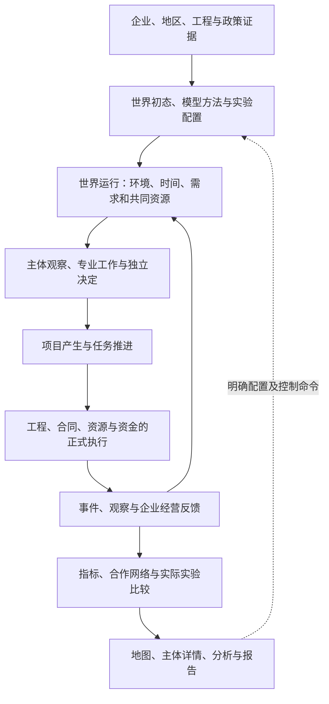

# 大湾区建筑业跨区域合作多智能体仿真平台：开发规范

平台研究粤港澳大湾区内的企业与机构，如何在市场、政策、资金、资源和项目条件下独立决策，形成建设项目和跨地区合作，以及这些互动如何影响交付绩效、企业经营和区域供需。

本套文档覆盖领域模型、世界与项目运行、八类主体、政策实验、软件架构、前端交互及验证。各文件共同构成开发依据，可以按目录整体共享；业务规则只在其所属文档定义，其他文件通过引用连接。

**规范定义与实际实现分开。** 文档中的规则是系统应遵守的要求；工程方法、参数和启用范围以[模型决策与实现准备](07_experiments/model_decisions.md)为准。代码、运行接入及验证能力必须有具体证据登记，不能从文档完整推断平台已经实现或获得现实验证。

<!-- page-nav:start -->
**本页导航**

[平台的完整链条](#平台的完整链条) · [核心设计边界](#核心设计边界) · [文档地图](#文档地图)

[推荐阅读路径](#推荐阅读路径) · [一个动作怎样连接整个平台](#一个动作怎样连接整个平台) · [从规范到代码](#从规范到代码)

[维护与验收约定](#维护与验收约定)
<!-- page-nav:end -->

## 平台的完整链条

世界、企业和项目相互反馈。建设需要可以被调查、调整、延期或放弃；签约、获批、放款、到货、完成、接受和责任关闭是不同事实。地图播放和页面查询只观察已提交记录，不能代替世界推进或主体决定。

## 核心设计边界

- **地域**：香港、澳门和广东内地九市。湾区外必要价格/供给可作为有来源的边界输入，不建立区外自主主体网络。
- **主体**：Owner、Bank、Architect、Engineer、QS、Government、Contractor、Supplier，各有独立身份、认知与经营约束。角色与组织、项目职能及授权分别表达。
- **项目产生**：投资收益、自用需求、公共服务三类业主在有限需求、载体、资源和资金下形成或放弃提案，不依赖固定项目列表维持世界运行。
- **专业方案**：业主先提出目的、候选地区、规模区间和交期；适用专业及供应方在有限模板内细化方案。建筑、超高层特征、道路、桥梁等按各自方法支持范围运行。
- **需求与资金**：需求以地区×用途/服务指标及存量表达；最小账本记录现金、应收应付、贷款和到期义务。未完业务和债务跨周期保留。
- **政策**：明文证据、机制推断和实验设定分开；政策改变可追踪的资格、任务、信息、资源或资金条件，效果由实际运行产生。
- **软件与界面**：前端、服务层、仿真核心、决策方法和结果投影分工明确。单一正式状态来源，地图与Analysis共用实验和比较结果。

## 文档地图

| 层级 | 文档 | 唯一维护内容 |
|---|---|---|
| 研究与总览 | [研究范围与总体逻辑](01_overview/research_scope.md) | 研究问题、地区/对象边界、反馈关系与解释限制 |
| 研究与总览 | [术语与阅读约定](01_overview/terminology.md) | 共用词汇、身份层级、状态区别与文档阅读方式 |
| 世界模型 | [世界运行](02_world/world_runtime.md) | 环境更新、行动机会、时间调度、外生与内生反馈 |
| 世界模型 | [共同对象与状态](02_world/domain_objects.md) | 组织、项目、任务、成果、合同、资源、资金、事件与认知 |
| 世界模型 | [工程类型与方案模板](02_world/project_types.md) | 工程对象、有限方案、方法适用域与支持声明 |
| 项目流程 | [项目运行与推进](03_projects/project_lifecycle.md) | 任务依赖、推进条件、责任绑定、并行、阻塞与收尾 |
| 项目流程 | [跨主体协作链](03_projects/collaboration_flow.md) | P01—P23交接索引；连接各角色，不复制行为规则 |
| 角色规范 | [八类角色](#角色规范) | 自身目标、可见信息、行为、状态变化、工作与异常恢复 |
| 政策实验 | [政策量化与情景设计](05_policy/quantification.md) | 证据到机制/参数/工具组合、稳定方案与比较定义 |
| 政策实验 | [政策工具目录](05_policy/instrument_catalog.md) | 各工具类型的目标、输入、作用入口和限定算例 |
| 软件开发 | [实现架构与开发契约](06_engineering/implementation_contracts.md) | 软件模块、字段契约、唯一写入、提交/投递/恢复与前端结构 |
| 软件开发 | [类型、函数与输入输出契约](06_engineering/interface_contracts.md) | 共用类型、字段生产责任、角色/方法/查询返回、全部实际函数的登记标准 |
| 软件开发 | [系统接口目录](06_engineering/system_interfaces.md) | 数据、世界、项目、工程、资金、政策、运行、结果和前端的具名边界函数与交接 |
| 软件开发 | [目标函数索引](06_engineering/function_catalog.md) | 八类角色与系统函数的查找入口；指向唯一字段和行为定义 |
| 软件开发 | [技能架构](06_engineering/skills.md) | 可复用能力、角色调用、工具与宿主责任 |
| 软件开发 | [前端功能与交互规范](06_engineering/frontend.md) | 页面操作、共享上下文、只读查询、地图/Analysis比较及导出 |
| 运行与验证 | [仿真运行与结果](07_experiments/run_and_results.md) | 数据装配、运行控制、实验作业、实际样本/配对、指标和网络 |
| 运行与验证 | [贯通场景与合成基准](07_experiments/reference_scenarios.md) | 跨模块接线、确定预期与异常分支；不替代现实方法验证 |
| 运行与验证 | [模型决策与实现准备](07_experiments/model_decisions.md) | D项模型选择、W项接口准备、依赖、关闭标准和配置登记 |
| 运行与验证 | [验证与验收策略](07_experiments/verification_strategy.md) | 软件、界面、工程、行为、校准和研究证据的分层验收 |

### 角色规范

| 角色 | 主要职责 |
|---|---|
| [Owner 业主](04_roles/owner.md) | 建设需要、提案与投资、委任、融资安排、采购取舍、接管使用及经营回款 |
| [Bank 银行](04_roles/bank.md) | 资金与组合管理、授信条件、报价与承诺、提款、监控、收回及补救 |
| [Architect 建筑师](04_roles/architect.md) | 需求转译、有限建筑方案、建筑接口整合、成果用途、修订及服务费用 |
| [Engineer 工程师](04_roles/engineer.md) | 专业方法、技术分析、工程设计或核验、现场检查、复查与专业责任 |
| [QS 造价顾问](04_roles/qs.md) | 数量和价格依据、估算、成本计划、采购评审、计量核证、变更及结算 |
| [Government 政府与监管机构](04_roles/government.md) | 地区与事项内受理、审查、补件、许可、检查、整改及制度反馈 |
| [Contractor 承包商](04_roles/contractor.md) | 投标和签约、跨项目排期、采购施工、变更、付款、交付及缺陷责任 |
| [Supplier 供应商](04_roles/supplier.md) | 产品/接口、报价接单、产能与批次、生产采购、运输交接、收款与退换 |

每项工作绑定实际组织与有效职能，区分发起/跟进、执行、决定、核验及接收。一个工程不必使用全部角色；一个组织参加多个项目仍共享同一资金/资源约束。

## 推荐阅读路径

| 阅读目的 | 路径 |
|---|---|
| 理解完整平台 | 研究范围 → 术语 → 世界运行 → 项目运行 → 贯通场景 |
| 实现智能体 | 对象/信息边界 → 相应角色 → 项目交接 → 技能与提交契约 |
| 实现仿真核心 | 世界运行 → 共同对象 → 工程模板 → 项目运行 → 运行与结果 → 开发契约 |
| 实现前端和接口 | 术语 → 前端规范 → 开发契约 → 所读业务主文档 → 运行/比较结果 |
| 开展政策研究 | 研究范围 → 政策量化 → 工具目录 → 模型决策 → 运行结果 → 验证策略 |
| 判断是否可交付 | 模型准备 → 对应规则/CHECK → 贯通场景 → 分层执行证据 |

## 一个动作怎样连接整个平台

以 [Architect A07 提交成果](04_roles/architect.md#architect-a07--提交成果并申请相应用途审查) 为例，先读行为卡的触发、Input、Payload和分支，再读同页专用类型；公共信封和失败状态查 [输入输出契约](06_engineering/interface_contracts.md)，保存成果、提交审查与用途放行的独立入口查 [系统接口](06_engineering/system_interfaces.md)。提交回执形成正式对象后，才按 [项目依赖](03_projects/project_lifecycle.md) 唤醒有权接收者；前端通过 [查询和展示契约](06_engineering/frontend.md) 读取同一事实。

所有角色采用同一阅读方式：**业务行为 → 有类型输出 → 有权校验与提交 → 下游任务 → 查询展示 → 确定验收**。文字用于解释理由，结构化字段承载程序可用的选择、范围、版本和依据；文字不能覆盖字段、授权或正式计算。需要新对象时先传具名草案，由唯一入口创建，不能要求输入尚未产生的正式引用。

## 从规范到代码

1. 在[模型决策](07_experiments/model_decisions.md)明确所实现机制的范围、方法、单位、参数来源及未覆盖项。
2. 在唯一主文档修改规则，同步对方交接、共同对象、项目条件和确定验收预期。
3. 按[输入输出契约](06_engineering/interface_contracts.md)、各角色逐动作定义和[系统接口](06_engineering/system_interfaces.md)落实schema、状态所有者、调用关系、命令/查询与提交入口；前端读取同一正式状态。实现时为全部实际函数绑定代码符号、输入输出和检查证据。
4. 用合成算例和失败路径核对行为，再连接页面、服务和实际运行；按影响执行相应验证。
5. 记录代码、规则/方法、配置、输入、随机与认知初态、结果版本和证据。修改冻结的世界配置时建立新运行或分支；仅修改已有事实的分析口径时生成新结果版本，均不改写既有实验事实。

MD规定语义和验收，不直接执行任意代码。参数化规则需要受支持的结构化配置和校验；新增动作、状态或计算方法需要实现。字段仅被保存或显示，不表示已经改变决定、约束或结果。

开发以端到端能力交付：可读世界 → 草案与运行控制 → 主体/项目/经营闭环 → 实际运行的政策比较 → 重复实验与机制分析 → 结果使用。具体软件职责见开发契约，界面交付路径见前端规范，业务机制依赖见运行结果；三个入口描述同一实施过程的不同责任。

## 维护与验收约定

- 规则ID、行为ID和CHECK编号用于稳定引用。文件或章节调整不改变业务编号；正文链接应可在整个文档目录独立打开。
- 主定义只保留一处：角色负责自身行为，世界负责调度，项目负责依赖，共同对象负责正式状态，结果层负责统计，前端负责交互与展示。
- 确定范围、未决模型、实现能力和验证证据分别登记；不以“已写文档”替代方法就绪，不以测试通过替代现实验证。
- 例子注明合成、单位、假设和适用边界；未知、未支持、不适用、有效零值、未完与技术失败分别表达。
- 更新字段/状态/方法时检查调用方、接收方、初始化、错误路径、读写投影、指标与测试，避免仅修改一页文字或一个按钮。
- 检查链接与锚点、唯一规则/验收编号、表格、公式及接口一致性；交付包不依赖个人电脑路径、聊天记录或历史审查稿。
